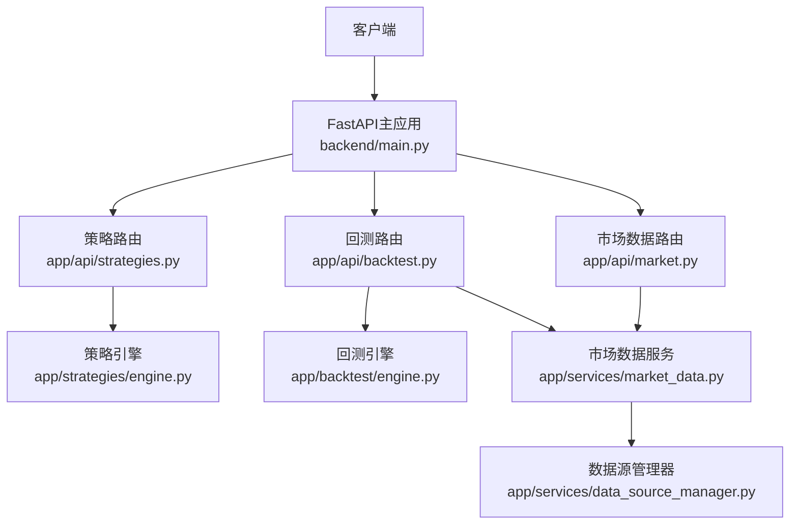
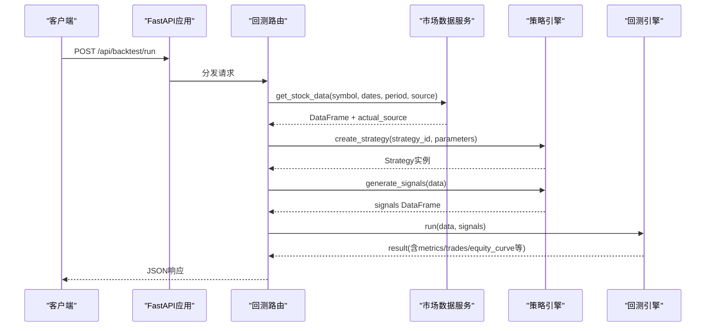
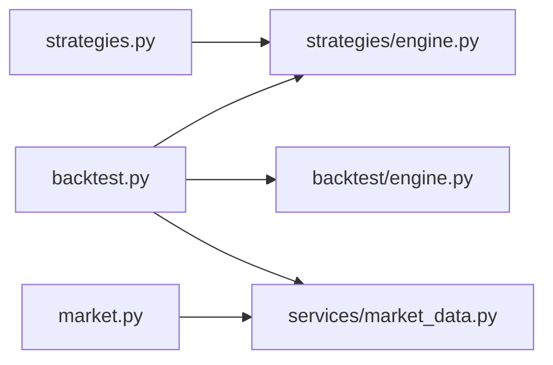

# API参考文档

<cite>
**本文引用的文件**   
- [backend/main.py](file://backend/main.py)
- [backend/app/api/strategies.py](file://backend/app/api/strategies.py)
- [backend/app/api/backtest.py](file://backend/app/api/backtest.py)
- [backend/app/api/market.py](file://backend/app/api/market.py)
- [backend/app/core/config.py](file://backend/app/core/config.py)
- [backend/app/models/models.py](file://backend/app/models/models.py)
- [backend/app/strategies/engine.py](file://backend/app/strategies/engine.py)
- [backend/app/backtest/engine.py](file://backend/app/backtest/engine.py)
- [backend/app/services/market_data.py](file://backend/app/services/market_data.py)
</cite>

## 目录
1. [简介](#简介)
2. [项目结构](#项目结构)
3. [核心组件](#核心组件)
4. [架构总览](#架构总览)
5. [详细接口规范](#详细接口规范)
6. [依赖关系分析](#依赖关系分析)
7. [性能与限制](#性能与限制)
8. [故障排查指南](#故障排查指南)
9. [结论](#结论)
10. [附录](#附录)

## 简介
本API参考文档面向量化策略查看与回测系统的后端REST服务，覆盖三大能力域：
- 策略管理：获取策略列表、获取策略详情
- 回测：执行回测、查询历史（预留）
- 市场数据：获取股票行情、获取股票基本信息、搜索股票代码

系统基于FastAPI构建，提供JSON格式的RESTful接口，默认启用CORS以支持前端跨域调用。当前版本为1.0.0。

## 项目结构
后端采用分层路由+服务+引擎的组织方式：
- 路由层：按业务域划分策略、回测、市场数据三个Router
- 服务层：封装数据源选择与统一的数据访问接口
- 引擎层：策略信号生成与回测计算
- 配置与模型：应用配置与数据库模型定义

图表来源
- [backend/main.py:9-27](file://backend/main.py#L9-L27)
- [backend/app/api/strategies.py:8-24](file://backend/app/api/strategies.py#L8-L24)
- [backend/app/api/backtest.py:13-76](file://backend/app/api/backtest.py#L13-L76)
- [backend/app/api/market.py:8-46](file://backend/app/api/market.py#L8-L46)
- [backend/app/strategies/engine.py:506-655](file://backend/app/strategies/engine.py#L506-L655)
- [backend/app/backtest/engine.py:10-70](file://backend/app/backtest/engine.py#L10-L70)
- [backend/app/services/market_data.py:11-41](file://backend/app/services/market_data.py#L11-L41)

章节来源
- [backend/main.py:1-36](file://backend/main.py#L1-L36)

## 核心组件
- FastAPI应用与中间件：注册CORS、挂载各业务Router、健康检查与根路径
- 策略引擎：内置多种策略实现与工厂方法，暴露可用策略清单与参数元信息
- 回测引擎：根据信号与价格序列计算收益曲线、交易记录与绩效指标
- 市场数据服务：统一封装多数据源获取、股票信息与代码搜索

章节来源
- [backend/main.py:9-27](file://backend/main.py#L9-L27)
- [backend/app/strategies/engine.py:506-655](file://backend/app/strategies/engine.py#L506-L655)
- [backend/app/backtest/engine.py:10-163](file://backend/app/backtest/engine.py#L10-L163)
- [backend/app/services/market_data.py:11-106](file://backend/app/services/market_data.py#L11-L106)

## 架构总览
下图展示一次“执行回测”的端到端调用流程：

图表来源
- [backend/app/api/backtest.py:28-69](file://backend/app/api/backtest.py#L28-L69)
- [backend/app/services/market_data.py:14-41](file://backend/app/services/market_data.py#L14-L41)
- [backend/app/strategies/engine.py:600-655](file://backend/app/strategies/engine.py#L600-L655)
- [backend/app/backtest/engine.py:15-70](file://backend/app/backtest/engine.py#L15-L70)

## 详细接口规范

### 通用约定
- 基础URL：http://localhost:8000（开发环境默认）
- 认证机制：未实现；如需鉴权，可在FastAPI中引入依赖注入中间件或OAuth2/JWT
- 速率限制：未实现；建议通过网关或中间件进行限流
- 版本兼容：当前API无显式版本前缀；版本号在应用元信息中体现
- 错误格式：HTTP状态码 + JSON detail字段（由FastAPI默认抛出）
- CORS：已启用允许所有来源与方法，便于本地调试

章节来源
- [backend/main.py:9-22](file://backend/main.py#L9-L22)
- [backend/app/core/config.py:8-24](file://backend/app/core/config.py#L8-L24)

---

### 策略管理API

#### 获取策略列表
- 方法：GET
- URL：/api/strategies/
- 描述：返回系统内可用的策略清单及其参数元信息
- 请求参数：无
- 成功响应：数组，每项包含id、name、description、parameters
- 失败响应：无特定错误码

示例
- curl
  - GET http://localhost:8000/api/strategies/
- JavaScript
  - fetch('/api/strategies/')
    .then(r => r.json())
    .then(console.log);

章节来源
- [backend/app/api/strategies.py:11-14](file://backend/app/api/strategies.py#L11-L14)
- [backend/app/strategies/engine.py:506-597](file://backend/app/strategies/engine.py#L506-L597)

#### 获取策略详情
- 方法：GET
- URL：/api/strategies/{strategy_id}
- 描述：根据策略ID返回策略详情
- 路径参数：
  - strategy_id：字符串，策略唯一标识
- 成功响应：策略对象（同列表项结构）
- 失败响应：
  - 404：未找到对应策略

示例
- curl
  - GET http://localhost:8000/api/strategies/ma_cross
- JavaScript
  - fetch('/api/strategies/ma_cross')
    .then(r => { if (!r.ok) throw new Error('Not Found'); return r.json(); })
    .then(console.log);

章节来源
- [backend/app/api/strategies.py:17-24](file://backend/app/api/strategies.py#L17-L24)

---

### 回测API

#### 执行回测
- 方法：POST
- URL：/api/backtest/run
- 描述：根据策略与标的，拉取数据、生成信号并运行回测，返回绩效与明细
- 请求体（JSON）：
  - strategy_id：字符串，必填
  - symbol：字符串，必填
  - start_date：字符串，可选，日期格式YYYY-MM-DD
  - end_date：字符串，可选，日期格式YYYY-MM-DD
  - period：字符串，默认"1y"
  - initial_capital：浮点数，默认100000.0
  - source：字符串，默认"auto"，可选值包括auto/yfinance/akshare/baostock/mock
  - parameters：对象，策略参数键值对
- 成功响应：
  - metrics：对象，包含total_return、annual_return、max_drawdown、sharpe_ratio、win_rate、total_trades等
  - trades：数组，每笔交易的入场/出场价、盈亏、方向等
  - equity_curve：数组，时间序列资金曲线
  - signals_data：数组，信号与持仓变化序列
  - strategy：对象，包含id、name、parameters
  - symbol：字符串
  - data_source：字符串，实际使用的数据源
  - is_mock：布尔，是否使用模拟数据
- 失败响应：
  - 400：请求参数错误或内部异常（detail中包含错误信息）

示例
- curl
  - POST http://localhost:8000/api/backtest/run
  - Content-Type: application/json
  - Body:
    {
      "strategy_id": "ma_cross",
      "symbol": "AAPL",
      "start_date": "2023-01-01",
      "end_date": "2023-12-31",
      "period": "1y",
      "initial_capital": 100000,
      "source": "auto",
      "parameters": {"short_window": 5, "long_window": 20}
    }
- JavaScript
  - fetch('/api/backtest/run', {
      method: 'POST',
      headers: {'Content-Type': 'application/json'},
      body: JSON.stringify({
        strategy_id: 'ma_cross',
        symbol: 'AAPL',
        start_date: '2023-01-01',
        end_date: '2023-12-31',
        period: '1y',
        initial_capital: 100000,
        source: 'auto',
        parameters: { short_window: 5, long_window: 20 }
      })
    })
    .then(r => { if (!r.ok) throw new Error(r.statusText); return r.json(); })
    .then(console.log);

章节来源
- [backend/app/api/backtest.py:16-69](file://backend/app/api/backtest.py#L16-L69)
- [backend/app/backtest/engine.py:15-70](file://backend/app/backtest/engine.py#L15-L70)

#### 查询回测历史
- 方法：GET
- URL：/api/backtest/history
- 描述：从数据库读取历史回测结果（当前未实现）
- 成功响应：占位消息
- 失败响应：无

示例
- curl
  - GET http://localhost:8000/api/backtest/history

章节来源
- [backend/app/api/backtest.py:72-76](file://backend/app/api/backtest.py#L72-L76)

---

### 市场数据API

#### 获取股票数据
- 方法：GET
- URL：/api/market/stock/{symbol}
- 描述：返回指定股票的历史行情数据
- 路径参数：
  - symbol：字符串，必填
- 查询参数：
  - start_date：字符串，可选
  - end_date：字符串，可选
  - period：字符串，默认"1y"
- 成功响应：
  - symbol：字符串
  - data：数组，K线数据行集合
- 失败响应：
  - 400：数据获取异常

示例
- curl
  - GET http://localhost:8000/api/market/stock/AAPL?start_date=2023-01-01&end_date=2023-12-31
- JavaScript
  - fetch('/api/market/stock/AAPL?start_date=2023-01-01&end_date=2023-12-31')
    .then(r => { if (!r.ok) throw new Error('Bad Request'); return r.json(); })
    .then(console.log);

章节来源
- [backend/app/api/market.py:11-27](file://backend/app/api/market.py#L11-L27)
- [backend/app/services/market_data.py:14-41](file://backend/app/services/market_data.py#L14-L41)

#### 获取股票基本信息
- 方法：GET
- URL：/api/market/stock/{symbol}/info
- 描述：返回股票名称、行业、市值、当前价格等基本信息
- 路径参数：
  - symbol：字符串，必填
- 成功响应：对象，包含symbol、name、sector、industry、market_cap、current_price、currency等
- 失败响应：
  - 400：信息获取异常

示例
- curl
  - GET http://localhost:8000/api/market/stock/AAPL/info
- JavaScript
  - fetch('/api/market/stock/AAPL/info')
    .then(r => { if (!r.ok) throw new Error('Bad Request'); return r.json(); })
    .then(console.log);

章节来源
- [backend/app/api/market.py:30-38](file://backend/app/api/market.py#L30-L38)
- [backend/app/services/market_data.py:43-82](file://backend/app/services/market_data.py#L43-L82)

#### 搜索股票代码
- 方法：GET
- URL：/api/market/search
- 描述：根据关键词模糊匹配股票代码与名称
- 查询参数：
  - keyword：字符串，必填，长度至少为1
- 成功响应：数组，每项包含symbol与name
- 失败响应：无特定错误码

示例
- curl
  - GET http://localhost:8000/api/market/search?keyword=AAPL
- JavaScript
  - fetch('/api/market/search?keyword=AAPL')
    .then(r => r.json())
    .then(console.log);

章节来源
- [backend/app/api/market.py:41-46](file://backend/app/api/market.py#L41-L46)
- [backend/app/services/market_data.py:84-105](file://backend/app/services/market_data.py#L84-L105)

---

### 健康检查与根路径
- GET /：返回应用欢迎信息
- GET /api/health：返回健康状态{"status":"healthy"}

章节来源
- [backend/main.py:29-35](file://backend/main.py#L29-L35)

## 依赖关系分析
- 路由到服务/引擎的单向依赖：
  - strategies.py → strategies/engine.py
  - backtest.py → strategies/engine.py、backtest/engine.py、services/market_data.py
  - market.py → services/market_data.py
- 数据源抽象：
  - services/market_data.py委托给data_source_manager（未在本文展开），对外暴露统一接口

图表来源
- [backend/app/api/strategies.py:6-14](file://backend/app/api/strategies.py#L6-L14)
- [backend/app/api/backtest.py:9-11](file://backend/app/api/backtest.py#L9-L11)
- [backend/app/api/market.py:6-7](file://backend/app/api/market.py#L6-L7)

章节来源
- [backend/app/api/strategies.py:1-24](file://backend/app/api/strategies.py#L1-L24)
- [backend/app/api/backtest.py:1-76](file://backend/app/api/backtest.py#L1-L76)
- [backend/app/api/market.py:1-46](file://backend/app/api/market.py#L1-L46)

## 性能与限制
- 回测计算复杂度：
  - 信号生成：O(n)，n为数据条数
  - 回测引擎：O(n)遍历计算收益与指标
- 数据获取：
  - 外部数据源可能受网络与配额限制；建议使用缓存或批量拉取
- 并发与限流：
  - 当前未实现限流；在高并发场景下建议增加网关级限流与队列化任务
- 序列化开销：
  - 大量K线与资金曲线数据会增大响应体积；可考虑分页或压缩传输

[本节为通用指导，不直接分析具体文件]

## 故障排查指南
- 常见错误与处理
  - 400 Bad Request：回测请求参数错误或数据获取失败。检查strategy_id、symbol、日期格式与数值范围
  - 404 Not Found：策略不存在。确认策略ID是否在策略列表中
  - 数据为空或NaN：检查数据源可用性、symbol是否正确、日期区间是否有效
- 调试建议
  - 使用浏览器开发者工具或Postman验证请求与响应
  - 先调用策略列表与市场数据接口，确认基础能力正常后再执行回测
  - 关注is_mock字段，若为true说明使用了模拟数据，需调整source或配置真实数据源
- 日志与诊断
  - 开启DEBUG模式以便获得更详细的错误堆栈
  - 检查.env环境变量与数据库连接（如启用持久化）

章节来源
- [backend/app/api/backtest.py:68-69](file://backend/app/api/backtest.py#L68-L69)
- [backend/app/api/strategies.py:20-24](file://backend/app/api/strategies.py#L20-L24)
- [backend/app/core/config.py:10-12](file://backend/app/core/config.py#L10-L12)

## 结论
本API提供了完整的策略管理、回测执行与市场数据访问能力，结构清晰、职责分明。建议在后续迭代中补充鉴权、限流、缓存与历史回测持久化能力，以提升生产可用性与扩展性。

[本节为总结性内容，不直接分析具体文件]

## 附录

### 数据模型（数据库）
- 策略表strategies：id、name、description、strategy_type、parameters、created_at、updated_at
- 回测结果表backtest_results：id、strategy_id、symbol、start_date、end_date、initial_capital、final_value、total_return、annual_return、max_drawdown、sharpe_ratio、win_rate、total_trades、trades_data、equity_curve、created_at

章节来源
- [backend/app/models/models.py:11-44](file://backend/app/models/models.py#L11-L44)

### 最佳实践
- 参数校验：在客户端侧对必填字段与取值范围进行预校验，减少无效请求
- 幂等性：对重复提交做去重（例如基于请求指纹）
- 错误处理：统一捕获HTTP错误并提示用户友好信息
- 数据源选择：优先使用auto自动选择，必要时显式指定source以获得稳定数据

[本节为通用指导，不直接分析具体文件]