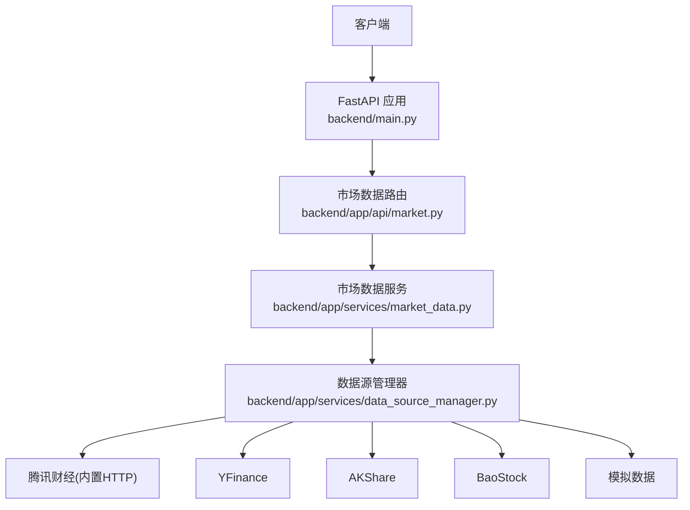
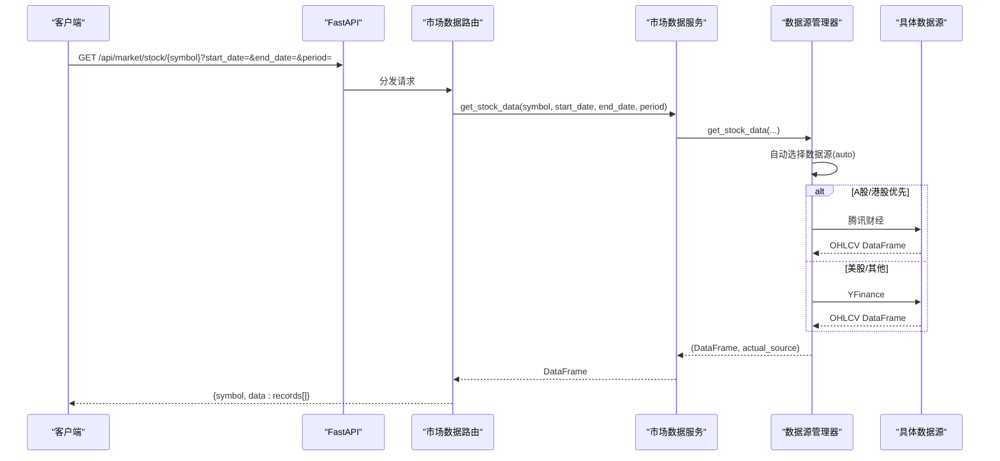
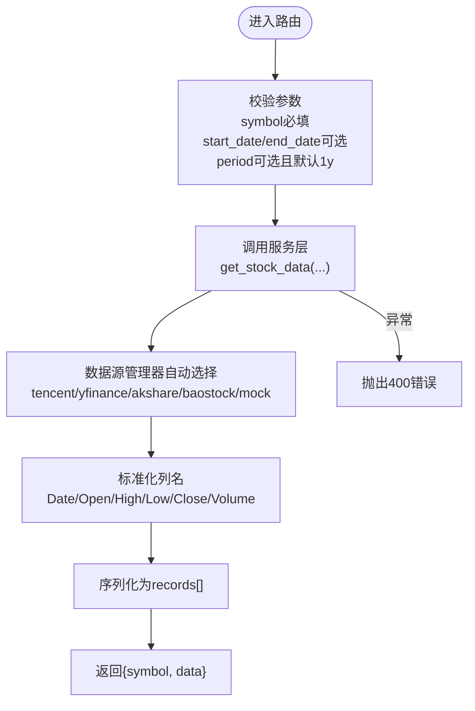
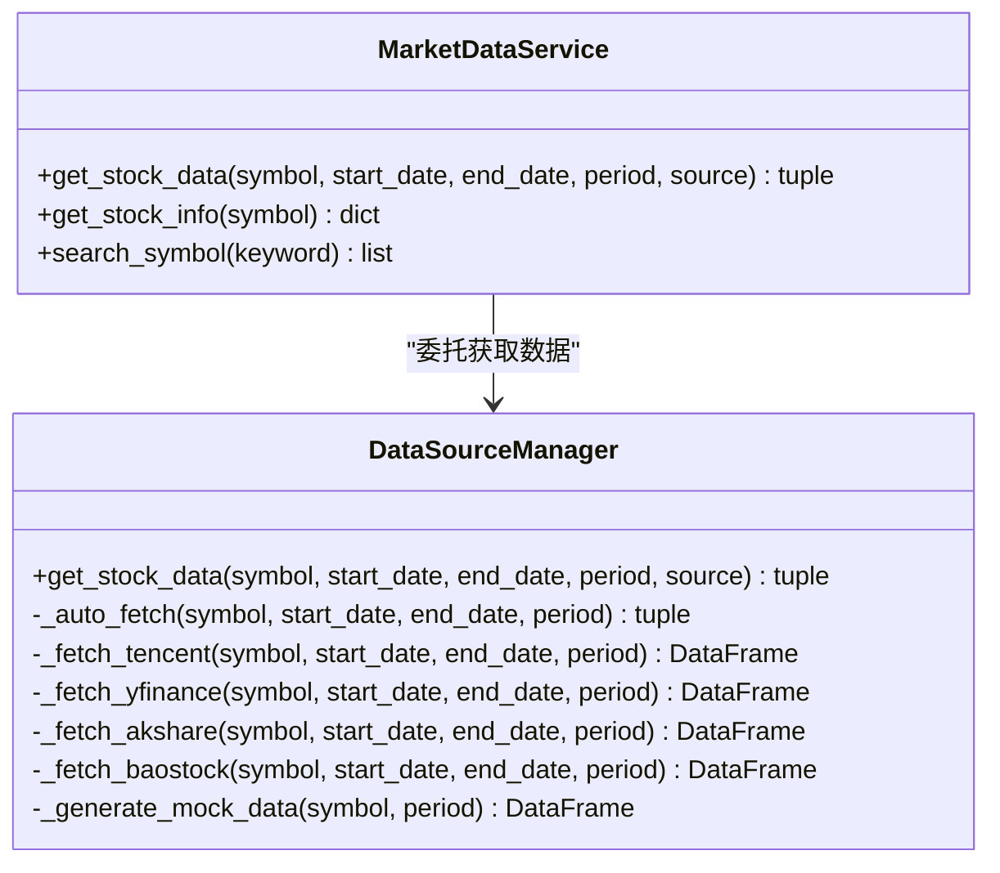

# 市场数据API

<cite>
**本文引用的文件**   
- [backend/main.py](../../../../../backend/main.py)
- [backend/app/api/market.py](../../../../../backend/app/api/market.py)
- [backend/app/services/market_data.py](../../../../../backend/app/services/market_data.py)
- [backend/app/services/data_source_manager.py](../../../../../backend/app/services/data_source_manager.py)
</cite>

## 目录
1. [简介](#简介)
2. [项目结构](#项目结构)
3. [核心组件](#核心组件)
4. [架构总览](#架构总览)
5. [详细接口规范](#详细接口规范)
6. [依赖关系分析](#依赖关系分析)
7. [性能与缓存](#性能与缓存)
8. [故障排查指南](#故障排查指南)
9. [结论](#结论)
10. [附录：示例与最佳实践](#附录示例与最佳实践)

## 简介
本文件为“市场数据API”的完整技术文档，聚焦于获取股票数据的接口（GET /api/market/stock/{symbol}）及相关市场数据接口。文档涵盖HTTP方法、URL路径、请求参数、响应格式、错误码与处理示例，并提供curl命令、JavaScript客户端调用示例和错误处理最佳实践。同时解释金融数据格式、时间序列处理与数据处理选项，并说明数据源选择、降级策略与性能优化建议。

## 项目结构
后端采用FastAPI构建REST API，路由注册在应用入口中；市场数据相关的路由位于独立模块，服务层封装多数据源访问逻辑，统一对外提供OHLCV数据。

**图表来源**
- [backend/main.py:9-27](../../../../../backend/main.py#L9-L27)
- [backend/app/api/market.py:8-46](../../../../../backend/app/api/market.py#L8-L46)
- [backend/app/services/market_data.py:11-41](../../../../../backend/app/services/market_data.py#L11-L41)
- [backend/app/services/data_source_manager.py:14-54](../../../../../backend/app/services/data_source_manager.py#L14-L54)

**章节来源**
- [backend/main.py:9-27](../../../../../backend/main.py#L9-L27)
- [backend/app/api/market.py:8-46](../../../../../backend/app/api/market.py#L8-L46)

## 核心组件
- 路由层：定义市场数据API端点，负责参数校验与异常包装。
- 服务层：统一对外暴露数据获取能力，内部委托数据源管理器。
- 数据源管理器：实现多数据源自动选择与降级，返回标准化OHLCV DataFrame与实际数据源标识。

关键职责划分：
- 路由层不直接访问外部网络或第三方库，仅做参数透传与结果序列化。
- 服务层屏蔽数据源差异，保证上层调用一致性。
- 数据源管理器集中处理不同数据源的适配、日期范围计算、列名标准化与空结果处理。

**章节来源**
- [backend/app/api/market.py:11-46](../../../../../backend/app/api/market.py#L11-L46)
- [backend/app/services/market_data.py:11-41](../../../../../backend/app/services/market_data.py#L11-L41)
- [backend/app/services/data_source_manager.py:14-54](../../../../../backend/app/services/data_source_manager.py#L14-L54)

## 架构总览
下图展示一次典型的股票数据请求从客户端到数据源再到响应的完整流程。

**图表来源**
- [backend/main.py:24-27](../../../../../backend/main.py#L24-L27)
- [backend/app/api/market.py:11-27](../../../../../backend/app/api/market.py#L11-L27)
- [backend/app/services/market_data.py:14-41](../../../../../backend/app/services/market_data.py#L14-L41)
- [backend/app/services/data_source_manager.py:17-54](../../../../../backend/app/services/data_source_manager.py#L17-L54)

## 详细接口规范

### 通用约定
- 基础路径：/api/market
- 认证：无（本地开发环境）
- CORS：已启用允许所有来源
- 内容类型：application/json
- 字符编码：UTF-8

### 接口一：获取股票历史行情
- 方法：GET
- URL：/api/market/stock/{symbol}
- 路径参数：
  - symbol：字符串，股票代码（支持A股如600519.SS、000858.SZ，港股如00700.HK，美股如AAPL等）
- 查询参数：
  - start_date：可选，开始日期，格式YYYY-MM-DD
  - end_date：可选，结束日期，格式YYYY-MM-DD
  - period：可选，周期字符串，默认1y；支持值包括1mo、3mo、6mo、1y、2y、5y
- 成功响应体：
  - symbol：字符串，原始传入的股票代码
  - data：数组，每条记录包含以下字段：
    - Date：日期（ISO字符串）
    - Open：开盘价（数值）
    - High：最高价（数值）
    - Low：最低价（数值）
    - Close：收盘价（数值）
    - Volume：成交量（数值）
- 错误响应：
  - 状态码：400
  - 响应体：{detail: 错误信息字符串}

**图表来源**
- [backend/app/api/market.py:11-27](../../../../../backend/app/api/market.py#L11-L27)
- [backend/app/services/market_data.py:14-41](../../../../../backend/app/services/market_data.py#L14-L41)
- [backend/app/services/data_source_manager.py:17-54](../../../../../backend/app/services/data_source_manager.py#L17-L54)

**章节来源**
- [backend/app/api/market.py:11-27](../../../../../backend/app/api/market.py#L11-L27)
- [backend/app/services/market_data.py:14-41](../../../../../backend/app/services/market_data.py#L14-L41)
- [backend/app/services/data_source_manager.py:17-54](../../../../../backend/app/services/data_source_manager.py#L17-L54)

### 接口二：获取股票基本信息
- 方法：GET
- URL：/api/market/stock/{symbol}/info
- 路径参数：
  - symbol：字符串，股票代码
- 成功响应体：
  - symbol：字符串
  - name：名称（若真实数据不可用则回退到模拟名称）
  - sector：行业板块（可能为N/A）
  - industry：细分行业（可能为N/A）
  - market_cap：市值（可能为N/A）
  - current_price：当前价格（可能为N/A）
  - currency：货币单位（根据市场推断）
- 错误响应：
  - 状态码：400
  - 响应体：{detail: 错误信息字符串}

**章节来源**
- [backend/app/api/market.py:30-38](../../../../../backend/app/api/market.py#L30-L38)
- [backend/app/services/market_data.py:43-82](../../../../../backend/app/services/market_data.py#L43-L82)

### 接口三：搜索股票代码
- 方法：GET
- URL：/api/market/search
- 查询参数：
  - keyword：必填，最小长度1，用于匹配symbol或名称
- 成功响应体：
  - 数组，元素包含：
    - symbol：字符串
    - name：字符串
- 错误响应：
  - 状态码：400（当keyword缺失或长度不足时由框架校验）

**章节来源**
- [backend/app/api/market.py:41-46](../../../../../backend/app/api/market.py#L41-L46)
- [backend/app/services/market_data.py:84-105](../../../../../backend/app/services/market_data.py#L84-L105)

## 依赖关系分析
- 路由层依赖服务层，服务层依赖数据源管理器。
- 数据源管理器按市场类型与可用性进行智能降级：
  - A股/港股优先使用腾讯财经（无需额外依赖）
  - 其次尝试YFinance（美股/港股）
  - 再次尝试AKShare（A股）
  - 再次尝试BaoStock（A股）
  - 最终兜底为模拟数据，确保系统始终可用

**图表来源**
- [backend/app/services/market_data.py:11-41](../../../../../backend/app/services/market_data.py#L11-L41)
- [backend/app/services/data_source_manager.py:14-54](../../../../../backend/app/services/data_source_manager.py#L14-L54)

**章节来源**
- [backend/app/services/market_data.py:11-41](../../../../../backend/app/services/market_data.py#L11-L41)
- [backend/app/services/data_source_manager.py:14-109](../../../../../backend/app/services/data_source_manager.py#L14-L109)

## 性能与缓存
- 数据源选择与降级：
  - 自动模式会根据市场类型与可用性依次尝试多个数据源，失败即降级，避免单点故障。
- 网络请求与超时：
  - 腾讯财经接口设置超时，避免长时间阻塞。
- 数据标准化：
  - 所有数据源输出统一为OHLCV标准列名，便于前端与下游处理。
- 缓存建议：
  - 可在服务层引入内存缓存（如functools.lru_cache）或Redis缓存，对相同symbol+时间范围的请求进行缓存，减少重复网络请求。
  - 针对高频查询（如大盘指数、热门个股），可设置较短TTL以提升吞吐。
- 并发与异步：
  - FastAPI原生支持异步，建议在数据源管理器中对I/O密集的网络请求使用异步HTTP客户端（如httpx）进一步提升并发能力。
- 批量与分页：
  - 当前接口返回全量历史数据，未来可增加limit/offset或分页参数以控制响应体积。

[本节为通用性能指导，不直接分析具体文件]

## 故障排查指南
- 常见错误与定位：
  - 400错误：通常由参数校验失败或服务层异常抛出，检查symbol格式、日期格式与period取值。
  - 空数据：可能是数据源未返回有效数据，检查网络连通性、数据源限制与symbol是否受支持。
  - 模拟数据：当所有真实数据源失败时会回退到模拟数据，确认actual_source是否为mock。
- 日志与调试：
  - 数据源管理器在自动选择过程中会打印各数据源的尝试与失败信息，便于定位问题。
- 数据源特定问题：
  - 腾讯财经：检查User-Agent与Referer头，确认接口可达。
  - YFinance：检查网络代理与速率限制。
  - AKShare/BaoStock：检查依赖安装与登录状态。

**章节来源**
- [backend/app/api/market.py:26-27](../../../../../backend/app/api/market.py#L26-L27)
- [backend/app/services/data_source_manager.py:56-109](../../../../../backend/app/services/data_source_manager.py#L56-L109)

## 结论
市场数据API通过FastAPI提供简洁的REST接口，服务层与数据源管理器解耦了外部数据接入，实现了多数据源自动选择与降级，确保系统稳定可用。接口返回标准化的OHLCV数据，便于前端与量化分析工具消费。建议在后续版本中加入缓存、分页与更丰富的技术指标计算能力，以满足更广泛的业务场景。

[本节为总结性内容，不直接分析具体文件]

## 附录：示例与最佳实践

### curl命令示例
- 获取股票历史行情（默认周期1年）：
  - curl "http://localhost:8000/api/market/stock/AAPL"
- 指定时间范围：
  - curl "http://localhost:8000/api/market/stock/600519.SS?start_date=2023-01-01&end_date=2023-12-31"
- 指定周期：
  - curl "http://localhost:8000/api/market/stock/TSLA?period=6mo"
- 获取股票基本信息：
  - curl "http://localhost:8000/api/market/stock/GOOGL/info"
- 搜索股票代码：
  - curl "http://localhost:8000/api/market/search?keyword=AAPL"

### JavaScript客户端调用示例
- 使用fetch获取股票历史行情：
  - fetch("/api/market/stock/AAPL")
    .then(res => res.json())
    .then(json => console.log(json))
    .catch(err => console.error("请求失败:", err));
- 带参数的请求：
  - fetch("/api/market/stock/600519.SS?start_date=2023-01-01&end_date=2023-12-31")
    .then(res => res.json())
    .then(data => console.log(data))
    .catch(err => console.error("请求失败:", err));

### 错误处理最佳实践
- 客户端侧：
  - 捕获网络异常与JSON解析异常，提示用户重试或检查输入。
  - 对空数据或模拟数据进行友好提示，避免误导分析。
- 服务端侧：
  - 保持统一的400错误响应格式，便于前端统一处理。
  - 在服务层增加参数校验与边界条件检查，减少无效请求进入数据源层。

[本节为通用实践指导，不直接分析具体文件]