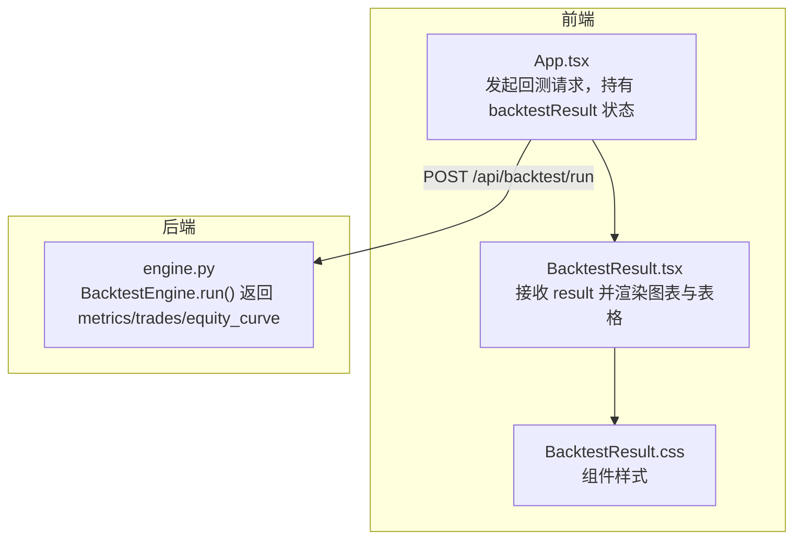
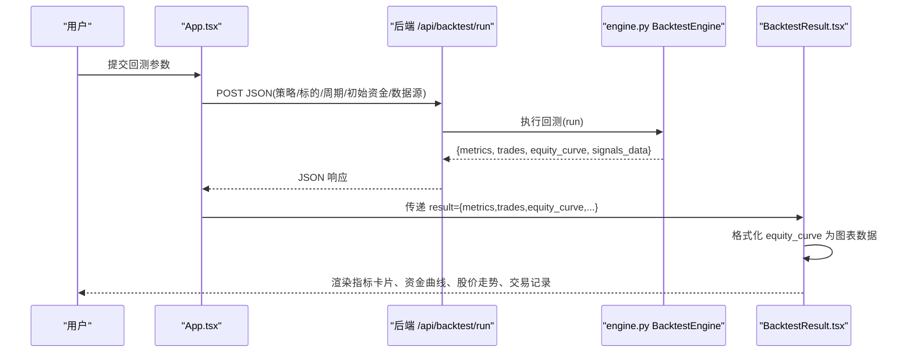
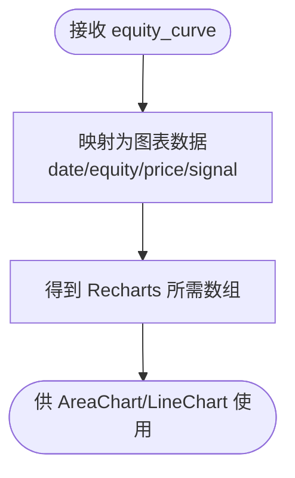
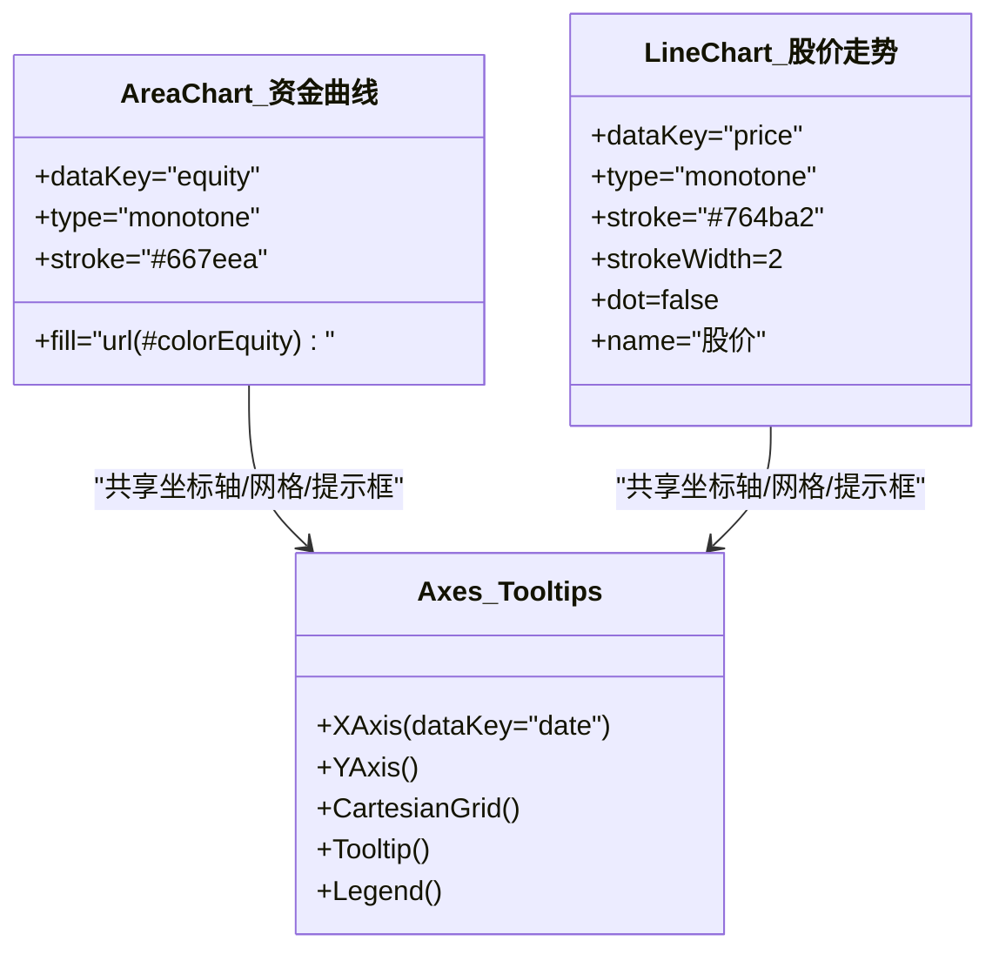
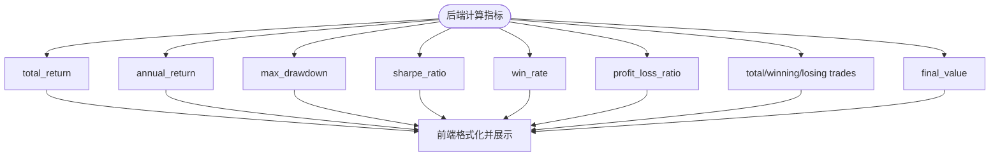
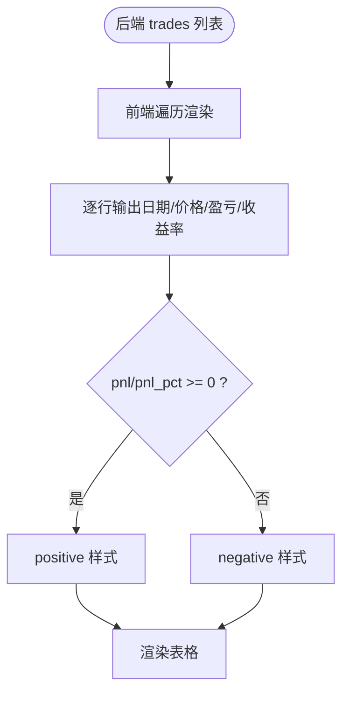
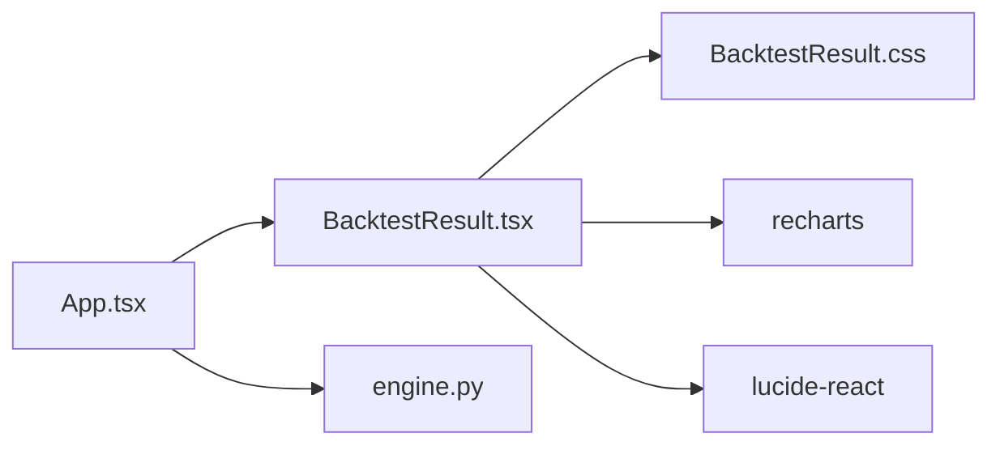

# 回测结果组件

<cite>
**本文引用的文件**   
- [BacktestResult.tsx](../../../../../../frontend/src/components/BacktestResult.tsx)
- [BacktestResult.css](../../../../../../frontend/src/components/BacktestResult.css)
- [App.tsx](../../../../../../frontend/src/App.tsx)
- [engine.py](../../../../../../backend/app/backtest/engine.py)
</cite>

## 目录
1. [简介](#简介)
2. [项目结构](#项目结构)
3. [核心组件](#核心组件)
4. [架构总览](#架构总览)
5. [详细组件分析](#详细组件分析)
6. [依赖关系分析](#依赖关系分析)
7. [性能与优化](#性能与优化)
8. [故障排查](#故障排查)
9. [结论](#结论)

## 简介
本文件面向“回测结果”前端展示组件，系统性说明其职责、数据流、图表渲染、指标计算与展示、交易记录表格呈现，以及与后端回测引擎的数据契约。重点覆盖：
- Recharts 图表库的使用（AreaChart、LineChart）
- 资金曲线与股价走势的数据格式转换与样式定制
- 绩效指标（收益率、夏普比率、最大回撤等）的计算来源与可视化
- 交易记录的表格展示（当前为静态列表，可扩展排序、筛选、分页）
- 数据状态管理与实时更新机制（由父组件负责）
- 图表自定义与性能优化的最佳实践

## 项目结构
该功能位于前端 React 应用中，由 App 层发起回测请求并持有回测结果状态，再将结果传递给 BacktestResult 组件进行渲染；样式通过独立的 CSS 文件管理。

图示来源
- [App.tsx:13-35](../../../../../../frontend/src/App.tsx#L13-L35)
- [App.tsx:83-90](../../../../../../frontend/src/App.tsx#L83-L90)
- [engine.py:15-70](../../../../../../backend/app/backtest/engine.py#L15-L70)

章节来源
- [App.tsx:1-100](../../../../../../frontend/src/App.tsx#L1-L100)

## 核心组件
BacktestResult 组件承担以下职责：
- 接收来自父组件的 result 对象，包含 metrics、trades、equity_curve、strategy、symbol、data_source、is_mock 等字段
- 将 equity_curve 转换为 Recharts 所需的扁平数组格式
- 渲染关键绩效指标卡片与网格
- 使用 AreaChart 绘制资金曲线，使用 LineChart 绘制股价走势
- 以表格形式展示交易记录（含盈亏正负着色）
- 根据 is_mock 显示模拟数据提示横幅

章节来源
- [BacktestResult.tsx:5-10](../../../../../../frontend/src/components/BacktestResult.tsx#L5-L10)
- [BacktestResult.tsx:35-41](../../../../../../frontend/src/components/BacktestResult.tsx#L35-L41)
- [BacktestResult.tsx:43-217](../../../../../../frontend/src/components/BacktestResult.tsx#L43-L217)

## 架构总览
从用户操作到图表渲染的整体流程如下：

图示来源
- [App.tsx:13-35](../../../../../../frontend/src/App.tsx#L13-L35)
- [App.tsx:83-90](../../../../../../frontend/src/App.tsx#L83-L90)
- [engine.py:15-70](../../../../../../backend/app/backtest/engine.py#L15-L70)
- [BacktestResult.tsx:35-41](../../../../../../frontend/src/components/BacktestResult.tsx#L35-L41)

## 详细组件分析

### 数据契约与状态管理
- 父组件 App.tsx 通过 fetch 调用后端接口，成功后将 JSON 结果写入 state，再作为 props 传给 BacktestResult。
- BacktestResult 是纯展示组件，不维护自身业务状态，所有数据均来自 props。
- is_mock 用于在顶部展示模拟数据提示横幅，提升用户体验。

章节来源
- [App.tsx:13-35](../../../../../../frontend/src/App.tsx#L13-L35)
- [App.tsx:83-90](../../../../../../frontend/src/App.tsx#L83-L90)
- [BacktestResult.tsx:43-50](../../../../../../frontend/src/components/BacktestResult.tsx#L43-L50)

### 图表数据格式化
- 后端 engine.py 在 run() 中生成 equity_curve，包含 Date、equity、Close、signal 等列，并以字典数组形式返回。
- 前端 BacktestResult.tsx 对 equity_curve 做映射，构造 Recharts 需要的扁平数据项，包含 date、equity、price、signal。
- 日期通过 toLocaleDateString 转为本地化字符串，便于 XAxis 展示。

图示来源
- [engine.py:63-67](../../../../../../backend/app/backtest/engine.py#L63-L67)
- [BacktestResult.tsx:35-41](../../../../../../frontend/src/components/BacktestResult.tsx#L35-L41)

章节来源
- [engine.py:63-67](../../../../../../backend/app/backtest/engine.py#L63-L67)
- [BacktestResult.tsx:35-41](../../../../../../frontend/src/components/BacktestResult.tsx#L35-L41)

### Recharts 图表配置与样式定制
- 资金曲线使用 AreaChart，配合线性渐变填充，营造平滑视觉效果；X/Y 轴、网格、Tooltip、图例按需配置。
- 股价走势使用 LineChart，设置单调曲线、线宽、隐藏点标记，并显示图例。
- 两个图表均包裹 ResponsiveContainer 实现自适应宽度。

图示来源
- [BacktestResult.tsx:123-180](../../../../../../frontend/src/components/BacktestResult.tsx#L123-L180)

章节来源
- [BacktestResult.tsx:123-180](../../../../../../frontend/src/components/BacktestResult.tsx#L123-L180)

### 绩效指标计算与展示逻辑
- 后端 engine.py 计算以下指标：
  - 总收益率 total_return
  - 年化收益率 annual_return
  - 最大回撤 max_drawdown
  - 夏普比率 sharpe_ratio（无风险利率 3%）
  - 胜率 win_rate
  - 盈亏比 profit_loss_ratio
  - 交易次数统计 total_trades、winning_trades、losing_trades
  - 最终资金 final_value
- 前端 BacktestResult.tsx 将这些指标以卡片和网格形式展示，并对百分比进行统一格式化。

图示来源
- [engine.py:105-162](../../../../../../backend/app/backtest/engine.py#L105-L162)
- [BacktestResult.tsx:61-121](../../../../../../frontend/src/components/BacktestResult.tsx#L61-L121)

章节来源
- [engine.py:105-162](../../../../../../backend/app/backtest/engine.py#L105-L162)
- [BacktestResult.tsx:61-121](../../../../../../frontend/src/components/BacktestResult.tsx#L61-L121)

### 交易记录表格展示
- 后端 engine.py 提取交易记录，包含 entry_date、exit_date、entry_price、exit_price、pnl、pnl_pct、direction。
- 前端 BacktestResult.tsx 遍历 trades 渲染表格行，按 pnl 与 pnl_pct 的正负应用不同样式类。
- 当前未实现排序、筛选、分页；如需扩展，可在组件内增加状态与处理函数，或引入第三方表格库。

图示来源
- [engine.py:72-103](../../../../../../backend/app/backtest/engine.py#L72-L103)
- [BacktestResult.tsx:183-217](../../../../../../frontend/src/components/BacktestResult.tsx#L183-L217)

章节来源
- [engine.py:72-103](../../../../../../backend/app/backtest/engine.py#L72-L103)
- [BacktestResult.tsx:183-217](../../../../../../frontend/src/components/BacktestResult.tsx#L183-L217)

### 数据状态管理与实时更新机制
- 状态所有权：App.tsx 持有 backtestResult 状态，并在请求完成后更新。
- 子组件消费：BacktestResult 仅消费 props，不修改外部状态。
- 实时性：当前为一次性请求-渲染模式；若需实时更新，可在 App.tsx 中使用轮询或 WebSocket，并将增量数据合并后重新传入 BacktestResult。

章节来源
- [App.tsx:13-35](../../../../../../frontend/src/App.tsx#L13-L35)
- [App.tsx:83-90](../../../../../../frontend/src/App.tsx#L83-L90)

## 依赖关系分析
- 组件依赖：
  - BacktestResult.tsx 依赖 lucide-react 图标库与 recharts 图表库
  - BacktestResult.css 提供组件样式
  - App.tsx 聚合表单、策略列表与结果展示
- 后端依赖：
  - engine.py 提供回测结果数据结构（metrics、trades、equity_curve）

图示来源
- [BacktestResult.tsx:1-3](../../../../../../frontend/src/components/BacktestResult.tsx#L1-L3)
- [App.tsx:1-6](../../../../../../frontend/src/App.tsx#L1-L6)
- [engine.py:1-10](../../../../../../backend/app/backtest/engine.py#L1-L10)

章节来源
- [BacktestResult.tsx:1-3](../../../../../../frontend/src/components/BacktestResult.tsx#L1-L3)
- [App.tsx:1-6](../../../../../../frontend/src/App.tsx#L1-L6)

## 性能与优化
- 数据预处理
  - 在前端对 equity_curve 做一次轻量映射，避免在渲染过程中重复计算。
  - 确保后端已清理 NaN/Inf，减少前端异常分支。
- 图表渲染
  - 使用 ResponsiveContainer 自适应容器尺寸，避免频繁重绘。
  - 合理设置 Tooltip 与 Legend，避免过多交互元素导致卡顿。
  - 对于大数据量场景，可考虑采样或虚拟滚动（针对表格）。
- 样式与布局
  - 使用 CSS Grid 与 Flexbox 组合，减少复杂嵌套带来的重排开销。
  - 媒体查询适配移动端，保证小屏体验。
- 可扩展性
  - 将指标卡片、图表、表格拆分为更细粒度的子组件，便于复用与测试。
  - 为图表添加 memoization（如 useMemo）以避免不必要的重渲染。

[本节为通用指导，不涉及具体代码片段]

## 故障排查
- 图表无数据
  - 检查后端是否返回 equity_curve，且包含 Date、equity、Close 字段。
  - 确认前端映射后的 dataKey 与图表配置一致。
- 日期显示异常
  - 检查后端 Date 是否为标准日期字符串；前端使用 toLocaleDateString 进行本地化。
- 指标为空或异常值
  - 检查后端 _calculate_metrics 的安全四舍五入逻辑，确保 NaN/Inf 被替换为有效数字。
- 模拟数据提示未出现
  - 检查 is_mock 字段是否正确传递至 BacktestResult。
- 表格样式错乱
  - 检查 positive/negative 类名是否正确应用到对应单元格。

章节来源
- [engine.py:105-162](../../../../../../backend/app/backtest/engine.py#L105-L162)
- [BacktestResult.tsx:35-41](../../../../../../frontend/src/components/BacktestResult.tsx#L35-L41)
- [BacktestResult.tsx:183-217](../../../../../../frontend/src/components/BacktestResult.tsx#L183-L217)

## 结论
BacktestResult 组件以清晰的职责边界完成回测结果的可视化：通过 Recharts 渲染资金曲线与股价走势，结合后端计算的绩效指标形成完整的回测视图。当前实现简洁稳定，适合快速验证策略效果。后续可按需扩展表格排序/筛选/分页、图表交互（缩放、联动）、以及实时更新能力，进一步提升分析与决策效率。