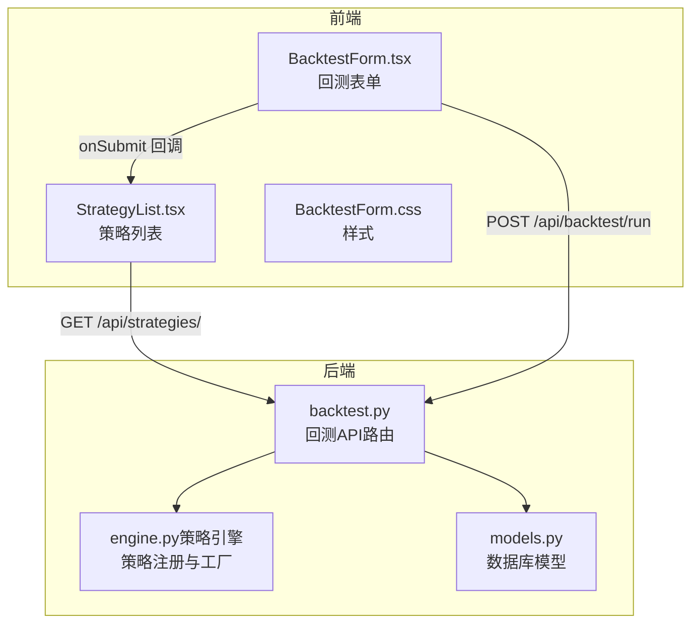
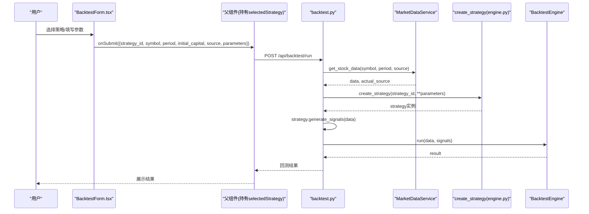
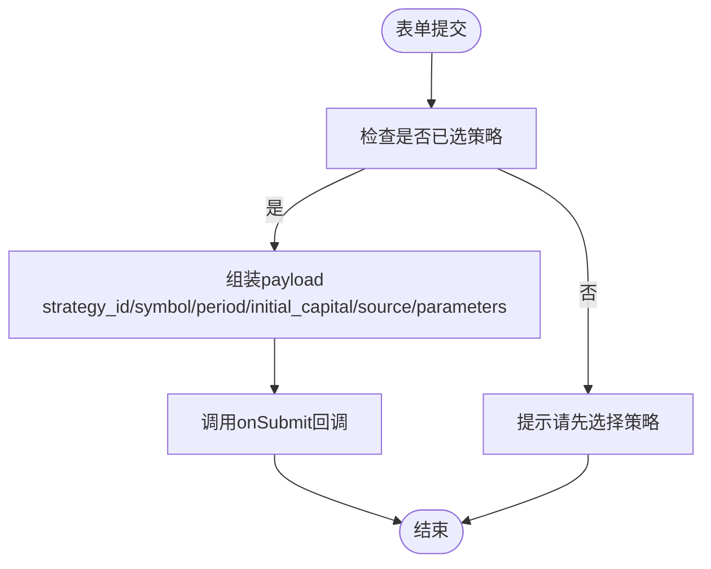
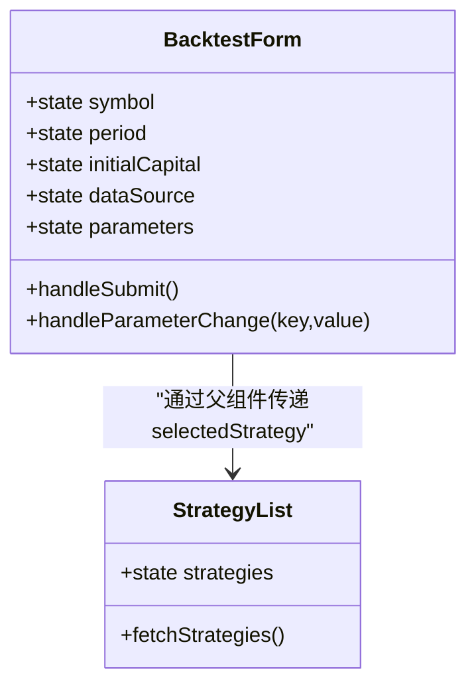
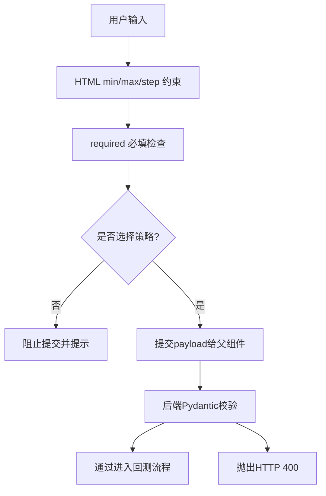
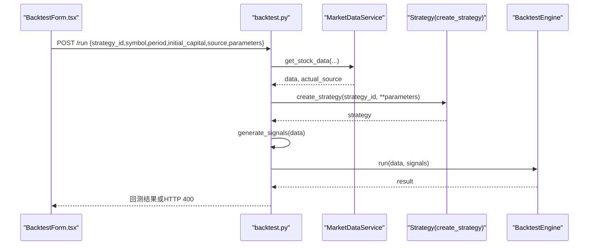
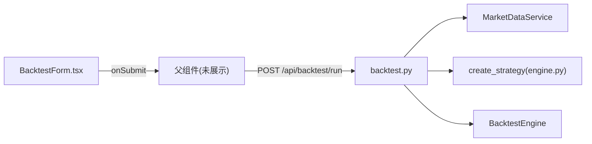

# 回测表单组件

<cite>
**本文引用的文件**   
- [BacktestForm.tsx](file://frontend/src/components/BacktestForm.tsx)
- [BacktestForm.css](file://frontend/src/components/BacktestForm.css)
- [StrategyList.tsx](file://frontend/src/components/StrategyList.tsx)
- [backtest.py](file://backend/app/api/backtest.py)
- [engine.py（策略引擎）](file://backend/app/strategies/engine.py)
- [models.py（数据库模型）](file://backend/app/models/models.py)
</cite>

## 目录
1. [简介](#简介)
2. [项目结构](#项目结构)
3. [核心组件](#核心组件)
4. [架构总览](#架构总览)
5. [详细组件分析](#详细组件分析)
6. [依赖关系分析](#依赖关系分析)
7. [性能与可扩展性](#性能与可扩展性)
8. [故障排查指南](#故障排查指南)
9. [结论](#结论)
10. [附录：字段与校验参考](#附录字段与校验参考)

## 简介
本文件面向 BacktestForm 回测表单组件，系统性说明其动态表单字段生成、参数验证、数据提交处理、与父组件通信机制，以及扩展与定制的最佳实践。该组件负责根据所选策略动态渲染参数输入控件，收集用户输入并调用后端回测接口，最终将结果交由上层组件展示。

## 项目结构
前端采用 React + TypeScript，表单组件位于 components 目录下；后端基于 FastAPI，提供回测运行接口。策略元数据（含参数定义）在后端集中维护，前端通过策略列表加载后，由表单按策略 ID 渲染对应参数控件。

图表来源
- [BacktestForm.tsx:21-48](file://frontend/src/components/BacktestForm.tsx#L21-L48)
- [StrategyList.tsx:31-41](file://frontend/src/components/StrategyList.tsx#L31-L41)
- [backtest.py:28-69](file://backend/app/api/backtest.py#L28-L69)
- [engine.py（策略引擎）:506-656](file://backend/app/strategies/engine.py#L506-L656)
- [models.py（数据库模型）:11-44](file://backend/app/models/models.py#L11-L44)

章节来源
- [BacktestForm.tsx:1-522](file://frontend/src/components/BacktestForm.tsx#L1-L522)
- [StrategyList.tsx:1-69](file://frontend/src/components/StrategyList.tsx#L1-L69)
- [backtest.py:1-77](file://backend/app/api/backtest.py#L1-L77)
- [engine.py（策略引擎）:506-656](file://backend/app/strategies/engine.py#L506-L656)
- [models.py（数据库模型）:1-44](file://backend/app/models/models.py#L1-L44)

## 核心组件
- BacktestForm：回测表单主组件，负责通用字段（股票代码、周期、初始资金、数据源）与策略参数动态渲染、表单提交与状态管理。
- StrategyList：策略列表组件，负责从后端获取策略元数据，并将选中策略的 id 传递给父级，供 BacktestForm 渲染对应参数。
- backtest.py：FastAPI 路由，接收回测请求，驱动市场数据服务、策略实例化、信号生成与回测引擎执行。
- engine.py（策略引擎）：维护可用策略清单及其参数 schema（类型、默认值、范围），并提供 create_strategy 工厂方法。
- models.py：数据库模型，用于持久化策略与回测结果（当前历史查询未实现）。

章节来源
- [BacktestForm.tsx:5-48](file://frontend/src/components/BacktestForm.tsx#L5-L48)
- [StrategyList.tsx:4-14](file://frontend/src/components/StrategyList.tsx#L4-L14)
- [backtest.py:16-26](file://backend/app/api/backtest.py#L16-L26)
- [engine.py（策略引擎）:506-656](file://backend/app/strategies/engine.py#L506-L656)
- [models.py（数据库模型）:11-44](file://backend/app/models/models.py#L11-L44)

## 架构总览
下图展示了从用户交互到后端执行的端到端流程：用户在表单中选择策略、填写参数并提交，前端触发 onSubmit 回调，由父组件发起 API 调用；后端解析请求、拉取行情数据、创建策略并生成信号，最后运行回测引擎返回结果。

图表来源
- [BacktestForm.tsx:28-48](file://frontend/src/components/BacktestForm.tsx#L28-L48)
- [backtest.py:28-69](file://backend/app/api/backtest.py#L28-L69)
- [engine.py（策略引擎）:600-656](file://backend/app/strategies/engine.py#L600-L656)

## 详细组件分析

### BacktestForm 组件
- 职责
  - 管理通用字段状态：symbol、period、initialCapital、dataSource、parameters。
  - 根据 selectedStrategy 动态渲染策略参数输入控件。
  - 在提交时聚合表单数据并通过 onSubmit 回调交给父组件。
  - 提供基础必填校验（HTML required）与最小值/步长等约束（min/step）。
- 关键行为
  - 动态参数更新：handleParameterChange 将键值对写入 parameters 状态。
  - 提交逻辑：若未选择策略则阻止提交并提示；否则组装 payload 并调用 onSubmit。
  - 数据源选择：内置 DATA_SOURCES 配置，支持自动/腾讯/YFinance/AKShare/BaoStock/Mock。
  - 加载态控制：按钮受 loading 属性控制，禁用并显示加载图标。

图表来源
- [BacktestForm.tsx:28-48](file://frontend/src/components/BacktestForm.tsx#L28-L48)

#### 动态表单字段渲染机制
- 渲染规则
  - 当 selectedStrategy 为特定策略 ID 时，渲染对应的参数输入组。
  - 每个参数使用 number 输入框，绑定 parameters[key]，并通过 handleParameterChange 更新。
  - 每个参数均设置 min/max/step 以限制取值范围与步进。
- 支持的策略与参数映射（节选）
  - ma_cross：short_window、long_window
  - momentum：lookback_period、threshold
  - mean_reversion：window、num_std
  - rsi：period、oversold、overbought
  - bollinger_bands：window、num_std、buy_threshold、sell_threshold
  - multi_factor：momentum_window、volatility_window、ma_window、rsi_period、buy_score、sell_score
  - transformer_predict：seq_length、pred_horizon、n_heads、threshold、lookback_train
  - transformer_dl：seq_length、pred_horizon、d_model、n_heads、n_layers、epochs、buy_threshold、sell_threshold

图表来源
- [BacktestForm.tsx:21-48](file://frontend/src/components/BacktestForm.tsx#L21-L48)
- [StrategyList.tsx:16-41](file://frontend/src/components/StrategyList.tsx#L16-L41)

章节来源
- [BacktestForm.tsx:50-504](file://frontend/src/components/BacktestForm.tsx#L50-L504)
- [BacktestForm.css:1-82](file://frontend/src/components/BacktestForm.css#L1-L82)

### 参数验证与约束
- 前端验证
  - HTML required：股票代码、初始资金为必填。
  - 数值范围：各参数通过 min/max/step 限制输入范围与步进。
  - 业务前置校验：未选择策略时阻止提交。
- 后端校验
  - Pydantic 模型 BacktestRequest 对 strategy_id、symbol、period、initial_capital、source、parameters 进行类型校验。
  - 异常统一捕获并返回 HTTP 400。

图表来源
- [BacktestForm.tsx:55-87](file://frontend/src/components/BacktestForm.tsx#L55-L87)
- [BacktestForm.tsx:28-48](file://frontend/src/components/BacktestForm.tsx#L28-L48)
- [backtest.py:16-26](file://backend/app/api/backtest.py#L16-L26)
- [backtest.py:68-69](file://backend/app/api/backtest.py#L68-L69)

章节来源
- [BacktestForm.tsx:28-48](file://frontend/src/components/BacktestForm.tsx#L28-L48)
- [backtest.py:16-26](file://backend/app/api/backtest.py#L16-L26)

### 数据提交流程与错误处理
- 前端
  - 点击“开始回测”触发 handleSubmit，组装 payload 并调用 onSubmit。
  - 按钮在 loading 状态下禁用，避免重复提交。
- 后端
  - 拉取行情数据（支持多数据源与自动降级）。
  - 根据 strategy_id 与 parameters 创建策略实例。
  - 生成交易信号并运行回测引擎。
  - 附加策略信息、股票信息与数据源标识后返回。
  - 任何异常统一转为 HTTP 400。

图表来源
- [BacktestForm.tsx:28-48](file://frontend/src/components/BacktestForm.tsx#L28-L48)
- [backtest.py:28-69](file://backend/app/api/backtest.py#L28-L69)

章节来源
- [BacktestForm.tsx:506-518](file://frontend/src/components/BacktestForm.tsx#L506-L518)
- [backtest.py:28-69](file://backend/app/api/backtest.py#L28-L69)

### 与父组件的通信机制
- 父组件向 BacktestForm 传入：
  - selectedStrategy：当前选中的策略 ID（字符串或 null）。
  - onSubmit：提交回调，接收 payload 对象。
  - loading：回测进行中状态。
- BacktestForm 通过 onSubmit 将完整回测参数对象传给父组件，由父组件负责实际 API 调用与结果处理。

章节来源
- [BacktestForm.tsx:5-9](file://frontend/src/components/BacktestForm.tsx#L5-L9)
- [BacktestForm.tsx:28-48](file://frontend/src/components/BacktestForm.tsx#L28-L48)

### 表单定制与扩展最佳实践
- 新增策略
  - 后端
    - 在 engine.py 的 get_available_strategies 中注册新策略的元数据（id、name、description、parameters 的 type/default/min/max）。
    - 在 create_strategy 中添加分支，根据 strategy_id 构造策略实例。
  - 前端
    - 在 BacktestForm.tsx 中新增对应策略 ID 的参数渲染分支，保持与后端参数名一致。
- 参数校验增强
  - 前端：优先使用 HTML 原生约束（required/min/max/step），必要时补充自定义校验并在 UI 上给出反馈。
  - 后端：利用 Pydantic 模型与自定义校验器确保入参合法性。
- 数据源扩展
  - 在 BacktestForm.tsx 的 DATA_SOURCES 中追加新的数据源选项，并确保后端 MarketDataService 支持该 source。
- 可访问性与体验
  - 为每个参数添加 label 与 small 辅助说明，提升可读性。
  - 在 loading 期间禁用提交按钮，防止重复提交。

章节来源
- [engine.py（策略引擎）:506-656](file://backend/app/strategies/engine.py#L506-L656)
- [BacktestForm.tsx:11-19](file://frontend/src/components/BacktestForm.tsx#L11-L19)
- [BacktestForm.tsx:111-504](file://frontend/src/components/BacktestForm.tsx#L111-L504)

## 依赖关系分析
- 组件耦合
  - BacktestForm 依赖父组件提供的 selectedStrategy 与 onSubmit，低耦合、高内聚。
  - StrategyList 仅负责策略列表展示与选择，不感知回测细节。
- 前后端契约
  - 请求体：strategy_id、symbol、period、initial_capital、source、parameters。
  - 响应体：包含策略信息、股票信息、数据源标识与回测指标。
- 外部依赖
  - 后端依赖 MarketDataService 获取行情数据，依赖 BacktestEngine 执行回测。
  - 前端依赖 lucide-react 图标库与 CSS 样式。

图表来源
- [BacktestForm.tsx:28-48](file://frontend/src/components/BacktestForm.tsx#L28-L48)
- [backtest.py:28-69](file://backend/app/api/backtest.py#L28-L69)
- [engine.py（策略引擎）:600-656](file://backend/app/strategies/engine.py#L600-L656)

章节来源
- [BacktestForm.tsx:1-522](file://frontend/src/components/BacktestForm.tsx#L1-L522)
- [backtest.py:1-77](file://backend/app/api/backtest.py#L1-L77)
- [engine.py（策略引擎）:506-656](file://backend/app/strategies/engine.py#L506-L656)

## 性能与可扩展性
- 渲染性能
  - 参数面板仅在 selectedStrategy 非空时渲染，减少不必要的 DOM 节点。
  - 使用受控组件与局部 state，避免整表重渲染。
- 可扩展性
  - 策略参数 schema 集中在后端，便于统一管理；前端按策略 ID 分支渲染，新增策略只需两处改动。
- 建议优化
  - 将策略参数 schema 暴露为独立 API，前端据此自动生成表单，消除硬编码分支，提高可维护性。
  - 对大参数集合考虑分组折叠与懒加载。

[本节为通用指导，不涉及具体文件分析]

## 故障排查指南
- 常见问题
  - 未选择策略即提交：前端会阻止提交并提示。请确保先选择策略。
  - 参数越界：HTML min/max/step 会限制输入；如仍报错，检查后端 Pydantic 校验与策略构造函数期望。
  - 数据源不可用：确认后端 MarketDataService 支持所选 source；可使用 mock 进行本地测试。
  - 网络或后端异常：后端统一返回 HTTP 400，请查看 detail 信息定位问题。
- 调试建议
  - 在前端控制台打印 onSubmit 的 payload，确认字段名称与类型正确。
  - 在后端日志中记录 request.parameters 与 create_strategy 的入参，确认参数透传无误。

章节来源
- [BacktestForm.tsx:28-48](file://frontend/src/components/BacktestForm.tsx#L28-L48)
- [backtest.py:68-69](file://backend/app/api/backtest.py#L68-L69)

## 结论
BacktestForm 通过受控状态与条件渲染实现了按策略动态生成参数输入的能力，结合 HTML 原生校验与后端 Pydantic 校验形成双重保障。组件职责清晰、与父组件解耦良好，易于扩展新策略与新数据源。建议在后续迭代中将策略参数 schema 暴露为 API，进一步降低前后端耦合度，提升可维护性与自动化程度。

[本节为总结性内容，不涉及具体文件分析]

## 附录：字段与校验参考
- 通用字段
  - 股票代码：文本输入，必填，示例格式见占位符。
  - 回测周期：下拉选择，可选 1mo/3mo/6mo/1y/2y/5y。
  - 初始资金：数字输入，必填，最小值与步进由 HTML 约束。
  - 数据源：下拉选择，支持 auto/tencent/yfinance/akshare/baostock/mock。
- 策略参数（示例）
  - ma_cross：short_window、long_window（整数，带范围）。
  - momentum：lookback_period、threshold（整数/浮点数，带范围）。
  - mean_reversion：window、num_std（整数/浮点数，带范围）。
  - rsi：period、oversold、overbought（整数/浮点数，带范围）。
  - bollinger_bands：window、num_std、buy_threshold、sell_threshold（整数/浮点数，带范围）。
  - multi_factor：momentum_window、volatility_window、ma_window、rsi_period、buy_score、sell_score（整数/浮点数，带范围）。
  - transformer_predict：seq_length、pred_horizon、n_heads、threshold、lookback_train（整数/浮点数，带范围）。
  - transformer_dl：seq_length、pred_horizon、d_model、n_heads、n_layers、epochs、buy_threshold、sell_threshold（整数/浮点数，带范围）。

章节来源
- [BacktestForm.tsx:55-504](file://frontend/src/components/BacktestForm.tsx#L55-L504)
- [engine.py（策略引擎）:506-596](file://backend/app/strategies/engine.py#L506-L596)