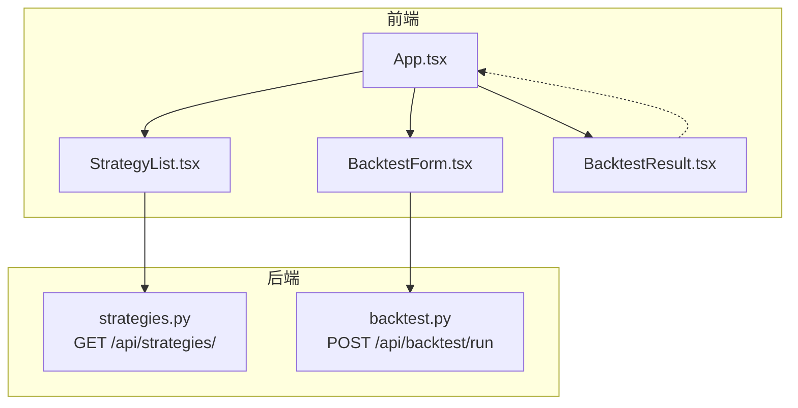
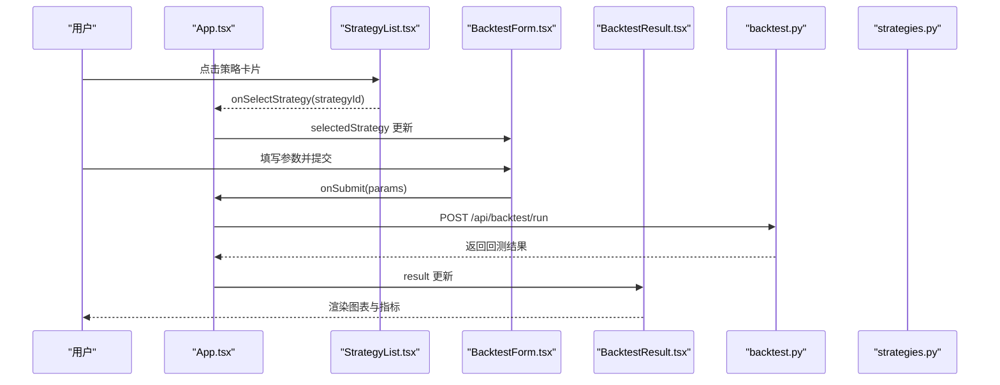
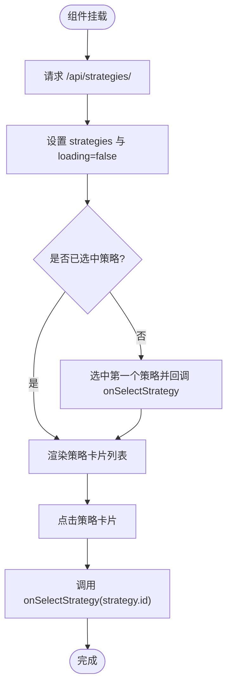
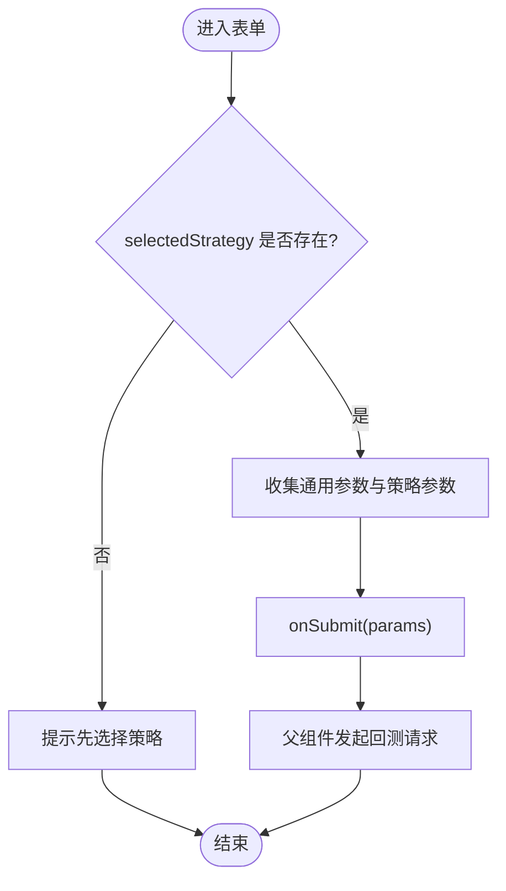
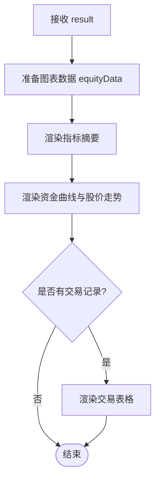
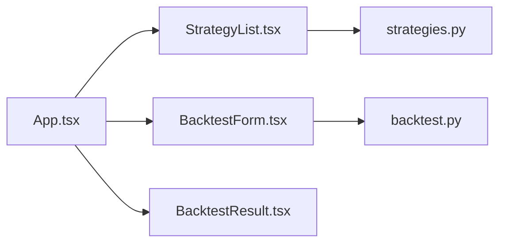

# 核心组件详解

<cite>
**本文引用的文件**   
- [StrategyList.tsx](file://frontend/src/components/StrategyList.tsx)
- [BacktestForm.tsx](file://frontend/src/components/BacktestForm.tsx)
- [BacktestResult.tsx](file://frontend/src/components/BacktestResult.tsx)
- [App.tsx](file://frontend/src/App.tsx)
- [backtest.py](file://backend/app/api/backtest.py)
- [strategies.py](file://backend/app/api/strategies.py)
</cite>

## 目录
1. [简介](#简介)
2. [项目结构](#项目结构)
3. [核心组件总览](#核心组件总览)
4. [架构总览](#架构总览)
5. [组件详细分析](#组件详细分析)
6. [依赖关系分析](#依赖关系分析)
7. [性能与优化](#性能与优化)
8. [故障排查指南](#故障排查指南)
9. [结论](#结论)
10. [附录：接口与扩展指南](#附录接口与扩展指南)

## 简介
本文件聚焦于三个核心前端 UI 组件的实现与设计模式，并结合后端 API 说明数据流与交互流程。目标是帮助读者理解：
- StrategyList 策略列表组件：策略展示、选择交互、状态同步
- BacktestForm 参数表单组件：表单验证、动态字段、数据提交、错误处理
- BacktestResult 结果展示组件：图表渲染、数据格式化、交互式可视化
同时给出组件 Props 接口定义、事件处理机制、状态管理方式以及可复用与扩展建议。

## 项目结构
前端采用 React + TypeScript，使用 Recharts 进行图表渲染；后端基于 FastAPI 提供策略列表与回测执行接口。关键文件如下：
- 前端组件：StrategyList.tsx、BacktestForm.tsx、BacktestResult.tsx
- 应用入口：App.tsx（负责状态提升与跨组件通信）
- 后端 API：backtest.py（回测执行）、strategies.py（策略列表）

**图示来源**
- [App.tsx:1-100](file://frontend/src/App.tsx#L1-L100)
- [StrategyList.tsx:1-69](file://frontend/src/components/StrategyList.tsx#L1-L69)
- [BacktestForm.tsx:1-522](file://frontend/src/components/BacktestForm.tsx#L1-L522)
- [BacktestResult.tsx:1-221](file://frontend/src/components/BacktestResult.tsx#L1-L221)
- [strategies.py:1-25](file://backend/app/api/strategies.py#L1-L25)
- [backtest.py:1-77](file://backend/app/api/backtest.py#L1-L77)

**章节来源**
- [App.tsx:1-100](file://frontend/src/App.tsx#L1-L100)
- [StrategyList.tsx:1-69](file://frontend/src/components/StrategyList.tsx#L1-L69)
- [BacktestForm.tsx:1-522](file://frontend/src/components/BacktestForm.tsx#L1-L522)
- [BacktestResult.tsx:1-221](file://frontend/src/components/BacktestResult.tsx#L1-L221)
- [strategies.py:1-25](file://backend/app/api/strategies.py#L1-L25)
- [backtest.py:1-77](file://backend/app/api/backtest.py#L1-L77)

## 核心组件总览
- StrategyList：从后端拉取策略元信息，支持点击选中并向上抛出 selectedStrategy，默认选中第一个策略。
- BacktestForm：根据所选策略动态渲染参数表单，收集用户输入并提交到后端回测接口。
- BacktestResult：接收回测结果，格式化指标与交易记录，使用 Recharts 渲染资金曲线与股价走势。

**章节来源**
- [StrategyList.tsx:1-69](file://frontend/src/components/StrategyList.tsx#L1-L69)
- [BacktestForm.tsx:1-522](file://frontend/src/components/BacktestForm.tsx#L1-L522)
- [BacktestResult.tsx:1-221](file://frontend/src/components/BacktestResult.tsx#L1-L221)

## 架构总览
以下时序图展示了“选择策略 → 填写参数 → 提交回测 → 展示结果”的端到端流程。

**图示来源**
- [App.tsx:13-36](file://frontend/src/App.tsx#L13-L36)
- [StrategyList.tsx:47-66](file://frontend/src/components/StrategyList.tsx#L47-L66)
- [BacktestForm.tsx:28-44](file://frontend/src/components/BacktestForm.tsx#L28-L44)
- [BacktestResult.tsx:9-41](file://frontend/src/components/BacktestResult.tsx#L9-L41)
- [backtest.py:28-69](file://backend/app/api/backtest.py#L28-L69)
- [strategies.py:11-14](file://backend/app/api/strategies.py#L11-L14)

## 组件详细分析

### StrategyList 策略列表组件
职责
- 加载策略列表并展示名称、描述与默认参数标签
- 支持点击选中策略，并通过回调向父组件同步 selectedStrategy
- 首次加载完成后自动选中第一个策略

关键实现要点
- 本地状态：strategies、loading
- 副作用：useEffect 在挂载时请求 /api/strategies/
- 默认选中逻辑：当 strategies 非空且未选中任何策略时，调用 onSelectStrategy 选中第一项
- 渲染：遍历策略数组，为选中项添加 selected 样式类

Props 接口
- selectedStrategy: string | null
- onSelectStrategy: (strategyId: string) => void

数据流与状态同步
- 通过 props.selectedStrategy 控制高亮
- 通过 onSelectStrategy 将选择状态上抛至 App.tsx

**图示来源**
- [StrategyList.tsx:20-29](file://frontend/src/components/StrategyList.tsx#L20-L29)
- [StrategyList.tsx:31-41](file://frontend/src/components/StrategyList.tsx#L31-L41)
- [StrategyList.tsx:47-66](file://frontend/src/components/StrategyList.tsx#L47-L66)

**章节来源**
- [StrategyList.tsx:1-69](file://frontend/src/components/StrategyList.tsx#L1-L69)

### BacktestForm 参数表单组件
职责
- 收集股票代码、回测周期、初始资金、数据源等通用参数
- 根据 selectedStrategy 动态渲染对应策略的参数输入控件
- 表单校验与提交，触发父组件的回测流程

关键实现要点
- 本地状态：symbol、period、initialCapital、dataSource、parameters
- 动态参数面板：按 selectedStrategy 分支渲染不同参数组
- 提交逻辑：校验 selectedStrategy 存在后，组装参数对象并调用 onSubmit
- 加载态：按钮禁用与图标切换由 loading 控制

Props 接口
- selectedStrategy: string | null
- onSubmit: (params: any) => void
- loading: boolean

动态字段映射
- ma_cross：short_window、long_window
- momentum：lookback_period、threshold
- mean_reversion：window、num_std
- rsi：period、oversold、overbought
- bollinger_bands：window、num_std、buy_threshold、sell_threshold
- multi_factor：momentum_window、volatility_window、ma_window、rsi_period、buy_score、sell_score
- transformer_predict：seq_length、pred_horizon、n_heads、threshold、lookback_train
- transformer_dl：seq_length、pred_horizon、d_model、n_heads、n_layers、epochs、buy_threshold、sell_threshold

**图示来源**
- [BacktestForm.tsx:28-44](file://frontend/src/components/BacktestForm.tsx#L28-L44)
- [BacktestForm.tsx:111-503](file://frontend/src/components/BacktestForm.tsx#L111-L503)

**章节来源**
- [BacktestForm.tsx:1-522](file://frontend/src/components/BacktestForm.tsx#L1-L522)

### BacktestResult 结果展示组件
职责
- 展示回测指标摘要、资金曲线与股价走势图表
- 格式化数字与百分比，标注模拟数据提示
- 渲染交易明细表格

关键实现要点
- 数据准备：将 equity_curve 转换为图表所需格式（日期、equity、price、signal）
- 指标格式化：formatNumber、formatPercent
- 图表渲染：AreaChart 资金曲线、LineChart 股价走势，Tooltip 交互
- 交易记录：条件渲染 trades 表格

Props 接口
- result: any（包含 metrics、trades、equity_curve、strategy、symbol、data_source、is_mock）

**图示来源**
- [BacktestResult.tsx:9-41](file://frontend/src/components/BacktestResult.tsx#L9-L41)
- [BacktestResult.tsx:123-181](file://frontend/src/components/BacktestResult.tsx#L123-L181)
- [BacktestResult.tsx:183-217](file://frontend/src/components/BacktestResult.tsx#L183-L217)

**章节来源**
- [BacktestResult.tsx:1-221](file://frontend/src/components/BacktestResult.tsx#L1-L221)

## 依赖关系分析
- 组件耦合
  - App.tsx 作为状态中心，持有 selectedStrategy、backtestResult、loading，并通过 props 向下传递
  - StrategyList 仅依赖 onSelectStrategy 回调，不感知其他组件
  - BacktestForm 依赖 selectedStrategy 与 onSubmit 回调
  - BacktestResult 为纯展示组件，依赖 result 数据
- 外部依赖
  - 前端：Recharts（图表）、Lucide 图标
  - 后端：FastAPI、Pydantic、自定义策略引擎与回测引擎

**图示来源**
- [App.tsx:1-100](file://frontend/src/App.tsx#L1-L100)
- [strategies.py:1-25](file://backend/app/api/strategies.py#L1-L25)
- [backtest.py:1-77](file://backend/app/api/backtest.py#L1-L77)

**章节来源**
- [App.tsx:1-100](file://frontend/src/App.tsx#L1-L100)
- [strategies.py:1-25](file://backend/app/api/strategies.py#L1-L25)
- [backtest.py:1-77](file://backend/app/api/backtest.py#L1-L77)

## 性能与优化
- 列表渲染
  - StrategyList 中 key 使用 strategy.id，避免不必要的重渲染
  - 若策略数量增长，可考虑虚拟滚动或分页加载
- 网络请求
  - StrategyList 仅在挂载时请求一次策略列表，避免重复请求
  - 可在 App 层增加缓存或防抖，减少频繁刷新
- 表单交互
  - BacktestForm 使用受控输入，局部 state 更新粒度细，避免整表重渲染
  - 对数值型输入使用 Number() 转换，确保类型稳定
- 图表渲染
  - BacktestResult 使用 ResponsiveContainer 自适应容器尺寸
  - 大量数据时可考虑采样或延迟渲染，避免主线程阻塞
- 状态管理
  - 当前采用 React useState 提升状态至 App，结构简单清晰
  - 随着复杂度上升，可考虑 Context 或轻量状态库（如 Zustand）

[本节为通用优化建议，不直接分析具体代码文件]

## 故障排查指南
常见问题与定位思路
- 策略列表为空
  - 检查后端 /api/strategies/ 是否正常返回
  - 查看浏览器控制台是否有 fetch 报错
  - 确认 StrategyList 的 useEffect 是否被触发
- 无法提交回测
  - 确认已选择策略（selectedStrategy 非空）
  - 检查后端 /api/backtest/run 响应码与错误信息
  - 观察 App.tsx 的 catch 分支是否弹出错误提示
- 图表不显示或异常
  - 检查 equity_curve 数据格式是否符合预期（Date、equity、Close、signal）
  - 确认 Recharts 版本与组件使用方式兼容
- 模拟数据提示
  - is_mock 为 true 时，BacktestResult 会显示模拟数据横幅，属正常行为

**章节来源**
- [StrategyList.tsx:31-41](file://frontend/src/components/StrategyList.tsx#L31-L41)
- [BacktestForm.tsx:28-44](file://frontend/src/components/BacktestForm.tsx#L28-L44)
- [App.tsx:13-36](file://frontend/src/App.tsx#L13-L36)
- [BacktestResult.tsx:43-50](file://frontend/src/components/BacktestResult.tsx#L43-L50)

## 结论
三个核心组件围绕“策略选择—参数配置—结果展示”的主线形成清晰的单向数据流。StrategyList 负责策略发现与选择，BacktestForm 负责参数收集与提交，BacktestResult 负责结果可视化。配合后端 FastAPI 接口，整体架构简洁、职责分明，便于扩展与维护。

[本节为总结性内容，不直接分析具体代码文件]

## 附录：接口与扩展指南

### 组件 Props 接口定义
- StrategyList
  - selectedStrategy: string | null
  - onSelectStrategy: (strategyId: string) => void
- BacktestForm
  - selectedStrategy: string | null
  - onSubmit: (params: any) => void
  - loading: boolean
- BacktestResult
  - result: any（包含 metrics、trades、equity_curve、strategy、symbol、data_source、is_mock）

**章节来源**
- [StrategyList.tsx:11-14](file://frontend/src/components/StrategyList.tsx#L11-L14)
- [BacktestForm.tsx:5-9](file://frontend/src/components/BacktestForm.tsx#L5-L9)
- [BacktestResult.tsx:5-7](file://frontend/src/components/BacktestResult.tsx#L5-L7)

### 事件处理机制
- StrategyList：onClick 触发 onSelectStrategy，将选中策略 ID 上抛
- BacktestForm：onSubmit 组装参数并调用父组件传入的 onSubmit
- App.tsx：handleBacktest 统一处理回测请求与结果落盘

**章节来源**
- [StrategyList.tsx:47-66](file://frontend/src/components/StrategyList.tsx#L47-L66)
- [BacktestForm.tsx:28-44](file://frontend/src/components/BacktestForm.tsx#L28-L44)
- [App.tsx:13-36](file://frontend/src/App.tsx#L13-L36)

### 状态管理与数据流
- 状态提升：selectedStrategy、backtestResult、loading 均位于 App.tsx
- 数据流向：StrategyList → App → BacktestForm → App → BacktestResult
- 后端对接：GET /api/strategies/ 获取策略列表；POST /api/backtest/run 执行回测

**章节来源**
- [App.tsx:8-36](file://frontend/src/App.tsx#L8-L36)
- [strategies.py:11-14](file://backend/app/api/strategies.py#L11-L14)
- [backtest.py:28-69](file://backend/app/api/backtest.py#L28-L69)

### 组件复用与扩展指南
- 新增策略
  - 在后端注册新策略并在 get_available_strategies 中暴露
  - 在 BacktestForm 中为该策略新增参数分组与校验规则
  - 在 StrategyList 中确保策略元信息包含 parameters 默认值
- 增强表单校验
  - 引入集中式校验库（如 zod/yup），对必填、范围、步长等进行统一校验
  - 将错误信息以行内提示形式展示，提升用户体验
- 优化图表性能
  - 对大数据集进行采样或分片渲染
  - 使用 useMemo/useCallback 缓存计算结果与回调函数
- 统一错误处理
  - 在 App.tsx 中统一捕获网络与业务错误，并展示友好提示
  - 对后端 HTTPException 进行映射，区分参数错误与系统错误

[本节为扩展建议，不直接分析具体代码文件]