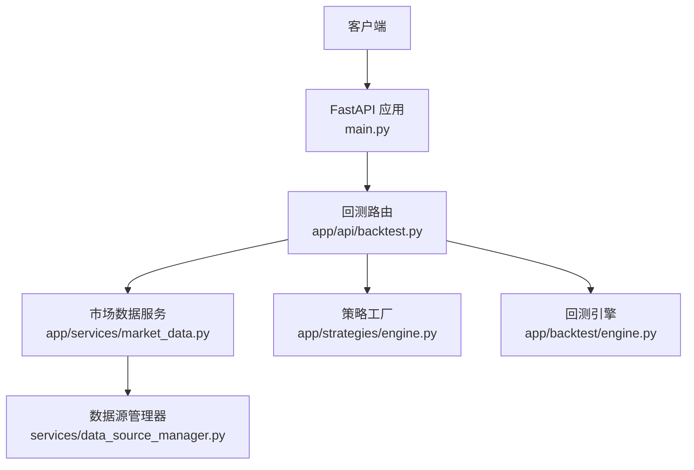
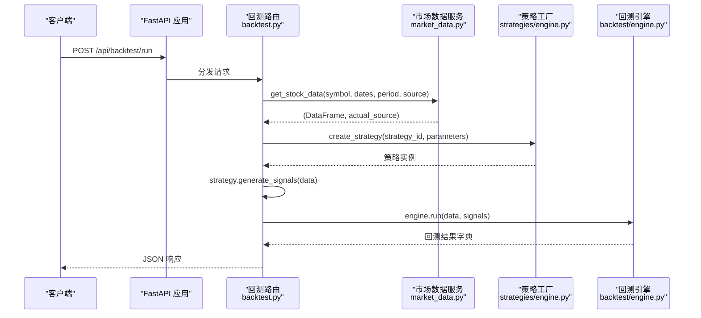
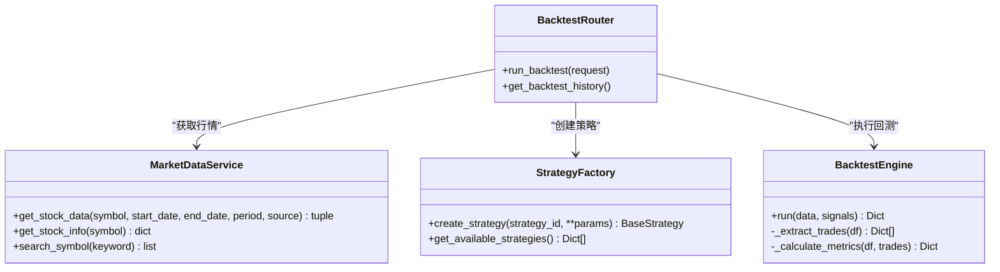

# 回测执行API

<cite>
**本文引用的文件**   
- [main.py](../../../../../../backend/main.py)
- [backtest.py](../../../../../../backend/app/api/backtest.py)
- [engine.py（策略引擎）](../../../../../../backend/app/strategies/engine.py)
- [engine.py（回测引擎）](../../../../../../backend/app/backtest/engine.py)
- [market_data.py](../../../../../../backend/app/services/market_data.py)
- [models.py](../../../../../../backend/app/models/models.py)
</cite>

## 目录
1. [简介](#简介)
2. [项目结构](#项目结构)
3. [核心组件](#核心组件)
4. [架构总览](#架构总览)
5. [详细组件分析](#详细组件分析)
6. [依赖关系分析](#依赖关系分析)
7. [性能与优化](#性能与优化)
8. [异常处理与状态码规范](#异常处理与状态码规范)
9. [请求与响应示例](#请求与响应示例)
10. [故障排查指南](#故障排查指南)
11. [结论](#结论)

## 简介
本文件面向“回测执行API”的实现与使用，覆盖以下要点：
- 接口定义、参数校验规则（股票代码、策略选择、时间范围等）
- 异步处理机制与调用流程（从参数接收、策略实例化、数据获取到结果计算）
- 返回数据结构与字段含义
- 错误处理与状态码规范
- 性能优化建议（缓存、并发、序列化安全等）

## 项目结构
后端采用 FastAPI 构建 REST API，按功能模块划分：
- API 路由层：负责请求解析、参数校验、业务编排
- 服务层：市场数据获取、数据源管理
- 策略层：多种量化策略实现与工厂方法
- 回测层：回测引擎，计算收益曲线、交易记录与指标
- 模型层：数据库模型（当前用于历史回测持久化的预留）

图表来源
- [main.py:9-27](../../../../../../backend/main.py#L9-L27)
- [backtest.py:13-66](../../../../../../backend/app/api/backtest.py#L13-L66)
- [market_data.py:11-41](../../../../../../backend/app/services/market_data.py#L11-L41)
- [engine.py（策略引擎）:600-655](../../../../../../backend/app/strategies/engine.py#L600-L655)
- [engine.py（回测引擎）:10-70](../../../../../../backend/app/backtest/engine.py#L10-L70)

章节来源
- [main.py:1-36](../../../../../../backend/main.py#L1-L36)

## 核心组件
- 回测路由：定义 /api/backtest/run 接口，接收请求并编排数据获取、信号生成、回测执行。
- 策略引擎：提供多种策略类及 create_strategy 工厂方法，支持动态参数注入。
- 回测引擎：基于信号与价格序列计算收益曲线、交易明细与绩效指标。
- 市场数据服务：统一封装多数据源获取股票行情数据。
- 数据库模型：预留策略与回测结果的持久化结构（历史查询尚未实现）。

章节来源
- [backtest.py:16-66](../../../../../../backend/app/api/backtest.py#L16-L66)
- [engine.py（策略引擎）:17-655](../../../../../../backend/app/strategies/engine.py#L17-L655)
- [engine.py（回测引擎）:10-163](../../../../../../backend/app/backtest/engine.py#L10-L163)
- [market_data.py:11-41](../../../../../../backend/app/services/market_data.py#L11-L41)
- [models.py:11-44](../../../../../../backend/app/models/models.py#L11-L44)

## 架构总览
下图展示一次回测执行的端到端时序：

图表来源
- [backtest.py:28-66](../../../../../../backend/app/api/backtest.py#L28-L66)
- [market_data.py:14-41](../../../../../../backend/app/services/market_data.py#L14-L41)
- [engine.py（策略引擎）:600-655](../../../../../../backend/app/strategies/engine.py#L600-L655)
- [engine.py（回测引擎）:15-70](../../../../../../backend/app/backtest/engine.py#L15-L70)

## 详细组件分析

### 回测执行接口（/api/backtest/run）
- 路径与方法：POST /api/backtest/run
- 请求体模型：BacktestRequest
  - strategy_id: 字符串，必填
  - symbol: 字符串，必填
  - start_date: 可选字符串
  - end_date: 可选字符串
  - period: 字符串，默认 "1y"
  - initial_capital: 浮点数，默认 100000.0
  - source: 字符串，默认 "auto"，支持 auto/yfinance/akshare/baostock/mock
  - parameters: 对象，策略参数键值对
- 处理流程：
  1) 通过 MarketDataService.get_stock_data 获取行情数据与实际数据源
  2) 通过 create_strategy 创建策略实例
  3) 调用 strategy.generate_signals 生成信号 DataFrame
  4) 使用 BacktestEngine.run 计算回测结果
  5) 附加策略信息、股票代码、实际数据源与是否模拟标识
- 返回值：包含 metrics、trades、equity_curve、signals_data 以及策略与标的信息的字典

章节来源
- [backtest.py:16-66](../../../../../../backend/app/api/backtest.py#L16-L66)

### 策略引擎与工厂
- BaseStrategy：抽象基类，定义 generate_signals 接口
- 具体策略：均线交叉、动量、均值回归、RSI、布林带、多因子、Transformer预测等
- 工厂方法 create_strategy：根据 strategy_id 与 parameters 构造对应策略实例；若为深度学习策略且未安装依赖则抛出 ImportError
- 可用策略列表：get_available_strategies 返回策略元信息与参数约束

章节来源
- [engine.py（策略引擎）:17-655](../../../../../../backend/app/strategies/engine.py#L17-L655)

### 回测引擎
- 输入：价格数据 DataFrame（含 Date/Open/High/Low/Close/Volume）与信号 DataFrame（含 signal/position）
- 输出：
  - metrics：绩效指标（初始资金、最终价值、总收益、年化收益、最大回撤、夏普比率、胜率、交易次数、盈亏比等）
  - trades：逐笔交易记录（入场/出场日期与价格、PnL/PnL%、方向）
  - equity_curve：资金曲线与收盘价、信号列的时间序列
  - signals_data：信号与仓位变化序列
- 关键逻辑：
  - 合并数据与信号，计算日收益率与策略收益率
  - 累计收益与资金曲线
  - 提取交易记录（买入/卖出配对）
  - 计算滚动最大回撤、夏普比率、胜率与盈亏比
  - 数值清洗（填充 NaN/Inf），日期格式化以保障 JSON 可序列化

章节来源
- [engine.py（回测引擎）:10-163](../../../../../../backend/app/backtest/engine.py#L10-L163)

### 市场数据服务
- 统一入口 MarketDataService.get_stock_data：委托 DataSourceManager 获取数据，返回 (DataFrame, actual_source)
- 其他辅助方法：get_stock_info、search_symbol（简化版）

章节来源
- [market_data.py:11-41](../../../../../../backend/app/services/market_data.py#L11-L41)

## 依赖关系分析
- 路由层依赖：
  - strategies.engine.create_strategy
  - backtest.engine.BacktestEngine
  - services.market_data.MarketDataService
- 策略层内部：
  - 各策略继承 BaseStrategy，实现 generate_signals
  - TransformerDL 策略按需导入，缺失依赖时抛出 ImportError
- 数据层：
  - MarketDataService 依赖 DataSourceManager（未在本文列出具体文件）

图表来源
- [backtest.py:28-66](../../../../../../backend/app/api/backtest.py#L28-L66)
- [market_data.py:11-41](../../../../../../backend/app/services/market_data.py#L11-L41)
- [engine.py（策略引擎）:600-655](../../../../../../backend/app/strategies/engine.py#L600-L655)
- [engine.py（回测引擎）:10-163](../../../../../../backend/app/backtest/engine.py#L10-L163)

## 性能与优化
- 数据获取与缓存
  - 建议在 DataSourceManager 或 MarketDataService 层增加 LRU/内存缓存，按 symbol+period+source 作为键，避免重复网络请求
  - 对热点标的（如指数或热门股）设置更长缓存过期时间
- 并发与异步
  - 当前 run_backtest 为 async def，但内部同步调用较多（pandas/numpy），在高并发下可能阻塞事件循环
  - 建议将重计算任务（generate_signals、engine.run）放入线程池或进程池执行，避免阻塞
- 序列化安全
  - 回测引擎已对数值进行 NaN/Inf 清理与日期格式化，确保 JSON 可序列化
  - 建议在中间件层统一做数值类型校验与转换
- 增量回测
  - 对于相同标的与策略的多次运行，可缓存中间结果（如信号 DataFrame），仅增量计算指标
- 资源控制
  - 限制并发回测数量，防止内存峰值过高
  - 对长周期回测增加超时与进度回调（未来可扩展）

[本节为通用性能建议，不直接分析具体代码文件]

## 异常处理与状态码规范
- 成功：HTTP 200，返回结构化 JSON（metrics/trades/equity_curve/signals_data 等）
- 参数或运行时错误：HTTP 400，detail 携带异常消息
- 策略不存在：由 create_strategy 抛出 ValueError，被上层捕获后返回 400
- 深度学习策略依赖缺失：抛出 ImportError，返回 400
- 健康检查：GET /api/health 返回 {"status": "healthy"}

章节来源
- [backtest.py:68-69](../../../../../../backend/app/api/backtest.py#L68-L69)
- [engine.py（策略引擎）:647-655](../../../../../../backend/app/strategies/engine.py#L647-L655)
- [main.py:33-35](../../../../../../backend/main.py#L33-L35)

## 请求与响应示例

### 请求示例
- 路径：POST /api/backtest/run
- 请求体（JSON）
{
  "strategy_id": "ma_cross",
  "symbol": "AAPL",
  "start_date": "2023-01-01",
  "end_date": "2023-12-31",
  "period": "1y",
  "initial_capital": 100000.0,
  "source": "auto",
  "parameters": {
    "short_window": 5,
    "long_window": 20
  }
}

### 响应示例（成功）
- HTTP 200
{
  "metrics": {
    "initial_capital": 100000.0,
    "final_value": 112345.67,
    "total_return": 12.35,
    "annual_return": 11.8,
    "max_drawdown": -8.45,
    "sharpe_ratio": 1.23,
    "win_rate": 56.0,
    "total_trades": 10,
    "winning_trades": 6,
    "losing_trades": 4,
    "profit_loss_ratio": 1.45
  },
  "trades": [
    {
      "entry_date": "2023-02-10",
      "exit_date": "2023-03-15",
      "entry_price": 150.0,
      "exit_price": 160.0,
      "pnl": 10.0,
      "pnl_pct": 6.67,
      "direction": "long"
    }
  ],
  "equity_curve": [
    {"Date": "2023-01-03", "equity": 100000.0, "Close": 130.0, "signal": 0},
    {"Date": "2023-01-04", "equity": 100120.0, "Close": 130.5, "signal": 1}
  ],
  "signals_data": [
    {"Date": "2023-01-03", "Close": 130.0, "signal": 0, "position_change": 0},
    {"Date": "2023-01-04", "Close": 130.5, "signal": 1, "position_change": 1}
  ],
  "strategy": {
    "id": "ma_cross",
    "name": "均线交叉策略",
    "parameters": {"short_window": 5, "long_window": 20}
  },
  "symbol": "AAPL",
  "data_source": "yfinance",
  "is_mock": false
}

### 错误响应示例
- 策略不存在：HTTP 400
{
  "detail": "Unknown strategy: unknown_id"
}
- 深度学习策略依赖缺失：HTTP 400
{
  "detail": "Transformer深度学习策略需要 PyTorch。请安装: pip install torch scikit-learn"
}

章节来源
- [backtest.py:28-69](../../../../../../backend/app/api/backtest.py#L28-L69)
- [engine.py（策略引擎）:647-655](../../../../../../backend/app/strategies/engine.py#L647-L655)

## 故障排查指南
- 无法获取数据
  - 检查 source 配置与网络连通性；确认 symbol 格式正确
  - 查看 MarketDataService 返回的实际数据源是否为 mock
- 策略参数无效
  - 核对 parameters 中字段名称与类型是否与策略定义一致
  - 参考 get_available_strategies 返回的参数约束
- 回测结果为空或指标异常
  - 检查信号是否存在有效买卖点（position_change 非零）
  - 确认数据时间序列连续且无大量缺失
- 深度学习策略报错
  - 安装 PyTorch 与相关依赖后重试
- 并发性能问题
  - 观察 CPU/内存占用，考虑引入线程池/进程池与缓存

章节来源
- [market_data.py:14-41](../../../../../../backend/app/services/market_data.py#L14-L41)
- [engine.py（策略引擎）:506-597](../../../../../../backend/app/strategies/engine.py#L506-L597)
- [engine.py（回测引擎）:72-163](../../../../../../backend/app/backtest/engine.py#L72-L163)

## 结论
回测执行API通过清晰的职责分层实现了从数据获取、策略信号生成到回测计算的完整链路。当前实现提供了丰富的策略族与稳健的回测指标计算，同时具备基础的错误处理与可序列化保障。后续可在数据缓存、并发执行、历史持久化等方面进一步增强系统稳定性与吞吐能力。