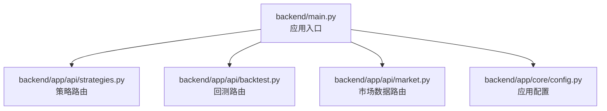
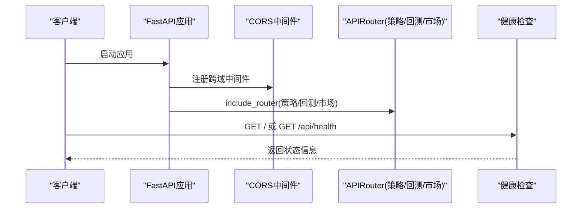
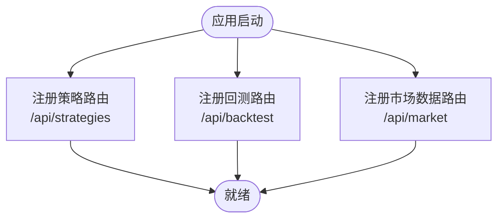
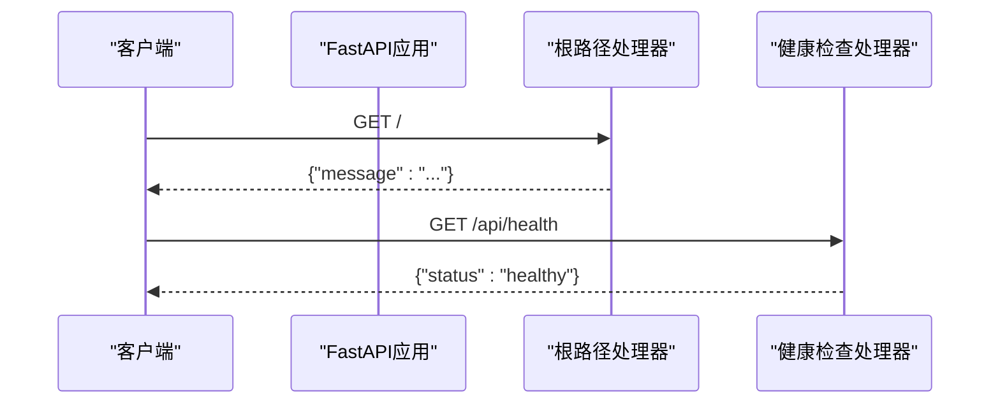
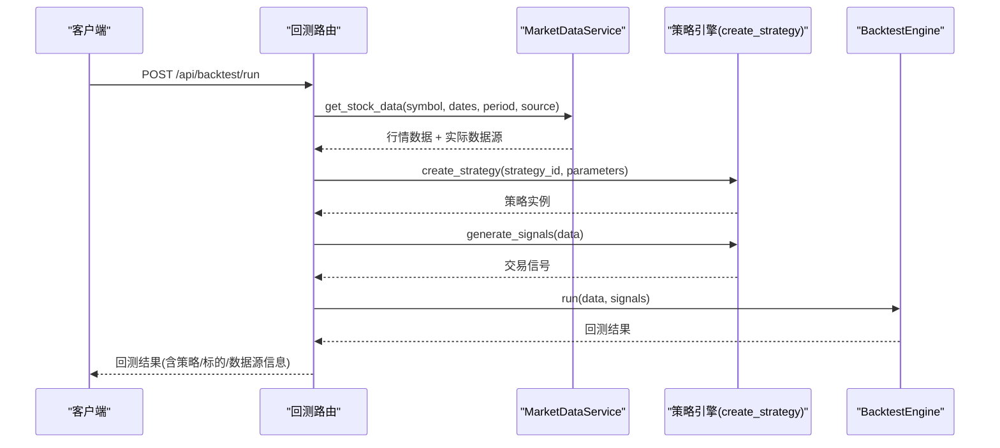
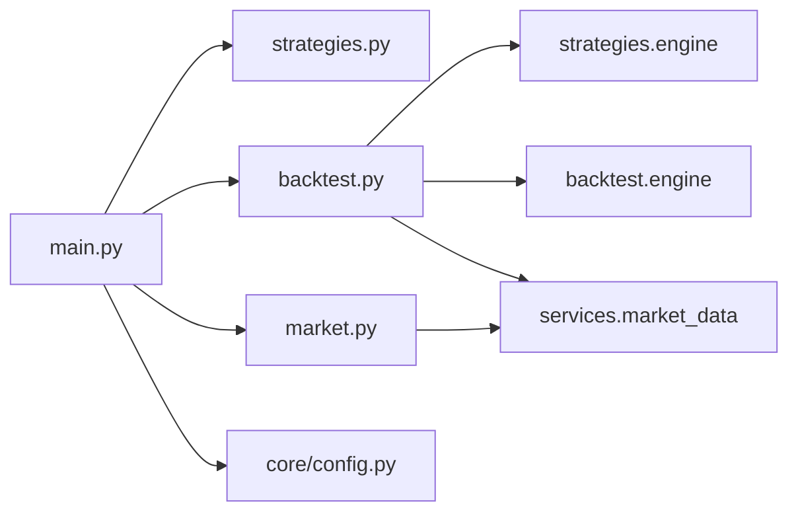

# FastAPI应用架构

<cite>
**本文引用的文件**   
- [backend/main.py](../../../../../backend/main.py)
- [backend/app/core/config.py](../../../../../backend/app/core/config.py)
- [backend/app/api/strategies.py](../../../../../backend/app/api/strategies.py)
- [backend/app/api/backtest.py](../../../../../backend/app/api/backtest.py)
- [backend/app/api/market.py](../../../../../backend/app/api/market.py)
</cite>

## 目录
1. [简介](#简介)
2. [项目结构](#项目结构)
3. [核心组件](#核心组件)
4. [架构总览](#架构总览)
5. [详细组件分析](#详细组件分析)
6. [依赖关系分析](#依赖关系分析)
7. [性能与可扩展性](#性能与可扩展性)
8. [故障排查指南](#故障排查指南)
9. [结论](#结论)

## 简介
本文件面向开发者，系统化梳理该FastAPI后端应用的启动流程、基础配置、跨域中间件、路由注册机制与健康检查接口实现。文档以代码级为依据，提供架构图、流程图与关键路径说明，帮助快速理解并扩展系统。

## 项目结构
后端采用模块化组织：
- 应用入口与全局配置位于 backend/main.py 与 backend/app/core/config.py
- API路由按功能拆分到 backend/app/api 下的 strategies.py、backtest.py、market.py
- 业务逻辑与服务层位于 app/services、app.backtest、app.strategies 等模块（本文件聚焦FastAPI应用层）

图表来源
- [backend/main.py:9-27](../../../../../backend/main.py#L9-L27)
- [backend/app/core/config.py:8-24](../../../../../backend/app/core/config.py#L8-L24)

章节来源
- [backend/main.py:1-36](../../../../../backend/main.py#L1-L36)
- [backend/app/core/config.py:1-25](../../../../../backend/app/core/config.py#L1-L25)

## 核心组件
- FastAPI实例创建与元信息设置：标题、描述、版本
- CORS跨域中间件：允许的来源、方法、头部与凭据
- 路由注册：策略、回测、市场数据三大模块挂载前缀与标签
- 健康检查接口：根路径与 /api/health

章节来源
- [backend/main.py:9-35](../../../../../backend/main.py#L9-L35)

## 架构总览
下图展示FastAPI应用启动时的关键交互：实例化、中间件加载、路由挂载与健康检查。

图表来源
- [backend/main.py:9-35](../../../../../backend/main.py#L9-L35)

## 详细组件分析

### 应用初始化与配置
- FastAPI实例
  - 标题：量化策略查看系统
  - 描述：本地股票量化策略查看与回测系统
  - 版本：1.0.0
- 配置中心
  - Settings类封装APP_NAME、APP_VERSION、DEBUG、DATABASE_URL、DEFAULT_MARKET等
  - 支持从.env环境变量文件读取配置
- 建议
  - 将title/description/version统一从Settings注入，避免硬编码
  - DEBUG开关可用于控制日志级别与调试行为

章节来源
- [backend/main.py:9-13](../../../../../backend/main.py#L9-L13)
- [backend/app/core/config.py:8-24](../../../../../backend/app/core/config.py#L8-L24)

### CORS跨域中间件
- allow_origins: ["*"]
- allow_credentials: True
- allow_methods: ["*"]
- allow_headers: ["*"]
- 影响范围：所有请求均通过CORS校验后进入路由处理

注意
- 生产环境建议收紧allow_origins为具体前端域名，避免安全风险

章节来源
- [backend/main.py:15-22](../../../../../backend/main.py#L15-L22)

### 路由注册机制
- 策略模块
  - 前缀：/api/strategies
  - 标签：策略
  - 主要端点：GET / 列出策略；GET /{strategy_id} 获取详情
- 回测模块
  - 前缀：/api/backtest
  - 标签：回测
  - 主要端点：POST /run 运行回测；GET /history 历史查询（待实现）
- 市场数据模块
  - 前缀：/api/market
  - 标签：市场数据
  - 主要端点：GET /stock/{symbol} 获取行情；GET /stock/{symbol}/info 基本信息；GET /search 搜索股票代码

图表来源
- [backend/main.py:24-27](../../../../../backend/main.py#L24-L27)
- [backend/app/api/strategies.py:8-24](../../../../../backend/app/api/strategies.py#L8-L24)
- [backend/app/api/backtest.py:13-76](../../../../../backend/app/api/backtest.py#L13-L76)
- [backend/app/api/market.py:8-46](../../../../../backend/app/api/market.py#L8-L46)

章节来源
- [backend/main.py:24-27](../../../../../backend/main.py#L24-L27)
- [backend/app/api/strategies.py:1-25](../../../../../backend/app/api/strategies.py#L1-L25)
- [backend/app/api/backtest.py:1-77](../../../../../backend/app/api/backtest.py#L1-L77)
- [backend/app/api/market.py:1-47](../../../../../backend/app/api/market.py#L1-L47)

### 健康检查接口
- GET /：返回应用欢迎消息
- GET /api/health：返回{"status": "healthy"}，用于负载均衡与健康探针

图表来源
- [backend/main.py:29-35](../../../../../backend/main.py#L29-L35)

章节来源
- [backend/main.py:29-35](../../../../../backend/main.py#L29-L35)

### 回测接口调用链（示例）
以下序列图展示POST /api/backtest/run的调用链路，体现数据获取、策略生成信号、回测引擎执行与结果组装。

图表来源
- [backend/app/api/backtest.py:28-69](../../../../../backend/app/api/backtest.py#L28-L69)

章节来源
- [backend/app/api/backtest.py:16-69](../../../../../backend/app/api/backtest.py#L16-L69)

## 依赖关系分析
- 应用入口依赖
  - FastAPI实例与CORS中间件
  - 三个APIRouter模块（策略、回测、市场数据）
  - 配置模块Settings
- 路由模块依赖
  - strategies.py 依赖 app.strategies.engine
  - backtest.py 依赖 app.strategies.engine、app.backtest.engine、app.services.market_data
  - market.py 依赖 app.services.market_data

图表来源
- [backend/main.py:4-7](../../../../../backend/main.py#L4-L7)
- [backend/app/api/backtest.py:9-11](../../../../../backend/app/api/backtest.py#L9-L11)
- [backend/app/api/market.py:6](../../../../../backend/app/api/market.py#L6)

章节来源
- [backend/main.py:4-7](../../../../../backend/main.py#L4-L7)
- [backend/app/api/backtest.py:9-11](../../../../../backend/app/api/backtest.py#L9-L11)
- [backend/app/api/market.py:6](../../../../../backend/app/api/market.py#L6)

## 性能与可扩展性
- CORS中间件
  - 当前允许所有来源与方法，便于开发联调；生产环境应限制来源白名单以减少攻击面
- 路由组织
  - 按功能拆分路由，利于并行开发与测试；可继续按领域进一步拆分
- 健康检查
  - 建议在健康检查中增加数据库连接、外部服务连通性等自检项，提升可用性感知

[本节为通用指导，不直接分析具体文件]

## 故障排查指南
- 跨域问题
  - 现象：浏览器控制台报CORS错误
  - 排查：确认前端域名是否在allow_origins中；若使用凭据，需确保allow_credentials=True且allow_origins不为通配符
- 路由未命中
  - 现象：404
  - 排查：确认include_router的前缀与tags是否正确；检查模块是否被正确导入
- 健康检查异常
  - 现象：/api/health返回非预期
  - 排查：检查根路径与健康检查处理器是否被覆盖或重定向

章节来源
- [backend/main.py:15-35](../../../../../backend/main.py#L15-L35)

## 结论
本FastAPI应用以清晰的入口与模块化路由组织为基础，配合CORS中间件与基础健康检查，满足前后端分离场景的快速接入与联调需求。建议在生产环境中收紧CORS策略、完善健康检查指标，并将应用元信息与配置统一到Settings中以增强可维护性。