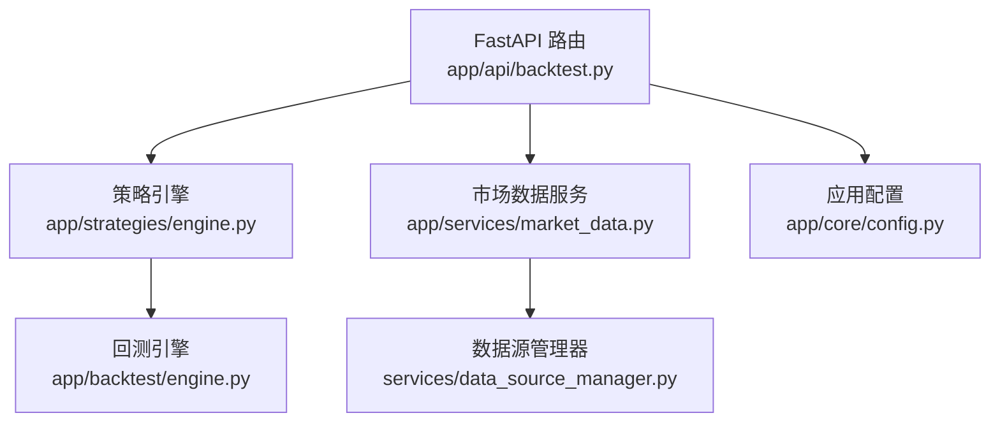
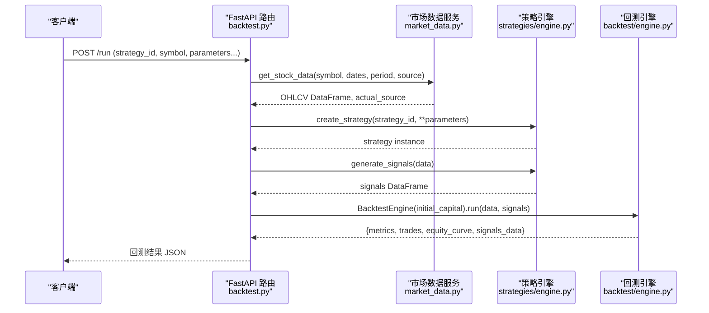
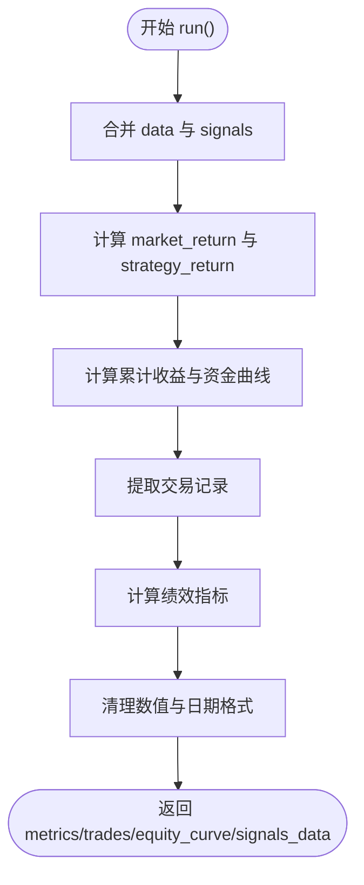
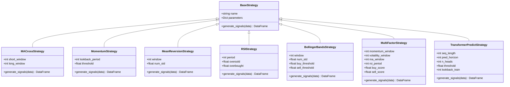
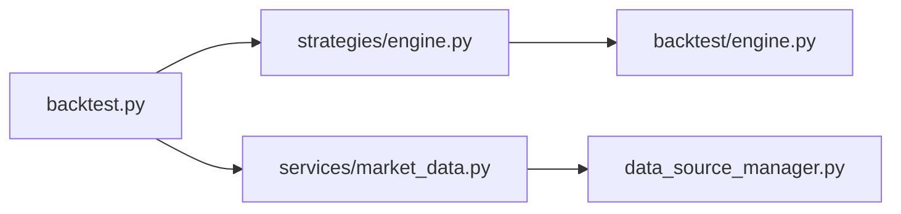

# 回测引擎核心

<cite>
**本文引用的文件**   
- [backend/app/backtest/engine.py](../../../../../backend/app/backtest/engine.py)
- [backend/app/strategies/engine.py](../../../../../backend/app/strategies/engine.py)
- [backend/app/api/backtest.py](../../../../../backend/app/api/backtest.py)
- [backend/app/services/market_data.py](../../../../../backend/app/services/market_data.py)
- [backend/app/core/config.py](../../../../../backend/app/core/config.py)
- [backend/tests/test_backtest_engine.py](../../../../../backend/tests/test_backtest_engine.py)
- [backend/tests/conftest.py](../../../../../backend/tests/conftest.py)
</cite>

## 目录
1. [简介](#简介)
2. [项目结构](#项目结构)
3. [核心组件](#核心组件)
4. [架构总览](#架构总览)
5. [详细组件分析](#详细组件分析)
6. [依赖关系分析](#依赖关系分析)
7. [性能与优化建议](#性能与优化建议)
8. [故障排查指南](#故障排查指南)
9. [结论](#结论)
10. [附录：指标公式与实现要点](#附录指标公式与实现要点)

## 简介
本文件面向量化回测系统的核心实现，重点讲解以下方面：
- 回测执行流程：历史数据加载、信号生成、交易模拟、资金曲线计算。
- 仓位管理逻辑：买入卖出信号处理、持仓数量计算（当前为全仓或空仓的二值化模型）、资金管理策略（初始资金驱动）。
- 手续费与滑点：当前未显式建模，说明扩展方案。
- 绩效指标：总收益率、年化收益率、夏普比率、最大回撤、胜率、盈亏比等数学定义与代码实现路径。
- 配置项与性能优化：API 参数、策略参数、数据源选择与回测性能调优建议。

## 项目结构
本项目采用前后端分离架构，后端基于 FastAPI 提供回测接口，核心回测逻辑位于 backtest 模块，策略实现位于 strategies 模块，市场数据通过 services 层抽象多数据源。

图表来源
- [backend/app/api/backtest.py:28-66](../../../../../backend/app/api/backtest.py#L28-L66)
- [backend/app/strategies/engine.py:506-656](../../../../../backend/app/strategies/engine.py#L506-L656)
- [backend/app/backtest/engine.py:10-70](../../../../../backend/app/backtest/engine.py#L10-L70)
- [backend/app/services/market_data.py:11-41](../../../../../backend/app/services/market_data.py#L11-L41)
- [backend/app/core/config.py:8-24](../../../../../backend/app/core/config.py#L8-L24)

章节来源
- [backend/app/api/backtest.py:1-77](../../../../../backend/app/api/backtest.py#L1-L77)
- [backend/app/backtest/engine.py:1-163](../../../../../backend/app/backtest/engine.py#L1-L163)
- [backend/app/strategies/engine.py:1-656](../../../../../backend/app/strategies/engine.py#L1-L656)
- [backend/app/services/market_data.py:1-106](../../../../../backend/app/services/market_data.py#L1-L106)
- [backend/app/core/config.py:1-25](../../../../../backend/app/core/config.py#L1-L25)

## 核心组件
- 回测引擎 BacktestEngine：负责合并数据与信号、计算策略收益与资金曲线、提取交易记录、计算绩效指标。
- 策略引擎 BaseStrategy 及其子类：提供均线交叉、动量、均值回归、RSI、布林带、多因子、Transformer 预测等策略的信号生成。
- 市场数据服务 MarketDataService：统一获取股票数据，支持自动选择数据源。
- API 路由：封装回测请求，串联数据获取、策略创建、信号生成与回测执行。
- 配置 Settings：应用级配置项，如数据库 URL、默认市场等。

章节来源
- [backend/app/backtest/engine.py:10-163](../../../../../backend/app/backtest/engine.py#L10-L163)
- [backend/app/strategies/engine.py:17-656](../../../../../backend/app/strategies/engine.py#L17-L656)
- [backend/app/services/market_data.py:11-41](../../../../../backend/app/services/market_data.py#L11-L41)
- [backend/app/api/backtest.py:16-66](../../../../../backend/app/api/backtest.py#L16-L66)
- [backend/app/core/config.py:8-24](../../../../../backend/app/core/config.py#L8-L24)

## 架构总览
下图展示一次完整回测的请求到响应流程，包括数据加载、信号生成、回测执行与结果返回。

图表来源
- [backend/app/api/backtest.py:28-66](../../../../../backend/app/api/backtest.py#L28-L66)
- [backend/app/services/market_data.py:14-41](../../../../../backend/app/services/market_data.py#L14-L41)
- [backend/app/strategies/engine.py:600-656](../../../../../backend/app/strategies/engine.py#L600-L656)
- [backend/app/backtest/engine.py:15-70](../../../../../backend/app/backtest/engine.py#L15-L70)

## 详细组件分析

### 回测引擎 BacktestEngine
职责与流程：
- 输入：OHLCV 数据 DataFrame 与信号 DataFrame（包含 signal 与 position_change）。
- 合并数据与信号，计算日度市场收益与策略收益（使用上一期信号对当日收益进行加权）。
- 计算累计收益与资金曲线（以初始资金乘以累计策略收益）。
- 提取交易记录（根据 position_change 判断买卖），并计算每笔交易的盈亏与百分比。
- 计算绩效指标：总收益率、年化收益率、最大回撤、夏普比率、胜率、盈亏比等。
- 输出：metrics、trades、equity_curve、signals_data，并对日期与数值列做安全化处理（避免 NaN/Inf）。

关键实现要点：
- 策略收益计算：使用 shift(1) 避免未来函数泄露。
- 最大回撤：基于滚动最高值计算每日回撤，取最小值为最大回撤。
- 夏普比率：假设无风险利率 3%，按日频计算超额收益的标准差与均值，再年化。
- 胜率与盈亏比：基于交易记录的盈亏分布统计。

图表来源
- [backend/app/backtest/engine.py:15-70](../../../../../backend/app/backtest/engine.py#L15-L70)
- [backend/app/backtest/engine.py:72-103](../../../../../backend/app/backtest/engine.py#L72-L103)
- [backend/app/backtest/engine.py:105-163](../../../../../backend/app/backtest/engine.py#L105-L163)

章节来源
- [backend/app/backtest/engine.py:10-163](../../../../../backend/app/backtest/engine.py#L10-L163)

### 策略引擎与信号生成
策略基类与具体策略：
- BaseStrategy：定义 generate_signals 接口。
- MACrossStrategy：短期均线上穿长期均线买入，下穿卖出；仅当信号变化时产生交易。
- MomentumStrategy：过去 N 日收益率超过阈值买入，低于负阈值卖出。
- MeanReversionStrategy：价格低于下轨买入，高于上轨卖出。
- RSIStrategy：RSI 超卖买入，超买卖出。
- BollingerBandsStrategy：基于 %B 指标与带宽过滤的布林带策略。
- MultiFactorStrategy：多因子打分（动量、波动率、换手率、均线偏离、RSI）加权后阈值交易。
- TransformerPredictStrategy：简化版多头注意力机制预测未来走势，按阈值生成信号。

信号输出规范：
- 每个策略返回 DataFrame，包含 signal（1/-1/0）与 position（signal.diff()，用于触发交易）。
- 回测引擎依据 position_change（即 position）进行买卖判定。

图表来源
- [backend/app/strategies/engine.py:17-54](../../../../../backend/app/strategies/engine.py#L17-L54)
- [backend/app/strategies/engine.py:57-81](../../../../../backend/app/strategies/engine.py#L57-L81)
- [backend/app/strategies/engine.py:84-111](../../../../../backend/app/strategies/engine.py#L84-L111)
- [backend/app/strategies/engine.py:114-150](../../../../../backend/app/strategies/engine.py#L114-L150)
- [backend/app/strategies/engine.py:153-205](../../../../../backend/app/strategies/engine.py#L153-L205)
- [backend/app/strategies/engine.py:208-324](../../../../../backend/app/strategies/engine.py#L208-L324)
- [backend/app/strategies/engine.py:327-503](../../../../../backend/app/strategies/engine.py#L327-L503)

章节来源
- [backend/app/strategies/engine.py:17-656](../../../../../backend/app/strategies/engine.py#L17-L656)

### 市场数据服务
职责：
- 统一入口 MarketDataService.get_stock_data 委托给 DataSourceManager 获取数据，返回 DataFrame 与实际数据源标识。
- 提供股票基本信息与搜索功能（含模拟数据）。

注意：
- 当前代码中 get_stock_info 直接引用了 yf 但未导入，属于潜在缺陷；实际数据获取由 DataSourceManager 完成。

章节来源
- [backend/app/services/market_data.py:11-41](../../../../../backend/app/services/market_data.py#L11-L41)
- [backend/app/services/market_data.py:43-82](../../../../../backend/app/services/market_data.py#L43-L82)
- [backend/app/services/market_data.py:84-106](../../../../../backend/app/services/market_data.py#L84-L106)

### API 路由与回测请求
职责：
- 接收回测请求参数（strategy_id、symbol、时间范围、周期、初始资金、数据源、策略参数）。
- 调用 MarketDataService 获取数据，create_strategy 创建策略实例，生成信号，运行 BacktestEngine。
- 附加策略信息与数据源信息，返回结构化结果。

章节来源
- [backend/app/api/backtest.py:16-66](../../../../../backend/app/api/backtest.py#L16-L66)

### 配置项
Settings 提供应用级配置，包括应用名、版本、调试开关、数据库 URL、默认市场等。可通过环境变量或 .env 文件注入。

章节来源
- [backend/app/core/config.py:8-24](../../../../../backend/app/core/config.py#L8-L24)

## 依赖关系分析
- API 层依赖策略引擎与市场数据服务。
- 策略引擎不依赖回测引擎，保持信号生成的独立性。
- 回测引擎依赖 pandas/numpy 进行向量化计算。
- 市场数据服务依赖数据源管理器（DataSourceManager），对外暴露统一接口。

图表来源
- [backend/app/api/backtest.py:9-11](../../../../../backend/app/api/backtest.py#L9-L11)
- [backend/app/strategies/engine.py:600-656](../../../../../backend/app/strategies/engine.py#L600-L656)
- [backend/app/backtest/engine.py:4-7](../../../../../backend/app/backtest/engine.py#L4-L7)
- [backend/app/services/market_data.py:8-8](../../../../../backend/app/services/market_data.py#L8-L8)

章节来源
- [backend/app/api/backtest.py:1-77](../../../../../backend/app/api/backtest.py#L1-L77)
- [backend/app/backtest/engine.py:1-163](../../../../../backend/app/backtest/engine.py#L1-L163)
- [backend/app/strategies/engine.py:1-656](../../../../../backend/app/strategies/engine.py#L1-L656)
- [backend/app/services/market_data.py:1-106](../../../../../backend/app/services/market_data.py#L1-L106)

## 性能与优化建议
- 向量化优先：尽量使用 pandas/numpy 向量化操作，避免逐行循环；当前回测引擎在收益与资金曲线计算已向量化，但交易提取仍使用 iterrows，可考虑用 diff 与布尔索引优化。
- 减少中间副本：多次 df.copy() 会增加内存占用，可在必要时复用 DataFrame。
- 预计算技术指标：对于复杂策略（如多因子、Transformer），提前缓存常用指标以减少重复计算。
- 并行回测：对不同策略或不同标的进行并行回测（例如使用 joblib 或 multiprocessing）。
- 数据源优化：批量拉取数据并按需切片，避免频繁网络请求。
- 序列化安全：确保返回结果不含 NaN/Inf，已在回测引擎中进行清理。

[本节为通用性能指导，不直接分析具体文件]

## 故障排查指南
常见问题与定位：
- 数据缺失或字段不全：检查 OHLCV 是否包含 Date/Open/High/Low/Close/Volume；若缺少 Volume，部分策略会填充默认值。
- 信号异常或无交易：确认策略参数合理（如窗口长度、阈值），检查 position_change 是否非零。
- 绩效指标异常：检查是否存在除零或无穷大情况；回测引擎已对夏普比率等做安全处理。
- JSON 序列化失败：确保日期为字符串、数值列无 NaN/Inf；测试用例覆盖了该场景。

参考测试用例：
- 验证返回结构、指标字段完整性、最大回撤非正、胜率范围、交易计数一致性、JSON 安全等。

章节来源
- [backend/tests/test_backtest_engine.py:15-179](../../../../../backend/tests/test_backtest_engine.py#L15-L179)
- [backend/tests/conftest.py:9-47](../../../../../backend/tests/conftest.py#L9-L47)

## 结论
本回测引擎实现了从数据加载、信号生成到交易模拟与绩效评估的完整闭环。其设计清晰、可扩展性强，支持多种经典与深度学习策略。当前版本未显式建模手续费与滑点，但提供了明确的扩展点。建议在后续迭代中引入交易成本与流动性冲击模型，进一步提升回测的真实性与稳健性。

[本节为总结性内容，不直接分析具体文件]

## 附录：指标公式与实现要点

- 总收益率
  - 公式：(最终资金 / 初始资金 - 1) × 100%
  - 实现位置：回测引擎计算 final_value 与 initial_capital 的比值。

- 年化收益率
  - 公式：(最终资金 / 初始资金)^(1/年数) - 1，其中年数 = 交易日天数 / 365
  - 实现位置：根据首尾日期差计算 years，再进行幂运算。

- 最大回撤
  - 公式：min((资金曲线 - 滚动最高值) / 滚动最高值) × 100%
  - 实现位置：使用 cummax 计算滚动最高值，再计算每日回撤并取最小值。

- 夏普比率
  - 公式：sqrt(252) × mean(日超额收益) / std(日超额收益)，无风险利率假设为 3%
  - 实现位置：计算 daily_return 减去日无风险利率，再求均值与标准差。

- 胜率
  - 公式：盈利交易数 / 总交易数 × 100%
  - 实现位置：遍历交易记录统计 pnl > 0 的数量。

- 盈亏比
  - 公式：平均盈利百分比 / 平均亏损百分比（绝对值）
  - 实现位置：分别计算盈利与亏损交易的平均 pnl_pct，再相除。

- 交易记录
  - 字段：entry_date、exit_date、entry_price、exit_price、pnl、pnl_pct、direction
  - 实现位置：根据 position_change 判定买卖，记录入场出场价与盈亏。

- 手续费与滑点
  - 现状：当前未显式建模交易成本与市场冲击。
  - 扩展建议：在 _extract_trades 中增加固定比例手续费与按成交量/波动率的滑点模型，并在 _calculate_metrics 中重新计算净收益与指标。

章节来源
- [backend/app/backtest/engine.py:105-163](../../../../../backend/app/backtest/engine.py#L105-L163)
- [backend/app/backtest/engine.py:72-103](../../../../../backend/app/backtest/engine.py#L72-L103)