# 数据服务层

<cite>
**本文引用的文件**   
- [backend/app/services/market_data.py](file://backend/app/services/market_data.py)
- [backend/app/services/data_source_manager.py](file://backend/app/services/data_source_manager.py)
- [DATA_SOURCES.md](file://DATA_SOURCES.md)
- [QUICKSTART.md](file://QUICKSTART.md)
</cite>

## 目录
1. [简介](#简介)
2. [项目结构](#项目结构)
3. [核心组件](#核心组件)
4. [架构总览](#架构总览)
5. [详细组件分析](#详细组件分析)
6. [依赖关系分析](#依赖关系分析)
7. [性能与稳定性](#性能与稳定性)
8. [故障排除指南](#故障排除指南)
9. [结论](#结论)
10. [附录：扩展新数据源适配器](#附录扩展新数据源适配器)

## 简介
本章节面向“数据服务层”，聚焦 MarketDataService 与 DataSourceManager 的设计与实现，覆盖以下目标：
- 数据获取抽象：统一接口、自动选择与降级策略
- 缓存机制：当前实现的缓存现状与扩展建议
- 错误重试策略：当前实现的重试现状与改进方向
- 多数据源管理器：数据源抽象、智能降级、负载均衡思路
- 五种数据源集成：腾讯财经、YFinance、AKShare、BaoStock、模拟数据
- 数据格式标准化：OHLCV 转换、时间序列对齐、缺失值处理
- 配置方法与扩展指南：如何添加新的数据源适配器
- 代码示例路径与常见问题排查

## 项目结构
数据服务层位于后端服务的 services 模块中，主要包含两个核心文件：
- market_data.py：对外暴露市场数据服务（MarketDataService），作为上层 API/回测引擎的入口
- data_source_manager.py：多数据源管理器（DataSourceManager），封装具体数据源的获取逻辑与自动切换

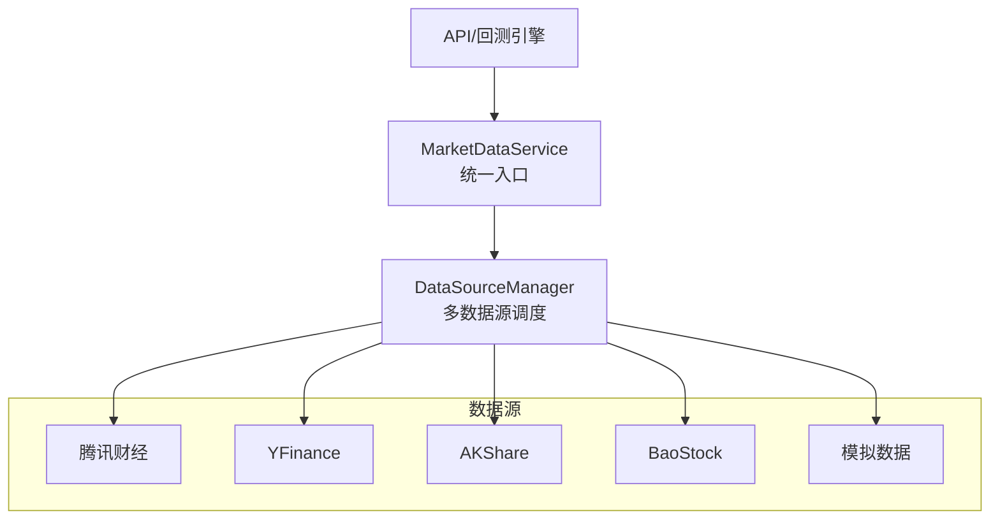

图表来源
- [backend/app/services/market_data.py:11-41](file://backend/app/services/market_data.py#L11-L41)
- [backend/app/services/data_source_manager.py:14-54](file://backend/app/services/data_source_manager.py#L14-L54)

章节来源
- [backend/app/services/market_data.py:1-106](file://backend/app/services/market_data.py#L1-L106)
- [backend/app/services/data_source_manager.py:1-469](file://backend/app/services/data_source_manager.py#L1-L469)

## 核心组件
- MarketDataService：对外提供 get_stock_data、get_stock_info、search_symbol 等静态方法。其 get_stock_data 直接委托给 DataSourceManager.get_stock_data，起到门面作用，屏蔽底层数据源差异。
- DataSourceManager：集中管理所有数据源的获取逻辑，支持 auto 自动选择与指定 source 两种模式；内置自动降级到模拟数据的兜底策略。

关键职责划分
- MarketDataService：面向业务层的统一入口，简化调用方使用
- DataSourceManager：负责数据源路由、参数归一化、数据格式标准化、异常捕获与降级

章节来源
- [backend/app/services/market_data.py:11-41](file://backend/app/services/market_data.py#L11-L41)
- [backend/app/services/data_source_manager.py:14-54](file://backend/app/services/data_source_manager.py#L14-L54)

## 架构总览
下图展示从调用方到数据源的完整流程，包括自动选择、失败降级与最终返回的数据形态。

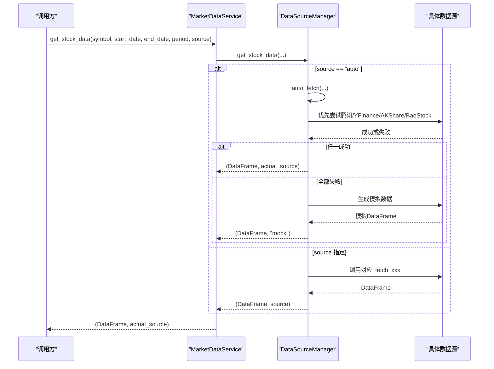

图表来源
- [backend/app/services/market_data.py:14-41](file://backend/app/services/market_data.py#L14-L41)
- [backend/app/services/data_source_manager.py:17-109](file://backend/app/services/data_source_manager.py#L17-L109)

## 详细组件分析

### MarketDataService 设计要点
- 统一入口：通过静态方法 get_stock_data 将请求转发至 DataSourceManager，保持调用简洁
- 股票信息：get_stock_info 尝试使用 yfinance 获取真实信息，失败则返回模拟信息
- 搜索功能：search_symbol 提供简化的股票代码搜索映射

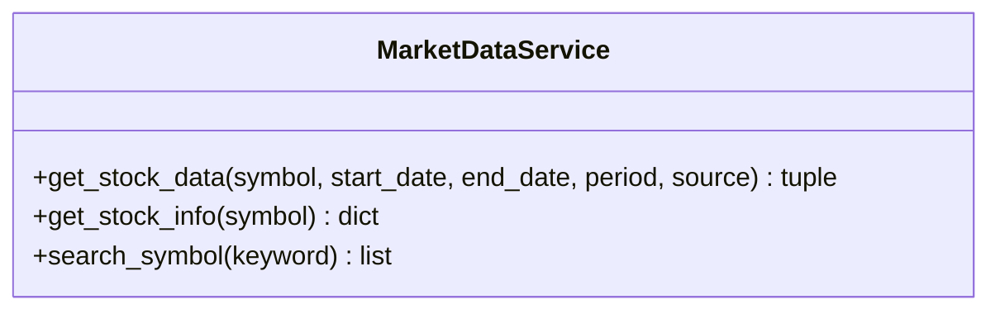

图表来源
- [backend/app/services/market_data.py:11-106](file://backend/app/services/market_data.py#L11-L106)

章节来源
- [backend/app/services/market_data.py:11-106](file://backend/app/services/market_data.py#L11-L106)

### DataSourceManager 设计与实现
- 数据源抽象：以静态方法形式封装各数据源获取逻辑，统一返回 OHLCV 标准列名 Date/Open/High/Low/Close/Volume
- 自动选择：_auto_fetch 根据股票代码后缀判断市场（A股/港股/美股），按优先级依次尝试数据源
- 智能降级：任一数据源失败时继续尝试下一个，最终兜底为模拟数据
- 负载均衡：当前未实现显式权重或轮询，采用固定优先级顺序；可扩展为基于成功率/延迟的动态选择

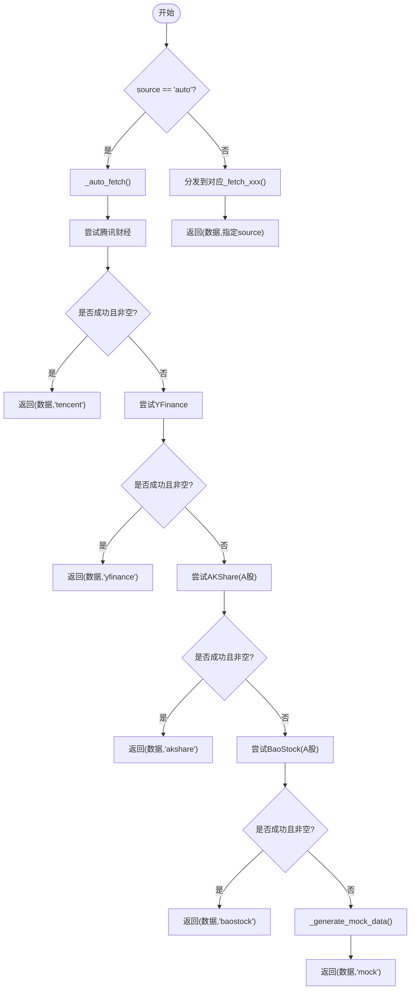

图表来源
- [backend/app/services/data_source_manager.py:17-109](file://backend/app/services/data_source_manager.py#L17-L109)

章节来源
- [backend/app/services/data_source_manager.py:14-109](file://backend/app/services/data_source_manager.py#L14-L109)

### 数据源实现细节

#### 腾讯财经（tencent）
- 接口：HTTP GET 到 web.ifzq.gtimg.cn，需构造 param 参数并设置 User-Agent/Referer
- 符号转换：_convert_to_tencent_symbol 将 .SS/.SZ/.BJ/.HK 转换为 sh/sz/bj/hk 前缀
- 日期范围：若未提供 start/end，则依据 period 计算天数窗口
- 数据解析：提取 qfqday/day/qfqweek/qfqmonth 中的 K 线数组，转为 DataFrame 并过滤日期范围
- 错误处理：响应码非 0 抛出异常；无数据返回空 DataFrame

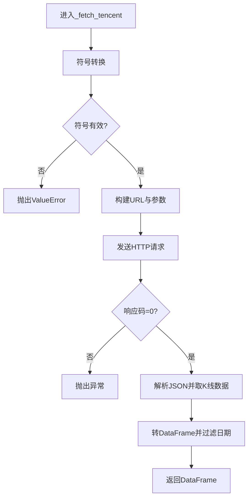

图表来源
- [backend/app/services/data_source_manager.py:112-208](file://backend/app/services/data_source_manager.py#L112-L208)
- [backend/app/services/data_source_manager.py:211-248](file://backend/app/services/data_source_manager.py#L211-L248)

章节来源
- [backend/app/services/data_source_manager.py:112-248](file://backend/app/services/data_source_manager.py#L112-L248)

#### YFinance（yfinance）
- 动态导入 yfinance，创建 Ticker 对象
- 支持 start/end 或 period 两种查询方式
- 输出标准化为 Date/Open/High/Low/Close/Volume 列

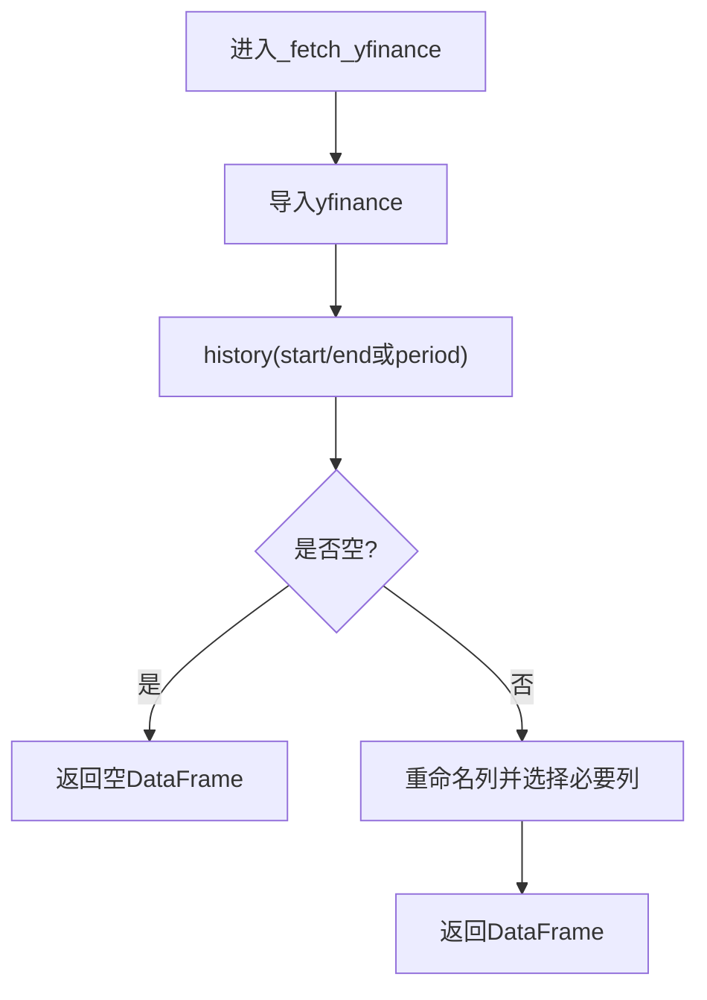

图表来源
- [backend/app/services/data_source_manager.py:251-274](file://backend/app/services/data_source_manager.py#L251-L274)

章节来源
- [backend/app/services/data_source_manager.py:251-274](file://backend/app/services/data_source_manager.py#L251-L274)

#### AKShare（akshare）
- 仅适用于 A 股
- 将 symbol 去除后缀（如 .SS/.SZ）后调用 stock_zh_a_hist
- 日期格式要求 YYYYMMDD
- 列映射：日期/开盘/最高/最低/收盘/成交量 -> Date/Open/High/Low/Close/Volume
- 异常捕获：打印错误并返回空 DataFrame

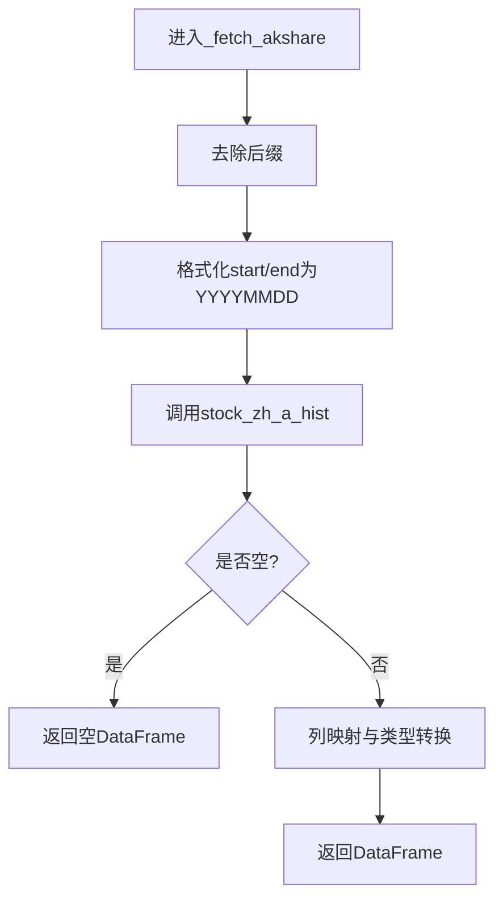

图表来源
- [backend/app/services/data_source_manager.py:277-335](file://backend/app/services/data_source_manager.py#L277-L335)

章节来源
- [backend/app/services/data_source_manager.py:277-335](file://backend/app/services/data_source_manager.py#L277-L335)

#### BaoStock（baostock）
- 登录/登出：bs.login()/bs.logout()
- 符号转换：sh.600519 / sz.000858
- 查询历史K线：query_history_k_data_plus，字段 date/open/high/low/close/volume
- 类型转换与列映射，最后返回标准化 DataFrame

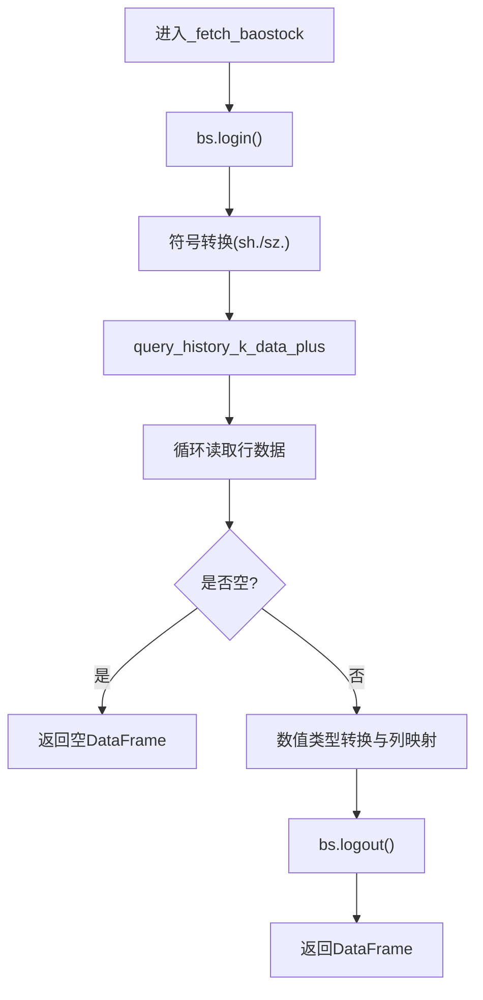

图表来源
- [backend/app/services/data_source_manager.py:338-416](file://backend/app/services/data_source_manager.py#L338-L416)

章节来源
- [backend/app/services/data_source_manager.py:338-416](file://backend/app/services/data_source_manager.py#L338-L416)

#### 模拟数据（mock）
- 根据 period 计算日期范围
- 基于随机收益模型生成价格序列，再推导 Open/High/Low/Volume
- 保证可复现：使用 np.random.seed(hash(symbol))

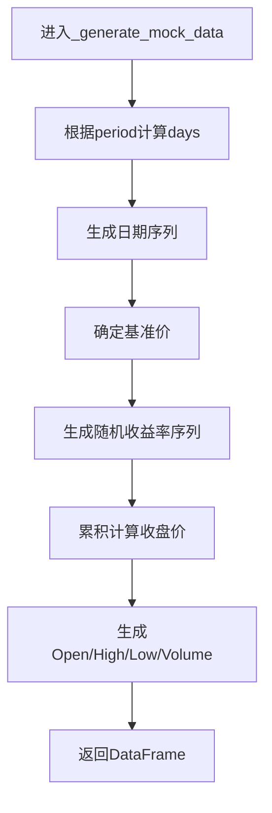

图表来源
- [backend/app/services/data_source_manager.py:419-468](file://backend/app/services/data_source_manager.py#L419-L468)

章节来源
- [backend/app/services/data_source_manager.py:419-468](file://backend/app/services/data_source_manager.py#L419-L468)

### 数据格式标准化
- 统一列名：Date/Open/High/Low/Close/Volume
- 日期类型：统一为 datetime（pandas Timestamp）
- 缺失值处理：
  - 当前实现在各数据源内部对空结果返回空 DataFrame，未进行填充或插值
  - 建议在统一出口增加缺失值检测与处理策略（如前向填充、线性插值、剔除缺失段）

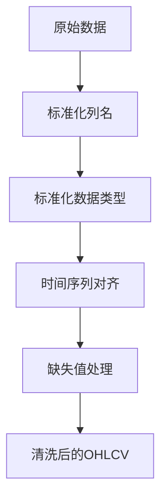

[此图为概念性流程图，不直接映射具体源码]

### 错误处理与重试策略
- 当前实现：
  - 在自动选择流程中对每个数据源 try/except 捕获异常，失败则继续尝试下一个
  - 腾讯财经对 HTTP 状态码与 JSON code 进行检查并抛异常
  - AKShare/BaoStock 等内部异常被捕获后返回空 DataFrame 或抛出异常
- 缺失点：
  - 未实现指数退避重试、熔断器、超时控制
  - 未记录失败原因与统计指标（成功率、延迟）
- 建议增强：
  - 引入重试装饰器（如 tenacity）
  - 增加超时与连接池配置
  - 记录日志与监控指标，便于定位问题

章节来源
- [backend/app/services/data_source_manager.py:56-109](file://backend/app/services/data_source_manager.py#L56-L109)
- [backend/app/services/data_source_manager.py:112-164](file://backend/app/services/data_source_manager.py#L112-L164)

### 缓存机制
- 当前实现：未发现显式缓存（内存/Redis/本地文件）
- 影响：重复请求相同 symbol/date range 会多次访问外部数据源
- 建议方案：
  - 内存缓存：LRU 字典，键为 (symbol, start_date, end_date, period)，值为 (DataFrame, timestamp)
  - 分布式缓存：Redis，支持过期时间与失效策略
  - 增量更新：按日粒度增量拉取，减少全量请求

[本节为通用建议，不直接分析具体源码]

## 依赖关系分析
- MarketDataService 依赖 DataSourceManager
- DataSourceManager 依赖：
  - requests（腾讯财经）
  - yfinance（YFinance）
  - akshare（AKShare）
  - baostock（BaoStock）
  - pandas/numpy（数据处理）

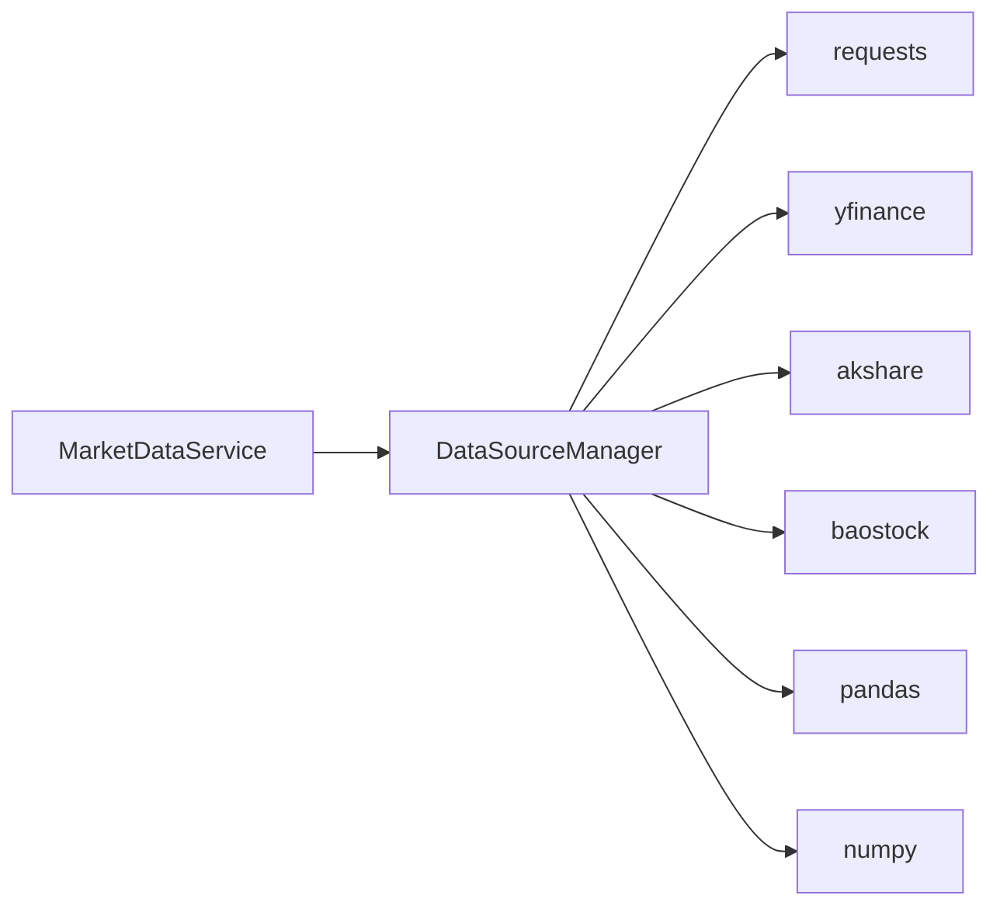

图表来源
- [backend/app/services/market_data.py:1-8](file://backend/app/services/market_data.py#L1-L8)
- [backend/app/services/data_source_manager.py:1-11](file://backend/app/services/data_source_manager.py#L1-L11)

章节来源
- [backend/app/services/market_data.py:1-106](file://backend/app/services/market_data.py#L1-L106)
- [backend/app/services/data_source_manager.py:1-469](file://backend/app/services/data_source_manager.py#L1-L469)

## 性能与稳定性
- 性能特征：
  - 腾讯财经：HTTP 请求，受网络与接口限频影响
  - YFinance：较慢，适合美股/港股
  - AKShare：较快，适合 A 股
  - BaoStock：中等速度，稳定但需登录/登出
  - 模拟数据：极快，无需网络
- 稳定性：
  - 自动降级确保系统可用
  - 建议增加重试、超时、熔断与监控以提升鲁棒性

[本节为通用讨论，不直接分析具体源码]

## 故障排除指南
- 常见症状与定位
  - 腾讯财经返回错误：检查 URL 参数、User-Agent/Referer、网络连通性与接口可用性
  - AKShare/BaoStock 返回空数据：确认 symbol 格式、日期范围、库版本与网络
  - YFinance 慢或失败：检查网络、代理、账户限制
  - 始终返回模拟数据：说明所有真实数据源均失败，查看日志中的失败提示
- 快速自检步骤
  - 手动测试各数据源函数（_fetch_tencent/_fetch_yfinance/_fetch_akshare/_fetch_baostock）
  - 校验 symbol 后缀（.SS/.SZ/.BJ/.HK）与数据源支持范围
  - 检查依赖安装（akshare、baostock）
- 参考文档
  - DATA_SOURCES.md 提供了安装与使用说明
  - QUICKSTART.md 提供了可选依赖安装命令

章节来源
- [DATA_SOURCES.md:1-125](file://DATA_SOURCES.md#L1-L125)
- [QUICKSTART.md:221-235](file://QUICKSTART.md#L221-L235)

## 结论
数据服务层通过 MarketDataService 提供统一入口，由 DataSourceManager 实现多数据源调度与自动降级，确保在不同环境与依赖条件下均可用。当前实现已具备基础的数据格式标准化与失败降级能力，但在缓存、重试、负载均衡与监控方面仍有提升空间。建议逐步引入缓存与重试机制，完善错误日志与指标采集，进一步提升系统的稳定性与可观测性。

## 附录：扩展新数据源适配器
- 适配步骤
  1. 在 DataSourceManager 中添加新的 _fetch_xxx 静态方法，返回标准化的 OHLCV DataFrame
  2. 在 get_stock_data 的分支中注册新 source 名称
  3. （可选）在 _auto_fetch 中调整优先级或条件判断，使新数据源参与自动选择
  4. 在 front-end 显示映射中补充新数据源名称（如需前端展示）
- 注意事项
  - 确保返回列名为 Date/Open/High/Low/Close/Volume，类型为 datetime/float/int
  - 处理空数据与异常，避免中断整体流程
  - 考虑依赖安装与导入时机（按需 import，避免启动开销）
- 参考路径
  - 新增数据源方法位置：[data_source_manager.py:251-468](file://backend/app/services/data_source_manager.py#L251-L468)
  - 自动选择逻辑位置：[data_source_manager.py:56-109](file://backend/app/services/data_source_manager.py#L56-L109)
  - 前端数据源名称映射：[BacktestResult.tsx:12-20](file://frontend/src/components/BacktestResult.tsx#L12-L20)

章节来源
- [backend/app/services/data_source_manager.py:56-109](file://backend/app/services/data_source_manager.py#L56-L109)
- [backend/app/services/data_source_manager.py:251-468](file://backend/app/services/data_source_manager.py#L251-L468)