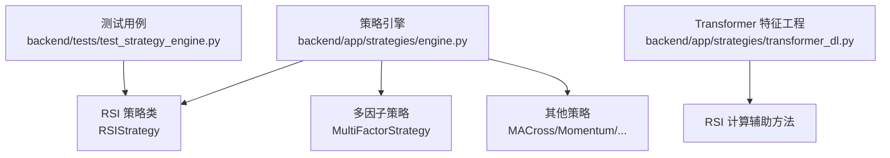
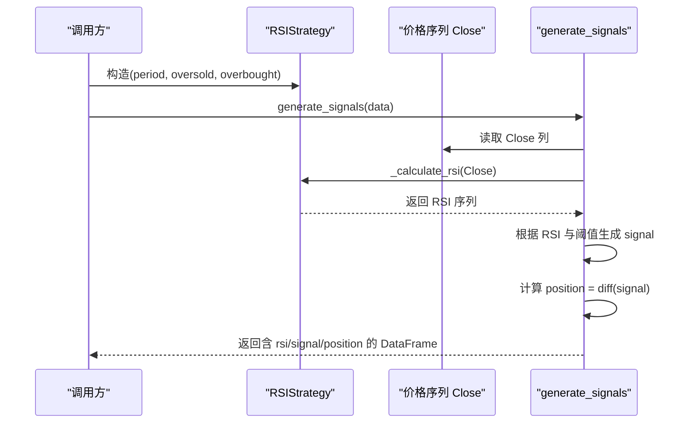
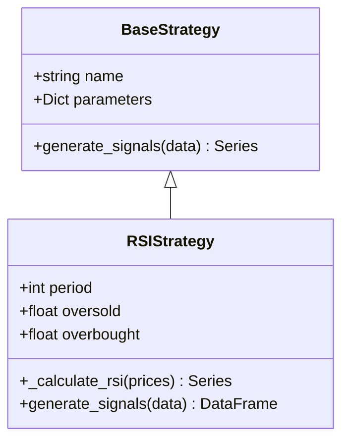
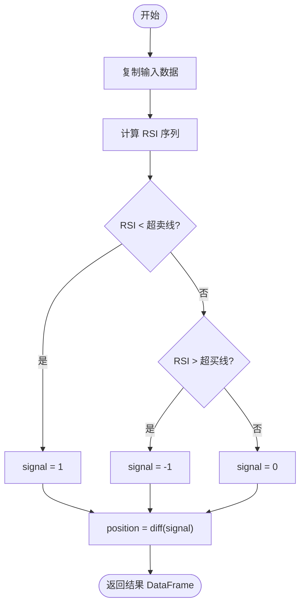
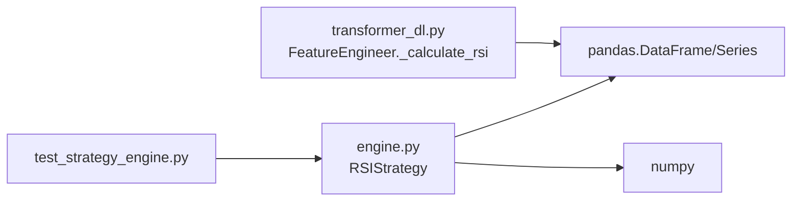

# RSI策略

<cite>
**本文引用的文件**   
- [backend/app/strategies/engine.py](../../../../../../../backend/app/strategies/engine.py)
- [backend/tests/test_strategy_engine.py](../../../../../../../backend/tests/test_strategy_engine.py)
- [backend/app/strategies/transformer_dl.py](../../../../../../../backend/app/strategies/transformer_dl.py)
</cite>

## 目录
1. [简介](#简介)
2. [项目结构](#项目结构)
3. [核心组件](#核心组件)
4. [架构总览](#架构总览)
5. [详细组件分析](#详细组件分析)
6. [依赖关系分析](#依赖关系分析)
7. [性能与实现特性](#性能与实现特性)
8. [回测与参数优化建议](#回测与参数优化建议)
9. [故障排查指南](#故障排查指南)
10. [结论](#结论)

## 简介
本文件围绕相对强弱指标（RSI）策略展开，结合仓库中已实现的 RSIStrategy 类，系统讲解：
- RSI 的理论基础、计算公式与加权平均过程
- period 参数的含义与 oversold/overbought 阈值设置原则
- 超买超卖信号的识别逻辑
- RSIStrategy 类的完整实现要点，包括 _calculate_rsi 的数学推导与 generate_signals 的信号生成流程
- RSI 背离分析的进阶用法思路
- 与其他指标结合的增强方案
- 不同时间周期下的参数最佳实践与回测优化建议

## 项目结构
本项目的策略实现位于后端模块 backend/app/strategies/engine.py，其中包含多个交易策略类，RSI 策略为其中之一。测试用例位于 backend/tests/test_strategy_engine.py，用于验证信号列结构与 RSI 取值范围等契约。深度学习特征工程在 backend/app/strategies/transformer_dl.py 中也实现了 RSI 计算，便于对比理解。

图表来源
- [backend/app/strategies/engine.py:114-150](../../../../../../../backend/app/strategies/engine.py#L114-L150)
- [backend/tests/test_strategy_engine.py:110-120](../../../../../../../backend/tests/test_strategy_engine.py#L110-L120)
- [backend/app/strategies/transformer_dl.py:98-105](../../../../../../../backend/app/strategies/transformer_dl.py#L98-L105)

章节来源
- [backend/app/strategies/engine.py:114-150](../../../../../../../backend/app/strategies/engine.py#L114-L150)
- [backend/tests/test_strategy_engine.py:110-120](../../../../../../../backend/tests/test_strategy_engine.py#L110-L120)

## 核心组件
- BaseStrategy：所有策略的基类，定义统一的 generate_signals 接口与参数结构。
- RSIStrategy：基于 RSI 指标的超买超卖反向交易策略，核心方法包括 _calculate_rsi 与 generate_signals。
- MultiFactorStrategy：在多因子框架中引入 RSI 作为因子之一，体现 RSI 与其他指标的组合使用方式。

章节来源
- [backend/app/strategies/engine.py:17-25](../../../../../../../backend/app/strategies/engine.py#L17-L25)
- [backend/app/strategies/engine.py:114-150](../../../../../../../backend/app/strategies/engine.py#L114-L150)
- [backend/app/strategies/engine.py:208-324](../../../../../../../backend/app/strategies/engine.py#L208-L324)

## 架构总览
RSI 策略在策略引擎中以类的方式组织，输入为 OHLCV 数据 DataFrame，输出包含 rsi、signal、position 等列。信号生成遵循“RSI < 超卖线买入；RSI > 超买线卖出”的规则，并通过 position 列标识实际开平仓动作。

图表来源
- [backend/app/strategies/engine.py:126-150](../../../../../../../backend/app/strategies/engine.py#L126-L150)

## 详细组件分析

### RSIStrategy 类
- 初始化参数
  - period：RSI 计算窗口，默认 14
  - oversold：超卖阈值，默认 30
  - overbought：超买阈值，默认 70
- _calculate_rsi 方法
  - 计算每日涨跌 delta = Close.diff()
  - 将正涨跌归为 gain，负涨跌归为 loss
  - 对 gain 与 loss 分别进行 period 窗口的简单移动平均
  - 计算 RS = 平均上涨幅度 / 平均下跌幅度
  - 通过 RSI = 100 - (100 / (1 + RS)) 得到最终值
- generate_signals 方法
  - 计算 RSI 并写入 df['rsi']
  - 当 RSI < oversold 时，signal=1（买入）
  - 当 RSI > overbought 时，signal=-1（卖出）
  - 计算 position = signal.diff()，仅在信号变化时产生交易动作

图表来源
- [backend/app/strategies/engine.py:17-25](../../../../../../../backend/app/strategies/engine.py#L17-L25)
- [backend/app/strategies/engine.py:114-150](../../../../../../../backend/app/strategies/engine.py#L114-L150)

#### _calculate_rsi 的数学推导
- 令 Δ_t = P_t - P_{t-1}
- 上涨幅度 g_t = max(Δ_t, 0)，下跌幅度 l_t = max(-Δ_t, 0)
- 平均上涨幅度 AvgGain = rolling_mean(g_t, window=period)
- 平均下跌幅度 AvgLoss = rolling_mean(l_t, window=period)
- 相对强度 RS = AvgGain / AvgLoss
- 相对强弱 RSI = 100 - (100 / (1 + RS))

注意：
- 该实现采用简单移动平均（SMA）而非 Wilder 平滑（Wilder’s smoothing），属于常见简化实现。
- 当 AvgLoss 为 0 时，RS 会趋向无穷大，导致 RSI 趋近 100；代码未显式处理除零，需在实际使用中注意极端行情或极短周期的数值稳定性。

章节来源
- [backend/app/strategies/engine.py:126-133](../../../../../../../backend/app/strategies/engine.py#L126-L133)

#### generate_signals 的信号生成逻辑
- 输入：OHLCV 数据 DataFrame，至少包含 Close 列
- 步骤：
  1) 计算 RSI 序列
  2) 依据 RSI 与阈值生成 signal 列（1/-1/0）
  3) 计算 position 列以标记实际开平仓点
- 输出：包含 rsi、signal、position 的 DataFrame

图表来源
- [backend/app/strategies/engine.py:135-150](../../../../../../../backend/app/strategies/engine.py#L135-L150)

章节来源
- [backend/app/strategies/engine.py:135-150](../../../../../../../backend/app/strategies/engine.py#L135-L150)

### RSI 背离分析的进阶用法
当前仓库未直接提供 RSI 背离检测的实现。可基于以下思路扩展：
- 趋势背离：价格创出新低而 RSI 未创新低（看涨背离）；价格创新高而 RSI 未创新高（看跌背离）
- 形态背离：价格在区间震荡但 RSI 呈现更高低点或更低高点
- 实现要点：
  - 使用局部极值检测（如 scipy.signal.find_peaks）定位价格与 RSI 的峰值/谷值
  - 比较相邻极值的斜率与高低关系，判定背离类型
  - 结合成交量或波动率过滤假信号

由于该功能未在现有代码中实现，此处仅提供概念性说明，不附加具体源码引用。

### 与其他指标结合的增强方案
- 布林带（Bollinger Bands）：结合 %B 与带宽收窄判断超买超卖的可靠性
- MACD：用 MACD 金叉/死叉确认 RSI 信号的方向一致性
- 均线系统：用长期均线过滤逆势信号（例如只在价格高于 MA200 时接受 RSI 超卖买入）
- 多因子框架：仓库中的 MultiFactorStrategy 已将 RSI 作为因子之一，通过归一化与加权打分综合决策

章节来源
- [backend/app/strategies/engine.py:153-205](../../../../../../../backend/app/strategies/engine.py#L153-L205)
- [backend/app/strategies/engine.py:208-324](../../../../../../../backend/app/strategies/engine.py#L208-L324)

## 依赖关系分析
- RSIStrategy 依赖 pandas/numpy 进行向量化计算
- 测试用例断言信号列结构与 RSI 取值范围
- Transformer 特征工程也实现了 RSI 计算，便于跨模块复用与对比

图表来源
- [backend/app/strategies/engine.py:114-150](../../../../../../../backend/app/strategies/engine.py#L114-L150)
- [backend/tests/test_strategy_engine.py:110-120](../../../../../../../backend/tests/test_strategy_engine.py#L110-L120)
- [backend/app/strategies/transformer_dl.py:98-105](../../../../../../../backend/app/strategies/transformer_dl.py#L98-L105)

章节来源
- [backend/app/strategies/engine.py:114-150](../../../../../../../backend/app/strategies/engine.py#L114-L150)
- [backend/tests/test_strategy_engine.py:110-120](../../../../../../../backend/tests/test_strategy_engine.py#L110-L120)
- [backend/app/strategies/transformer_dl.py:98-105](../../../../../../../backend/app/strategies/transformer_dl.py#L98-L105)

## 性能与实现特性
- 向量化计算：使用 pandas rolling mean 计算平均涨跌，避免逐行循环，提升性能
- 内存占用：generate_signals 会复制输入 DataFrame 并新增列，需注意大数据集时的内存开销
- 数值稳定性：当 AvgLoss 接近 0 时，RS 可能发散，导致 RSI 接近 100；建议在极端行情或短周期场景中进行保护（如限制最小分母或替换 NaN）
- 信号去抖动：position 基于 signal.diff()，仅在信号变化时触发交易，减少频繁切换

章节来源
- [backend/app/strategies/engine.py:126-150](../../../../../../../backend/app/strategies/engine.py#L126-L150)

## 回测与参数优化建议
- period 参数
  - 较短周期（如 5-10）更敏感，适合短线高频，但易受噪声影响
  - 较长周期（如 20-30）更稳定，适合中长线趋势过滤
- oversold/overbought 阈值
  - 经典值为 30/70；在强趋势市场中可适当放宽（如 20/80）以减少假信号
  - 在震荡市中可收紧（如 25/75）以提高反转捕捉能力
- 组合过滤
  - 结合趋势过滤器（如 MA200）避免逆大势交易
  - 结合波动率过滤（如 ATR 或布林带带宽）降低低流动性时段信号质量下降的影响
- 回测优化
  - 滚动窗口优化：在不同市场状态（趋势/震荡）下动态调整 period 与阈值
  - 样本外验证：划分训练/验证/测试集，避免过拟合
  - 交易成本与滑点：加入手续费与滑点模型评估真实收益

[本节为通用指导，不直接分析具体文件]

## 故障排查指南
- 信号列缺失或非法值
  - 检查 generate_signals 是否返回了 signal 与 position 列
  - 断言 signal 仅包含 {-1, 0, 1}
- RSI 取值异常
  - 确保 Close 列非空且无大量 NaN
  - 检查 period 是否过小导致数值不稳定
- 输入数据被修改
  - 策略内部应复制输入 DataFrame，避免污染原始数据

章节来源
- [backend/tests/test_strategy_engine.py:57-64](../../../../../../../backend/tests/test_strategy_engine.py#L57-L64)
- [backend/tests/test_strategy_engine.py:110-120](../../../../../../../backend/tests/test_strategy_engine.py#L110-L120)
- [backend/tests/test_strategy_engine.py:182-186](../../../../../../../backend/tests/test_strategy_engine.py#L182-L186)

## 结论
RSIStrategy 提供了简洁高效的 RSI 超买超卖反向交易实现，核心在于对上涨/下跌幅度的窗口平均与 RSI 公式的向量化计算。通过合理设置 period 与阈值，并结合趋势、波动率或其他技术指标进行过滤，可显著提升信号质量。对于背离分析与高级用法，可在现有基础上扩展极值检测与多指标融合逻辑。测试用例保证了信号结构与 RSI 取值范围的契约，有助于在工程中稳定集成与持续迭代。