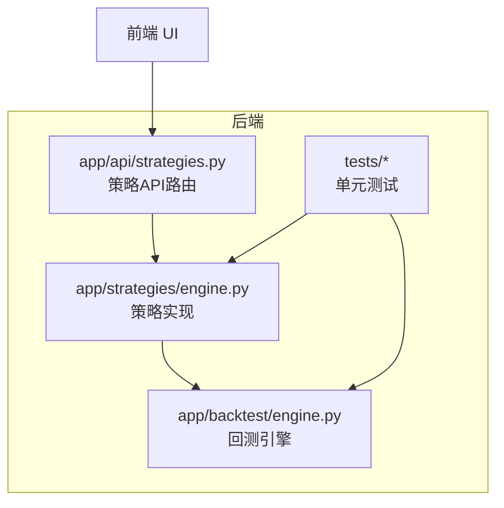
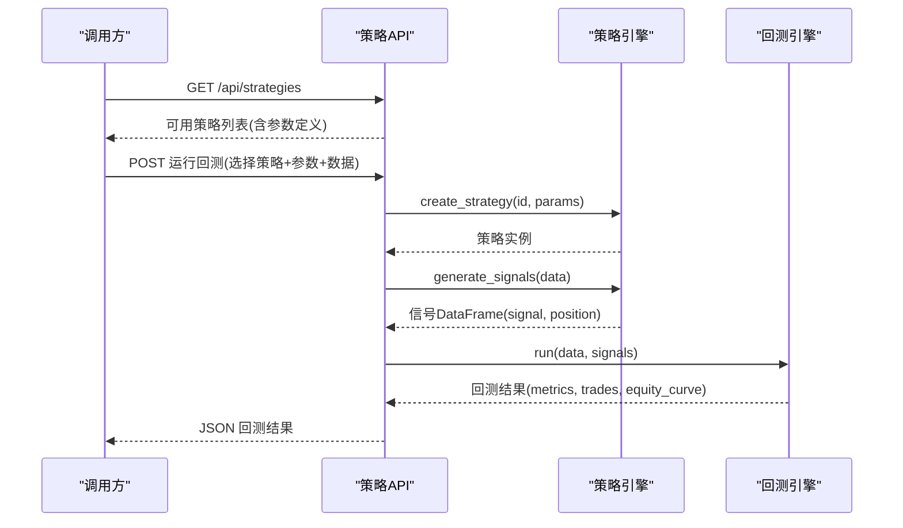
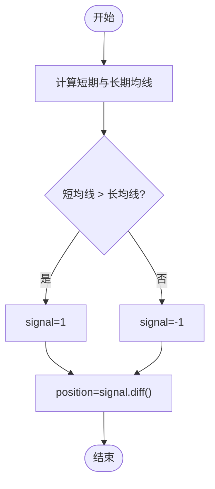
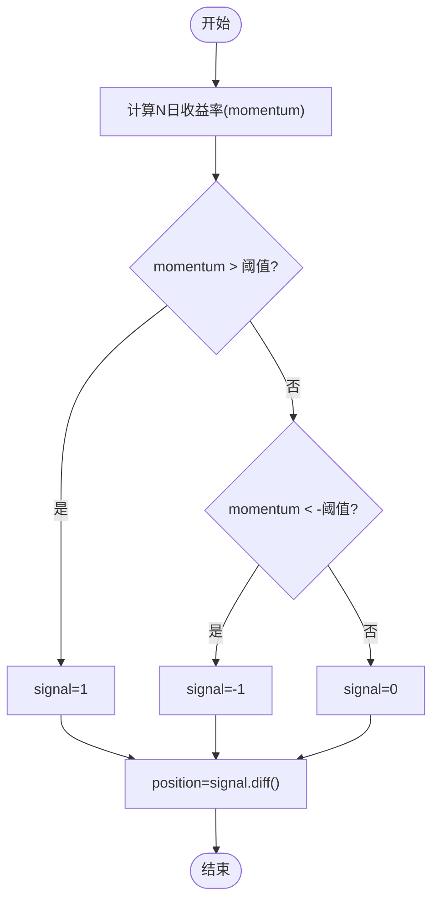
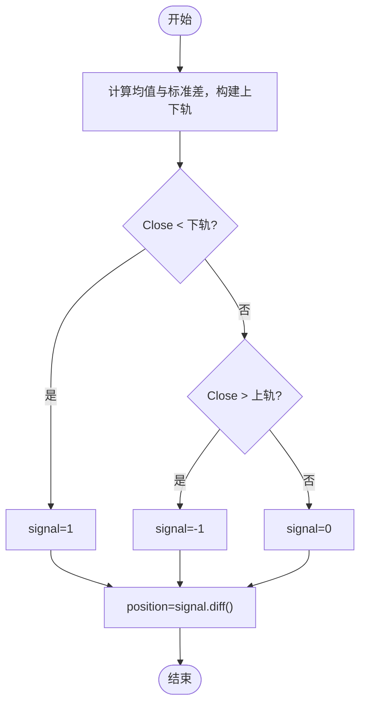
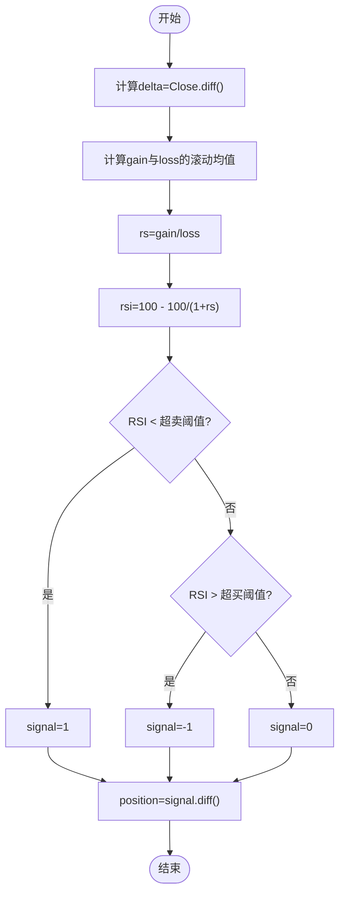
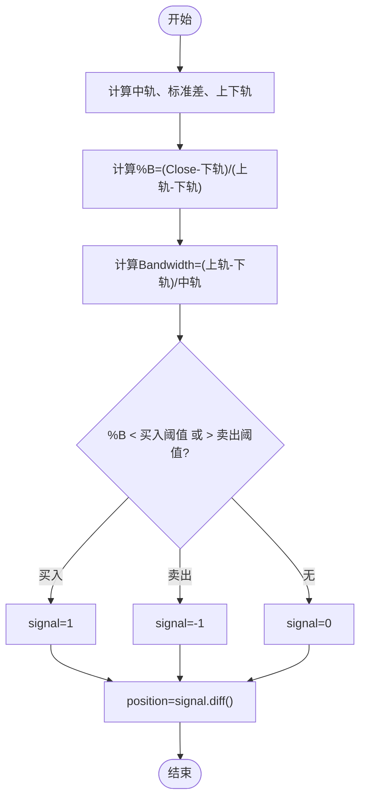
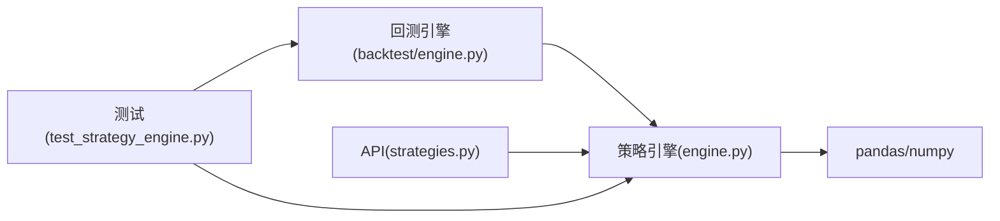

# 传统技术指标策略

<cite>
**本文引用的文件**   
- [backend/app/strategies/engine.py](../../../../../../../backend/app/strategies/engine.py)
- [backend/app/backtest/engine.py](../../../../../../../backend/app/backtest/engine.py)
- [backend/app/api/strategies.py](../../../../../../../backend/app/api/strategies.py)
- [backend/tests/test_strategy_engine.py](../../../../../../../backend/tests/test_strategy_engine.py)
- [backend/tests/conftest.py](../../../../../../../backend/tests/conftest.py)
</cite>

## 目录
1. [引言](#引言)
2. [项目结构](#项目结构)
3. [核心组件](#核心组件)
4. [架构总览](#架构总览)
5. [详细组件分析](#详细组件分析)
6. [依赖关系分析](#依赖关系分析)
7. [性能与实现特性](#性能与实现特性)
8. [参数调优建议](#参数调优建议)
9. [回测与效果评估](#回测与效果评估)
10. [故障排查指南](#故障排查指南)
11. [结论](#结论)

## 引言
本文件面向传统量化策略的技术文档，聚焦以下五类经典策略在代码库中的实现：均线交叉（双均线、三均线扩展）、动量（价格动量、成交量动量）、均值回归（统计套利思路、配对交易思路）、RSI（超买超卖判断、背离分析）、布林带（带宽分析与突破交易）。文档将系统讲解每种策略的核心算法、参数配置、信号生成逻辑，并解释关键指标的计算方法（移动平均线、RSI、布林带）及其实现细节。同时提供策略参数调优建议与回测效果分析方法，帮助读者快速理解、复现与优化这些传统策略。

## 项目结构
本项目后端采用分层结构：
- 策略层：定义策略基类与各具体策略实现，统一输出信号 DataFrame。
- 回测层：基于策略信号计算收益曲线、交易记录与绩效指标。
- API 层：暴露策略列表与详情接口，供前端调用。
- 测试层：覆盖策略创建、信号列校验、边界条件等用例。

图表来源
- [backend/app/strategies/engine.py:17-656](../../../../../../../backend/app/strategies/engine.py#L17-L656)
- [backend/app/backtest/engine.py:10-163](../../../../../../../backend/app/backtest/engine.py#L10-L163)
- [backend/app/api/strategies.py:1-25](../../../../../../../backend/app/api/strategies.py#L1-L25)
- [backend/tests/test_strategy_engine.py:1-187](../../../../../../../backend/tests/test_strategy_engine.py#L1-L187)

章节来源
- [backend/app/strategies/engine.py:17-656](../../../../../../../backend/app/strategies/engine.py#L17-L656)
- [backend/app/backtest/engine.py:10-163](../../../../../../../backend/app/backtest/engine.py#L10-L163)
- [backend/app/api/strategies.py:1-25](../../../../../../../backend/app/api/strategies.py#L1-L25)
- [backend/tests/test_strategy_engine.py:1-187](../../../../../../../backend/tests/test_strategy_engine.py#L1-L187)

## 核心组件
- BaseStrategy：策略抽象基类，定义统一的 generate_signals 接口，所有传统策略继承该基类。
- MACrossStrategy：双均线交叉策略；可自然扩展到三均线系统（短、中、长均线组合）。
- MomentumStrategy：价格动量策略；结合成交量可做“量价共振”扩展。
- MeanReversionStrategy：均值回归策略；可用于统计套利与配对交易的单标的简化版。
- RSIStrategy：RSI 超买超卖策略；可扩展背离分析。
- BollingerBandsStrategy：布林带策略；包含 %B 与带宽 Bandwidth 的辅助过滤。
- MultiFactorStrategy：多因子打分策略（作为传统策略的综合参考）。
- BacktestEngine：回测引擎，负责从信号到收益曲线、交易明细与绩效指标。
- get_available_strategies / create_strategy：策略注册表与工厂函数，集中管理策略元数据与实例化。

章节来源
- [backend/app/strategies/engine.py:17-656](../../../../../../../backend/app/strategies/engine.py#L17-L656)
- [backend/app/backtest/engine.py:10-163](../../../../../../../backend/app/backtest/engine.py#L10-L163)

## 架构总览
策略与回测的整体流程如下：

图表来源
- [backend/app/api/strategies.py:11-24](../../../../../../../backend/app/api/strategies.py#L11-L24)
- [backend/app/strategies/engine.py:506-656](../../../../../../../backend/app/strategies/engine.py#L506-L656)
- [backend/app/backtest/engine.py:15-70](../../../../../../../backend/app/backtest/engine.py#L15-L70)

## 详细组件分析

### 均线交叉策略（双均线、三均线扩展）
- 核心算法
  - 短期与长期简单移动平均线（SMA）比较：短均线上穿长均线产生买入信号，下穿产生卖出信号。
  - 通过 signal.diff() 得到 position，仅在信号变化时触发交易。
- 参数配置
  - short_window：短期均线窗口（默认 5）。
  - long_window：长期均线窗口（默认 20）。
- 信号生成逻辑
  - 计算 ma_short 与 ma_long。
  - 当 ma_short > ma_long 时 signal=1；否则 signal=-1。
  - position = signal.diff()，仅当信号变化时产生交易。
- 三均线扩展思路
  - 引入中期均线（如 10），形成短-中-长三段：短上穿中且中上穿长为强买入；短下穿中且中下穿长为强卖出；其余为持有或观望。
- 实现要点
  - 使用 rolling().mean() 计算 SMA。
  - 避免对原始输入 DataFrame 进行原地修改，内部使用 copy。

图表来源
- [backend/app/strategies/engine.py:28-54](../../../../../../../backend/app/strategies/engine.py#L28-L54)

章节来源
- [backend/app/strategies/engine.py:28-54](../../../../../../../backend/app/strategies/engine.py#L28-L54)
- [backend/tests/test_strategy_engine.py:70-85](../../../../../../../backend/tests/test_strategy_engine.py#L70-L85)

### 动量策略（价格动量、成交量动量）
- 核心算法
  - 价格动量：过去 N 日收益率超过阈值则买入，低于负阈值则卖出。
  - 成交量动量扩展：若成交量显著放大配合价格上涨，增强买入信号；反之放量下跌强化卖出信号。
- 参数配置
  - lookback_period：动量回溯期（默认 20）。
  - threshold：动量阈值（默认 0.05）。
- 信号生成逻辑
  - 计算 momentum = Close.pct_change(periods=N)。
  - 根据阈值设置 signal=1/-1，position=signal.diff()。
- 实现要点
  - 使用 pct_change 计算收益率。
  - 可通过 Volume 列做成交量动量过滤（例如 Volume 高于历史均值且价格动量为正时确认买入）。

图表来源
- [backend/app/strategies/engine.py:57-81](../../../../../../../backend/app/strategies/engine.py#L57-L81)

章节来源
- [backend/app/strategies/engine.py:57-81](../../../../../../../backend/app/strategies/engine.py#L57-L81)
- [backend/tests/test_strategy_engine.py:87-96](../../../../../../../backend/tests/test_strategy_engine.py#L87-L96)

### 均值回归策略（统计套利、配对交易）
- 核心算法
  - 以滚动均值与标准差构建上下轨，价格低于下轨买入，高于上轨卖出。
  - 统计套利思路：对价差序列建模（均值+波动带），偏离时反向交易。
  - 配对交易思路：两标的价差 Z-score 超过阈值时做空价差，回归时平仓。
- 参数配置
  - window：滚动窗口（默认 20）。
  - num_std：标准差倍数（默认 2.0）。
- 信号生成逻辑
  - 计算 ma、std，以及 upper_band、lower_band。
  - Close < lower_band 时 signal=1；Close > upper_band 时 signal=-1。
  - position=signal.diff()。
- 实现要点
  - 使用 rolling().mean() 与 rolling().std() 计算均值与标准差。
  - 适合震荡市；趋势市中需配合其他过滤器。

图表来源
- [backend/app/strategies/engine.py:84-111](../../../../../../../backend/app/strategies/engine.py#L84-L111)

章节来源
- [backend/app/strategies/engine.py:84-111](../../../../../../../backend/app/strategies/engine.py#L84-L111)
- [backend/tests/test_strategy_engine.py:98-107](../../../../../../../backend/tests/test_strategy_engine.py#L98-L107)

### RSI 策略（超买超卖判断、背离分析）
- 核心算法
  - RSI 计算：基于上涨幅度与下跌幅度的滚动均值比值，转换为 0-100 区间。
  - 超买超卖：RSI 低于超卖阈值买入，高于超买阈值卖出。
  - 背离分析扩展：价格创新高但 RSI 未创新高（顶背离）视为潜在卖出信号；价格创新低但 RSI 未创新低（底背离）视为潜在买入信号。
- 参数配置
  - period：RSI 周期（默认 14）。
  - oversold：超卖阈值（默认 30）。
  - overbought：超买阈值（默认 70）。
- 信号生成逻辑
  - 计算 delta = Close.diff()，gain 与 loss 分别取正负变动，滚动求均值。
  - rs = gain / loss，rsi = 100 - 100/(1+rs)。
  - 根据阈值设置 signal=1/-1，position=signal.diff()。
- 实现要点
  - 注意 loss 为零时的除零保护（在多因子策略中有 replace(0, np.nan) 的处理方式）。
  - RSI 值范围应在 0-100，测试用例已验证。

图表来源
- [backend/app/strategies/engine.py:114-150](../../../../../../../backend/app/strategies/engine.py#L114-L150)

章节来源
- [backend/app/strategies/engine.py:114-150](../../../../../../../backend/app/strategies/engine.py#L114-L150)
- [backend/tests/test_strategy_engine.py:110-120](../../../../../../../backend/tests/test_strategy_engine.py#L110-L120)

### 布林带策略（带宽分析、突破交易）
- 核心算法
  - 布林带：中轨=SMA，上轨=中轨+k*STD，下轨=中轨-k*STD。
  - %B 指标：%B=(Close-下轨)/(上轨-下轨)，接近 0 表示接近下轨，接近 1 表示接近上轨。
  - 带宽 Bandwidth：(上轨-下轨)/中轨，用于衡量波动率收缩/扩张。
  - 信号：%B 低于买入阈值时买入，高于卖出阈值时卖出。
- 参数配置
  - window：布林带周期（默认 20）。
  - num_std：标准差倍数（默认 2.0）。
  - buy_threshold：买入阈值（默认 0.05）。
  - sell_threshold：卖出阈值（默认 0.95）。
- 信号生成逻辑
  - 计算 bb_mid、bb_std、bb_upper、bb_lower。
  - 计算 percent_b 与 bandwidth，处理分母为 0 的情况。
  - 根据 %B 阈值设置 signal=1/-1，position=signal.diff()。
- 实现要点
  - 使用 rolling().mean() 与 rolling().std() 计算中轨与标准差。
  - 带宽收窄常伴随突破后的加速行情，可作为过滤条件。

图表来源
- [backend/app/strategies/engine.py:153-205](../../../../../../../backend/app/strategies/engine.py#L153-L205)

章节来源
- [backend/app/strategies/engine.py:153-205](../../../../../../../backend/app/strategies/engine.py#L153-L205)
- [backend/tests/test_strategy_engine.py:123-131](../../../../../../../backend/tests/test_strategy_engine.py#L123-L131)

### 多因子选股策略（综合参考）
- 核心算法
  - 动量因子、波动率因子、换手率因子、均线偏离因子、RSI 因子归一化后加权求和，得到 composite_score。
  - 综合得分高于买入阈值买入，低于卖出阈值卖出。
- 参数配置
  - momentum_window、volatility_window、ma_window、rsi_period。
  - buy_score、sell_score。
  - 各因子权重 w_momentum、w_volatility、w_turnover、w_ma_deviation、w_rsi。
- 信号生成逻辑
  - 对各因子进行 Min-Max 归一化，填充 NaN 为中性值 0.5。
  - 加权求和得到 composite_score，按阈值生成 signal 与 position。

章节来源
- [backend/app/strategies/engine.py:208-324](../../../../../../../backend/app/strategies/engine.py#L208-L324)
- [backend/tests/test_strategy_engine.py:134-142](../../../../../../../backend/tests/test_strategy_engine.py#L134-L142)

## 依赖关系分析
- 策略模块依赖 pandas/numpy 进行时间序列与数值计算。
- 回测模块依赖策略输出的 signal 与 position 列，计算策略收益、累计收益、资金曲线与绩效指标。
- API 模块依赖策略注册表 get_available_strategies，返回策略元数据。
- 测试模块覆盖策略创建、信号列存在性、RSI 取值范围、percent_b 列存在性等断言。

图表来源
- [backend/app/strategies/engine.py:1-15](../../../../../../../backend/app/strategies/engine.py#L1-L15)
- [backend/app/backtest/engine.py:1-8](../../../../../../../backend/app/backtest/engine.py#L1-L8)
- [backend/app/api/strategies.py:1-7](../../../../../../../backend/app/api/strategies.py#L1-L7)
- [backend/tests/test_strategy_engine.py:1-19](../../../../../../../backend/tests/test_strategy_engine.py#L1-L19)

章节来源
- [backend/app/strategies/engine.py:1-15](../../../../../../../backend/app/strategies/engine.py#L1-L15)
- [backend/app/backtest/engine.py:1-8](../../../../../../../backend/app/backtest/engine.py#L1-L8)
- [backend/app/api/strategies.py:1-7](../../../../../../../backend/app/api/strategies.py#L1-L7)
- [backend/tests/test_strategy_engine.py:1-19](../../../../../../../backend/tests/test_strategy_engine.py#L1-L19)

## 性能与实现特性
- 向量化计算：策略普遍使用 pandas rolling 与 numpy 操作，具备良好性能。
- 数据不可变性：generate_signals 内部使用 data.copy()，避免修改原始输入。
- 缺失值处理：布林带 %B 与带宽计算中对分母为 0 的情况进行保护（fillna 或 replace(0, np.nan)）。
- 回测健壮性：回测引擎对浮点数进行清理（fillna(0)、替换 Inf），确保 JSON 序列化安全。
- 指标范围校验：RSI 值范围在 0-100，测试用例已覆盖。

章节来源
- [backend/app/strategies/engine.py:174-205](../../../../../../../backend/app/strategies/engine.py#L174-L205)
- [backend/app/backtest/engine.py:57-62](../../../../../../../backend/app/backtest/engine.py#L57-L62)
- [backend/tests/test_strategy_engine.py:116-120](../../../../../../../backend/tests/test_strategy_engine.py#L116-L120)

## 参数调优建议
- 均线交叉
  - 短窗口与长窗口的比例建议在 1:3~1:10 之间，避免过短导致噪声过多。
  - 在趋势市场中可适当增大长窗口以降低假信号。
- 动量策略
  - lookback_period 与 threshold 需匹配资产波动特征；高波动品种可提高阈值。
  - 成交量动量可作为确认条件，提升胜率。
- 均值回归
  - window 与 num_std 决定回归带的宽度；num_std 越大信号越少但更稳健。
  - 在震荡市中表现较好，趋势市中需谨慎。
- RSI 策略
  - period 常用 14；oversold/overbought 可根据市场波动调整（如 20/80）。
  - 背离分析需结合形态识别与成交量确认。
- 布林带策略
  - window 与 num_std 影响带宽；bandwidth 收窄后突破往往具有动能。
  - %B 阈值可微调以平衡买卖频率与胜率。
- 多因子策略
  - 权重分配应基于历史回测与相关性分析；避免高度相关因子的重复贡献。
  - 阈值 buy_score/sell_score 需与因子分布匹配。

[本节为通用指导，不直接分析具体文件]

## 回测与效果评估
- 回测流程
  - 合并数据与信号，计算每日策略收益（滞后一期以避免未来信息泄露）。
  - 计算累计收益与资金曲线。
  - 提取交易记录（入场/出场价格、盈亏与百分比）。
  - 计算绩效指标：总收益、年化收益、最大回撤、夏普比率、胜率、盈亏比、交易次数等。
- 关键指标说明
  - 总收益与年化收益：衡量绝对回报。
  - 最大回撤：衡量风险与下行波动。
  - 夏普比率：单位风险超额收益（假设无风险利率 3%）。
  - 胜率与盈亏比：衡量交易质量与期望收益。
- 可视化建议
  - 绘制资金曲线与基准对比。
  - 标注买卖点与关键指标（RSI、布林带、均线）。
  - 展示回撤曲线与月度收益热力图。

章节来源
- [backend/app/backtest/engine.py:15-70](../../../../../../../backend/app/backtest/engine.py#L15-L70)
- [backend/app/backtest/engine.py:105-162](../../../../../../../backend/app/backtest/engine.py#L105-L162)

## 故障排查指南
- 未知策略 ID
  - 现象：create_strategy 抛出 ValueError。
  - 排查：检查 strategy_id 是否在注册表中；核对 API 返回的策略列表。
- 信号列缺失或不合法
  - 现象：缺少 signal/position 列，或 signal 取值不在 {-1,0,1}。
  - 排查：检查 generate_signals 是否返回正确列；确认 diff 与阈值逻辑。
- RSI 取值异常
  - 现象：RSI 超出 0-100 或出现 NaN。
  - 排查：检查 loss 为零时的除零保护；确认滚动窗口长度与数据长度。
- 布林带 %B 异常
  - 现象：percent_b 为 NaN 或无穷大。
  - 排查：检查上轨-下轨是否为 0；确认 fillna/replace 处理。
- 回测结果为空或指标异常
  - 现象：metrics 中出现 NaN/Inf 或交易记录为空。
  - 排查：检查信号是否频繁切换；确认 position_change 与交易记录提取逻辑；查看数值清理步骤。

章节来源
- [backend/app/strategies/engine.py:600-656](../../../../../../../backend/app/strategies/engine.py#L600-L656)
- [backend/tests/test_strategy_engine.py:48-50](../../../../../../../backend/tests/test_strategy_engine.py#L48-L50)
- [backend/tests/test_strategy_engine.py:57-64](../../../../../../../backend/tests/test_strategy_engine.py#L57-L64)
- [backend/tests/test_strategy_engine.py:116-120](../../../../../../../backend/tests/test_strategy_engine.py#L116-L120)
- [backend/tests/test_strategy_engine.py:129-131](../../../../../../../backend/tests/test_strategy_engine.py#L129-L131)
- [backend/app/backtest/engine.py:130-148](../../../../../../../backend/app/backtest/engine.py#L130-L148)

## 结论
本仓库实现了五种传统技术指标策略的完整代码路径，涵盖均线交叉、动量、均值回归、RSI 与布林带。策略层提供统一的信号生成接口，回测层提供稳健的收益与绩效评估，API 层便于前端集成。通过对参数的合理调优与结合成交量、背离、带宽等辅助信号，可在不同市场环境下提升策略的稳健性与收益风险比。建议在实际应用中结合样本外测试、滚动回测与交易成本模型，进一步验证策略的鲁棒性。