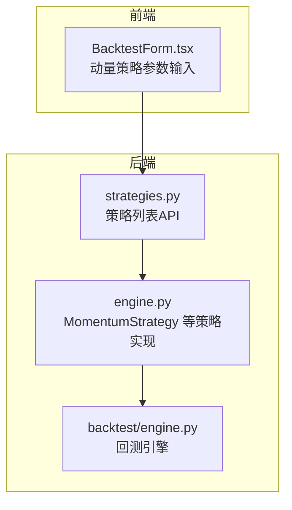
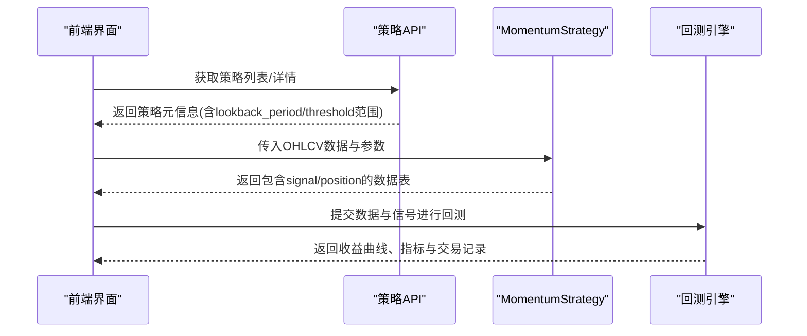
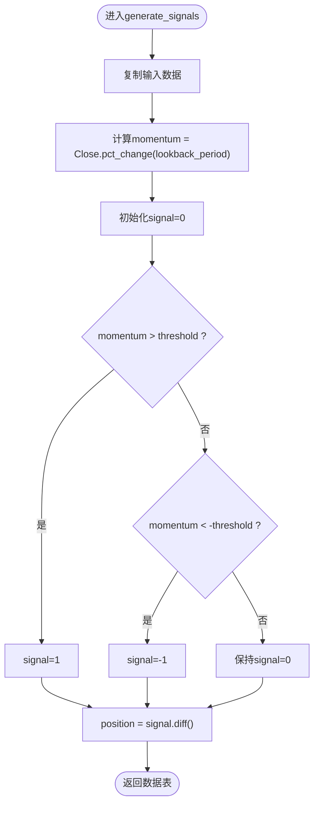
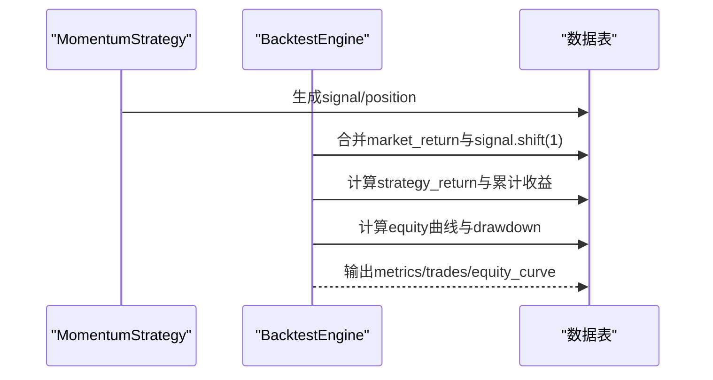
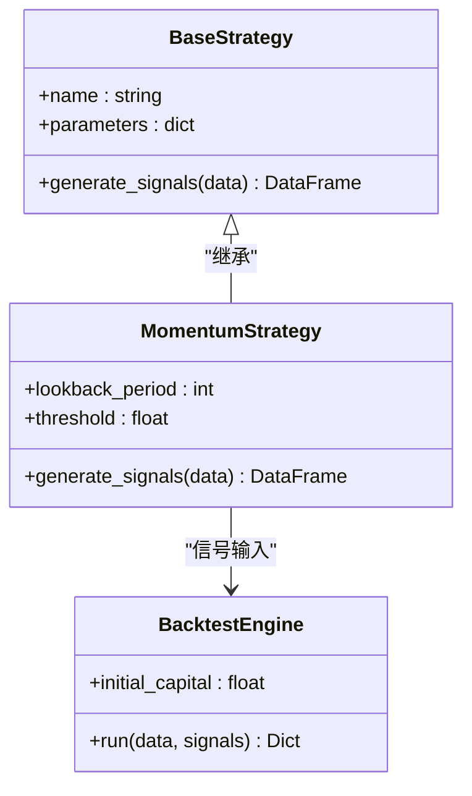

# 动量策略

<cite>
**本文引用的文件**   
- [backend/app/strategies/engine.py](../../../../../../../backend/app/strategies/engine.py)
- [backend/app/backtest/engine.py](../../../../../../../backend/app/backtest/engine.py)
- [backend/app/api/strategies.py](../../../../../../../backend/app/api/strategies.py)
- [frontend/src/components/BacktestForm.tsx](../../../../../../../frontend/src/components/BacktestForm.tsx)
- [backend/tests/test_strategy_engine.py](../../../../../../../backend/tests/test_strategy_engine.py)
</cite>

## 目录
1. [简介](#简介)
2. [项目结构](#项目结构)
3. [核心组件](#核心组件)
4. [架构总览](#架构总览)
5. [详细组件分析](#详细组件分析)
6. [依赖关系分析](#依赖关系分析)
7. [性能与参数优化](#性能与参数优化)
8. [故障排查指南](#故障排查指南)
9. [结论](#结论)
10. [附录：实现要点与参考路径](#附录实现要点与参考路径)

## 简介
本文件围绕“动量策略”展开，重点讲解价格动量的核心概念、计算方法与阈值设定原理；解释 lookback_period 与 threshold 参数的含义与作用；说明交易逻辑（价格涨幅超过正向阈值买入、跌幅超过负向阈值卖出）；给出 MomentumStrategy 类的完整实现思路与关键步骤；并结合回测引擎说明如何评估策略在不同市场环境下的表现。同时提供结合成交量过滤假信号的扩展建议与参数优化方法，帮助读者在实战中提高策略准确性与稳健性。

## 项目结构
本项目后端采用 FastAPI + Pandas/Numpy 的策略与回测框架，前端通过 React/Vite 提供可视化表单与结果展示。与动量策略直接相关的代码主要位于后端策略引擎与回测引擎中，前端负责参数配置与结果呈现。

图表来源
- [backend/app/api/strategies.py:11-24](../../../../../../../backend/app/api/strategies.py#L11-L24)
- [backend/app/strategies/engine.py:57-81](../../../../../../../backend/app/strategies/engine.py#L57-L81)
- [backend/app/backtest/engine.py:10-70](../../../../../../../backend/app/backtest/engine.py#L10-L70)
- [frontend/src/components/BacktestForm.tsx:140-164](../../../../../../../frontend/src/components/BacktestForm.tsx#L140-L164)

章节来源
- [backend/app/api/strategies.py:1-25](../../../../../../../backend/app/api/strategies.py#L1-L25)
- [backend/app/strategies/engine.py:1-81](../../../../../../../backend/app/strategies/engine.py#L1-L81)
- [backend/app/backtest/engine.py:1-70](../../../../../../../backend/app/backtest/engine.py#L1-L70)
- [frontend/src/components/BacktestForm.tsx:140-164](../../../../../../../frontend/src/components/BacktestForm.tsx#L140-L164)

## 核心组件
- BaseStrategy：策略基类，定义统一的 generate_signals 接口。
- MomentumStrategy：动量策略实现，基于 Close 的 pct_change 计算价格动量，按阈值生成买卖信号。
- BacktestEngine：回测引擎，将信号与市场数据合并，计算策略收益、资金曲线与绩效指标。
- strategies API：对外暴露可用策略清单与详情，便于前端选择与参数配置。

章节来源
- [backend/app/strategies/engine.py:17-81](../../../../../../../backend/app/strategies/engine.py#L17-L81)
- [backend/app/backtest/engine.py:10-70](../../../../../../../backend/app/backtest/engine.py#L10-L70)
- [backend/app/api/strategies.py:11-24](../../../../../../../backend/app/api/strategies.py#L11-L24)

## 架构总览
动量策略从前端参数输入开始，经后端策略引擎生成信号，再由回测引擎计算收益与指标，最终返回给前端展示。

图表来源
- [backend/app/api/strategies.py:11-24](../../../../../../../backend/app/api/strategies.py#L11-L24)
- [backend/app/strategies/engine.py:57-81](../../../../../../../backend/app/strategies/engine.py#L57-L81)
- [backend/app/backtest/engine.py:15-70](../../../../../../../backend/app/backtest/engine.py#L15-L70)
- [frontend/src/components/BacktestForm.tsx:140-164](../../../../../../../frontend/src/components/BacktestForm.tsx#L140-L164)

## 详细组件分析

### 价格动量与成交量动量概念
- 价格动量：衡量过去一段时间内价格的相对变化幅度，常用 Close 的百分比变化 pct_change(periods=N) 表示。N 越大，越平滑但滞后更强；N 越小，更敏感但噪声更多。
- 成交量动量：衡量成交量的相对变化，可用于确认趋势强度或过滤假突破。常见做法包括 Volume 的 pct_change、滚动均值/标准差、以及量价背离检测。

本节为概念性说明，不直接分析具体文件。

### MomentumStrategy 类实现与信号生成逻辑
MomentumStrategy 的核心流程如下：
- 使用 Close.pct_change(periods=lookback_period) 计算价格动量列 momentum。
- 根据 threshold 设置正负阈值：当 momentum > threshold 时 signal=1（买入），当 momentum < -threshold 时 signal=-1（卖出），否则 signal=0（持有）。
- 通过 signal.diff() 得到 position，用于标识实际开平仓动作。

图表来源
- [backend/app/strategies/engine.py:67-81](../../../../../../../backend/app/strategies/engine.py#L67-L81)

章节来源
- [backend/app/strategies/engine.py:57-81](../../../../../../../backend/app/strategies/engine.py#L57-L81)

### lookback_period 与 threshold 的作用与意义
- lookback_period：决定动量计算的窗口长度。较短周期对近期价格变动更敏感，适合短线趋势；较长周期更稳定，适合中长线趋势。
- threshold：决定触发交易的动量门槛。正值阈值对应买入条件，负值阈值对称对应卖出条件。阈值越大，交易越少但信号更可靠；阈值越小，交易越多但易受噪声影响。

章节来源
- [backend/app/strategies/engine.py:57-81](../../../../../../../backend/app/strategies/engine.py#L57-L81)
- [backend/app/api/strategies.py:11-24](../../../../../../../backend/app/api/strategies.py#L11-L24)
- [frontend/src/components/BacktestForm.tsx:140-164](../../../../../../../frontend/src/components/BacktestForm.tsx#L140-L164)

### 交易逻辑与回测流程
- 交易逻辑：当价格动量超过正向阈值时买入，低于负向阈值时卖出；其余时间持有。
- 回测流程：将策略生成的 signal 与 market_return 相乘得到 strategy_return，再计算累计收益与资金曲线；提取交易记录并计算夏普比率、最大回撤、胜率、盈亏比等指标。

图表来源
- [backend/app/backtest/engine.py:15-70](../../../../../../../backend/app/backtest/engine.py#L15-L70)
- [backend/app/strategies/engine.py:67-81](../../../../../../../backend/app/strategies/engine.py#L67-L81)

章节来源
- [backend/app/backtest/engine.py:15-70](../../../../../../../backend/app/backtest/engine.py#L15-L70)

### 不同市场环境下表现分析与参数优化建议
- 趋势市：动量策略通常表现较好，可适当增大 lookback_period 以捕捉中长期趋势，适度提高 threshold 减少频繁交易。
- 震荡市：动量策略容易反复止损，可考虑降低 threshold 或引入成交量过滤、波动率过滤来抑制假信号。
- 高波动市：需提高 threshold 以避免被短期波动误导；同时可结合波动率指标（如 ATR 或滚动标准差）动态调整阈值。
- 参数优化建议：
  - 网格搜索 lookback_period ∈ [5, 100]，threshold ∈ [0.01, 0.2]，以夏普比率、最大回撤、胜率为主要目标函数。
  - 分时段回测（牛市、熊市、震荡）评估稳定性，避免过拟合单一环境。
  - 结合成交量过滤：仅当成交量放大（例如 Volume 的滚动均值显著高于历史均值）时确认动量信号，提升准确率。

本节为通用指导，不直接分析具体文件。

### 结合成交量过滤假信号的方法
虽然当前 MomentumStrategy 未内置成交量过滤，但可在信号生成前后加入以下增强逻辑：
- 量价共振：仅在 momentum > threshold 且当日成交量大于其 N 日滚动均值的 K 倍时确认买入；反之亦然。
- 成交量动量：使用 Volume.pct_change 或滚动标准差判断量能是否放大，作为辅助过滤条件。
- 多因子融合：将动量因子与成交量因子归一化后加权打分，综合得分超过阈值才交易。

这些方法可作为后续扩展方向，不在当前 MomentumStrategy 实现中。

## 依赖关系分析
- 策略层：BaseStrategy 抽象出统一接口，MomentumStrategy 继承并实现 generate_signals。
- 回测层：BacktestEngine 依赖策略输出的 signal/position 与 OHLCV 数据进行收益计算与指标统计。
- 接口层：strategies.py 暴露 get_available_strategies，供前端查询策略元信息与参数范围。
- 前端层：BacktestForm.tsx 提供 lookback_period 与 threshold 的输入控件，限制取值范围与步长。

图表来源
- [backend/app/strategies/engine.py:17-81](../../../../../../../backend/app/strategies/engine.py#L17-L81)
- [backend/app/backtest/engine.py:10-70](../../../../../../../backend/app/backtest/engine.py#L10-L70)

章节来源
- [backend/app/strategies/engine.py:17-81](../../../../../../../backend/app/strategies/engine.py#L17-L81)
- [backend/app/backtest/engine.py:10-70](../../../../../../../backend/app/backtest/engine.py#L10-L70)

## 性能与参数优化
- 计算复杂度：pct_change 与 diff 均为 O(n)，整体线性复杂度，适合大规模数据。
- 内存占用：策略会新增 momentum/signal/position 列，注意数据规模较大时的内存管理。
- 参数敏感性：threshold 对交易频率影响显著；lookback_period 对滞后性与稳定性影响显著。
- 优化实践：
  - 使用滚动窗口与向量化操作（Pandas）避免显式循环。
  - 对极端值与缺失值进行填充与清洗，确保回测稳定性。
  - 结合多市场环境进行参数稳健性检验，避免单一行情下的过拟合。

本节为通用指导，不直接分析具体文件。

## 故障排查指南
- 信号为空或全零：检查 lookback_period 是否过大导致前若干行 NaN；确认 threshold 设置是否过于严格。
- 交易频繁且亏损：降低 threshold 或提高 threshold 以减少噪音；加入成交量或波动率过滤。
- 回测指标异常：检查数据日期列是否为 datetime 类型；确保 signal 与 position 列存在且无 NaN/Inf。
- 前端参数无效：确认 BacktestForm.tsx 中的 min/max/step 与后端策略参数范围一致。

章节来源
- [backend/app/backtest/engine.py:47-70](../../../../../../../backend/app/backtest/engine.py#L47-L70)
- [frontend/src/components/BacktestForm.tsx:140-164](../../../../../../../frontend/src/components/BacktestForm.tsx#L140-L164)

## 结论
动量策略通过价格动量与阈值机制实现简洁有效的趋势跟踪。在当前实现中，MomentumStrategy 使用 Close.pct_change 计算动量并按阈值生成买卖信号；BacktestEngine 负责将信号转化为收益与指标。为提升策略稳健性，建议结合成交量过滤、波动率过滤与多因子融合，并通过分时段回测与参数网格搜索优化参数组合。

## 附录：实现要点与参考路径
- 动量计算与信号生成：
  - 参考路径：[backend/app/strategies/engine.py:67-81](../../../../../../../backend/app/strategies/engine.py#L67-L81)
- 策略元信息与参数范围：
  - 参考路径：[backend/app/api/strategies.py:11-24](../../../../../../../backend/app/api/strategies.py#L11-L24)
- 前端参数控件：
  - 参考路径：[frontend/src/components/BacktestForm.tsx:140-164](../../../../../../../frontend/src/components/BacktestForm.tsx#L140-L164)
- 回测收益与指标计算：
  - 参考路径：[backend/app/backtest/engine.py:15-70](../../../../../../../backend/app/backtest/engine.py#L15-L70)
- 单元测试验证信号列与边界条件：
  - 参考路径：[backend/tests/test_strategy_engine.py:87-95](../../../../../../../backend/tests/test_strategy_engine.py#L87-L95)