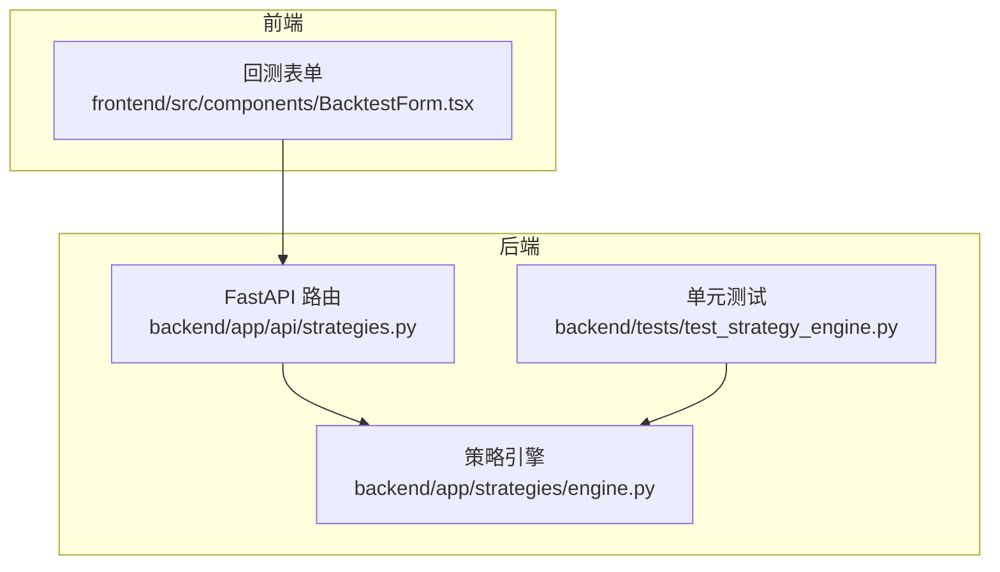
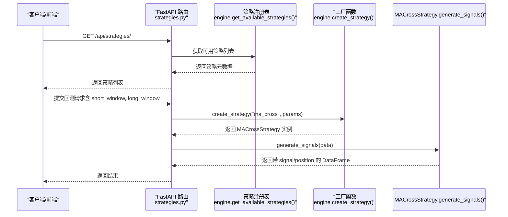
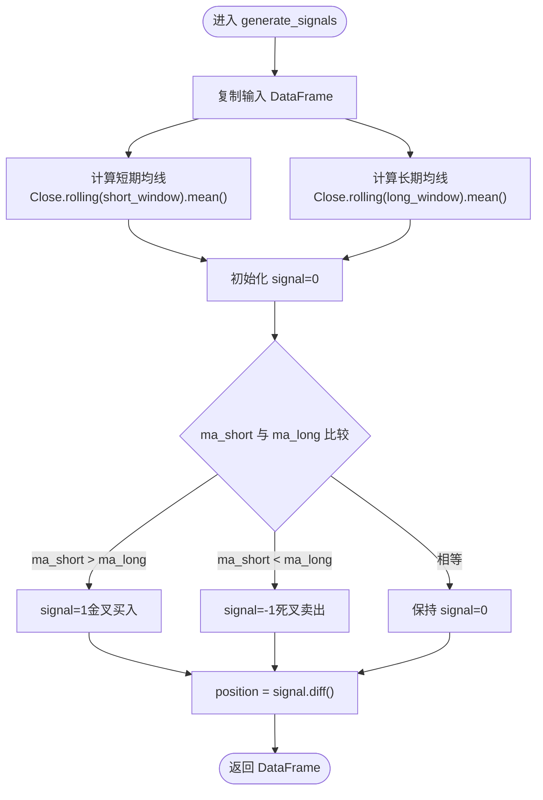
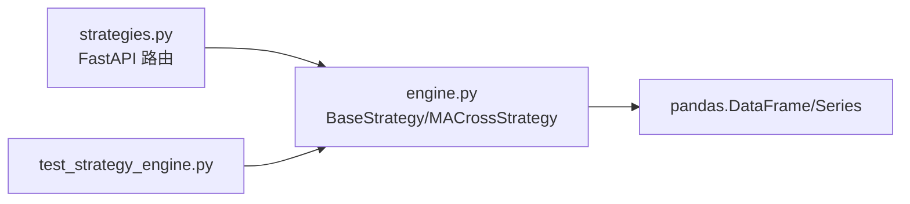

# 均线交叉策略

<cite>
**本文引用的文件**   
- [backend/app/strategies/engine.py](file://backend/app/strategies/engine.py)
- [backend/tests/test_strategy_engine.py](file://backend/tests/test_strategy_engine.py)
- [backend/app/api/strategies.py](file://backend/app/api/strategies.py)
</cite>

## 目录
1. [引言](#引言)
2. [项目结构](#项目结构)
3. [核心组件](#核心组件)
4. [架构总览](#架构总览)
5. [详细组件分析](#详细组件分析)
6. [依赖关系分析](#依赖关系分析)
7. [性能与实现特性](#性能与实现特性)
8. [参数调优与市场环境选择](#参数调优与市场环境选择)
9. [故障排查指南](#故障排查指南)
10. [结论](#结论)

## 引言
本文件围绕“均线交叉策略”展开，重点讲解双均线系统与三均线系统的实现原理、信号生成机制，以及移动平均线的数学定义与 pandas rolling 的使用方式。文档同时给出 MACrossStrategy 类的完整实现路径说明，包括参数配置（short_window, long_window）和 generate_signals 方法的具体逻辑，并提供参数调优建议与不同市场环境下的周期选择指导。

## 项目结构
本项目采用前后端分离架构：后端使用 FastAPI 提供策略接口，策略引擎位于 backend/app/strategies/engine.py；前端通过表单与后端交互。与均线交叉策略直接相关的代码集中在策略引擎与测试文件中。

图表来源
- [backend/app/api/strategies.py:1-25](file://backend/app/api/strategies.py#L1-L25)
- [backend/app/strategies/engine.py:1-656](file://backend/app/strategies/engine.py#L1-L656)
- [backend/tests/test_strategy_engine.py:1-187](file://backend/tests/test_strategy_engine.py#L1-L187)

章节来源
- [backend/app/api/strategies.py:1-25](file://backend/app/api/strategies.py#L1-L25)
- [backend/app/strategies/engine.py:1-656](file://backend/app/strategies/engine.py#L1-L656)
- [backend/tests/test_strategy_engine.py:1-187](file://backend/tests/test_strategy_engine.py#L1-L187)

## 核心组件
- BaseStrategy：策略基类，定义统一的 generate_signals 接口。
- MACrossStrategy：均线交叉策略，计算短期与长期移动平均线并生成买卖信号。
- get_available_strategies / create_strategy：策略注册表与工厂函数，用于对外暴露策略元数据与实例化。

关键职责
- 输入：包含 OHLCV 等列的 DataFrame（至少需要 Close）。
- 输出：包含 signal 与 position 列的 DataFrame，signal ∈ {-1, 0, 1}，position 为 signal 的一阶差分，表示实际交易动作。

章节来源
- [backend/app/strategies/engine.py:17-54](file://backend/app/strategies/engine.py#L17-L54)
- [backend/app/strategies/engine.py:506-656](file://backend/app/strategies/engine.py#L506-L656)

## 架构总览
均线交叉策略在系统中的调用链如下：

图表来源
- [backend/app/api/strategies.py:11-24](file://backend/app/api/strategies.py#L11-L24)
- [backend/app/strategies/engine.py:506-656](file://backend/app/strategies/engine.py#L506-L656)

## 详细组件分析

### MACrossStrategy 类
MACrossStrategy 继承自 BaseStrategy，核心逻辑在 generate_signals 中完成。

- 参数
  - short_window：短期均线窗口（默认 5）
  - long_window：长期均线窗口（默认 20）

- 主要步骤
  1) 复制输入 DataFrame，避免修改原始数据。
  2) 计算短期均线 ma_short = Close.rolling(short_window).mean()
  3) 计算长期均线 ma_long = Close.rolling(long_window).mean()
  4) 初始化 signal=0，当 ma_short > ma_long 时置 1（金叉买入），否则当 ma_short < ma_long 时置 -1（死叉卖出）。
  5) 计算 position = signal.diff()，仅在信号变化时产生交易动作。

- 输出列
  - ma_short, ma_long：中间指标列
  - signal：{-1, 0, 1}
  - position：{1, -1, 0}，表示实际下单方向

图表来源
- [backend/app/strategies/engine.py:28-54](file://backend/app/strategies/engine.py#L28-L54)

章节来源
- [backend/app/strategies/engine.py:28-54](file://backend/app/strategies/engine.py#L28-L54)

### 移动平均线与 pandas rolling
- 数学定义
  - 简单移动平均线（SMA）：对过去 N 个收盘价求算术平均。
  - 公式：SMA_t = (1/N) * Σ_{i=1..N} Close_{t-i+1}
- pandas 实现
  - df['Close'].rolling(window=N).mean() 即计算长度为 N 的滚动均值。
- 在 MACrossStrategy 中的使用
  - 短期均线：df['ma_short'] = df['Close'].rolling(window=self.short_window).mean()
  - 长期均线：df['ma_long'] = df['Close'].rolling(window=self.long_window).mean()

章节来源
- [backend/app/strategies/engine.py:43-45](file://backend/app/strategies/engine.py#L43-L45)

### 信号生成机制：金叉与死叉
- 金叉（买入信号）：短期均线上穿长期均线，即 ma_short > ma_long → signal=1
- 死叉（卖出信号）：短期均线下穿长期均线，即 ma_short < ma_long → signal=-1
- 仅当信号发生变化时才交易：position = signal.diff()

章节来源
- [backend/app/strategies/engine.py:47-52](file://backend/app/strategies/engine.py#L47-L52)

### 三均线系统扩展思路
当前仓库实现了双均线系统（短期与长期）。若需扩展至三均线系统（例如短、中、长三条均线），可遵循以下设计原则：
- 新增中期均线 ma_mid = Close.rolling(mid_window).mean()
- 信号规则示例：
  - 买入：ma_short > ma_mid 且 ma_mid > ma_long（多头排列）
  - 卖出：ma_short < ma_mid 且 ma_mid < ma_long（空头排列）
- 该扩展属于概念性设计，便于在三条均线之间形成更稳健的趋势过滤。

[本节为概念性扩展说明，不直接分析具体源码]

## 依赖关系分析
- 模块内依赖
  - MACrossStrategy 依赖 pandas 的 Series/DataFrame 与 rolling 方法。
  - 工厂函数 create_strategy 根据 strategy_id 创建对应策略实例。
- 外部依赖
  - FastAPI 路由层通过 get_available_strategies 暴露策略元数据。

图表来源
- [backend/app/strategies/engine.py:1-656](file://backend/app/strategies/engine.py#L1-L656)
- [backend/app/api/strategies.py:1-25](file://backend/app/api/strategies.py#L1-L25)
- [backend/tests/test_strategy_engine.py:1-187](file://backend/tests/test_strategy_engine.py#L1-L187)

章节来源
- [backend/app/strategies/engine.py:506-656](file://backend/app/strategies/engine.py#L506-L656)
- [backend/app/api/strategies.py:11-24](file://backend/app/api/strategies.py#L11-L24)

## 性能与实现特性
- 时间复杂度
  - rolling.mean 的计算为 O(N)，整体 generate_signals 为 O(N)。
- 空间复杂度
  - 额外存储 ma_short、ma_long、signal、position，O(N)。
- 向量化实现
  - 使用 pandas 向量化操作，避免显式循环，提升性能。
- 输入不变性
  - 策略内部复制输入 DataFrame，不修改原始数据，保证可重复性与线程安全。

章节来源
- [backend/app/strategies/engine.py:43-54](file://backend/app/strategies/engine.py#L43-L54)
- [backend/tests/test_strategy_engine.py:182-186](file://backend/tests/test_strategy_engine.py#L182-L186)

## 参数调优与市场环境选择
- 参数范围（来自策略注册表）
  - short_window：整数，默认 5，范围 2-50
  - long_window：整数，默认 20，范围 10-200
- 调优建议
  - 趋势市场：增大 long_window（如 50-200）以平滑噪声，缩短 short_window（如 5-10）提高灵敏度。
  - 震荡市场：缩短 long_window（如 10-30），配合较短 short_window，减少假突破。
  - 高频/日内：考虑更短的窗口（如 3-10），但需警惕频繁交易成本。
- 验证方法
  - 使用历史数据进行滚动回测，评估胜率、盈亏比、最大回撤与换手率。
  - 结合波动率与成交量过滤，降低震荡市中的无效信号。

章节来源
- [backend/app/strategies/engine.py:506-517](file://backend/app/strategies/engine.py#L506-L517)

## 故障排查指南
- 常见问题
  - 输入数据缺少 Close 列：会导致 rolling 计算失败。
  - 数据长度不足：短期或长期均线前若干行会出现 NaN，需合理处理。
  - 信号值异常：检查是否误将 signal 初始化为非 0 值。
- 定位方法
  - 检查 generate_signals 输出的列名与取值范围。
  - 断言 position 是否为 signal.diff()。
  - 确认未修改原始输入 DataFrame。

章节来源
- [backend/tests/test_strategy_engine.py:57-64](file://backend/tests/test_strategy_engine.py#L57-L64)
- [backend/tests/test_strategy_engine.py:174-186](file://backend/tests/test_strategy_engine.py#L174-L186)

## 结论
MACrossStrategy 提供了简洁高效的均线交叉信号生成能力，基于 pandas rolling 的向量化计算保证了性能与可读性。通过合理设置 short_window 与 long_window，可在不同市场环境中取得较好的趋势跟踪效果。未来可扩展三均线系统以增强趋势过滤能力，并结合波动率与成交量进行信号优化。