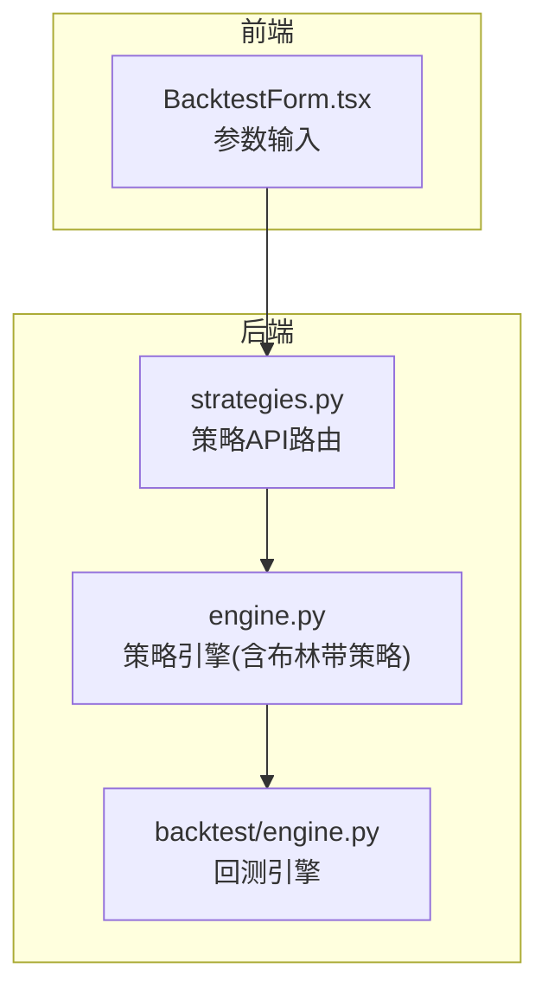
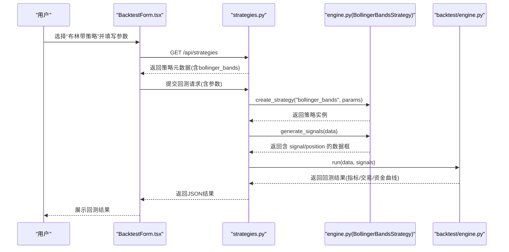
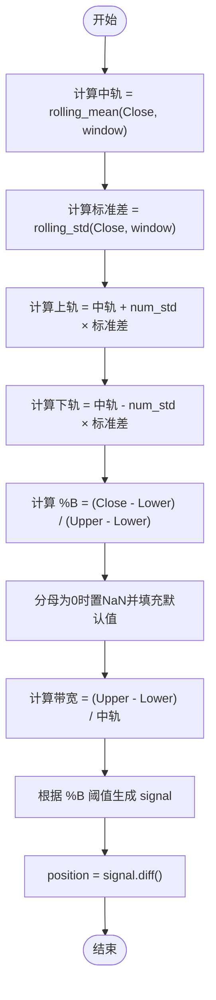
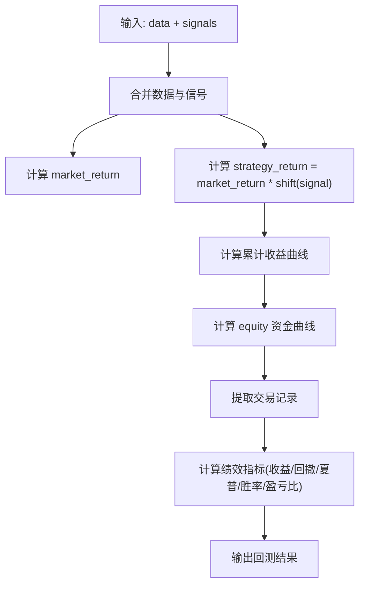
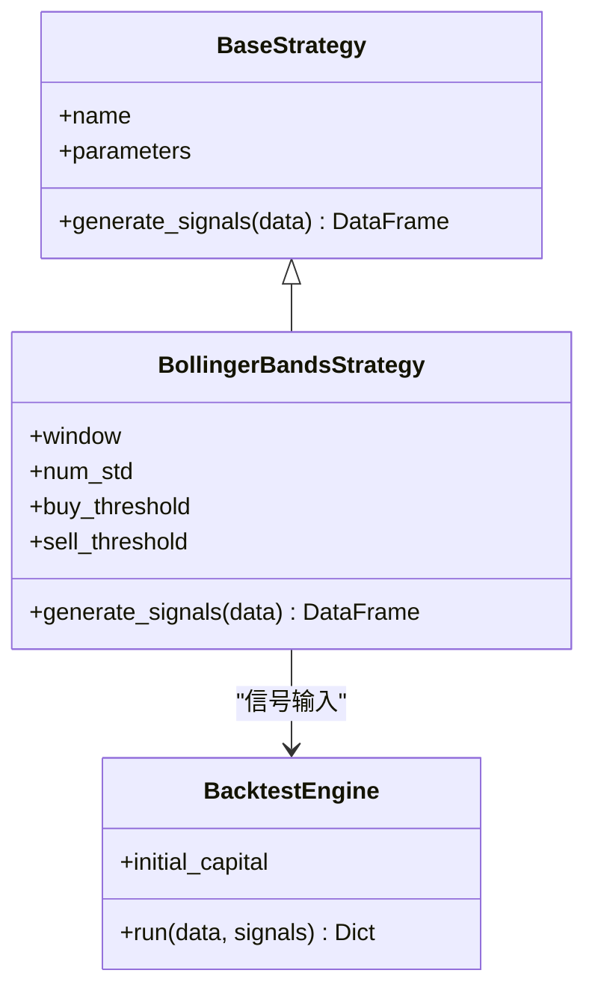

# 布林带策略

<cite>
**本文引用的文件**   
- [backend/app/strategies/engine.py](../../../../../../../backend/app/strategies/engine.py)
- [backend/app/backtest/engine.py](../../../../../../../backend/app/backtest/engine.py)
- [backend/app/api/strategies.py](../../../../../../../backend/app/api/strategies.py)
- [frontend/src/components/BacktestForm.tsx](../../../../../../../frontend/src/components/BacktestForm.tsx)
</cite>

## 目录
1. [引言](#引言)
2. [项目结构](#项目结构)
3. [核心组件](#核心组件)
4. [架构总览](#架构总览)
5. [详细组件分析](#详细组件分析)
6. [依赖关系分析](#依赖关系分析)
7. [性能与波动率环境分析](#性能与波动率环境分析)
8. [参数优化与实战技巧](#参数优化与实战技巧)
9. [故障排查指南](#故障排查指南)
10. [结论](#结论)

## 引言
本文件面向量化交易实践者，系统性讲解布林带策略的理论基础、数学公式、指标含义与工程实现。重点包括：
- 中轨、上轨、下轨的计算方法
- %B 指标的含义与用法：%B = (Close - Lower) / (Upper - Lower)
- 带宽（Bandwidth）的分析价值与收窄信号
- buy_threshold 与 sell_threshold 的作用机制
- BollingerBandsStrategy 类的完整实现路径与信号生成逻辑
- 不同波动率环境下的表现分析与成交量确认思路
- 参数优化策略与实战应用技巧

## 项目结构
本项目采用前后端分离的架构：
- 后端提供策略引擎、回测引擎与API路由
- 前端提供回测表单与结果展示
- 布林带策略作为策略引擎中的一个具体实现，通过API暴露并可被前端配置参数

图表来源
- [backend/app/api/strategies.py:11-24](../../../../../../../backend/app/api/strategies.py#L11-L24)
- [backend/app/strategies/engine.py:153-205](../../../../../../../backend/app/strategies/engine.py#L153-L205)
- [backend/app/backtest/engine.py:10-70](../../../../../../../backend/app/backtest/engine.py#L10-L70)
- [frontend/src/components/BacktestForm.tsx:227-261](../../../../../../../frontend/src/components/BacktestForm.tsx#L227-L261)

章节来源
- [backend/app/api/strategies.py:11-24](../../../../../../../backend/app/api/strategies.py#L11-L24)
- [backend/app/strategies/engine.py:153-205](../../../../../../../backend/app/strategies/engine.py#L153-L205)
- [backend/app/backtest/engine.py:10-70](../../../../../../../backend/app/backtest/engine.py#L10-L70)
- [frontend/src/components/BacktestForm.tsx:227-261](../../../../../../../frontend/src/components/BacktestForm.tsx#L227-L261)

## 核心组件
- BaseStrategy：策略基类，定义统一的 generate_signals 接口
- MACrossStrategy、MomentumStrategy、MeanReversionStrategy、RSIStrategy：其他示例策略
- BollingerBandsStrategy：布林带策略的核心实现，包含布林带计算、%B 指标、带宽计算与信号生成
- MultiFactorStrategy、TransformerPredictStrategy：多因子与Transformer预测策略
- BacktestEngine：回测引擎，负责收益曲线、交易记录与绩效指标计算
- strategies.py：FastAPI路由，暴露策略列表与详情查询
- BacktestForm.tsx：前端参数表单，支持布林带策略的参数配置

章节来源
- [backend/app/strategies/engine.py:17-25](../../../../../../../backend/app/strategies/engine.py#L17-L25)
- [backend/app/strategies/engine.py:153-205](../../../../../../../backend/app/strategies/engine.py#L153-L205)
- [backend/app/backtest/engine.py:10-70](../../../../../../../backend/app/backtest/engine.py#L10-L70)
- [backend/app/api/strategies.py:11-24](../../../../../../../backend/app/api/strategies.py#L11-L24)
- [frontend/src/components/BacktestForm.tsx:227-261](../../../../../../../frontend/src/components/BacktestForm.tsx#L227-L261)

## 架构总览
从数据到信号的端到端流程如下：
- 前端用户通过表单设置布林带策略参数（周期、标准差倍数、买入阈值、卖出阈值）
- 后端API返回可用策略元信息，供前端渲染参数控件
- 策略引擎根据参数实例化 BollingerBandsStrategy，并调用 generate_signals 生成信号列
- 回测引擎将信号与价格序列合并，计算策略收益、资金曲线、交易记录与绩效指标

图表来源
- [backend/app/api/strategies.py:11-24](../../../../../../../backend/app/api/strategies.py#L11-L24)
- [backend/app/strategies/engine.py:506-597](../../../../../../../backend/app/strategies/engine.py#L506-L597)
- [backend/app/strategies/engine.py:600-656](../../../../../../../backend/app/strategies/engine.py#L600-L656)
- [backend/app/backtest/engine.py:15-70](../../../../../../../backend/app/backtest/engine.py#L15-L70)
- [frontend/src/components/BacktestForm.tsx:227-261](../../../../../../../frontend/src/components/BacktestForm.tsx#L227-L261)

## 详细组件分析

### 布林带理论基础与数学公式
- 中轨（Middle Band）：N日收盘价简单移动平均线
  - 中轨 = MA(Close, N)
- 标准差（Std）：N日收盘价的滚动标准差
  - Std = std(Close, N)
- 上轨（Upper Band）：中轨 + k × 标准差
  - Upper = Mid + k × Std
- 下轨（Lower Band）：中轨 - k × 标准差
  - Lower = Mid - k × Std
- %B 指标：衡量价格在上下轨之间的相对位置
  - %B = (Close - Lower) / (Upper - Lower)
  - %B ∈ (-∞, +∞)，但在正常波动下通常接近[0,1]区间；当上下轨宽度为0时，代码中以NaN处理并填充默认值
- 带宽（Bandwidth）：衡量波动率的相对宽度
  - Bandwidth = (Upper - Lower) / Mid
  - 带宽收窄常预示波动率压缩，可能酝酿突破；带宽扩张常伴随趋势加速或波动加剧

章节来源
- [backend/app/strategies/engine.py:183-196](../../../../../../../backend/app/strategies/engine.py#L183-L196)

### %B 指标与带宽的分析价值
- %B 的意义
  - %B < buy_threshold：价格靠近下轨，超卖区域，潜在买入信号
  - %B > sell_threshold：价格靠近上轨，超买区域，潜在卖出信号
  - 该指标对震荡行情尤为有效，能捕捉均值回归机会
- 带宽的价值
  - 带宽收窄：波动率压缩，市场处于蓄势阶段，假突破风险增加，需结合其他过滤条件
  - 带宽扩张：波动率放大，趋势可能加速，但追涨杀跌风险上升
  - 在工程中，带宽用于辅助判断是否处于“收敛-发散”转换的关键节点

章节来源
- [backend/app/strategies/engine.py:189-196](../../../../../../../backend/app/strategies/engine.py#L189-L196)

### buy_threshold 与 sell_threshold 的作用
- buy_threshold：控制买入触发时的 %B 下限阈值，越小越严格（越靠近下轨才买入）
- sell_threshold：控制卖出触发时的 %B 上限阈值，越大越严格（越靠近上轨才卖出）
- 典型默认值
  - buy_threshold ≈ 0.05
  - sell_threshold ≈ 0.95
- 参数影响
  - 提高 buy_threshold（如从0.05提升到0.1）：放宽买入条件，更多信号但可能降低胜率
  - 降低 sell_threshold（如从0.95降到0.9）：放宽卖出条件，减少持仓时间，降低回撤但可能错失趋势

章节来源
- [backend/app/strategies/engine.py:161-172](../../../../../../../backend/app/strategies/engine.py#L161-L172)
- [backend/app/strategies/engine.py:198-201](../../../../../../../backend/app/strategies/engine.py#L198-L201)
- [backend/app/strategies/engine.py:547-555](../../../../../../../backend/app/strategies/engine.py#L547-L555)
- [frontend/src/components/BacktestForm.tsx:250-261](../../../../../../../frontend/src/components/BacktestForm.tsx#L250-L261)

### BollingerBandsStrategy 完整实现与信号生成逻辑
- 初始化参数
  - window：布林带周期（默认20）
  - num_std：标准差倍数（默认2.0）
  - buy_threshold：买入阈值（默认0.05）
  - sell_threshold：卖出阈值（默认0.95）
- 计算步骤
  - 计算中轨、标准差、上轨、下轨
  - 计算 %B 指标，并对分母为0的情况进行安全处理（替换为NaN后填充默认值）
  - 计算带宽，用于后续过滤或分析
  - 基于 %B 阈值生成 signal（1=买入，-1=卖出），并通过 diff 得到 position（仅信号变化时产生交易）
- 输出字段
  - bb_mid、bb_std、bb_upper、bb_lower：布林带三轨与标准差
  - percent_b：%B 指标
  - bandwidth：带宽
  - signal、position：交易信号与仓位变动

图表来源
- [backend/app/strategies/engine.py:183-203](../../../../../../../backend/app/strategies/engine.py#L183-L203)

章节来源
- [backend/app/strategies/engine.py:153-205](../../../../../../../backend/app/strategies/engine.py#L153-L205)

### 回测引擎与绩效指标
- 回测引擎接收策略生成的信号与原始价格数据
- 计算市场收益率与策略收益率（使用上一期信号）
- 计算累计收益与资金曲线
- 提取交易记录（入场价、出场价、盈亏与百分比）
- 计算关键指标：总收益、年化收益、最大回撤、夏普比率、胜率、盈亏比等

图表来源
- [backend/app/backtest/engine.py:15-70](../../../../../../../backend/app/backtest/engine.py#L15-L70)
- [backend/app/backtest/engine.py:105-162](../../../../../../../backend/app/backtest/engine.py#L105-L162)

章节来源
- [backend/app/backtest/engine.py:15-70](../../../../../../../backend/app/backtest/engine.py#L15-L70)
- [backend/app/backtest/engine.py:105-162](../../../../../../../backend/app/backtest/engine.py#L105-L162)

### 前端参数表单与策略元数据
- 前端表单针对 bollinger_bands 策略暴露以下参数控件：
  - 布林带周期（window）
  - 标准差倍数（num_std）
  - 买入阈值（buy_threshold）
  - 卖出阈值（sell_threshold）
- 后端策略元数据定义了参数的类型、默认值与取值范围，便于前端校验与提示

章节来源
- [frontend/src/components/BacktestForm.tsx:227-261](../../../../../../../frontend/src/components/BacktestForm.tsx#L227-L261)
- [backend/app/strategies/engine.py:547-555](../../../../../../../backend/app/strategies/engine.py#L547-L555)

## 依赖关系分析
- 策略层依赖
  - BollingerBandsStrategy 继承自 BaseStrategy，统一实现 generate_signals 接口
  - 策略元数据由 get_available_strategies 提供，create_strategy 根据策略ID创建实例
- 回测层依赖
  - BacktestEngine 依赖策略输出的 signal 与 position 列
- API层依赖
  - strategies.py 暴露策略列表与详情查询，供前端获取元数据

图表来源
- [backend/app/strategies/engine.py:17-25](../../../../../../../backend/app/strategies/engine.py#L17-L25)
- [backend/app/strategies/engine.py:153-205](../../../../../../../backend/app/strategies/engine.py#L153-L205)
- [backend/app/backtest/engine.py:10-70](../../../../../../../backend/app/backtest/engine.py#L10-L70)

章节来源
- [backend/app/strategies/engine.py:17-25](../../../../../../../backend/app/strategies/engine.py#L17-L25)
- [backend/app/strategies/engine.py:153-205](../../../../../../../backend/app/strategies/engine.py#L153-L205)
- [backend/app/backtest/engine.py:10-70](../../../../../../../backend/app/backtest/engine.py#L10-L70)

## 性能与波动率环境分析
- 震荡市（低趋势、高均值回归）
  - 优势：%B 指标能有效捕捉价格触及上下轨后的反转机会
  - 注意：带宽收窄时假突破增多，建议结合成交量或其他过滤器
- 趋势市（强单边趋势）
  - 劣势：价格可能长时间停留在上轨或下轨附近，导致频繁反向信号
  - 建议：提高 buy_threshold/sell_threshold 的严格度，或在带宽扩张时暂停反向信号
- 波动率切换（收敛→发散）
  - 带宽收窄后若出现放量突破，可考虑顺势跟随而非逆势反转
  - 若突破无量，则更可能是假突破，适合继续以 %B 的反转逻辑为主

章节来源
- [backend/app/strategies/engine.py:153-205](../../../../../../../backend/app/strategies/engine.py#L153-L205)
- [backend/app/backtest/engine.py:105-162](../../../../../../../backend/app/backtest/engine.py#L105-L162)

## 参数优化与实战技巧
- 参数优化建议
  - window：常用10~60，短周期更敏感但噪声大，长周期更稳定但滞后
  - num_std：常用1.5~3.0，增大可降低误报但延迟信号
  - buy_threshold：0.0~0.3，越小越严格；结合历史胜率与盈亏比优化
  - sell_threshold：0.7~1.0，越大越严格；避免过早平仓
- 实战技巧
  - 结合成交量确认：
    - 突破放量且 %B 接近极端值时，顺势信号更可靠
    - 突破缩量且 %B 接近极端值时，警惕假突破，谨慎开仓
  - 结合带宽收窄信号：
    - 带宽持续收窄后首次放量突破，可作为趋势启动的确认
    - 若突破后带宽迅速回落，视为假突破概率较高
  - 动态阈值：
    - 在高波动环境中适当放宽阈值，在低波动环境中收紧阈值
  - 风险控制：
    - 固定止损止盈比例，结合最大回撤与夏普比率评估策略稳健性

章节来源
- [backend/app/strategies/engine.py:547-555](../../../../../../../backend/app/strategies/engine.py#L547-L555)
- [backend/app/backtest/engine.py:105-162](../../../../../../../backend/app/backtest/engine.py#L105-L162)

## 故障排查指南
- 常见问题
  - 分母为0导致 %B 异常：代码已用 NaN 处理并填充默认值，确保数据无异常零值
  - 信号频繁反转：检查 buy_threshold/sell_threshold 是否过宽，或窗口过小导致噪声
  - 带宽缺失或为0：检查 mid 是否为0，代码已做安全处理
- 诊断步骤
  - 打印 percent_b、bandwidth、signal、position 列，观察信号触发点
  - 对比 market_return 与 strategy_return，定位信号滞后或过度反应
  - 查看交易记录中的入场/出场价与盈亏百分比，验证逻辑是否符合预期

章节来源
- [backend/app/strategies/engine.py:189-203](../../../../../../../backend/app/strategies/engine.py#L189-L203)
- [backend/app/backtest/engine.py:72-103](../../../../../../../backend/app/backtest/engine.py#L72-L103)

## 结论
布林带策略通过中轨、上轨、下轨构建价格通道，并以 %B 指标衡量价格相对位置，辅以带宽分析波动率状态。在震荡市中具备较好的均值回归捕获能力，在趋势市中需谨慎使用以避免频繁反向信号。通过合理设置 buy_threshold 与 sell_threshold，并结合成交量与带宽收窄/扩张信号，可有效提升策略的稳定性和实战效果。回测引擎提供的绩效指标有助于评估策略在不同市场环境下的表现，并为参数优化提供依据。