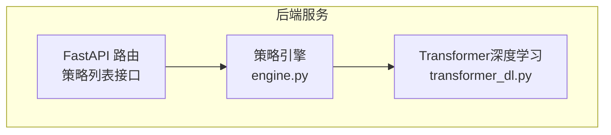
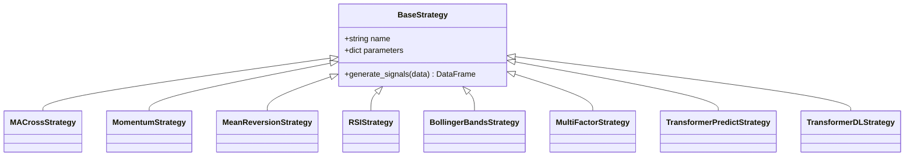
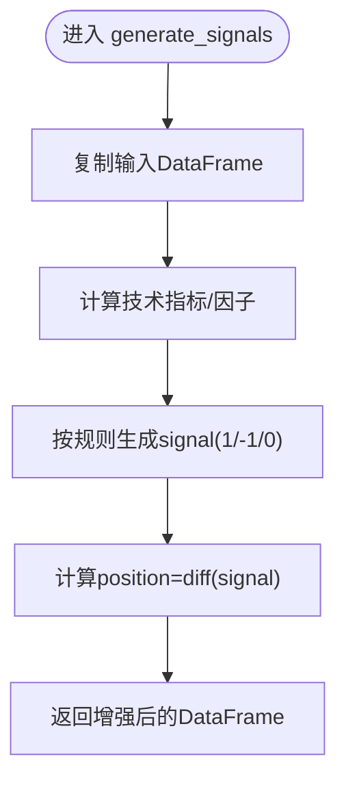
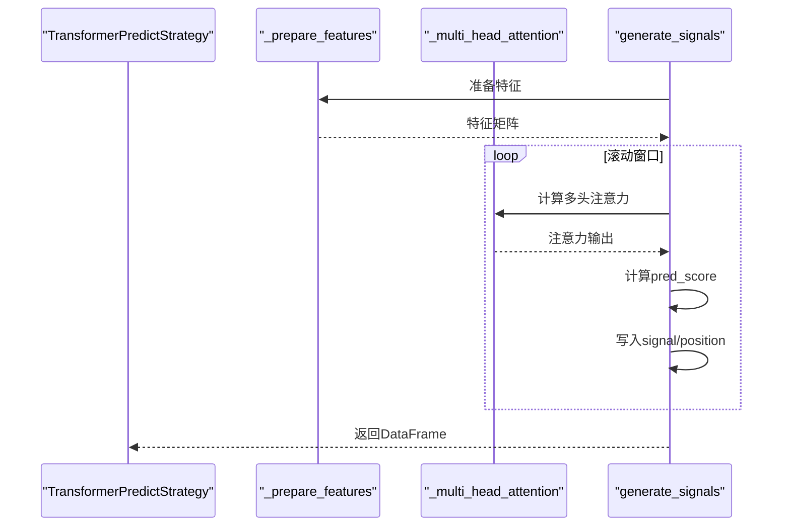
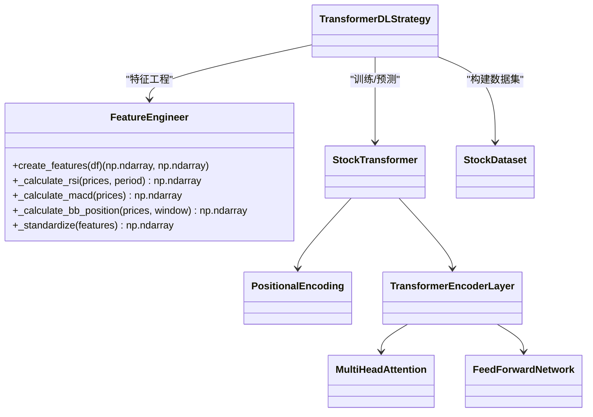
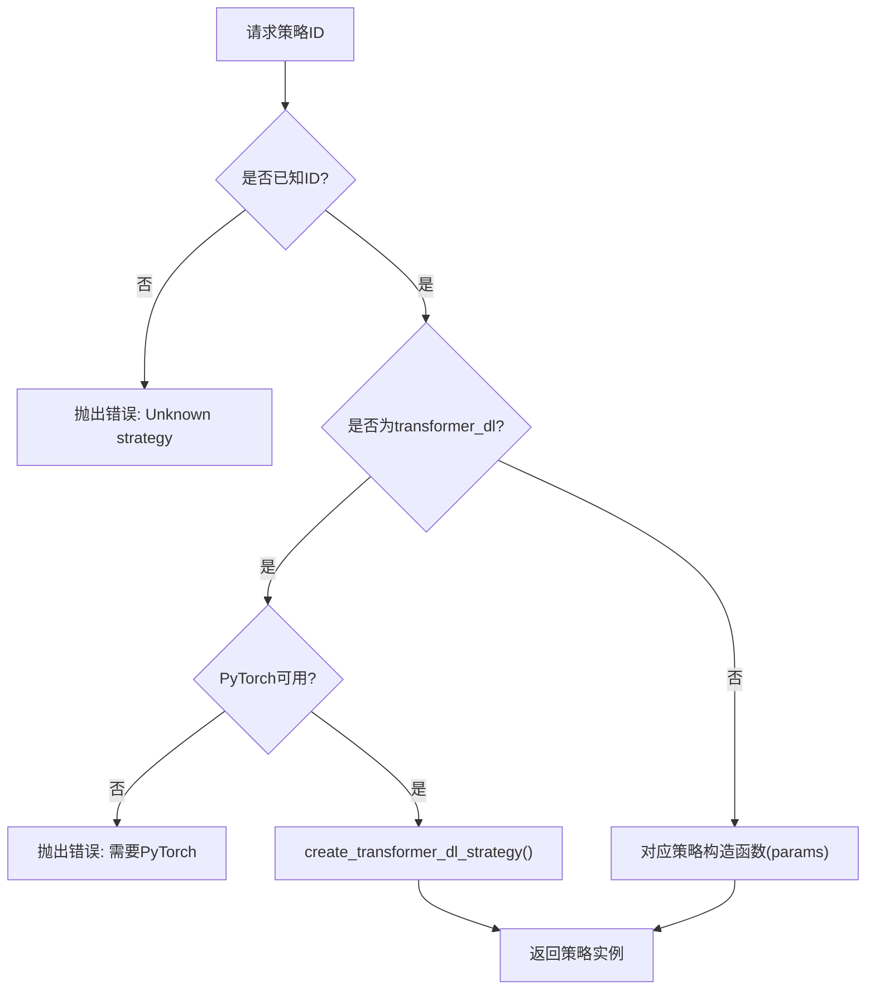
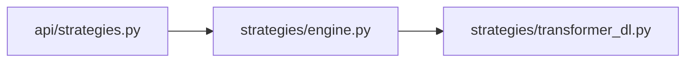

# 策略引擎实现

<cite>
**本文引用的文件**   
- [backend/app/strategies/engine.py](../../../../../../backend/app/strategies/engine.py)
- [backend/app/strategies/transformer_dl.py](../../../../../../backend/app/strategies/transformer_dl.py)
- [backend/app/api/strategies.py](../../../../../../backend/app/api/strategies.py)
</cite>

## 目录
1. [简介](#简介)
2. [项目结构](#项目结构)
3. [核心组件](#核心组件)
4. [架构总览](#架构总览)
5. [详细组件分析](#详细组件分析)
6. [依赖关系分析](#依赖关系分析)
7. [性能与可扩展性](#性能与可扩展性)
8. [故障排查指南](#故障排查指南)
9. [结论](#结论)
10. [附录：策略开发指南](#附录策略开发指南)

## 简介
本文件系统性梳理量化策略引擎的实现，重点包括：
- BaseStrategy 基类的设计模式、抽象方法定义、生命周期管理与参数传递机制
- 七种量化策略的具体实现：均线交叉、动量、均值回归、RSI、布林带、多因子选股、Transformer深度学习
- 策略工厂模式的注册与动态实例化流程
- 面向开发者的扩展指南与最佳实践

## 项目结构
策略相关代码集中在后端模块中，关键路径如下：
- backend/app/strategies/engine.py：策略基类、经典策略实现、策略清单与工厂函数
- backend/app/strategies/transformer_dl.py：基于 PyTorch 的 Transformer 深度学习策略与模型组件
- backend/app/api/strategies.py：对外暴露的策略列表 API（FastAPI）

图表来源
- [backend/app/api/strategies.py:1-25](../../../../../../backend/app/api/strategies.py#L1-L25)
- [backend/app/strategies/engine.py:506-656](../../../../../../backend/app/strategies/engine.py#L506-L656)
- [backend/app/strategies/transformer_dl.py:322-516](../../../../../../backend/app/strategies/transformer_dl.py#L322-L516)

章节来源
- [backend/app/strategies/engine.py:1-656](../../../../../../backend/app/strategies/engine.py#L1-L656)
- [backend/app/strategies/transformer_dl.py:1-516](../../../../../../backend/app/strategies/transformer_dl.py#L1-L516)
- [backend/app/api/strategies.py:1-25](../../../../../../backend/app/api/strategies.py#L1-L25)

## 核心组件
- BaseStrategy：所有策略的统一基类，定义 name、parameters 属性与 generate_signals 抽象方法
- 经典策略族：MACrossStrategy、MomentumStrategy、MeanReversionStrategy、RSIStrategy、BollingerBandsStrategy、MultiFactorStrategy
- TransformerPredictStrategy：轻量级注意力加权预测策略（纯 NumPy/Pandas）
- TransformerDLStrategy：完整 PyTorch Transformer 深度学习策略（可选依赖）
- 工厂函数：get_available_strategies、create_strategy、create_transformer_dl_strategy

章节来源
- [backend/app/strategies/engine.py:17-504](../../../../../../backend/app/strategies/engine.py#L17-L504)
- [backend/app/strategies/transformer_dl.py:322-516](../../../../../../backend/app/strategies/transformer_dl.py#L322-L516)

## 架构总览
策略引擎采用“基类 + 具体策略 + 工厂”的分层设计。外部通过 FastAPI 暴露策略元数据；运行时通过工厂根据策略 ID 动态创建策略实例并执行信号生成。

图表来源
- [backend/app/strategies/engine.py:17-504](../../../../../../backend/app/strategies/engine.py#L17-L504)
- [backend/app/strategies/transformer_dl.py:322-488](../../../../../../backend/app/strategies/transformer_dl.py#L322-L488)

## 详细组件分析

### BaseStrategy 基类与设计模式
- 设计要点
  - 统一入口：所有策略必须实现 generate_signals(data) -> DataFrame
  - 参数封装：name 与 parameters 作为策略元信息，便于前端展示与校验
  - 生命周期：构造时初始化参数；运行时仅调用 generate_signals 完成信号计算
- 输入输出约定
  - 输入：包含 OHLCV 等列的 DataFrame（至少包含 Close）
  - 输出：在输入基础上追加 signal、position 等列，用于回测引擎消费

图表来源
- [backend/app/strategies/engine.py:17-25](../../../../../../backend/app/strategies/engine.py#L17-L25)

章节来源
- [backend/app/strategies/engine.py:17-25](../../../../../../backend/app/strategies/engine.py#L17-L25)

### 经典策略实现概览
- 均线交叉策略（MACrossStrategy）
  - 逻辑：短期均线上穿长期均线买入，下穿卖出；仅在信号变化时交易
  - 复杂度：O(n)，滚动窗口均值计算
- 动量策略（MomentumStrategy）
  - 逻辑：N日收益率超过阈值买入，低于负阈值卖出
  - 复杂度：O(n)
- 均值回归策略（MeanReversionStrategy）
  - 逻辑：价格低于下轨买入，高于上轨卖出
  - 复杂度：O(n)
- RSI策略（RSIStrategy）
  - 逻辑：RSI超卖买入、超买卖出
  - 复杂度：O(n)
- 布林带策略（BollingerBandsStrategy）
  - 逻辑：基于 %B 指标与带宽过滤，接近下轨买入、接近上轨卖出
  - 复杂度：O(n)
- 多因子选股策略（MultiFactorStrategy）
  - 逻辑：动量、波动率、换手率、均线偏离、RSI 五大因子归一化后加权打分，得分高买入、低卖出
  - 复杂度：O(n)，含多次滚动统计与归一化

章节来源
- [backend/app/strategies/engine.py:28-54](../../../../../../backend/app/strategies/engine.py#L28-L54)
- [backend/app/strategies/engine.py:57-81](../../../../../../backend/app/strategies/engine.py#L57-L81)
- [backend/app/strategies/engine.py:84-111](../../../../../../backend/app/strategies/engine.py#L84-L111)
- [backend/app/strategies/engine.py:114-150](../../../../../../backend/app/strategies/engine.py#L114-L150)
- [backend/app/strategies/engine.py:153-205](../../../../../../backend/app/strategies/engine.py#L153-L205)
- [backend/app/strategies/engine.py:208-324](../../../../../../backend/app/strategies/engine.py#L208-L324)

### Transformer 预测策略（轻量版）
- 核心思想
  - 使用多头自注意力对历史序列进行加权，结合特征（收益率、均线偏离、波动率等）得到预测分数，按阈值生成信号
  - 滚动窗口 Walk-forward 避免未来数据泄露
- 关键步骤
  - 特征准备：收益率、MA偏离、波动率、成交量变化等
  - 多头注意力：将输入切分为多个头分别计算注意力后拼接
  - 预测分数：线性组合注意力输出特征
  - 信号生成：pred_score > threshold 买入，< -threshold 卖出

图表来源
- [backend/app/strategies/engine.py:327-503](../../../../../../backend/app/strategies/engine.py#L327-L503)

章节来源
- [backend/app/strategies/engine.py:327-503](../../../../../../backend/app/strategies/engine.py#L327-L503)

### Transformer 深度学习策略（PyTorch）
- 模型组件
  - PositionalEncoding：正弦/余弦位置编码
  - MultiHeadAttention：多头自注意力，含残差连接与层归一化
  - FeedForwardNetwork：两层前馈网络，ReLU激活与Dropout
  - StockTransformer：编码器堆叠 + 输出头预测未来收益
- 训练与预测
  - 滚动窗口训练：固定训练窗口长度，周期性重训
  - DataLoader 分批训练，Adam优化器，余弦退火学习率调度
  - 预测：取最后一个时间步的输出，作为未来收益预测
- 策略行为
  - 生成 pred_return，按 buy_threshold/sell_threshold 生成信号

图表来源
- [backend/app/strategies/transformer_dl.py:30-137](../../../../../../backend/app/strategies/transformer_dl.py#L30-L137)
- [backend/app/strategies/transformer_dl.py:143-304](../../../../../../backend/app/strategies/transformer_dl.py#L143-L304)
- [backend/app/strategies/transformer_dl.py:306-321](../../../../../../backend/app/strategies/transformer_dl.py#L306-L321)
- [backend/app/strategies/transformer_dl.py:322-488](../../../../../../backend/app/strategies/transformer_dl.py#L322-L488)

章节来源
- [backend/app/strategies/transformer_dl.py:30-137](../../../../../../backend/app/strategies/transformer_dl.py#L30-L137)
- [backend/app/strategies/transformer_dl.py:143-304](../../../../../../backend/app/strategies/transformer_dl.py#L143-L304)
- [backend/app/strategies/transformer_dl.py:306-321](../../../../../../backend/app/strategies/transformer_dl.py#L306-L321)
- [backend/app/strategies/transformer_dl.py:322-488](../../../../../../backend/app/strategies/transformer_dl.py#L322-L488)

### 策略工厂与注册机制
- 策略清单：get_available_strategies 返回所有可用策略的元数据（id、name、description、parameters），供前端渲染与参数校验
- 动态实例化：create_strategy 根据 strategy_id 选择对应构造函数并传入参数
- 深度学习策略：当 strategy_id 为 transformer_dl 时，若未安装 PyTorch 则抛出 ImportError；否则调用 create_transformer_dl_strategy

图表来源
- [backend/app/strategies/engine.py:506-656](../../../../../../backend/app/strategies/engine.py#L506-L656)
- [backend/app/strategies/transformer_dl.py:492-516](../../../../../../backend/app/strategies/transformer_dl.py#L492-L516)

章节来源
- [backend/app/strategies/engine.py:506-656](../../../../../../backend/app/strategies/engine.py#L506-L656)
- [backend/app/strategies/transformer_dl.py:492-516](../../../../../../backend/app/strategies/transformer_dl.py#L492-L516)

## 依赖关系分析
- 内部依赖
  - engine.py 依赖 transformer_dl.py（可选）以支持深度学习策略
  - api/strategies.py 依赖 engine.py 获取策略清单
- 外部依赖
  - pandas、numpy（数据处理）
  - torch（深度学习策略，可选）

图表来源
- [backend/app/api/strategies.py:1-25](../../../../../../backend/app/api/strategies.py#L1-L25)
- [backend/app/strategies/engine.py:1-15](../../../../../../backend/app/strategies/engine.py#L1-L15)
- [backend/app/strategies/transformer_dl.py:18-25](../../../../../../backend/app/strategies/transformer_dl.py#L18-L25)

章节来源
- [backend/app/api/strategies.py:1-25](../../../../../../backend/app/api/strategies.py#L1-L25)
- [backend/app/strategies/engine.py:1-15](../../../../../../backend/app/strategies/engine.py#L1-L15)
- [backend/app/strategies/transformer_dl.py:18-25](../../../../../../backend/app/strategies/transformer_dl.py#L18-L25)

## 性能与可扩展性
- 性能特性
  - 经典策略均为向量化实现，时间复杂度 O(n)，适合长序列回测
  - TransformerDLStrategy 涉及深度学习训练，训练窗口越大、epochs 越多，耗时越高；建议合理设置 train_window、batch_size、epochs
- 可扩展性
  - 新增策略：继承 BaseStrategy 并在 engine.py 中注册到 get_available_strategies 与 create_strategy
  - 深度学习策略：可替换 StockTransformer 或调整特征工程 FeatureEngineer

[本节为通用指导，不直接分析具体文件]

## 故障排查指南
- 常见错误
  - Unknown strategy：传入的 strategy_id 不在注册表中
  - 缺少 PyTorch：使用 transformer_dl 但未安装 torch
- 定位建议
  - 检查 create_strategy 分支逻辑是否正确匹配 strategy_id
  - 确认 transformer_dl.py 的 TORCH_AVAILABLE 标志与导入是否正常

章节来源
- [backend/app/strategies/engine.py:600-656](../../../../../../backend/app/strategies/engine.py#L600-L656)
- [backend/app/strategies/transformer_dl.py:492-516](../../../../../../backend/app/strategies/transformer_dl.py#L492-L516)

## 结论
该策略引擎以 BaseStrategy 为核心抽象，提供统一的信号生成接口；通过工厂模式集中管理策略注册与实例化，兼顾了经典技术分析与深度学习策略的可扩展性。开发者可在此基础上快速扩展新策略，并通过 API 暴露给前端使用。

[本节为总结性内容，不直接分析具体文件]

## 附录：策略开发指南

### 如何继承 BaseStrategy
- 新建类继承 BaseStrategy
- 在 __init__ 中调用 super().__init__(name, parameters) 保存策略名称与参数
- 实现 generate_signals(data) -> DataFrame，遵循以下约定：
  - 输入：至少包含 Close 列的 DataFrame
  - 输出：在输入基础上追加 signal、position 列；必要时可追加中间指标列

章节来源
- [backend/app/strategies/engine.py:17-25](../../../../../../backend/app/strategies/engine.py#L17-L25)

### 实现 generate_signals 的最佳实践
- 使用 pandas 向量化操作，避免逐行循环
- 先计算指标，再基于阈值/交叉条件生成 signal
- 使用 diff(signal) 得到 position，减少重复交易
- 处理 NaN 与除零情况（如 band_width 为 0）

章节来源
- [backend/app/strategies/engine.py:28-54](../../../../../../backend/app/strategies/engine.py#L28-L54)
- [backend/app/strategies/engine.py:153-205](../../../../../../backend/app/strategies/engine.py#L153-L205)

### 自定义指标计算
- 参考 RSI、MACD、布林带等内置计算方法
- 注意数值稳定性（加极小值防止除零）
- 对滚动窗口结果进行填充或边界处理

章节来源
- [backend/app/strategies/engine.py:114-150](../../../../../../backend/app/strategies/engine.py#L114-L150)
- [backend/app/strategies/transformer_dl.py:98-137](../../../../../../backend/app/strategies/transformer_dl.py#L98-L137)

### 注册新策略
- 在 engine.py 中添加策略类
- 在 get_available_strategies 中补充策略元数据（id、name、description、parameters）
- 在 create_strategy 中增加分支以支持动态实例化

章节来源
- [backend/app/strategies/engine.py:506-656](../../../../../../backend/app/strategies/engine.py#L506-L656)