# Transformer深度学习策略

<cite>
**本文引用的文件**   
- [transformer_dl.py](../../../../../../../backend/app/strategies/transformer_dl.py)
- [engine.py](../../../../../../../backend/app/strategies/engine.py)
- [backtest_engine.py](../../../../../../../backend/app/backtest/engine.py)
- [models.py](../../../../../../../backend/app/models/models.py)
- [market_data.py](../../../../../../../backend/app/services/market_data.py)
- [strategies_api.py](../../../../../../../backend/app/api/strategies.py)
</cite>

## 目录
1. [引言](#引言)
2. [项目结构](#项目结构)
3. [核心组件](#核心组件)
4. [架构总览](#架构总览)
5. [详细组件分析](#详细组件分析)
6. [依赖关系分析](#依赖关系分析)
7. [性能与训练流程](#性能与训练流程)
8. [评估指标与回测](#评估指标与回测)
9. [故障排查指南](#故障排查指南)
10. [结论](#结论)
11. [附录：参数与配置](#附录参数与配置)

## 引言
本文件系统性梳理并解释本项目中基于 PyTorch 的 Transformer 深度学习策略，重点覆盖以下方面：
- Transformer 核心组件的数学原理与代码实现：位置编码、多头自注意力、前馈网络、层归一化、残差连接。
- 完整模型结构：输入投影、编码器堆叠、输出头；面向时间序列预测的任务建模方法（特征工程、序列构建、标签定义）。
- 训练流程：损失函数（MSE）、优化器（Adam）、学习率调度（余弦退火）、梯度裁剪、滚动窗口训练（Walk-forward validation）避免未来数据泄露。
- 信号生成与交易逻辑：预测收益率阈值触发买卖信号。
- 与传统统计模型的对比优势与计算成本权衡。
- 模型评估指标、过拟合防止技术与超参数调优建议。

## 项目结构
本项目后端采用模块化组织，Transformer 深度学习策略位于策略模块中，并通过统一策略引擎对外暴露。关键路径如下：
- 策略实现：backend/app/strategies/transformer_dl.py
- 策略注册与工厂：backend/app/strategies/engine.py
- 回测引擎：backend/app/backtest/engine.py
- 数据库模型：backend/app/models/models.py
- 市场数据服务：backend/app/services/market_data.py
- 策略 API：backend/app/api/strategies.py

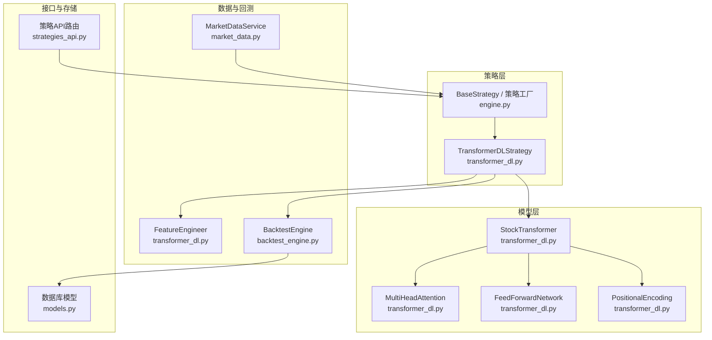

图表来源
- [transformer_dl.py:143-304](../../../../../../../backend/app/strategies/transformer_dl.py#L143-L304)
- [engine.py:327-503](../../../../../../../backend/app/strategies/engine.py#L327-L503)
- [backtest_engine.py:10-70](../../../../../../../backend/app/backtest/engine.py#L10-L70)
- [market_data.py:11-41](../../../../../../../backend/app/services/market_data.py#L11-L41)
- [strategies_api.py:1-25](../../../../../../../backend/app/api/strategies.py#L1-L25)
- [models.py:11-44](../../../../../../../backend/app/models/models.py#L11-L44)

章节来源
- [engine.py:17-25](../../../../../../../backend/app/strategies/engine.py#L17-L25)
- [engine.py:506-597](../../../../../../../backend/app/strategies/engine.py#L506-L597)
- [strategies_api.py:11-24](../../../../../../../backend/app/api/strategies.py#L11-L24)

## 核心组件
本节聚焦 Transformer 深度学习策略的核心类与方法，涵盖特征工程、模型组件、数据集封装、策略训练与信号生成。

- 特征工程 FeatureEngineer
  - 功能：从 OHLCV 原始价格序列构造 9 维特征向量，包括收益率、对数收益率、均线偏离度、波动率、成交量变化、RSI、MACD、布林带位置、动量，并进行 Z-score 标准化。目标为未来 N 日收益率。
  - 关键点：使用 pandas rolling 与 numpy 向量化计算，保证无 PyTorch 依赖。

- 位置编码 PositionalEncoding
  - 数学：PE(pos, 2i)=sin(pos/10000^(2i/d_model))，PE(pos, 2i+1)=cos(...)
  - 作用：为序列注入位置信息，使模型感知时间步顺序。

- 多头自注意力 MultiHeadAttention
  - 数学：Attention(Q,K,V)=softmax(QK^T/sqrt(d_k))V；多头将 Q/K/V 切分为多个子空间并行计算后拼接再线性变换。
  - 实现要点：Q/K/V 线性映射、缩放点积、可选 mask、Dropout、LayerNorm 残差连接。

- 前馈网络 FeedForwardNetwork
  - 数学：FFN(x)=ReLU(xW1+b1)W2+b2，含 Dropout 与 LayerNorm 残差连接。

- 编码器层 TransformerEncoderLayer
  - 组合：多头注意力 + FFN，均包含残差与归一化。

- 股票 Transformer StockTransformer
  - 结构：输入投影 -> 位置编码 -> N 层编码器 -> 取最后时间步 -> 输出头（两层 MLP，输出 pred_horizon 维预测）。
  - 初始化：Xavier 均匀初始化权重。

- 数据集 StockDataset
  - 封装：将特征与目标对齐为滑动窗口样本 (x_t:t+seq_len, y_{t+seq_len})。

- 策略 TransformerDLStrategy
  - 训练：Adam + CosineAnnealingLR + MSE + 梯度裁剪。
  - 滚动窗口：固定长度训练窗口，周期性重训，避免未来数据泄露。
  - 预测：取最近 seq_length 历史特征作为输入，输出首维预测收益率。
  - 信号：根据预测收益率阈值生成买入/卖出信号。

章节来源
- [transformer_dl.py:30-137](../../../../../../../backend/app/strategies/transformer_dl.py#L30-L137)
- [transformer_dl.py:143-235](../../../../../../../backend/app/strategies/transformer_dl.py#L143-L235)
- [transformer_dl.py:237-304](../../../../../../../backend/app/strategies/transformer_dl.py#L237-L304)
- [transformer_dl.py:306-320](../../../../../../../backend/app/strategies/transformer_dl.py#L306-L320)
- [transformer_dl.py:324-487](../../../../../../../backend/app/strategies/transformer_dl.py#L324-L487)

## 架构总览
下图展示 Transformer 深度学习策略在系统中的整体交互：策略通过特征工程准备数据，构建 PyTorch 模型进行滚动训练与预测，最终生成交易信号供回测引擎评估。

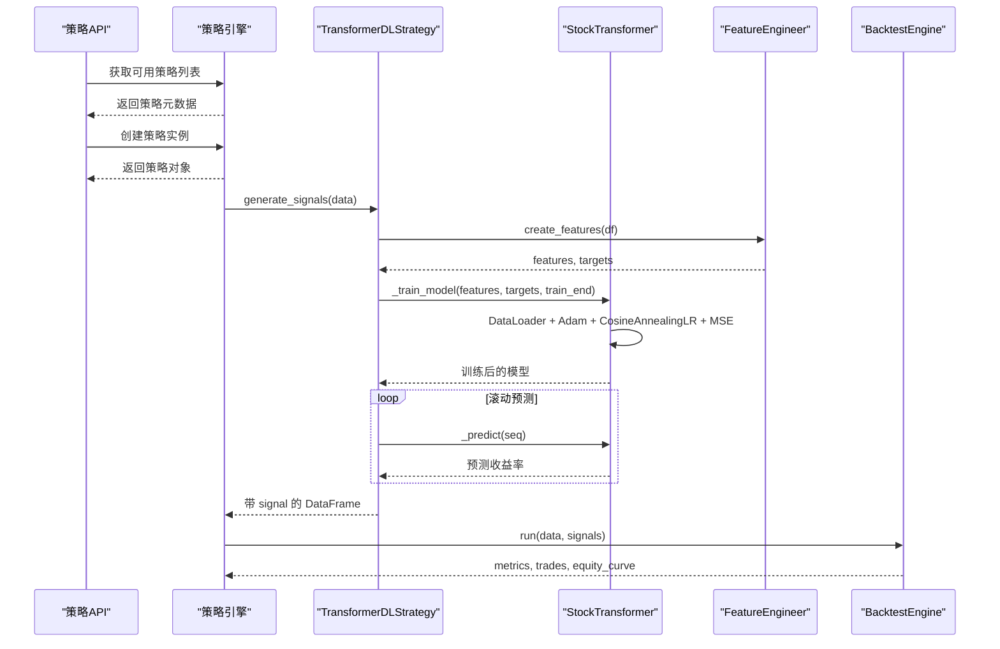

图表来源
- [strategies_api.py:11-24](../../../../../../../backend/app/api/strategies.py#L11-L24)
- [engine.py:600-655](../../../../../../../backend/app/strategies/engine.py#L600-L655)
- [transformer_dl.py:449-487](../../../../../../../backend/app/strategies/transformer_dl.py#L449-L487)
- [backtest_engine.py:15-70](../../../../../../../backend/app/backtest/engine.py#L15-L70)

## 详细组件分析

### 位置编码 PositionalEncoding
- 目的：为序列注入绝对位置信息，帮助模型区分不同时间步。
- 实现细节：预计算 pe 矩阵，按奇偶维度分别填充 sin/cos，并在 forward 中与输入相加，随后 Dropout。
- 复杂度：O(max_len * d_model)，仅一次预计算。

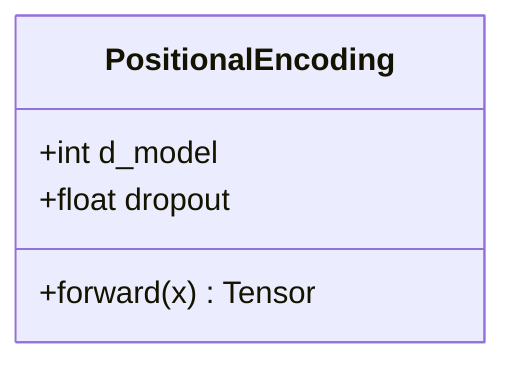

图表来源
- [transformer_dl.py:143-166](../../../../../../../backend/app/strategies/transformer_dl.py#L143-L166)

章节来源
- [transformer_dl.py:143-166](../../../../../../../backend/app/strategies/transformer_dl.py#L143-L166)

### 多头自注意力 MultiHeadAttention
- 数学：
  - Attention(Q,K,V)=softmax(QK^T/sqrt(d_k))V
  - MultiHead=Concat(head_1,...,head_h)W^O
- 实现要点：
  - Q/K/V 线性映射后 reshape 为多头形状并转置。
  - 缩放点积得分，支持 mask 屏蔽未来位置。
  - Softmax 后 Dropout，乘以 V 得到上下文向量。
  - 输出线性变换，Dropout，LayerNorm 残差连接。

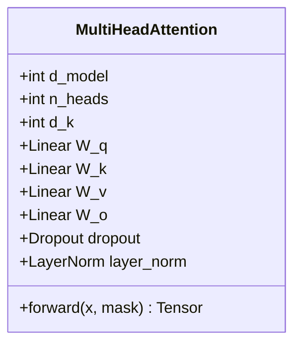

图表来源
- [transformer_dl.py:168-213](../../../../../../../backend/app/strategies/transformer_dl.py#L168-L213)

章节来源
- [transformer_dl.py:168-213](../../../../../../../backend/app/strategies/transformer_dl.py#L168-L213)

### 前馈网络 FeedForwardNetwork
- 数学：FFN(x)=ReLU(xW1+b1)W2+b2
- 实现要点：两层线性 + ReLU + Dropout + LayerNorm 残差连接。

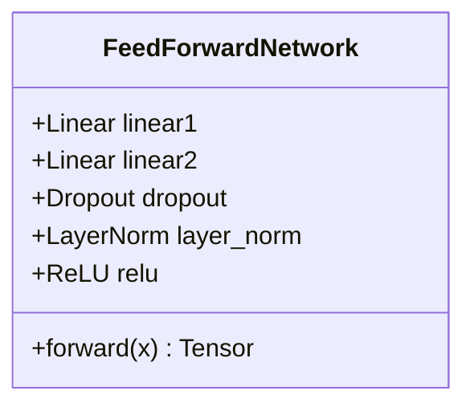

图表来源
- [transformer_dl.py:215-235](../../../../../../../backend/app/strategies/transformer_dl.py#L215-L235)

章节来源
- [transformer_dl.py:215-235](../../../../../../../backend/app/strategies/transformer_dl.py#L215-L235)

### 编码器层 TransformerEncoderLayer
- 组成：多头注意力 + FFN，均遵循残差与归一化模式。

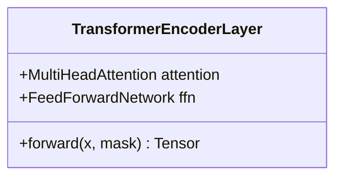

图表来源
- [transformer_dl.py:237-247](../../../../../../../backend/app/strategies/transformer_dl.py#L237-L247)

章节来源
- [transformer_dl.py:237-247](../../../../../../../backend/app/strategies/transformer_dl.py#L237-L247)

### 股票 Transformer StockTransformer
- 结构：
  - 输入投影：nn.Linear(input_dim, d_model)
  - 位置编码：PositionalEncoding
  - 编码器堆叠：n_layers 个 TransformerEncoderLayer
  - 输出头：两层 MLP，输出 pred_horizon 维预测
- 前向传播：取最后一个时间步的特征进入输出头。

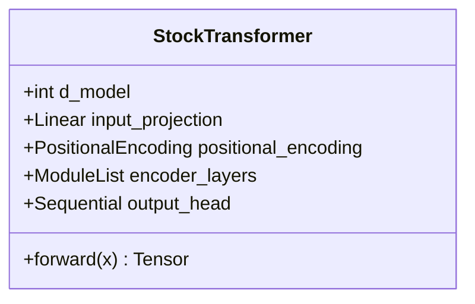

图表来源
- [transformer_dl.py:249-304](../../../../../../../backend/app/strategies/transformer_dl.py#L249-L304)

章节来源
- [transformer_dl.py:249-304](../../../../../../../backend/app/strategies/transformer_dl.py#L249-L304)

### 数据集 StockDataset
- 作用：将连续特征序列转换为监督学习样本，x 为长度为 seq_length 的历史窗口，y 为下一时刻的目标值。

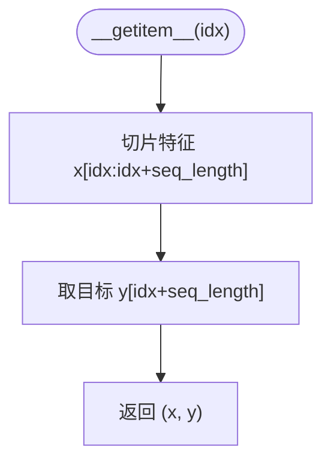

图表来源
- [transformer_dl.py:306-320](../../../../../../../backend/app/strategies/transformer_dl.py#L306-L320)

章节来源
- [transformer_dl.py:306-320](../../../../../../../backend/app/strategies/transformer_dl.py#L306-L320)

### 策略 TransformerDLStrategy
- 训练流程：
  - 构建 DataLoader，使用 Adam 优化器，CosineAnnealingLR 学习率调度，MSELoss 损失函数，梯度裁剪 max_norm=1.0。
  - 滚动窗口训练：每次以固定长度 train_window 的数据训练，周期 retrain_interval 重训，避免未来数据泄露。
- 预测流程：
  - 取最近 seq_length 特征作为输入，模型输出首维预测收益率。
- 信号生成：
  - 根据预测收益率阈值 buy_threshold/sell_threshold 生成 1/-1 信号，diff 得到 position 变化。

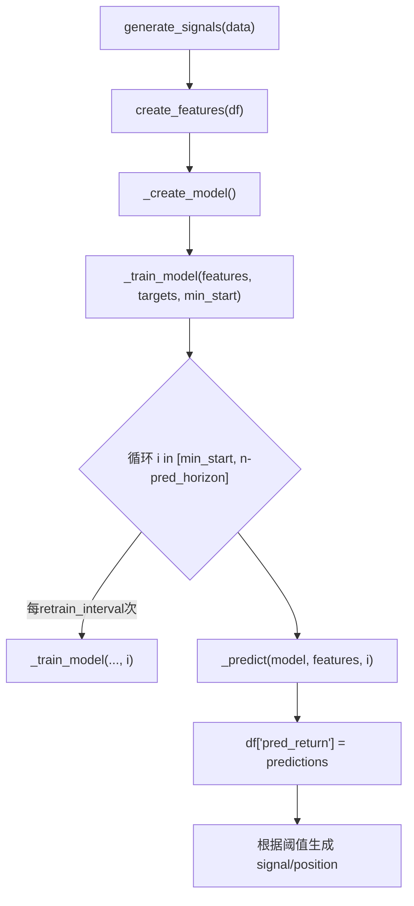

图表来源
- [transformer_dl.py:449-487](../../../../../../../backend/app/strategies/transformer_dl.py#L449-L487)
- [transformer_dl.py:397-436](../../../../../../../backend/app/strategies/transformer_dl.py#L397-L436)

章节来源
- [transformer_dl.py:324-487](../../../../../../../backend/app/strategies/transformer_dl.py#L324-L487)

## 依赖关系分析
- 策略引擎 engine.py 提供 BaseStrategy 抽象与多种传统策略实现，同时注册深度学习策略 TransformerDLStrategy。
- transformer_dl.py 中的 StockTransformer 依赖 torch.nn 模块，且仅在 TORCH_AVAILABLE=True 时加载。
- backtest_engine.py 负责将策略信号转化为资金曲线与绩效指标。
- market_data.py 提供多数据源的市场数据接入。
- models.py 定义策略与回测结果的持久化结构。
- strategies_api.py 暴露策略列表与详情查询接口。

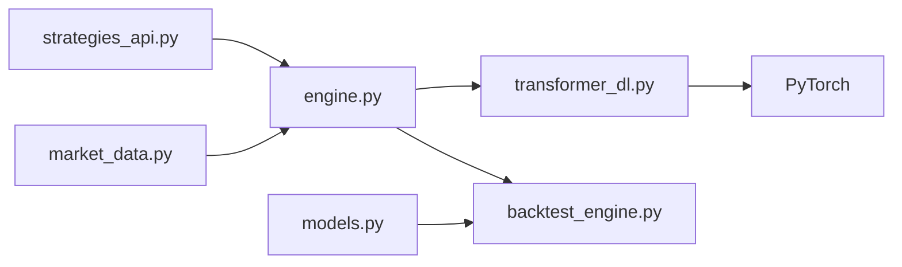

图表来源
- [strategies_api.py:1-25](../../../../../../../backend/app/api/strategies.py#L1-L25)
- [engine.py:1-14](../../../../../../../backend/app/strategies/engine.py#L1-L14)
- [engine.py:600-655](../../../../../../../backend/app/strategies/engine.py#L600-L655)
- [transformer_dl.py:18-25](../../../../../../../backend/app/strategies/transformer_dl.py#L18-L25)
- [backtest_engine.py:10-70](../../../../../../../backend/app/backtest/engine.py#L10-L70)
- [market_data.py:11-41](../../../../../../../backend/app/services/market_data.py#L11-L41)
- [models.py:11-44](../../../../../../../backend/app/models/models.py#L11-L44)

章节来源
- [engine.py:1-14](../../../../../../../backend/app/strategies/engine.py#L1-L14)
- [engine.py:600-655](../../../../../../../backend/app/strategies/engine.py#L600-L655)
- [transformer_dl.py:18-25](../../../../../../../backend/app/strategies/transformer_dl.py#L18-L25)

## 性能与训练流程

### 数学原理与复杂度
- 位置编码：O(max_len * d_model)
- 多头注意力：
  - QK^T 计算 O(batch * heads * seq_len^2 * d_k)
  - softmax 与加权求和 O(batch * heads * seq_len^2)
- 前馈网络：O(seq_len * d_model * d_ff)
- 总体复杂度随序列长度呈平方增长，需控制 seq_length 与 batch_size。

### 训练流程
- 损失函数：MSELoss，针对预测收益率的首维输出。
- 优化器：Adam，weight_decay=1e-5。
- 学习率调度：CosineAnnealingLR(T_max=epochs)。
- 梯度裁剪：clip_grad_norm_(max_norm=1.0) 防止梯度爆炸。
- 设备选择：自动检测 CUDA/CPU。

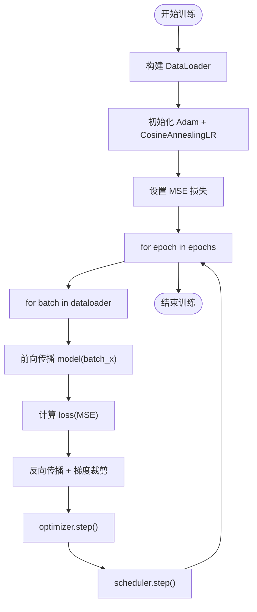

图表来源
- [transformer_dl.py:397-436](../../../../../../../backend/app/strategies/transformer_dl.py#L397-L436)

章节来源
- [transformer_dl.py:397-436](../../../../../../../backend/app/strategies/transformer_dl.py#L397-L436)

### 滚动窗口训练（Walk-forward Validation）
- 原理：在每个时间点 i，使用固定长度的历史窗口 [i-train_window, i) 训练模型，然后对 i 时刻进行预测；每隔 retrain_interval 步重训一次，逐步推进。
- 优势：严格避免未来数据泄露，模拟真实交易环境下的在线学习过程。
- 实现要点：
  - 最小起始点 min_start=train_window+seq_length
  - 周期性重训 last_retrain 更新
  - 预测取最近 seq_length 历史特征

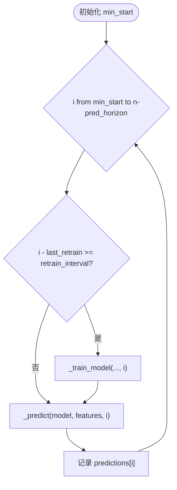

图表来源
- [transformer_dl.py:449-487](../../../../../../../backend/app/strategies/transformer_dl.py#L449-L487)

章节来源
- [transformer_dl.py:449-487](../../../../../../../backend/app/strategies/transformer_dl.py#L449-L487)

## 评估指标与回测
回测引擎计算以下指标：
- 总收益率、年化收益率、最大回撤、夏普比率、胜率、盈亏比、总交易次数等。
- 资金曲线与交易明细。

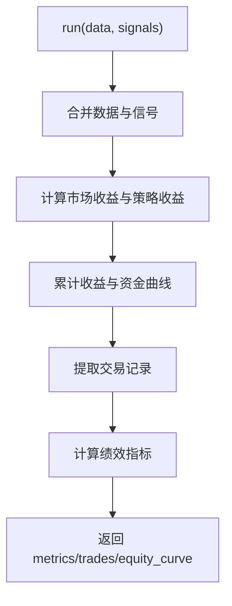

图表来源
- [backtest_engine.py:15-70](../../../../../../../backend/app/backtest/engine.py#L15-L70)
- [backtest_engine.py:105-162](../../../../../../../backend/app/backtest/engine.py#L105-L162)

章节来源
- [backtest_engine.py:15-70](../../../../../../../backend/app/backtest/engine.py#L15-L70)
- [backtest_engine.py:105-162](../../../../../../../backend/app/backtest/engine.py#L105-L162)

## 故障排查指南
- PyTorch 未安装或导入失败：
  - 现象：调用 create_transformer_dl_strategy 抛出 ImportError。
  - 处理：安装 PyTorch CPU 精简版或 GPU 版本，确保环境变量正确。
- 设备选择异常：
  - 现象：device='auto' 无法识别 CUDA。
  - 处理：显式指定 device='cpu' 或 'cuda'。
- 训练不稳定或梯度爆炸：
  - 现象：loss 发散或 NaN。
  - 处理：检查梯度裁剪是否启用，适当降低 learning_rate 或增大 batch_size。
- 滚动窗口训练无效：
  - 现象：预测结果全零或信号极少。
  - 处理：确认 train_window 与 seq_length 足够大，retrain_interval 合理。

章节来源
- [transformer_dl.py:492-515](../../../../../../../backend/app/strategies/transformer_dl.py#L492-L515)
- [engine.py:647-653](../../../../../../../backend/app/strategies/engine.py#L647-L653)

## 结论
本项目实现了完整的 Transformer 深度学习策略，涵盖从特征工程、模型构建、滚动训练到信号生成与回测评估的全链路。相比传统统计模型（如均线交叉、RSI、布林带），Transformer 能够捕捉长距离依赖与非线性模式，具备更强的表达能力；但代价是更高的计算成本与更复杂的超参数调优。在实际应用中，应结合数据规模、算力条件与业务需求，合理配置 seq_length、d_model、n_heads、n_layers、epochs 等参数，并使用滚动窗口训练避免未来数据泄露，以获得稳健的回测与实盘表现。

## 附录：参数与配置
- 策略参数（来自策略工厂与前端表单校验）：
  - seq_length: 10-60，默认 30
  - pred_horizon: 1-20，默认 5
  - d_model: 32-128，默认 64
  - n_heads: 2-8，默认 4
  - n_layers: 1-4，默认 2
  - epochs: 10-100，默认 50
  - buy_threshold: 0.005-0.05，默认 0.02
  - sell_threshold: -0.05~-0.005，默认 -0.02

章节来源
- [engine.py:582-596](../../../../../../../backend/app/strategies/engine.py#L582-L596)
- [QUICKSTART.md:192-204](../../../../../../../QUICKSTART.md#L192-L204)