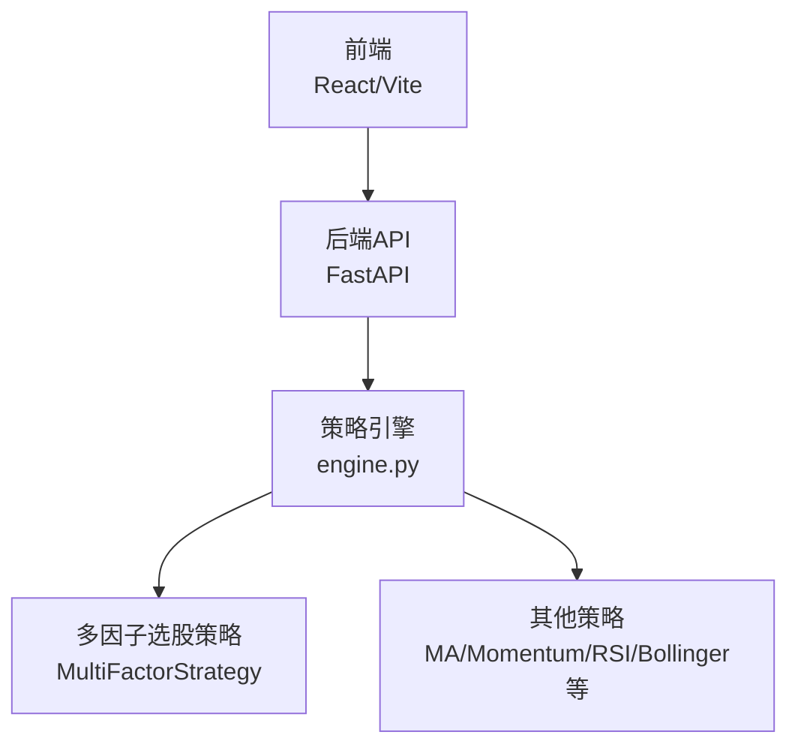
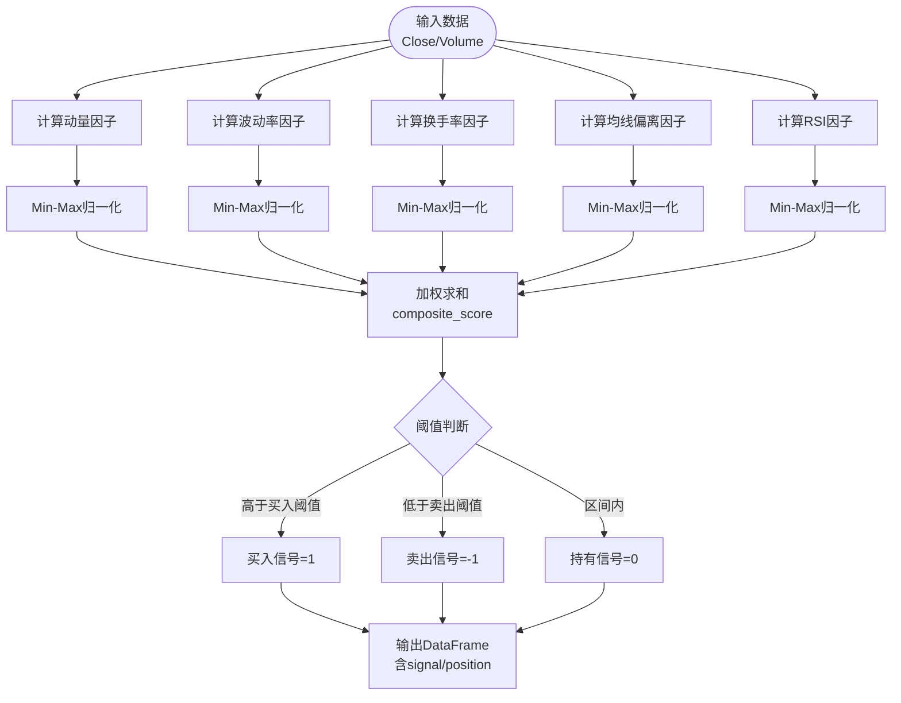
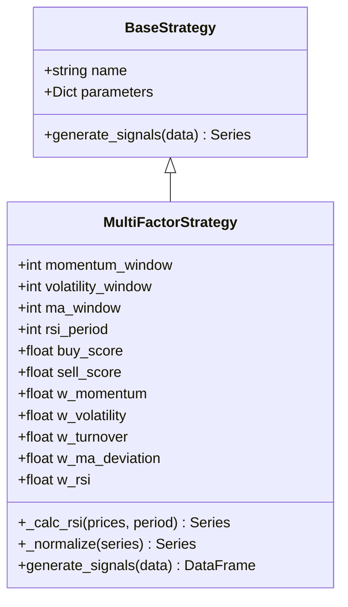
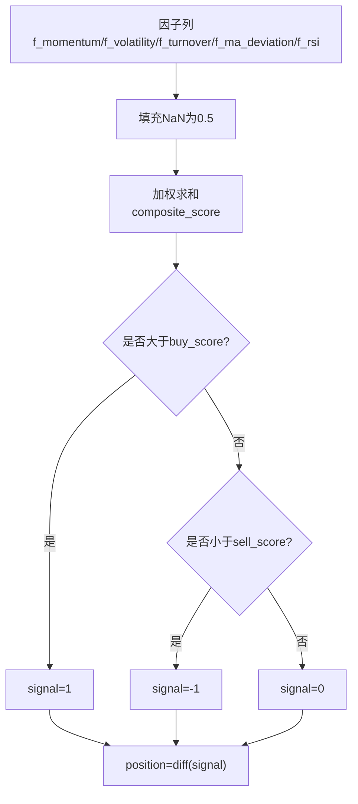

# 多因子选股策略

<cite>
**本文引用的文件**   
- [backend/app/strategies/engine.py](../../../../../../../backend/app/strategies/engine.py)
- [backend/app/api/strategies.py](../../../../../../../backend/app/api/strategies.py)
- [QUICKSTART.md](../../../../../../../QUICKSTART.md)
</cite>

## 目录
1. [引言](#引言)
2. [项目结构](#项目结构)
3. [核心组件](#核心组件)
4. [架构总览](#架构总览)
5. [详细组件分析](#详细组件分析)
6. [依赖关系分析](#依赖关系分析)
7. [性能与实现要点](#性能与实现要点)
8. [故障排查指南](#故障排查指南)
9. [结论](#结论)
10. [附录：参数与阈值说明](#附录参数与阈值说明)

## 引言
本文件面向“多因子选股策略”的完整技术文档，聚焦以下目标：
- 解释多因子模型的设计原理与经济学含义
- 详解动量、波动率、换手率、均线偏离、RSI五大因子的计算方式
- 说明因子归一化（Min-Max）的实现细节与必要性
- 阐述权重分配机制与优化思路
- 给出完整的因子组合打分算法、信号生成与阈值设置
- 提供因子相关性分析与有效性检验的实践建议
- 对比传统单因子策略的优势，并讨论在A股市场的适用性与局限

## 项目结构
本项目采用前后端分离架构。后端通过FastAPI暴露策略接口，策略逻辑集中在策略引擎中；前端负责回测表单与结果展示。多因子选股策略作为后端策略之一，由策略引擎统一管理与调用。

**图表来源**
- [backend/app/api/strategies.py:1-25](../../../../../../../backend/app/api/strategies.py#L1-L25)
- [backend/app/strategies/engine.py:506-597](../../../../../../../backend/app/strategies/engine.py#L506-L597)

**章节来源**
- [backend/app/api/strategies.py:1-25](../../../../../../../backend/app/api/strategies.py#L1-L25)
- [backend/app/strategies/engine.py:506-597](../../../../../../../backend/app/strategies/engine.py#L506-L597)

## 核心组件
- BaseStrategy：策略基类，定义统一的generate_signals接口
- MultiFactorStrategy：多因子选股策略的核心实现，包含五大因子计算、归一化、加权打分与信号生成
- get_available_strategies / create_strategy：策略注册与工厂方法，对外暴露策略元数据与实例创建能力
- strategies API路由：提供策略列表与详情查询接口

**章节来源**
- [backend/app/strategies/engine.py:17-26](../../../../../../../backend/app/strategies/engine.py#L17-L26)
- [backend/app/strategies/engine.py:208-324](../../../../../../../backend/app/strategies/engine.py#L208-L324)
- [backend/app/strategies/engine.py:506-597](../../../../../../../backend/app/strategies/engine.py#L506-L597)
- [backend/app/api/strategies.py:1-25](../../../../../../../backend/app/api/strategies.py#L1-L25)

## 架构总览
多因子选股策略的数据流如下：输入OHLCV数据 → 计算各因子 → Min-Max归一化 → 加权求和得到综合得分 → 根据阈值生成交易信号 → 输出带signal与position列的结果DataFrame。

**图表来源**
- [backend/app/strategies/engine.py:267-324](../../../../../../../backend/app/strategies/engine.py#L267-L324)

## 详细组件分析

### 多因子选股策略类（MultiFactorStrategy）
该类实现了五因子打分与信号生成流程，关键方法与字段如下：
- 初始化参数：窗口长度（动量、波动率、均线）、RSI周期、买卖阈值、各因子权重
- _calc_rsi：RSI计算
- _normalize：Min-Max归一化到[0,1]
- generate_signals：因子计算、归一化、加权求和、信号生成

**图表来源**
- [backend/app/strategies/engine.py:17-26](../../../../../../../backend/app/strategies/engine.py#L17-L26)
- [backend/app/strategies/engine.py:208-324](../../../../../../../backend/app/strategies/engine.py#L208-L324)

**章节来源**
- [backend/app/strategies/engine.py:208-324](../../../../../../../backend/app/strategies/engine.py#L208-L324)

### 因子计算方法与经济学含义

#### 动量因子
- 计算方式：过去N日收益率（pct_change），越高得分越高
- 经济学含义：趋势延续性，追涨杀跌的动量效应
- 实现位置：[backend/app/strategies/engine.py:274-277](../../../../../../../backend/app/strategies/engine.py#L274-L277)

#### 波动率因子
- 计算方式：过去N日收益率的标准差（滚动std），取负值后归一化，低波动得分高
- 经济学含义：低波溢价，规避高波动风险
- 实现位置：[backend/app/strategies/engine.py:279-283](../../../../../../../backend/app/strategies/engine.py#L279-L283)

#### 换手率因子
- 计算方式：用成交量近似换手率，取负值后归一化，低成交量得分高
- 经济学含义：流动性溢价，避免高换手带来的冲击成本
- 实现位置：[backend/app/strategies/engine.py:285-290](../../../../../../../backend/app/strategies/engine.py#L285-L290)

#### 均线偏离因子
- 计算方式：(均线 - 收盘价)/均线，价格低于均线时得分高（均值回归机会）
- 经济学含义：均值回归，超跌反弹
- 实现位置：[backend/app/strategies/engine.py:292-296](../../../../../../../backend/app/strategies/engine.py#L292-L296)

#### RSI因子
- 计算方式：RSI越低得分越高（对RSI取负后归一化）
- 经济学含义：超卖反弹机会
- 实现位置：[backend/app/strategies/engine.py:298-301](../../../../../../../backend/app/strategies/engine.py#L298-L301)

**章节来源**
- [backend/app/strategies/engine.py:274-301](../../../../../../../backend/app/strategies/engine.py#L274-L301)

### 因子归一化处理（Min-Max标准化）
- 目的：将不同量纲、不同分布的因子映射到统一区间[0,1]，便于加权求和与比较
- 实现细节：
  - 先dropna，若序列为空或max==min则返回常量0.5，避免除零与退化
  - 否则按(series - min)/(max - min)进行线性缩放
- 必要性：
  - 消除量纲差异，确保权重可比
  - 稳定阈值决策边界，减少极端值影响
- 实现位置：[backend/app/strategies/engine.py:260-265](../../../../../../../backend/app/strategies/engine.py#L260-L265)

**章节来源**
- [backend/app/strategies/engine.py:260-265](../../../../../../../backend/app/strategies/engine.py#L260-L265)

### 权重分配机制与优化方法
- 默认权重：动量0.25、波动率0.2、换手率0.15、均线偏离0.2、RSI 0.2
- 设定逻辑：
  - 动量与均线偏离赋予较高权重，强调趋势与均值回归
  - 波动率次之，体现风险控制
  - 换手率略低，降低流动性噪声
  - RSI中等权重，捕捉超卖反弹
- 优化方法建议：
  - 历史回测网格搜索或贝叶斯优化
  - 基于IC（信息系数）或IR（信息比率）的因子重要性排序
  - 动态权重（分市场状态切换）
- 实现位置：[backend/app/strategies/engine.py:220-250](../../../../../../../backend/app/strategies/engine.py#L220-L250)

**章节来源**
- [backend/app/strategies/engine.py:220-250](../../../../../../../backend/app/strategies/engine.py#L220-L250)

### 因子组合打分算法与信号阈值
- 综合得分公式：
  composite_score = w_momentum*f_momentum + w_volatility*f_volatility + w_turnover*f_turnover + w_ma_deviation*f_ma_deviation + w_rsi*f_rsi
- 信号规则：
  - composite_score > buy_score → 买入信号=1
  - composite_score < sell_score → 卖出信号=-1
  - 否则持有信号=0
- 缺失值处理：各因子NaN填充为0.5，保证打分连续性
- 实现位置：[backend/app/strategies/engine.py:303-322](../../../../../../../backend/app/strategies/engine.py#L303-L322)

**图表来源**
- [backend/app/strategies/engine.py:303-322](../../../../../../../backend/app/strategies/engine.py#L303-L322)

**章节来源**
- [backend/app/strategies/engine.py:303-322](../../../../../../../backend/app/strategies/engine.py#L303-L322)

### 与传统单因子策略相比的优势
- 分散风险：多因子互补，降低单一因子失效的风险
- 稳健性更强：在不同市场环境下，部分因子可能表现不佳，但整体更稳定
- 可解释性强：因子权重透明，便于研究与迭代
- 适配面广：可同时捕捉趋势、均值回归、波动率与流动性等多重收益来源

### 在A股市场中的适用性与局限性
- 适用性：
  - A股散户占比高，动量与均值回归现象较明显
  - 波动率与换手率能较好反映流动性与情绪
- 局限性：
  - 因子拥挤与衰减，需定期评估与再平衡
  - 交易成本与滑点影响显著，需结合风控与仓位管理
  - 宏观与政策冲击可能导致因子失效

## 依赖关系分析
- 策略引擎对外暴露get_available_strategies与create_strategy，供API层调用
- 多因子策略依赖pandas/numpy进行向量化计算
- API路由仅做轻量转发，不承载业务逻辑

**图表来源**
- [backend/app/api/strategies.py:1-25](../../../../../../../backend/app/api/strategies.py#L1-L25)
- [backend/app/strategies/engine.py:506-597](../../../../../../../backend/app/strategies/engine.py#L506-L597)

**章节来源**
- [backend/app/api/strategies.py:1-25](../../../../../../../backend/app/api/strategies.py#L1-L25)
- [backend/app/strategies/engine.py:506-597](../../../../../../../backend/app/strategies/engine.py#L506-L597)

## 性能与实现要点
- 向量化计算：使用pandas rolling与numpy数组运算，避免逐行循环
- 缺失值处理：fillna(0.5)保证打分连续性，避免NaN传播
- 数值稳定性：RSI计算中对loss为0的情况替换为nan，防止除零
- 内存占用：大规模截面数据时注意列的及时释放与复用

**章节来源**
- [backend/app/strategies/engine.py:252-265](../../../../../../../backend/app/strategies/engine.py#L252-L265)
- [backend/app/strategies/engine.py:303-322](../../../../../../../backend/app/strategies/engine.py#L303-L322)

## 故障排查指南
- 问题：RSI出现NaN导致打分异常
  - 原因：gain或loss为0导致rs计算为nan
  - 解决：代码中已对loss为0替换为nan，后续fillna(0.5)兜底
  - 参考：[backend/app/strategies/engine.py:252-258](../../../../../../../backend/app/strategies/engine.py#L252-L258)
- 问题：因子极值导致归一化失真
  - 原因：极端行情下max-min过大或为0
  - 解决：_normalize中对空序列或max==min返回0.5
  - 参考：[backend/app/strategies/engine.py:260-265](../../../../../../../backend/app/strategies/engine.py#L260-L265)
- 问题：成交量缺失
  - 原因：数据源无Volume列
  - 解决：若无Volume，换手率因子设为0.5
  - 参考：[backend/app/strategies/engine.py:285-290](../../../../../../../backend/app/strategies/engine.py#L285-L290)

**章节来源**
- [backend/app/strategies/engine.py:252-265](../../../../../../../backend/app/strategies/engine.py#L252-L265)
- [backend/app/strategies/engine.py:285-290](../../../../../../../backend/app/strategies/engine.py#L285-L290)

## 结论
多因子选股策略通过动量、波动率、换手率、均线偏离与RSI五个维度构建综合打分体系，利用Min-Max归一化与加权求和实现稳健的信号生成。该策略在A股市场中具备较好的适用性，但仍需关注因子衰减、交易成本与宏观冲击等风险。建议在实盘前进行充分的因子相关性分析、有效性检验与参数优化，并结合风控与仓位管理提升整体稳健性。

## 附录：参数与阈值说明
- 多因子策略参数范围与默认值（来自快速开始文档）：
  - 动量周期：5-60，默认20
  - 波动率周期：10-60，默认20
  - 均线周期：10-60，默认20
  - RSI周期：5-30，默认14
  - 买入阈值：0.5-0.9，默认0.6
  - 卖出阈值：0.1-0.5，默认0.4
- 策略注册与工厂方法：
  - get_available_strategies返回策略元数据，包括id、name、description与parameters
  - create_strategy根据strategy_id创建具体策略实例

**章节来源**
- [QUICKSTART.md:173-181](../../../../../../../QUICKSTART.md#L173-L181)
- [backend/app/strategies/engine.py:506-597](../../../../../../../backend/app/strategies/engine.py#L506-L597)