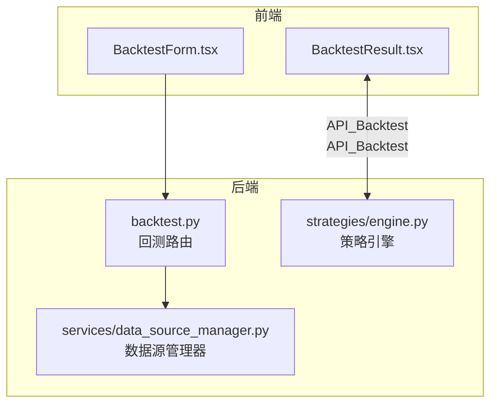
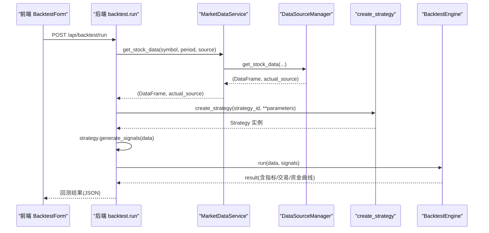
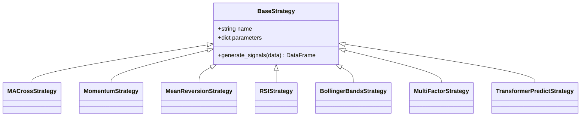
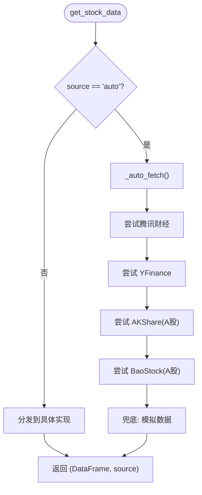
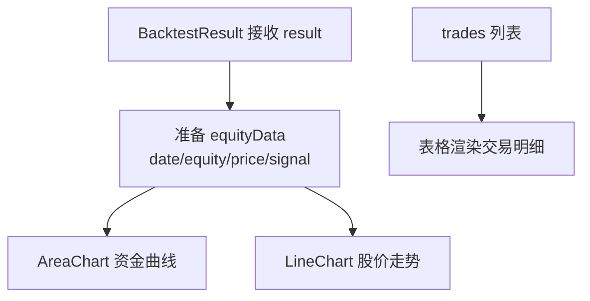

# 功能扩展指南

<cite>
**本文引用的文件**   
- [backend/app/strategies/engine.py](file://backend/app/strategies/engine.py)
- [backend/app/services/data_source_manager.py](file://backend/app/services/data_source_manager.py)
- [backend/app/api/backtest.py](file://backend/app/api/backtest.py)
- [frontend/src/components/BacktestForm.tsx](file://frontend/src/components/BacktestForm.tsx)
- [frontend/src/components/BacktestResult.tsx](file://frontend/src/components/BacktestResult.tsx)
- [DATA_SOURCES.md](file://DATA_SOURCES.md)
</cite>

## 目录
1. [引言](#引言)
2. [项目结构](#项目结构)
3. [核心组件](#核心组件)
4. [架构总览](#架构总览)
5. [详细组件分析](#详细组件分析)
6. [依赖关系分析](#依赖关系分析)
7. [性能与可扩展性](#性能与可扩展性)
8. [故障排查](#故障排查)
9. [结论](#结论)
10. [附录：变更影响边界与同步更新清单](#附录变更影响边界与同步更新清单)

## 引言
本指南面向希望扩展系统能力的开发者，覆盖以下主题：
- 新增量化策略的完整流程（继承基类、实现信号生成、注册元数据、参数配置）
- 扩展数据源（实现获取接口、异常降级、统一数据格式）
- 开发自定义可视化组件（React 组件结构、Recharts 集成、状态管理）
- 提供最佳实践、常见陷阱与解决方案
- 明确变更影响边界与前后端同步更新要求

## 项目结构
本项目采用前后端分离架构：
- 后端 FastAPI 提供回测 API，封装策略引擎与多数据源管理器
- 前端 React + Recharts 提供表单输入与结果可视化



图表来源
- [backend/app/api/backtest.py:28-69](file://backend/app/api/backtest.py#L28-L69)
- [backend/app/strategies/engine.py:17-25](file://backend/app/strategies/engine.py#L17-L25)
- [backend/app/services/data_source_manager.py:14-54](file://backend/app/services/data_source_manager.py#L14-L54)
- [frontend/src/components/BacktestForm.tsx:21-48](file://frontend/src/components/BacktestForm.tsx#L21-L48)
- [frontend/src/components/BacktestResult.tsx:9-43](file://frontend/src/components/BacktestResult.tsx#L9-L43)

章节来源
- [backend/app/api/backtest.py:1-77](file://backend/app/api/backtest.py#L1-L77)
- [backend/app/strategies/engine.py:1-656](file://backend/app/strategies/engine.py#L1-L656)
- [backend/app/services/data_source_manager.py:1-469](file://backend/app/services/data_source_manager.py#L1-L469)
- [frontend/src/components/BacktestForm.tsx:1-522](file://frontend/src/components/BacktestForm.tsx#L1-L522)
- [frontend/src/components/BacktestResult.tsx:1-221](file://frontend/src/components/BacktestResult.tsx#L1-L221)

## 核心组件
- 策略引擎：定义 BaseStrategy 抽象基类与多种内置策略；提供 get_available_strategies 与 create_strategy 工厂方法
- 数据源管理器：统一获取 OHLCV 数据，支持自动选择与降级到模拟数据
- 回测 API：串联数据获取、策略实例化、信号生成与回测执行，返回包含指标、交易记录、资金曲线等结果
- 前端表单与结果：用户输入策略与参数，展示回测结果与图表

章节来源
- [backend/app/strategies/engine.py:17-25](file://backend/app/strategies/engine.py#L17-L25)
- [backend/app/strategies/engine.py:506-656](file://backend/app/strategies/engine.py#L506-L656)
- [backend/app/services/data_source_manager.py:14-109](file://backend/app/services/data_source_manager.py#L14-L109)
- [backend/app/api/backtest.py:28-69](file://backend/app/api/backtest.py#L28-L69)
- [frontend/src/components/BacktestForm.tsx:11-48](file://frontend/src/components/BacktestForm.tsx#L11-L48)
- [frontend/src/components/BacktestResult.tsx:9-43](file://frontend/src/components/BacktestResult.tsx#L9-L43)

## 架构总览
下图展示了从前端提交到后端执行并返回结果的完整调用链。



图表来源
- [backend/app/api/backtest.py:28-69](file://backend/app/api/backtest.py#L28-L69)
- [backend/app/services/data_source_manager.py:14-54](file://backend/app/services/data_source_manager.py#L14-L54)
- [backend/app/strategies/engine.py:600-656](file://backend/app/strategies/engine.py#L600-L656)

## 详细组件分析

### 一、新增量化策略（继承 BaseStrategy）
目标：在不改动现有逻辑的前提下，通过继承基类、实现信号生成、注册元数据与工厂方法，完成新策略接入。

步骤概览
1. 继承 BaseStrategy 并实现 generate_signals
2. 在 get_available_strategies 中注册策略元数据（id、name、description、parameters）
3. 在 create_strategy 中增加分支以创建新策略实例
4. 在前端 BacktestForm 中为新策略添加参数表单控件



图表来源
- [backend/app/strategies/engine.py:17-25](file://backend/app/strategies/engine.py#L17-L25)
- [backend/app/strategies/engine.py:28-504](file://backend/app/strategies/engine.py#L28-L504)

关键要点
- 基类约定
  - __init__ 接收 name 与 parameters，供后续回测结果展示
  - generate_signals 必须返回包含 signal 与 position 列的 DataFrame
- 策略元数据
  - id 作为唯一标识，用于 create_strategy 与前端参数渲染
  - parameters 描述每个参数的类型、默认值、取值范围，便于前端校验与渲染
- 工厂方法
  - create_strategy 根据 strategy_id 构造具体策略实例，并透传参数

新增策略完整流程
- 在 strategies/engine.py 中新增子类，实现 generate_signals
- 在 get_available_strategies 追加该策略的元数据条目
- 在 create_strategy 增加对应分支
- 在 frontend/src/components/BacktestForm.tsx 中为该策略新增参数输入控件（与元数据 fields 对齐）

最佳实践
- 保持 generate_signals 对输入数据的不可变性（使用副本），避免副作用
- 合理处理 NaN/Inf，确保下游回测引擎稳定
- 为复杂策略提供清晰的 docstring 与参数说明，便于前端自动生成表单

常见陷阱与解决
- 忘记在 get_available_strategies 注册：导致前端无法显示参数面板
- 忘记在 create_strategy 注册：导致运行时 Unknown strategy 错误
- 未对齐前端参数字段名：导致参数无法正确传入策略构造函数

章节来源
- [backend/app/strategies/engine.py:17-25](file://backend/app/strategies/engine.py#L17-L25)
- [backend/app/strategies/engine.py:506-656](file://backend/app/strategies/engine.py#L506-L656)
- [frontend/src/components/BacktestForm.tsx:111-504](file://frontend/src/components/BacktestForm.tsx#L111-L504)

### 二、扩展数据源（实现获取接口、异常降级、统一格式）
目标：在不破坏现有自动切换与降级机制的前提下，新增一个数据源实现。

当前能力
- DataSourceManager.get_stock_data 支持 auto/tencent/yfinance/akshare/baostock/mock
- _auto_fetch 按市场类型优先尝试多个数据源，失败则降级至模拟数据
- 所有实现均输出统一的 OHLCV 列名：Date/Open/High/Low/Close/Volume



图表来源
- [backend/app/services/data_source_manager.py:14-109](file://backend/app/services/data_source_manager.py#L14-L109)

新增数据源步骤
1. 在 data_source_manager.py 中新增私有方法 _fetch_xxx(symbol, start_date, end_date, period)，返回统一格式的 DataFrame
2. 在 get_stock_data 的 dispatch 分支中添加新 source 枚举
3. （可选）在 _auto_fetch 中插入新的尝试顺序，或仅在指定 source 下可用
4. 在前端 DATA_SOURCES 列表中添加新选项（label/desc/icon）
5. 在 BacktestResult 的数据源名称映射中补充新 source 的显示名称

统一数据格式规范
- 列名：Date/Open/High/Low/Close/Volume
- Date 为 datetime 类型
- 数值列均为 float
- 空数据时返回空 DataFrame，由上层进行降级处理

异常与降级
- 各数据源实现应捕获异常并返回空 DataFrame 或抛出可识别异常
- _auto_fetch 会依次尝试，最终兜底 mock 数据
- 前端通过 is_mock 标记提示“模拟数据”

章节来源
- [backend/app/services/data_source_manager.py:14-109](file://backend/app/services/data_source_manager.py#L14-L109)
- [backend/app/services/data_source_manager.py:112-248](file://backend/app/services/data_source_manager.py#L112-L248)
- [backend/app/services/data_source_manager.py:250-417](file://backend/app/services/data_source_manager.py#L250-L417)
- [backend/app/services/data_source_manager.py:418-469](file://backend/app/services/data_source_manager.py#L418-L469)
- [frontend/src/components/BacktestForm.tsx:11-19](file://frontend/src/components/BacktestForm.tsx#L11-L19)
- [frontend/src/components/BacktestResult.tsx:12-20](file://frontend/src/components/BacktestResult.tsx#L12-L20)
- [DATA_SOURCES.md:45-58](file://DATA_SOURCES.md#L45-L58)

### 三、开发自定义可视化组件（React + Recharts）
目标：基于现有 BacktestResult 的结构，扩展或新建可视化组件，展示更多维度信息。

组件职责
- 接收回测结果 result（metrics/trades/equity_curve/strategy/symbol/data_source/is_mock）
- 将 equity_curve 转换为 Recharts 所需的数据结构
- 渲染资金曲线、股价走势、交易明细等



图表来源
- [frontend/src/components/BacktestResult.tsx:35-43](file://frontend/src/components/BacktestResult.tsx#L35-L43)
- [frontend/src/components/BacktestResult.tsx:123-181](file://frontend/src/components/BacktestResult.tsx#L123-L181)
- [frontend/src/components/BacktestResult.tsx:183-217](file://frontend/src/components/BacktestResult.tsx#L183-L217)

扩展建议
- 新增图表：如回撤曲线、收益分布直方图、持仓热力图等
- 状态管理：复用 props 传递，避免全局状态污染；如需跨组件共享，可使用 Context
- 交互增强：时间轴缩放、信号点标注、导出 CSV/PNG
- 样式与可访问性：遵循现有 CSS 命名与语义化标签

章节来源
- [frontend/src/components/BacktestResult.tsx:1-221](file://frontend/src/components/BacktestResult.tsx#L1-L221)

## 依赖关系分析
- 策略层与数据层解耦：策略仅依赖 OHLCV 数据与 generate_signals 契约
- 数据源层屏蔽差异：上层无需关心具体数据源实现细节
- API 层编排流程：负责组装数据、策略与回测引擎，并注入上下文（symbol、data_source、is_mock）

```mermaid
graph LR
API["backtest.py"] --> STRAT["strategies/engine.py"]
API --> DS["services/data_source_manager.py"]
FE["BacktestForm.tsx"] --> API
FE_RESULT["BacktestResult.tsx"] <-- API
```

图表来源
- [backend/app/api/backtest.py:28-69](file://backend/app/api/backtest.py#L28-L69)
- [backend/app/strategies/engine.py:506-656](file://backend/app/strategies/engine.py#L506-L656)
- [backend/app/services/data_source_manager.py:14-54](file://backend/app/services/data_source_manager.py#L14-L54)
- [frontend/src/components/BacktestForm.tsx:21-48](file://frontend/src/components/BacktestForm.tsx#L21-L48)
- [frontend/src/components/BacktestResult.tsx:9-43](file://frontend/src/components/BacktestResult.tsx#L9-L43)

章节来源
- [backend/app/api/backtest.py:1-77](file://backend/app/api/backtest.py#L1-L77)
- [backend/app/strategies/engine.py:1-656](file://backend/app/strategies/engine.py#L1-L656)
- [backend/app/services/data_source_manager.py:1-469](file://backend/app/services/data_source_manager.py#L1-L469)
- [frontend/src/components/BacktestForm.tsx:1-522](file://frontend/src/components/BacktestForm.tsx#L1-L522)
- [frontend/src/components/BacktestResult.tsx:1-221](file://frontend/src/components/BacktestResult.tsx#L1-L221)

## 性能与可扩展性
- 策略计算
  - 尽量使用向量化操作（pandas/numpy），避免逐行循环
  - 对长序列注意滚动窗口计算的内存占用，必要时分块处理
- 数据获取
  - 网络请求设置超时与重试；对第三方库导入做 try/except 保护
  - 大区间数据拉取考虑分页或增量更新
- 前端渲染
  - 大数据量图表使用采样或虚拟滚动
  - 避免在渲染函数中进行昂贵计算，使用 useMemo/useCallback 缓存

[本节为通用指导，不直接分析具体文件]

## 故障排查
常见问题与定位路径
- Unknown strategy 错误
  - 检查是否在 create_strategy 中注册了该 strategy_id
  - 检查前端是否传入了正确的 strategy_id
  - 参考：[backend/app/strategies/engine.py:600-656](file://backend/app/strategies/engine.py#L600-L656)
- 数据为空或全部为模拟数据
  - 检查 _auto_fetch 的降级日志与 is_mock 标志
  - 确认网络与依赖安装（如 akshare/baostock）
  - 参考：[backend/app/services/data_source_manager.py:56-109](file://backend/app/services/data_source_manager.py#L56-L109)
- 前端参数未生效
  - 核对 BacktestForm 中的参数键名是否与策略构造函数一致
  - 核对 get_available_strategies 中 parameters 的字段名
  - 参考：[frontend/src/components/BacktestForm.tsx:111-504](file://frontend/src/components/BacktestForm.tsx#L111-L504), [backend/app/strategies/engine.py:506-597](file://backend/app/strategies/engine.py#L506-L597)
- 图表不显示或数据错位
  - 检查 equityData 的 date/equity/price 字段是否正确映射
  - 参考：[frontend/src/components/BacktestResult.tsx:35-43](file://frontend/src/components/BacktestResult.tsx#L35-L43)

章节来源
- [backend/app/strategies/engine.py:600-656](file://backend/app/strategies/engine.py#L600-L656)
- [backend/app/services/data_source_manager.py:56-109](file://backend/app/services/data_source_manager.py#L56-L109)
- [frontend/src/components/BacktestForm.tsx:111-504](file://frontend/src/components/BacktestForm.tsx#L111-L504)
- [frontend/src/components/BacktestResult.tsx:35-43](file://frontend/src/components/BacktestResult.tsx#L35-L43)

## 结论
通过遵循本指南，你可以：
- 快速新增策略并保持与现有系统的无缝集成
- 安全扩展数据源，利用自动降级保障可用性
- 构建高质量的前端可视化组件，提升用户体验
- 明确变更影响边界，减少回归风险

[本节为总结性内容，不直接分析具体文件]

## 附录：变更影响边界与同步更新清单
新增策略需同步更新的清单
- 后端
  - strategies/engine.py：新增策略类、get_available_strategies、create_strategy
- 前端
  - components/BacktestForm.tsx：新增参数表单控件
  - components/BacktestResult.tsx：如需展示策略特有指标，可增加图表或表格

扩展现有数据源需同步更新的清单
- 后端
  - services/data_source_manager.py：新增 _fetch_xxx 方法与 get_stock_data 分支
- 前端
  - components/BacktestForm.tsx：DATA_SOURCES 列表新增项
  - components/BacktestResult.tsx：dataSourceNames 映射新增项

同步更新检查表
- 策略 id 一致性：后端元数据、工厂方法、前端表单条件渲染保持一致
- 参数键名一致性：后端 parameters 定义与前端 input key 一致
- 数据源枚举一致性：后端 source 枚举与前端 DATA_SOURCES 一致
- 结果字段一致性：API 返回字段与前端消费字段一致

章节来源
- [backend/app/strategies/engine.py:506-656](file://backend/app/strategies/engine.py#L506-L656)
- [backend/app/services/data_source_manager.py:14-54](file://backend/app/services/data_source_manager.py#L14-L54)
- [frontend/src/components/BacktestForm.tsx:11-19](file://frontend/src/components/BacktestForm.tsx#L11-L19)
- [frontend/src/components/BacktestResult.tsx:12-20](file://frontend/src/components/BacktestResult.tsx#L12-L20)