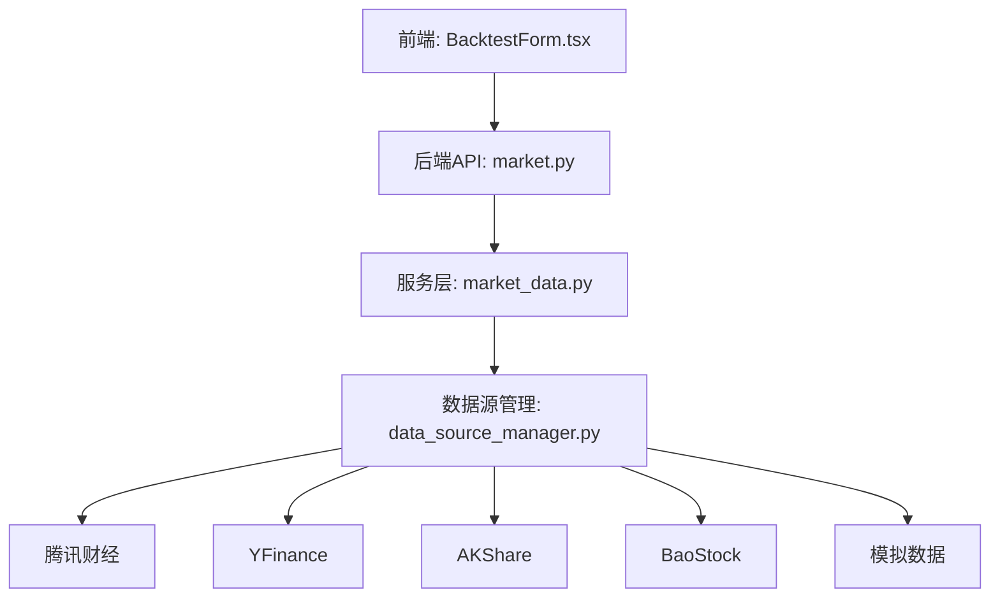
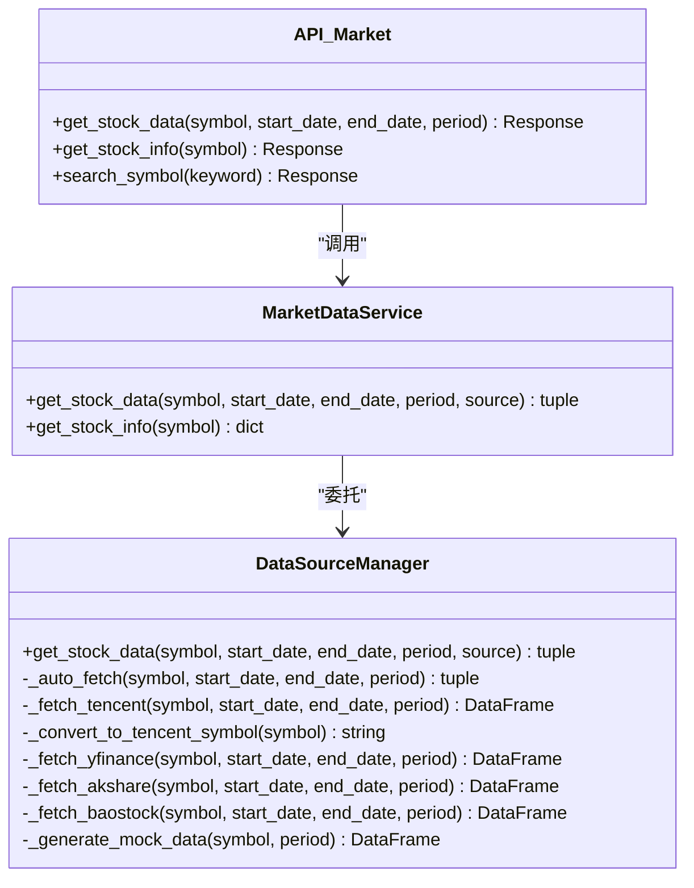
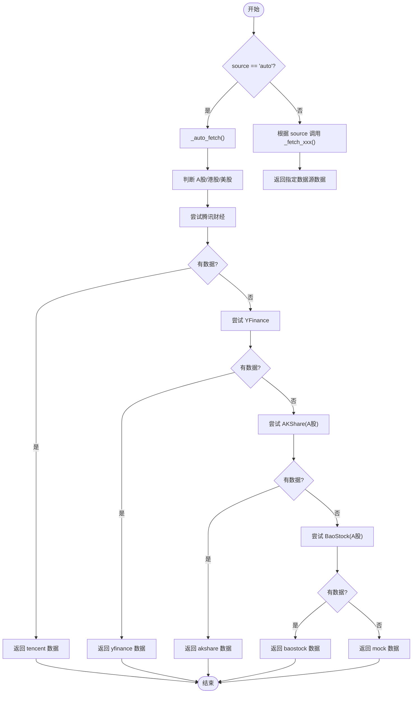
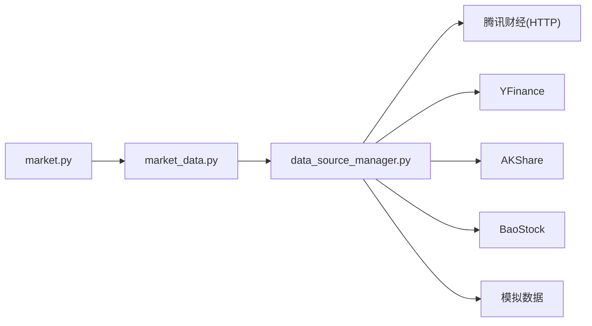

# 添加新数据源

<cite>
**本文引用的文件**   
- [backend/app/services/data_source_manager.py](../../../../../../backend/app/services/data_source_manager.py)
- [backend/app/services/market_data.py](../../../../../../backend/app/services/market_data.py)
- [backend/app/api/market.py](../../../../../../backend/app/api/market.py)
- [frontend/src/components/BacktestForm.tsx](../../../../../../frontend/src/components/BacktestForm.tsx)
- [frontend/src/components/BacktestResult.tsx](../../../../../../frontend/src/components/BacktestResult.tsx)
- [DATA_SOURCES.md](../../../../../../DATA_SOURCES.md)
</cite>

## 目录
1. [引言](#引言)
2. [项目结构](#项目结构)
3. [核心组件](#核心组件)
4. [架构总览](#架构总览)
5. [详细组件分析](#详细组件分析)
6. [依赖关系分析](#依赖关系分析)
7. [性能与稳定性](#性能与稳定性)
8. [测试与验证](#测试与验证)
9. [故障排查](#故障排查)
10. [结论](#结论)

## 引言
本文面向希望为系统新增一个市场数据源的开发者，目标是：
- 理解 DataSourceManager 的架构设计与智能降级机制
- 掌握实现新的 _fetch_xxx 静态方法的标准流程（网络请求、数据解析、异常处理）
- 遵循统一的 OHLCV DataFrame 列名规范
- 完成前端同步更新（DATA_SOURCES 数组与 dataSourceNames 映射）
- 提供完整的实现示例路径与测试方法，并给出数据质量验证与性能优化建议

## 项目结构
本功能涉及后端服务层、API 路由以及前端展示层的联动。关键文件如下：
- 后端数据源管理器：负责多数据源调度、自动选择与降级
- 后端市场数据服务：对外暴露统一的数据获取接口
- 后端 API 路由：将前端请求转发到服务层
- 前端表单：用户选择数据源并提交回测参数
- 前端结果页：展示数据来源名称及是否使用模拟数据的提示

图表来源
- [backend/app/api/market.py:11-27](../../../../../../backend/app/api/market.py#L11-L27)
- [backend/app/services/market_data.py:14-41](../../../../../../backend/app/services/market_data.py#L14-L41)
- [backend/app/services/data_source_manager.py:14-54](../../../../../../backend/app/services/data_source_manager.py#L14-L54)

章节来源
- [backend/app/api/market.py:1-47](../../../../../../backend/app/api/market.py#L1-L47)
- [backend/app/services/market_data.py:1-55](../../../../../../backend/app/services/market_data.py#L1-L55)
- [backend/app/services/data_source_manager.py:1-469](../../../../../../backend/app/services/data_source_manager.py#L1-L469)
- [frontend/src/components/BacktestForm.tsx:11-19](../../../../../../frontend/src/components/BacktestForm.tsx#L11-L19)
- [frontend/src/components/BacktestResult.tsx:12-20](../../../../../../frontend/src/components/BacktestResult.tsx#L12-L20)

## 核心组件
- DataSourceManager：集中管理所有数据源，提供 get_stock_data 入口和 _auto_fetch 智能降级逻辑
- MarketDataService：对上层暴露统一的数据获取方法，内部委托给 DataSourceManager
- API 路由：提供 /stock/{symbol} 等接口，返回标准化 OHLCV 数据
- 前端 DATA_SOURCES：定义可选数据源列表及其描述
- 前端 dataSourceNames：将后端返回的数据源标识映射为可读名称

章节来源
- [backend/app/services/data_source_manager.py:14-109](../../../../../../backend/app/services/data_source_manager.py#L14-L109)
- [backend/app/services/market_data.py:14-41](../../../../../../backend/app/services/market_data.py#L14-L41)
- [backend/app/api/market.py:11-27](../../../../../../backend/app/api/market.py#L11-L27)
- [frontend/src/components/BacktestForm.tsx:11-19](../../../../../../frontend/src/components/BacktestForm.tsx#L11-L19)
- [frontend/src/components/BacktestResult.tsx:12-20](../../../../../../frontend/src/components/BacktestResult.tsx#L12-L20)

## 架构总览
DataSourceManager 采用“单一入口 + 策略分发”的设计：
- 统一入口 get_stock_data 接收 symbol、日期范围、周期和数据源标识
- 当 source=auto 时，调用 _auto_fetch 进行智能选择
- 指定 source 时直接调用对应 _fetch_xxx 静态方法
- 每个 _fetch_xxx 必须返回标准化的 OHLCV DataFrame，列名为 Date, Open, High, Low, Close, Volume

图表来源
- [backend/app/services/data_source_manager.py:14-109](../../../../../../backend/app/services/data_source_manager.py#L14-L109)
- [backend/app/services/market_data.py:14-41](../../../../../../backend/app/services/market_data.py#L14-L41)
- [backend/app/api/market.py:11-27](../../../../../../backend/app/api/market.py#L11-L27)

## 详细组件分析

### DataSourceManager 架构与智能降级
- 统一入口：get_stock_data 支持 auto 与具体数据源名称
- 智能降级：_auto_fetch 按市场类型优先尝试不同数据源，任一失败则继续下一个，最终兜底为模拟数据
- 扩展点：新增数据源需实现 _fetch_xxx 并在 get_stock_data 与 _auto_fetch 中注册

图表来源
- [backend/app/services/data_source_manager.py:17-109](../../../../../../backend/app/services/data_source_manager.py#L17-L109)

章节来源
- [backend/app/services/data_source_manager.py:17-109](../../../../../../backend/app/services/data_source_manager.py#L17-L109)

### 数据获取方法 _fetch_xxx 的实现规范
新增数据源需遵循以下规范：
- 方法签名：_fetch_xxx(symbol, start_date, end_date, period) -> pd.DataFrame
- 网络请求：包含超时、重试或错误码处理；必要时设置 User-Agent/Referer 等头
- 数据解析：将第三方库返回的结构转换为统一的 OHLCV DataFrame
- 列名标准化：Date, Open, High, Low, Close, Volume
- 数据类型：Date 为 datetime，Open/High/Low/Close/Volume 为数值型
- 空数据处理：若无数据返回空 DataFrame，便于上层降级逻辑继续尝试其他数据源
- 异常处理：捕获网络异常、解析异常，记录日志或抛出明确错误信息

以现有实现为例：
- 腾讯财经：_fetch_tencent 通过 HTTP 接口拉取 K 线，解析 JSON 后构造 DataFrame
- YFinance：_fetch_yfinance 使用 yf.Ticker.history 获取数据并重命名列
- AKShare：_fetch_akshare 调用 stock_zh_a_hist，重命名列并转换日期
- BaoStock：_fetch_baostock 登录并查询历史K线，转换列名与类型
- 模拟数据：_generate_mock_data 生成随机 OHLCV 序列用于测试

章节来源
- [backend/app/services/data_source_manager.py:111-208](../../../../../../backend/app/services/data_source_manager.py#L111-L208)
- [backend/app/services/data_source_manager.py:250-274](../../../../../../backend/app/services/data_source_manager.py#L250-L274)
- [backend/app/services/data_source_manager.py:276-335](../../../../../../backend/app/services/data_source_manager.py#L276-L335)
- [backend/app/services/data_source_manager.py:337-416](../../../../../../backend/app/services/data_source_manager.py#L337-L416)
- [backend/app/services/data_source_manager.py:418-469](../../../../../../backend/app/services/data_source_manager.py#L418-L469)

### 数据格式标准化要求（OHLCV DataFrame）
所有数据源返回的 DataFrame 必须满足：
- 列名：Date, Open, High, Low, Close, Volume
- Date 为 datetime 类型
- Open/High/Low/Close/Volume 为浮点数
- 无缺失关键列；若某条记录不完整，应过滤或填充
- 时间序列有序（建议按日期升序）

校验建议：
- 在 _fetch_xxx 末尾增加列存在性与类型检查
- 对空 DataFrame 进行快速返回，避免后续逻辑报错
- 对重复日期去重，保留最新一条

章节来源
- [backend/app/services/data_source_manager.py:181-208](../../../../../../backend/app/services/data_source_manager.py#L181-L208)
- [backend/app/services/data_source_manager.py:270-274](../../../../../../backend/app/services/data_source_manager.py#L270-L274)
- [backend/app/services/data_source_manager.py:315-331](../../../../../../backend/app/services/data_source_manager.py#L315-L331)
- [backend/app/services/data_source_manager.py:393-411](../../../../../../backend/app/services/data_source_manager.py#L393-L411)

### 前端同步更新步骤
新增数据源后，需要在前端两处同步配置：
- BacktestForm.tsx 中的 DATA_SOURCES 数组：添加新的选项（value、label、desc、icon）
- BacktestResult.tsx 中的 dataSourceNames 映射：将后端返回的数据源标识映射为可读名称

步骤：
1. 在 DATA_SOURCES 中添加一项，确保 value 与后端支持的 source 一致
2. 在 dataSourceNames 中添加 key-value，key 与 value 保持一致
3. 提交前可预览下拉框显示与描述文案
4. 运行回测，确认结果页能正确显示数据来源名称

章节来源
- [frontend/src/components/BacktestForm.tsx:11-19](../../../../../../frontend/src/components/BacktestForm.tsx#L11-L19)
- [frontend/src/components/BacktestResult.tsx:12-20](../../../../../../frontend/src/components/BacktestResult.tsx#L12-L20)

### 完整实现示例（路径指引）
以下为新增数据源的标准流程与参考位置：
- 在 data_source_manager.py 中新增 _fetch_newsource 静态方法
- 在 get_stock_data 中增加分支，支持 source="newsource"
- 在 _auto_fetch 中增加对新数据源的尝试逻辑（按优先级插入）
- 在 BacktestForm.tsx 的 DATA_SOURCES 中添加 newsource 选项
- 在 BacktestResult.tsx 的 dataSourceNames 中添加 newsource 映射
- 在 DATA_SOURCES.md 中补充安装说明与对比表

章节来源
- [backend/app/services/data_source_manager.py:17-54](../../../../../../backend/app/services/data_source_manager.py#L17-L54)
- [backend/app/services/data_source_manager.py:56-109](../../../../../../backend/app/services/data_source_manager.py#L56-L109)
- [frontend/src/components/BacktestForm.tsx:11-19](../../../../../../frontend/src/components/BacktestForm.tsx#L11-L19)
- [frontend/src/components/BacktestResult.tsx:12-20](../../../../../../frontend/src/components/BacktestResult.tsx#L12-L20)
- [DATA_SOURCES.md:26-43](../../../../../../DATA_SOURCES.md#L26-L43)

## 依赖关系分析
- API 层依赖 MarketDataService
- MarketDataService 依赖 DataSourceManager
- DataSourceManager 依赖多个外部数据源（HTTP、yfinance、akshare、baostock、本地模拟）

图表来源
- [backend/app/api/market.py:11-27](../../../../../../backend/app/api/market.py#L11-L27)
- [backend/app/services/market_data.py:14-41](../../../../../../backend/app/services/market_data.py#L14-L41)
- [backend/app/services/data_source_manager.py:14-109](../../../../../../backend/app/services/data_source_manager.py#L14-L109)

章节来源
- [backend/app/api/market.py:1-47](../../../../../../backend/app/api/market.py#L1-L47)
- [backend/app/services/market_data.py:1-55](../../../../../../backend/app/services/market_data.py#L1-L55)
- [backend/app/services/data_source_manager.py:1-469](../../../../../../backend/app/services/data_source_manager.py#L1-L469)

## 性能与稳定性
- 网络请求优化
  - 设置合理的超时与重试次数
  - 复用连接池（如 requests.Session）
  - 限制单次请求的数据量，避免过大响应
- 数据解析优化
  - 批量转换列类型，减少逐行操作
  - 尽早过滤无效记录，降低内存占用
- 降级策略优化
  - 根据市场类型调整尝试顺序，减少无效调用
  - 缓存最近一次成功的数据源，避免频繁切换
- 前端体验优化
  - 在 DATA_SOURCES 中提供清晰的描述与图标
  - 在结果页显示数据来源与是否使用模拟数据的提示

[本节为通用指导，不直接分析具体文件]

## 测试与验证
- 单元测试要点
  - 覆盖 _fetch_xxx 的成功、空数据、异常三种场景
  - 校验返回 DataFrame 的列名与类型是否符合标准
  - 验证 _auto_fetch 的降级顺序与最终兜底行为
- 集成测试要点
  - 通过 API 调用 /stock/{symbol}，验证返回结构与字段
  - 前端选择不同数据源，确认下拉项与结果页名称映射正确
- 数据质量验证
  - 检查 OHLCV 合理性：High >= Max(Open, Close)，Low <= Min(Open, Close)
  - 检查成交量非负
  - 检查日期连续性与去重
- 性能基准
  - 统计各数据源的平均延迟与成功率
  - 对比不同周期（1mo/1y/5y）下的耗时与内存占用

章节来源
- [backend/app/services/data_source_manager.py:111-469](../../../../../../backend/app/services/data_source_manager.py#L111-L469)
- [backend/app/api/market.py:11-27](../../../../../../backend/app/api/market.py#L11-L27)
- [frontend/src/components/BacktestForm.tsx:94-108](../../../../../../frontend/src/components/BacktestForm.tsx#L94-L108)
- [frontend/src/components/BacktestResult.tsx:44-59](../../../../../../frontend/src/components/BacktestResult.tsx#L44-L59)

## 故障排查
- 常见错误
  - 未知数据源：get_stock_data 会抛出 ValueError，检查 source 值是否在支持列表中
  - 股票代码无法转换：腾讯财经转换器返回 None，检查符号后缀（.SS/.SZ/.BJ/.HK）
  - 网络请求失败：requests.raise_for_status 抛错，检查 URL、Headers、超时
  - 第三方库未安装：yfinance/akshare/baostock 导入失败，按文档安装依赖
- 定位方法
  - 查看控制台打印的尝试与失败日志
  - 检查返回的 data_source 是否为 mock，若是则说明真实数据源均失败
  - 在 _fetch_xxx 中加入更详细的异常信息与堆栈
- 修复建议
  - 修正股票代码格式或数据源选择逻辑
  - 增加重试与退避策略
  - 完善空数据与异常分支，确保降级流程稳定

章节来源
- [backend/app/services/data_source_manager.py:51-54](../../../../../../backend/app/services/data_source_manager.py#L51-L54)
- [backend/app/services/data_source_manager.py:127-129](../../../../../../backend/app/services/data_source_manager.py#L127-L129)
- [backend/app/services/data_source_manager.py:158-164](../../../../../../backend/app/services/data_source_manager.py#L158-L164)
- [backend/app/services/data_source_manager.py:257-274](../../../../../../backend/app/services/data_source_manager.py#L257-L274)
- [backend/app/services/data_source_manager.py:283-335](../../../../../../backend/app/services/data_source_manager.py#L283-L335)
- [backend/app/services/data_source_manager.py:344-416](../../../../../../backend/app/services/data_source_manager.py#L344-L416)

## 结论
通过 DataSourceManager 的统一入口与智能降级机制，系统能够灵活接入多种市场数据源，并在任一数据源不可用时自动切换到备选方案，最终保证回测流程可用。新增数据源的关键在于：
- 实现标准化的 _fetch_xxx 静态方法
- 在 get_stock_data 与 _auto_fetch 中注册新数据源
- 保持 OHLCV DataFrame 列名与类型一致
- 同步更新前端 DATA_SOURCES 与 dataSourceNames
- 完善测试与数据质量校验，确保稳定性与性能

[本节为总结性内容，不直接分析具体文件]