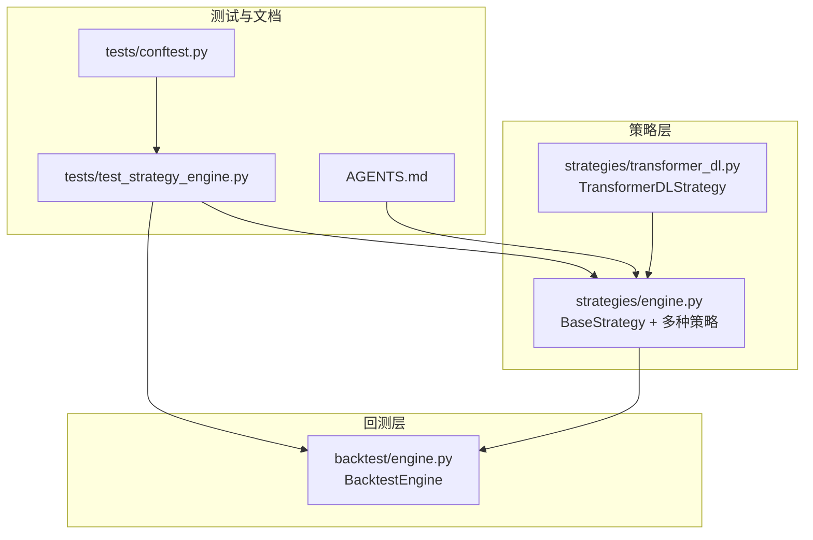
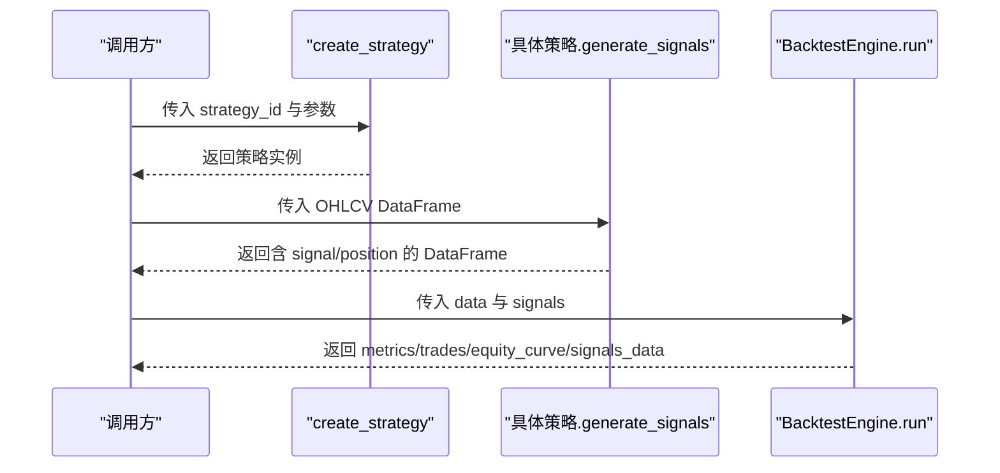
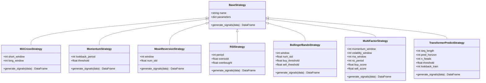
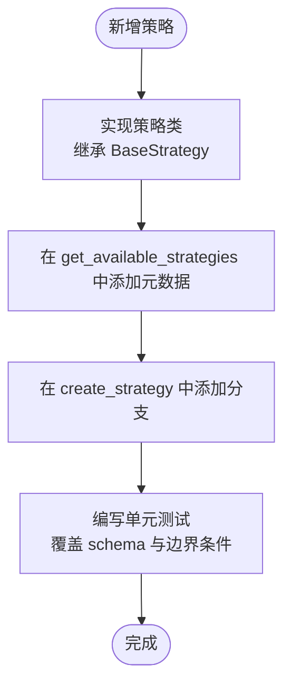
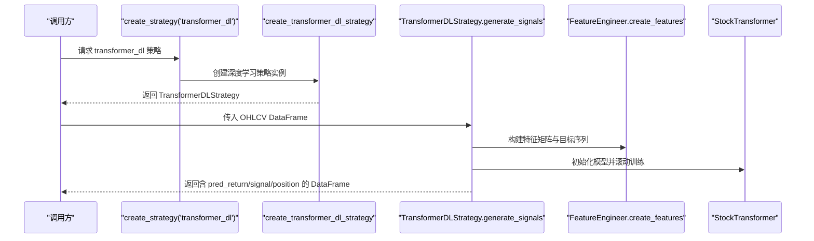
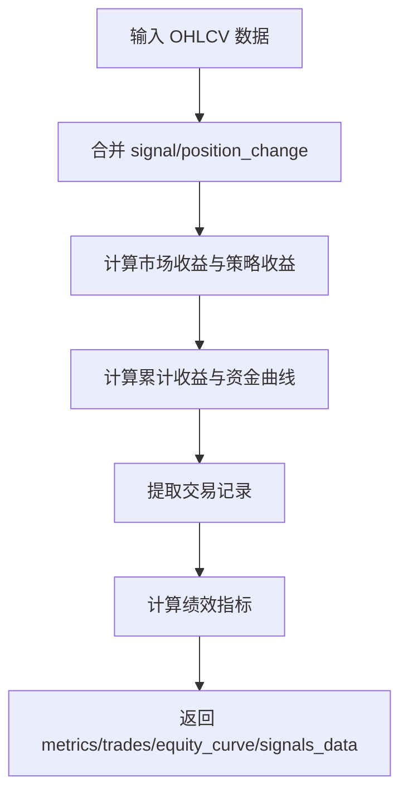
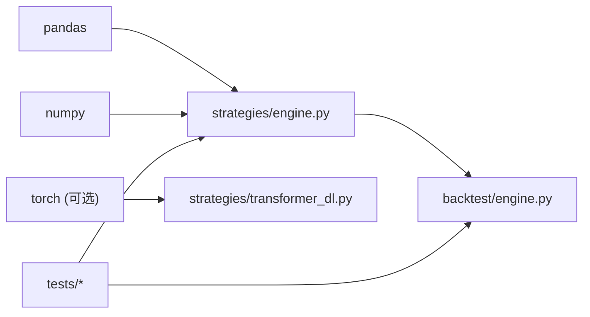

# 添加新策略

<cite>
**本文引用的文件**   
- [backend/app/strategies/engine.py](file://backend/app/strategies/engine.py)
- [backend/app/backtest/engine.py](file://backend/app/backtest/engine.py)
- [backend/app/strategies/transformer_dl.py](file://backend/app/strategies/transformer_dl.py)
- [backend/tests/test_strategy_engine.py](file://backend/tests/test_strategy_engine.py)
- [backend/tests/conftest.py](file://backend/tests/conftest.py)
- [AGENTS.md](file://AGENTS.md)
</cite>

## 目录
1. [简介](#简介)
2. [项目结构](#项目结构)
3. [核心组件](#核心组件)
4. [架构总览](#架构总览)
5. [详细组件分析](#详细组件分析)
6. [依赖关系分析](#依赖关系分析)
7. [性能与优化建议](#性能与优化建议)
8. [故障排查指南](#故障排查指南)
9. [结论](#结论)
10. [附录：新增策略清单式步骤](#附录新增策略清单式步骤)

## 简介
本文面向希望在系统中添加新的量化交易策略的开发者。内容涵盖：
- 如何继承 BaseStrategy 基类，实现 generate_signals 方法
- 如何处理 OHLCV 数据并生成交易信号
- 如何在 engine.py 中注册新策略（get_available_strategies 与 create_strategy）
- 从简单技术指标策略到复杂深度学习策略的实现范式
- 参数验证、错误处理与性能优化的最佳实践
- 策略元数据的定义方式、参数配置的结构化设计，以及与回测引擎的集成方式

## 项目结构
本仓库中与“添加新策略”直接相关的代码主要位于后端 Python 模块：
- 策略定义与工厂：backend/app/strategies/engine.py
- 深度学习 Transformer 策略：backend/app/strategies/transformer_dl.py
- 回测引擎：backend/app/backtest/engine.py
- 测试与示例数据：backend/tests/test_strategy_engine.py、backend/tests/conftest.py
- 变更影响说明：AGENTS.md

图表来源
- [backend/app/strategies/engine.py:17-656](file://backend/app/strategies/engine.py#L17-L656)
- [backend/app/backtest/engine.py:10-163](file://backend/app/backtest/engine.py#L10-L163)
- [backend/app/strategies/transformer_dl.py:324-516](file://backend/app/strategies/transformer_dl.py#L324-L516)
- [backend/tests/test_strategy_engine.py:1-187](file://backend/tests/test_strategy_engine.py#L1-L187)
- [backend/tests/conftest.py:1-46](file://backend/tests/conftest.py#L1-L46)
- [AGENTS.md:93-118](file://AGENTS.md#L93-L118)

章节来源
- [backend/app/strategies/engine.py:17-656](file://backend/app/strategies/engine.py#L17-L656)
- [backend/app/backtest/engine.py:10-163](file://backend/app/backtest/engine.py#L10-L163)
- [backend/app/strategies/transformer_dl.py:324-516](file://backend/app/strategies/transformer_dl.py#L324-L516)
- [backend/tests/test_strategy_engine.py:1-187](file://backend/tests/test_strategy_engine.py#L1-L187)
- [backend/tests/conftest.py:1-46](file://backend/tests/conftest.py#L1-L46)
- [AGENTS.md:93-118](file://AGENTS.md#L93-L118)

## 核心组件
- BaseStrategy 基类：定义策略的统一接口，要求子类实现 generate_signals(data: pd.DataFrame) -> pd.DataFrame
- 具体策略类：均线交叉、动量、均值回归、RSI、布林带、多因子、Transformer 预测等
- 策略注册表 get_available_strategies：返回策略元数据（id、name、description、parameters），用于前端动态表单与校验
- 工厂函数 create_strategy：根据 strategy_id 创建对应策略实例
- BacktestEngine：接收 OHLCV 数据与策略信号，计算收益曲线、交易记录与绩效指标

章节来源
- [backend/app/strategies/engine.py:17-26](file://backend/app/strategies/engine.py#L17-L26)
- [backend/app/strategies/engine.py:506-656](file://backend/app/strategies/engine.py#L506-L656)
- [backend/app/backtest/engine.py:10-70](file://backend/app/backtest/engine.py#L10-L70)

## 架构总览
下图展示从策略生成信号到回测引擎评估的完整流程。

图表来源
- [backend/app/strategies/engine.py:600-656](file://backend/app/strategies/engine.py#L600-L656)
- [backend/app/backtest/engine.py:15-70](file://backend/app/backtest/engine.py#L15-L70)

## 详细组件分析

### BaseStrategy 与策略继承模式
- BaseStrategy 提供 name 与 parameters 属性，并要求子类实现 generate_signals
- 所有具体策略均继承 BaseStrategy，并在 __init__ 中通过 super().__init__ 设置名称与参数字典
- generate_signals 输入为 OHLCV DataFrame，输出必须包含：
  - signal：取值限定为 {1, -1, 0}，分别表示买入、卖出、持有
  - position：signal 的一阶差分，用于标识实际开平仓动作

图表来源
- [backend/app/strategies/engine.py:17-504](file://backend/app/strategies/engine.py#L17-L504)

章节来源
- [backend/app/strategies/engine.py:17-504](file://backend/app/strategies/engine.py#L17-L504)

### OHLCV 数据处理与信号生成规范
- 输入列约定：Date、Open、High、Low、Close、Volume（Volume 可选）
- 输出列约定：至少包含 signal 与 position；可附加中间指标列（如 ma_short、momentum、rsi、percent_b、composite_score、pred_score 等）
- 信号值约束：signal ∈ {-1, 0, 1}；position = signal.diff()
- 不修改原始输入 DataFrame：应在内部 copy 后操作

章节来源
- [backend/tests/conftest.py:9-46](file://backend/tests/conftest.py#L9-L46)
- [backend/tests/test_strategy_engine.py:57-64](file://backend/tests/test_strategy_engine.py#L57-L64)
- [backend/tests/test_strategy_engine.py:174-186](file://backend/tests/test_strategy_engine.py#L174-L186)

### 在 engine.py 中注册新策略
新增策略需完成三处同步：
1. 在 strategies/engine.py 中实现策略类（继承 BaseStrategy，实现 generate_signals）
2. 在 get_available_strategies 中添加策略元数据（id、name、description、parameters）
3. 在 create_strategy 工厂函数中添加分支，按 id 创建实例

图表来源
- [backend/app/strategies/engine.py:506-656](file://backend/app/strategies/engine.py#L506-L656)
- [AGENTS.md:93-118](file://AGENTS.md#L93-L118)

章节来源
- [backend/app/strategies/engine.py:506-656](file://backend/app/strategies/engine.py#L506-L656)
- [AGENTS.md:93-118](file://AGENTS.md#L93-L118)

### 简单技术指标策略示例：均线交叉
- 逻辑要点：
  - 计算短期与长期移动平均线
  - 当短期上穿长期时产生买入信号，下穿时产生卖出信号
  - 使用 diff 得到 position，仅在信号变化时交易
- 关键实现位置：
  - 策略类定义与 generate_signals 逻辑
  - 元数据中的 short_window 与 long_window 参数范围
  - 工厂函数中按 id 创建实例

章节来源
- [backend/app/strategies/engine.py:28-54](file://backend/app/strategies/engine.py#L28-L54)
- [backend/app/strategies/engine.py:508-517](file://backend/app/strategies/engine.py#L508-L517)
- [backend/app/strategies/engine.py:602-606](file://backend/app/strategies/engine.py#L602-L606)

### 复杂深度学习策略示例：Transformer 深度学习
- 特点：
  - 基于 PyTorch 的完整 Transformer 架构（位置编码、多头注意力、前馈网络、层归一化）
  - 滚动窗口训练（Walk-forward Validation），避免未来数据泄露
  - 特征工程包括收益率、对数收益率、均线偏离度、波动率、成交量变化、RSI、MACD、布林带位置、动量
- 关键点：
  - 策略类 TransformerDLStrategy 实现 generate_signals，输出 pred_return 与 signal/position
  - 工厂函数 create_transformer_dl_strategy 负责参数映射与依赖检查
  - 在 strategies/engine.py 中通过 create_strategy 分支调用

图表来源
- [backend/app/strategies/transformer_dl.py:324-516](file://backend/app/strategies/transformer_dl.py#L324-L516)
- [backend/app/strategies/engine.py:647-653](file://backend/app/strategies/engine.py#L647-L653)

章节来源
- [backend/app/strategies/transformer_dl.py:324-516](file://backend/app/strategies/transformer_dl.py#L324-L516)
- [backend/app/strategies/engine.py:647-653](file://backend/app/strategies/engine.py#L647-L653)

### 与回测引擎的集成
- BacktestEngine.run 接收 data 与 signals，合并 signal 与 position_change，计算策略收益、累计收益、资金曲线
- 提取交易记录（entry/exit/pnl/pnl_pct/direction）
- 计算绩效指标（总收益、年化收益、最大回撤、夏普比率、胜率、盈亏比等）
- 返回结构化结果：metrics、trades、equity_curve、signals_data

图表来源
- [backend/app/backtest/engine.py:15-70](file://backend/app/backtest/engine.py#L15-L70)
- [backend/app/backtest/engine.py:72-163](file://backend/app/backtest/engine.py#L72-L163)

章节来源
- [backend/app/backtest/engine.py:15-163](file://backend/app/backtest/engine.py#L15-L163)

## 依赖关系分析
- 策略层依赖 pandas/numpy 进行数据处理
- 深度学习策略额外依赖 torch/torch.nn/optim/datautils
- 回测引擎仅依赖 pandas/numpy，与策略解耦
- 测试用例覆盖策略注册、工厂函数、信号 schema 与边界条件

图表来源
- [backend/app/strategies/engine.py:1-14](file://backend/app/strategies/engine.py#L1-L14)
- [backend/app/strategies/transformer_dl.py:18-25](file://backend/app/strategies/transformer_dl.py#L18-L25)
- [backend/app/backtest/engine.py:1-8](file://backend/app/backtest/engine.py#L1-L8)
- [backend/tests/test_strategy_engine.py:1-19](file://backend/tests/test_strategy_engine.py#L1-L19)

章节来源
- [backend/app/strategies/engine.py:1-14](file://backend/app/strategies/engine.py#L1-L14)
- [backend/app/strategies/transformer_dl.py:18-25](file://backend/app/strategies/transformer_dl.py#L18-L25)
- [backend/app/backtest/engine.py:1-8](file://backend/app/backtest/engine.py#L1-L8)
- [backend/tests/test_strategy_engine.py:1-19](file://backend/tests/test_strategy_engine.py#L1-L19)

## 性能与优化建议
- 向量化优先：尽量使用 pandas/numpy 的向量化运算，避免逐行循环
- 滚动窗口优化：合理设置 rolling/window 长度，避免过大窗口导致内存与计算开销
- 缺失值与异常值：对 NaN/Inf 做填充或替换，确保后续计算稳定
- 深度学习训练：
  - 使用小批量训练与学习率调度器
  - 梯度裁剪防止爆炸
  - 滚动窗口训练减少过拟合
- 回测数值安全：对浮点结果进行 safe_round，避免 JSON 序列化问题

章节来源
- [backend/app/backtest/engine.py:130-162](file://backend/app/backtest/engine.py#L130-L162)
- [backend/app/strategies/transformer_dl.py:414-436](file://backend/app/strategies/transformer_dl.py#L414-L436)

## 故障排查指南
- 未知策略 ID：create_strategy 会抛出 ValueError，确认是否在 get_available_strategies 与 create_strategy 中同步注册
- 缺少必要列：确保 generate_signals 返回包含 signal 与 position，且 signal ∈ {-1, 0, 1}
- 输入数据被修改：策略应内部 copy 数据，不要修改原始 DataFrame
- 深度学习依赖缺失：若未安装 torch，create_transformer_dl_strategy 会抛出 ImportError
- 短数据场景：确保策略能处理最小数据集，不会崩溃

章节来源
- [backend/app/strategies/engine.py:654-656](file://backend/app/strategies/engine.py#L654-L656)
- [backend/tests/test_strategy_engine.py:48-50](file://backend/tests/test_strategy_engine.py#L48-L50)
- [backend/tests/test_strategy_engine.py:167-186](file://backend/tests/test_strategy_engine.py#L167-L186)
- [backend/app/strategies/transformer_dl.py:492-498](file://backend/app/strategies/transformer_dl.py#L492-L498)

## 结论
通过统一继承 BaseStrategy、严格约定 generate_signals 的输入输出、在 engine.py 中集中注册策略元数据与工厂函数，系统实现了策略的可插拔扩展。结合 BacktestEngine 的回测能力，开发者可以便捷地从简单技术指标策略扩展到复杂的深度学习策略，并通过测试保障稳定性与正确性。

## 附录：新增策略清单式步骤
- 在 strategies/engine.py 中：
  - 新增策略类，继承 BaseStrategy，实现 generate_signals
  - 在 get_available_strategies 中添加策略元数据（id、name、description、parameters）
  - 在 create_strategy 中添加分支，按 id 创建实例
- 编写测试：
  - 覆盖策略创建、信号 schema、默认参数、中间列存在性、边界条件
- 与回测引擎集成：
  - 确保 signal/position 列名一致，值域合法
  - 运行 BacktestEngine.run 验证收益曲线与指标输出

章节来源
- [backend/app/strategies/engine.py:506-656](file://backend/app/strategies/engine.py#L506-L656)
- [backend/tests/test_strategy_engine.py:26-50](file://backend/tests/test_strategy_engine.py#L26-L50)
- [backend/tests/test_strategy_engine.py:57-64](file://backend/tests/test_strategy_engine.py#L57-L64)
- [backend/tests/test_strategy_engine.py:167-186](file://backend/tests/test_strategy_engine.py#L167-L186)
- [AGENTS.md:93-118](file://AGENTS.md#L93-L118)