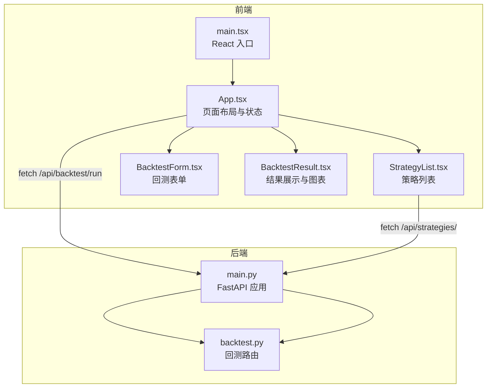
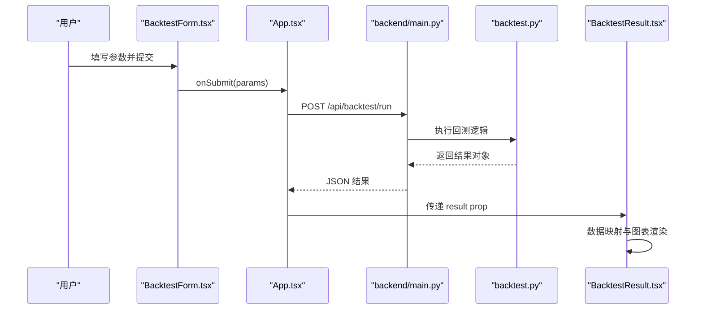
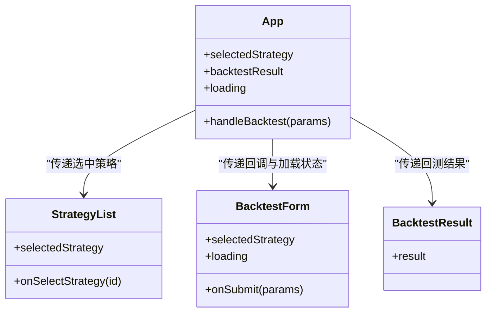
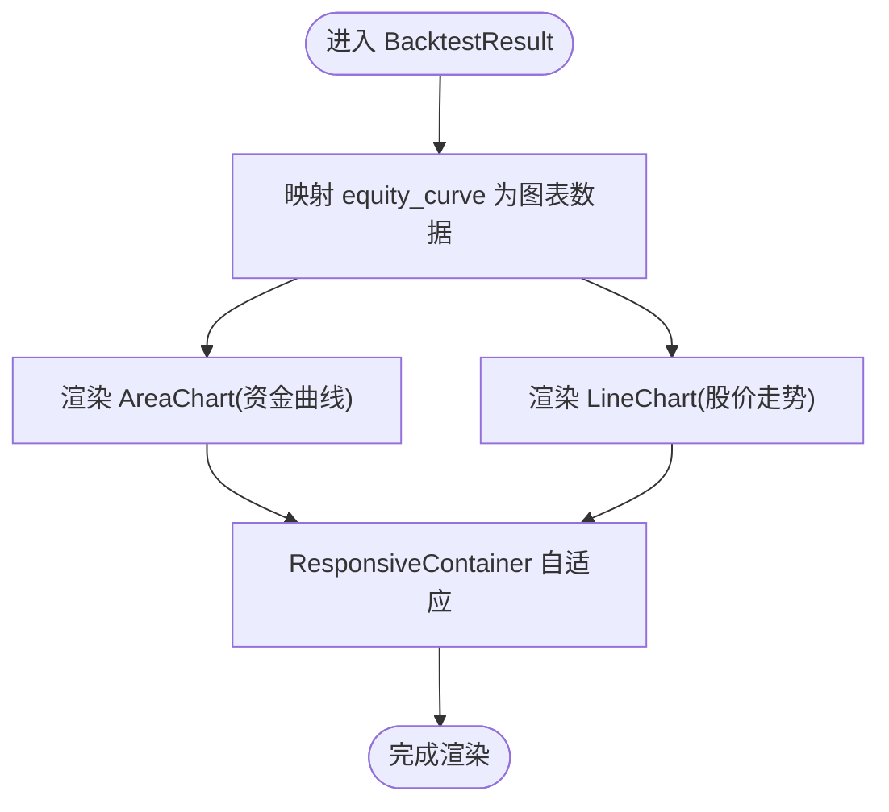
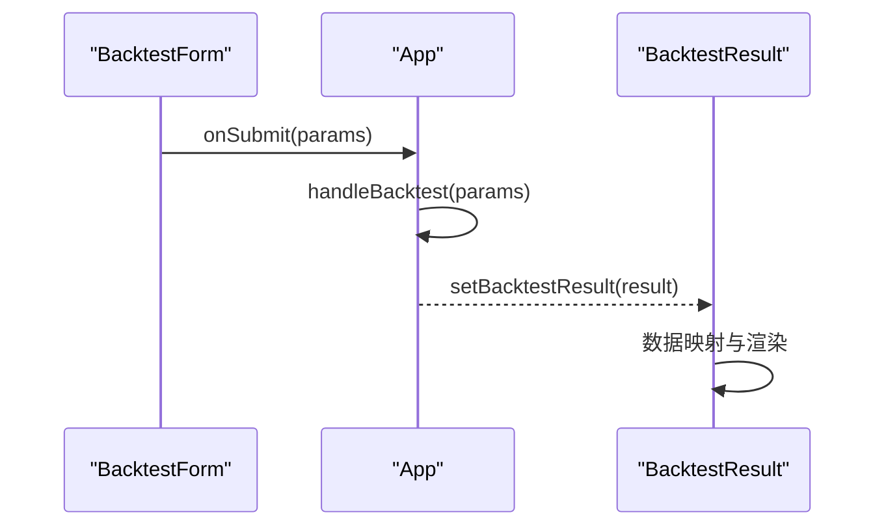
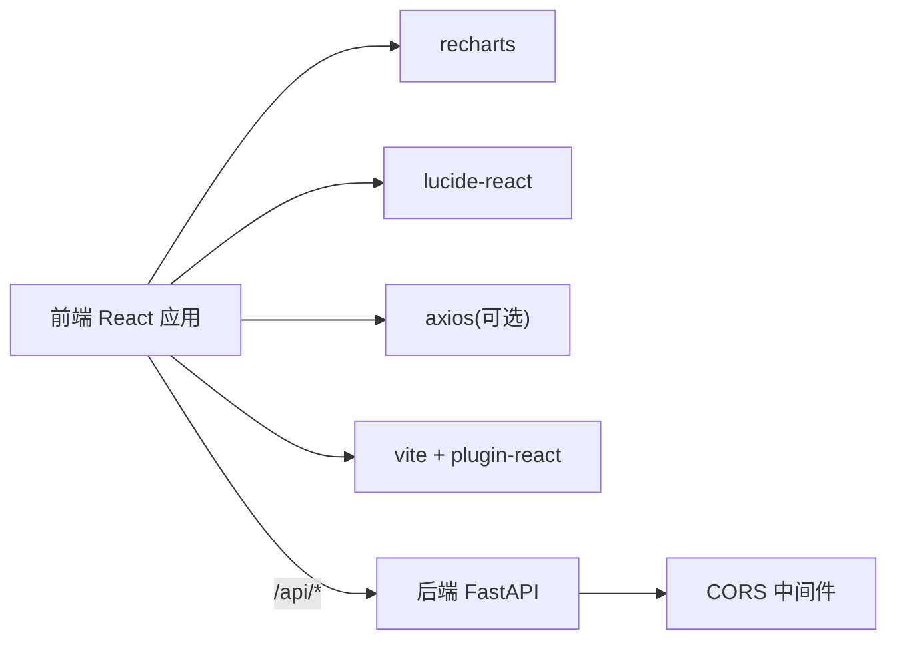
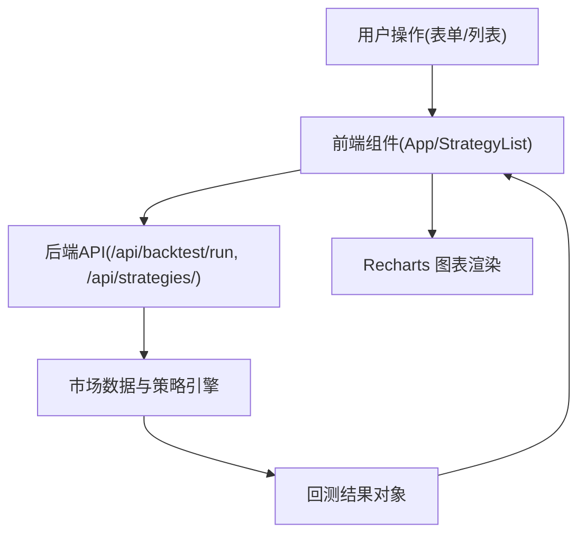

# 自定义可视化组件

<cite>
**本文引用的文件**   
- [frontend/src/main.tsx](file://frontend/src/main.tsx)
- [frontend/src/App.tsx](file://frontend/src/App.tsx)
- [frontend/package.json](file://frontend/package.json)
- [frontend/vite.config.ts](file://frontend/vite.config.ts)
- [frontend/src/components/StrategyList.tsx](file://frontend/src/components/StrategyList.tsx)
- [frontend/src/components/BacktestForm.tsx](file://frontend/src/components/BacktestForm.tsx)
- [frontend/src/components/BacktestResult.tsx](file://frontend/src/components/BacktestResult.tsx)
- [frontend/src/components/BacktestResult.css](file://frontend/src/components/BacktestResult.css)
- [backend/main.py](file://backend/main.py)
- [backend/app/api/backtest.py](file://backend/app/api/backtest.py)
</cite>

## 目录
1. [引言](#引言)
2. [项目结构](#项目结构)
3. [核心组件](#核心组件)
4. [架构总览](#架构总览)
5. [详细组件分析](#详细组件分析)
6. [依赖关系分析](#依赖关系分析)
7. [性能与可复用性](#性能与可复用性)
8. [样式、响应式与主题适配](#样式响应式与主题适配)
9. [后端集成与数据流](#后端集成与数据流)
10. [常见问题排查](#常见问题排查)
11. [结论](#结论)

## 引言
本指南面向希望在现有量化策略查看系统中开发“自定义可视化组件”的前端工程师。文档从 React 组件基础结构与 Props 设计模式出发，结合 Recharts 库讲解交互式图表的构建方法，涵盖数据绑定、事件响应、样式定制、响应式设计与主题适配的最佳实践。同时给出从简单指标卡片到复杂组合图表的完整示例路径，并说明前端与后端 API 的集成方式与数据流处理，重点强调组件的可复用性与状态管理策略。

## 项目结构
本项目采用前后端分离：
- 前端基于 React + TypeScript + Vite，使用 Recharts 进行图表渲染，通过 fetch 调用后端 API。
- 后端基于 FastAPI，提供策略、回测与市场数据相关接口，并通过 CORS 允许跨域访问；开发阶段由 Vite 代理将 /api/* 转发至后端服务。

**图示来源**
- [frontend/src/main.tsx:1-11](file://frontend/src/main.tsx#L1-L11)
- [frontend/src/App.tsx:1-100](file://frontend/src/App.tsx#L1-L100)
- [frontend/src/components/StrategyList.tsx:1-69](file://frontend/src/components/StrategyList.tsx#L1-L69)
- [frontend/src/components/BacktestForm.tsx:1-522](file://frontend/src/components/BacktestForm.tsx#L1-L522)
- [frontend/src/components/BacktestResult.tsx:1-221](file://frontend/src/components/BacktestResult.tsx#L1-L221)
- [backend/main.py:1-36](file://backend/main.py#L1-L36)
- [backend/app/api/backtest.py:1-77](file://backend/app/api/backtest.py#L1-L77)

**章节来源**
- [frontend/src/main.tsx:1-11](file://frontend/src/main.tsx#L1-L11)
- [frontend/src/App.tsx:1-100](file://frontend/src/App.tsx#L1-L100)
- [backend/main.py:1-36](file://backend/main.py#L1-L36)

## 核心组件
- App.tsx：页面容器，负责选择策略、触发回测、持有回测结果与加载状态，并将数据下传给子组件。
- StrategyList.tsx：策略列表组件，从后端获取策略清单，支持选中高亮与默认选中逻辑。
- BacktestForm.tsx：回测表单组件，封装股票代码、周期、初始资金、数据源选择以及动态策略参数输入。
- BacktestResult.tsx：回测结果展示组件，包含指标卡片、资金曲线与股价走势（Recharts）、交易记录表格，并根据 is_mock 显示模拟数据提示。

这些组件体现了“受控组件 + 单向数据流”的设计：父组件持有状态，子组件通过 props 接收数据与回调函数，避免在子组件中直接修改共享状态。

**章节来源**
- [frontend/src/App.tsx:8-99](file://frontend/src/App.tsx#L8-L99)
- [frontend/src/components/StrategyList.tsx:11-69](file://frontend/src/components/StrategyList.tsx#L11-L69)
- [frontend/src/components/BacktestForm.tsx:5-522](file://frontend/src/components/BacktestForm.tsx#L5-L522)
- [frontend/src/components/BacktestResult.tsx:5-221](file://frontend/src/components/BacktestResult.tsx#L5-L221)

## 架构总览
下图展示了用户交互到图表渲染的端到端流程：用户在表单中选择策略与参数，提交后前端调用后端回测接口，后端返回结构化结果，前端将其映射为图表数据并渲染。

**图示来源**
- [frontend/src/components/BacktestForm.tsx:28-44](file://frontend/src/components/BacktestForm.tsx#L28-L44)
- [frontend/src/App.tsx:13-36](file://frontend/src/App.tsx#L13-L36)
- [backend/main.py:24-27](file://backend/main.py#L24-L27)
- [backend/app/api/backtest.py:28-66](file://backend/app/api/backtest.py#L28-L66)
- [frontend/src/components/BacktestResult.tsx:9-41](file://frontend/src/components/BacktestResult.tsx#L9-L41)

## 详细组件分析

### React 组件基本结构与 Props 设计模式
- 组件职责单一：每个组件只负责一个功能域（列表、表单、结果）。
- Props 契约清晰：
  - StrategyListProps：selectedStrategy、onSelectStrategy。
  - BacktestFormProps：selectedStrategy、onSubmit、loading。
  - BacktestResultProps：result。
- 状态提升：App.tsx 集中管理 selectedStrategy、backtestResult、loading，子组件仅消费或回调更新。

**图示来源**
- [frontend/src/App.tsx:8-99](file://frontend/src/App.tsx#L8-L99)
- [frontend/src/components/StrategyList.tsx:11-69](file://frontend/src/components/StrategyList.tsx#L11-L69)
- [frontend/src/components/BacktestForm.tsx:5-522](file://frontend/src/components/BacktestForm.tsx#L5-L522)
- [frontend/src/components/BacktestResult.tsx:5-221](file://frontend/src/components/BacktestResult.tsx#L5-L221)

**章节来源**
- [frontend/src/App.tsx:8-99](file://frontend/src/App.tsx#L8-L99)
- [frontend/src/components/StrategyList.tsx:11-69](file://frontend/src/components/StrategyList.tsx#L11-L69)
- [frontend/src/components/BacktestForm.tsx:5-522](file://frontend/src/components/BacktestForm.tsx#L5-L522)
- [frontend/src/components/BacktestResult.tsx:5-221](file://frontend/src/components/BacktestResult.tsx#L5-L221)

### 使用 Recharts 创建交互式图表
- 数据准备：BacktestResult.tsx 将 equity_curve 映射为包含 date、equity、price、signal 的数据数组，供图表组件使用。
- 图表类型：
  - AreaChart 用于资金曲线，配合渐变填充与 Tooltip。
  - LineChart 用于股价走势，配置 Legend 与 Line。
- 响应式容器：使用 ResponsiveContainer 包裹图表，确保在不同屏幕尺寸下自适应宽度与高度。
- 交互能力：Tooltip 提供悬停信息；Legend 提供图例切换；XAxis/YAxis 控制坐标轴样式。

**图示来源**
- [frontend/src/components/BacktestResult.tsx:35-41](file://frontend/src/components/BacktestResult.tsx#L35-L41)
- [frontend/src/components/BacktestResult.tsx:123-180](file://frontend/src/components/BacktestResult.tsx#L123-L180)

**章节来源**
- [frontend/src/components/BacktestResult.tsx:35-41](file://frontend/src/components/BacktestResult.tsx#L35-L41)
- [frontend/src/components/BacktestResult.tsx:123-180](file://frontend/src/components/BacktestResult.tsx#L123-L180)

### 数据绑定与事件响应
- 数据绑定：
  - 表单字段通过 state 与 onChange 双向绑定（如 symbol、period、initialCapital、dataSource、parameters）。
  - 图表数据通过 map 转换后端返回的结构化数据。
- 事件响应：
  - 表单提交触发 onSubmit，最终调用 App.handleBacktest。
  - 策略列表点击触发 onSelectStrategy，更新父级选中状态。
  - 图表 Tooltip/Legend 等交互由 Recharts 内部处理，无需额外事件绑定。

**图示来源**
- [frontend/src/components/BacktestForm.tsx:28-44](file://frontend/src/components/BacktestForm.tsx#L28-L44)
- [frontend/src/App.tsx:13-36](file://frontend/src/App.tsx#L13-L36)
- [frontend/src/components/BacktestResult.tsx:9-41](file://frontend/src/components/BacktestResult.tsx#L9-L41)

**章节来源**
- [frontend/src/components/BacktestForm.tsx:28-44](file://frontend/src/components/BacktestForm.tsx#L28-L44)
- [frontend/src/App.tsx:13-36](file://frontend/src/App.tsx#L13-L36)
- [frontend/src/components/BacktestResult.tsx:9-41](file://frontend/src/components/BacktestResult.tsx#L9-L41)

### 样式定制、响应式设计与主题适配最佳实践
- 样式组织：
  - 全局样式位于 index.css，组件样式位于 components/*.css。
  - BacktestResult.css 定义了图表容器、表格、摘要卡片等样式，并使用媒体查询实现响应式布局。
- 响应式设计：
  - 使用 CSS Grid 与 Flexbox 布局，结合 @media 断点调整列数与字号。
  - 图表使用 ResponsiveContainer 自适应容器尺寸。
- 主题适配：
  - 颜色变量可通过 CSS 自定义属性统一管理，便于切换明暗主题。
  - 图表渐变色与边框色可在 CSS 或 Recharts 配置中统一设置。

**章节来源**
- [frontend/src/components/BacktestResult.css:1-249](file://frontend/src/components/BacktestResult.css#L1-L249)
- [frontend/src/components/BacktestResult.tsx:123-180](file://frontend/src/components/BacktestResult.tsx#L123-L180)

### 从简单指标卡片到复杂组合图表的示例路径
- 简单指标卡片：BacktestResult.tsx 中的 summary-card 展示总收益率、最终资金、夏普比率、最大回撤等关键指标，适合扩展为独立的可复用指标卡片组件。
- 复杂组合图表：在同一组件内组合 AreaChart 与 LineChart，并附带交易记录表格，形成完整的回测结果视图。

建议将指标卡片抽取为独立组件 MetricCard，接受 value、label、icon、type 等 props，以增强复用性。

**章节来源**
- [frontend/src/components/BacktestResult.tsx:61-93](file://frontend/src/components/BacktestResult.tsx#L61-L93)
- [frontend/src/components/BacktestResult.tsx:123-180](file://frontend/src/components/BacktestResult.tsx#L123-L180)

## 依赖关系分析
- 前端依赖：
  - react、react-dom：React 运行时。
  - recharts：图表库。
  - axios：HTTP 客户端（当前代码使用 fetch，但依赖已存在）。
  - lucide-react：图标库。
- 构建工具：
  - vite：开发与构建。
  - @vitejs/plugin-react：React 插件。
- 后端依赖：
  - fastapi：Web 框架。
  - CORS 中间件：允许跨域请求。

**图示来源**
- [frontend/package.json:13-19](file://frontend/package.json#L13-L19)
- [frontend/vite.config.ts:1-15](file://frontend/vite.config.ts#L1-L15)
- [backend/main.py:15-22](file://backend/main.py#L15-L22)

**章节来源**
- [frontend/package.json:13-19](file://frontend/package.json#L13-L19)
- [frontend/vite.config.ts:1-15](file://frontend/vite.config.ts#L1-L15)
- [backend/main.py:15-22](file://backend/main.py#L15-L22)

## 性能与可复用性
- 性能优化建议：
  - 对大量数据渲染时，考虑分页或虚拟滚动（例如交易记录表格）。
  - 图表数据预处理尽量在组件外完成，减少重渲染开销。
  - 使用 useMemo/useCallback 缓存计算结果与回调函数（当子组件频繁重渲染时）。
- 可复用性设计：
  - 将指标卡片、图表容器、表单控件抽象为独立组件。
  - 通过 props 暴露配置项（如颜色、单位、格式化函数），提高通用性。
  - 将数据获取逻辑下沉到 hooks 或服务层，组件仅关注展示与交互。

[本节为通用指导，不直接分析具体文件]

## 样式、响应式与主题适配
- 样式组织：
  - 全局样式与组件样式分离，便于维护与主题切换。
- 响应式：
  - 使用 CSS Grid/Flexbox 与媒体查询适配不同屏幕。
  - 图表使用 ResponsiveContainer 自适应容器。
- 主题：
  - 建议使用 CSS 自定义属性定义主题变量（颜色、字体、间距），并在根节点设置主题类名。
  - 图表配色与网格线颜色可通过 Recharts 配置或 CSS 覆盖。

**章节来源**
- [frontend/src/components/BacktestResult.css:1-249](file://frontend/src/components/BacktestResult.css#L1-L249)
- [frontend/src/components/BacktestResult.tsx:123-180](file://frontend/src/components/BacktestResult.tsx#L123-L180)

## 后端集成与数据流
- API 路由：
  - /api/strategies/*：策略管理。
  - /api/backtest/*：回测执行。
  - /api/market/*：市场数据。
- 前端调用：
  - App.tsx 使用 fetch 调用 /api/backtest/run，传入策略 ID、股票、周期、初始资金、数据源与参数。
  - StrategyList.tsx 调用 /api/strategies/ 获取策略列表。
- 后端处理：
  - backtest.py 解析请求，获取市场数据，创建策略，生成信号，运行回测引擎，组装结果并返回。
- 数据流：
  - 前端表单 -> App 状态 -> 后端 API -> 结果对象 -> 图表数据映射 -> 渲染。

**图示来源**
- [frontend/src/App.tsx:13-36](file://frontend/src/App.tsx#L13-L36)
- [frontend/src/components/StrategyList.tsx:31-41](file://frontend/src/components/StrategyList.tsx#L31-L41)
- [backend/app/api/backtest.py:28-66](file://backend/app/api/backtest.py#L28-L66)

**章节来源**
- [frontend/src/App.tsx:13-36](file://frontend/src/App.tsx#L13-L36)
- [frontend/src/components/StrategyList.tsx:31-41](file://frontend/src/components/StrategyList.tsx#L31-L41)
- [backend/app/api/backtest.py:28-66](file://backend/app/api/backtest.py#L28-L66)

## 常见问题排查
- 网络与代理：
  - 确认 Vite 代理配置将 /api/* 转发至后端地址（localhost:8000）。
  - 检查浏览器控制台是否有 CORS 错误；后端已启用 CORS 中间件。
- 数据格式：
  - 确保后端返回的 equity_curve、metrics、trades 字段与前端映射一致。
  - 日期字段需正确转换为字符串或 Date 对象。
- 图表渲染：
  - 若图表不显示，检查 ResponsiveContainer 的父容器是否有宽高。
  - 确认 Recharts 组件导入与版本兼容。
- 状态管理：
  - 避免在子组件中直接修改父级状态，应通过回调函数更新。
  - 对于异步请求，合理设置 loading 与错误提示。

**章节来源**
- [frontend/vite.config.ts:6-14](file://frontend/vite.config.ts#L6-L14)
- [backend/main.py:15-22](file://backend/main.py#L15-L22)
- [frontend/src/components/BacktestResult.tsx:35-41](file://frontend/src/components/BacktestResult.tsx#L35-L41)

## 结论
通过本项目的组件划分与数据流设计，可以清晰地理解如何开发可复用的可视化组件：以 React 组件为基础，使用 Props 传递数据与回调，借助 Recharts 构建交互式图表，并通过后端 API 获取与处理数据。在实际开发中，建议进一步抽象指标卡片、图表容器与表单控件，完善主题系统与响应式布局，以提升组件的复用性与可维护性。