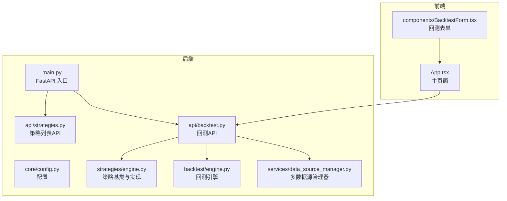
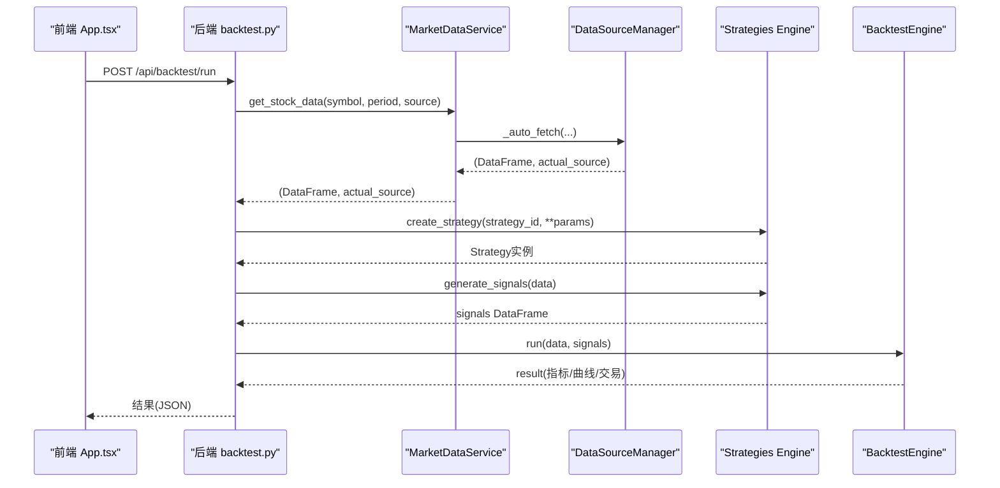
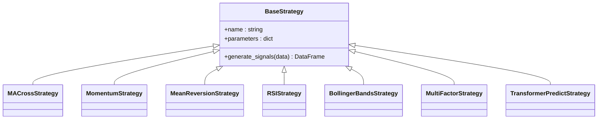
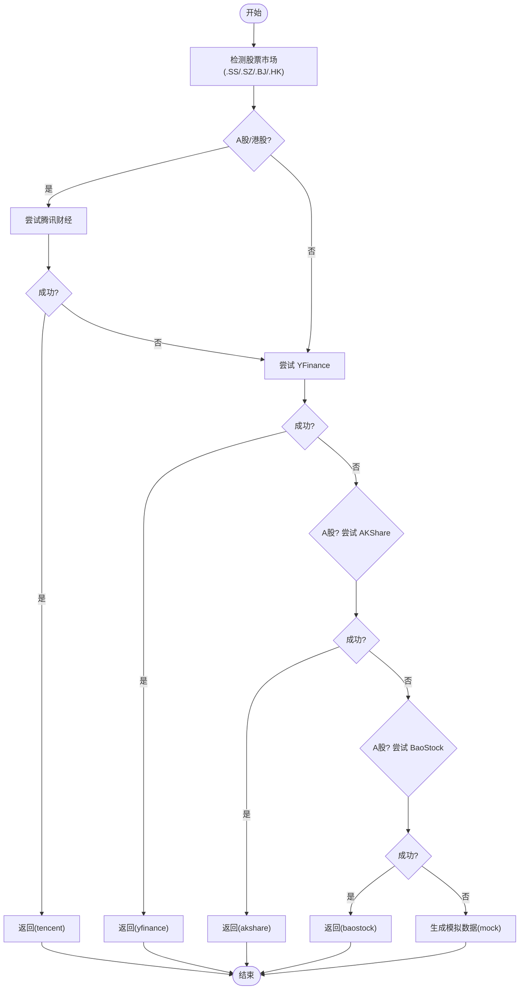
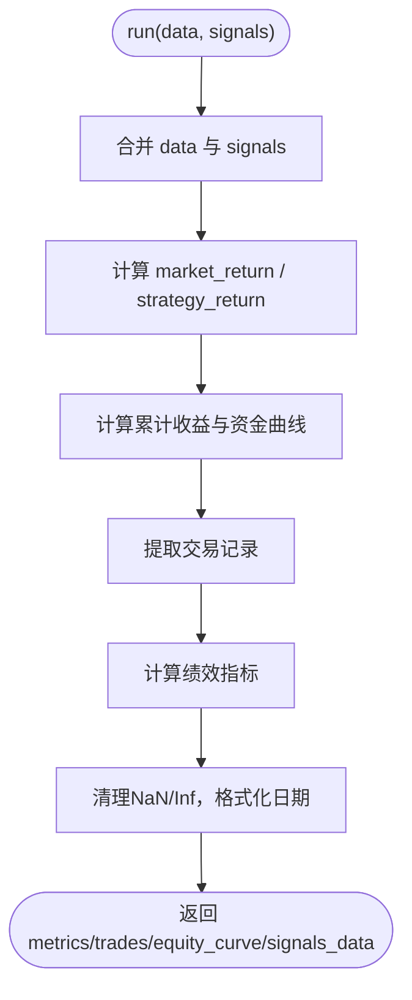
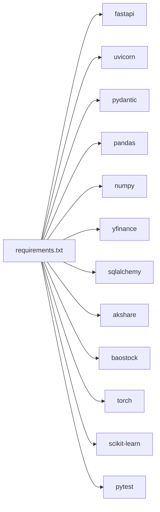
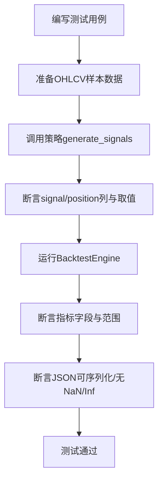

# 开发指南

<cite>
**本文引用的文件**   
- [README.md](file://README.md)
- [AGENTS.md](file://AGENTS.md)
- [DATA_SOURCES.md](file://DATA_SOURCES.md)
- [QUICKSTART.md](file://QUICKSTART.md)
- [backend/main.py](file://backend/main.py)
- [backend/app/core/config.py](file://backend/app/core/config.py)
- [backend/app/strategies/engine.py](file://backend/app/strategies/engine.py)
- [backend/app/services/data_source_manager.py](file://backend/app/services/data_source_manager.py)
- [backend/app/api/backtest.py](file://backend/app/api/backtest.py)
- [backend/app/api/strategies.py](file://backend/app/api/strategies.py)
- [backend/app/backtest/engine.py](file://backend/app/backtest/engine.py)
- [frontend/src/App.tsx](file://frontend/src/App.tsx)
- [frontend/src/components/BacktestForm.tsx](file://frontend/src/components/BacktestForm.tsx)
- [backend/tests/test_strategy_engine.py](file://backend/tests/test_strategy_engine.py)
- [backend/tests/test_backtest_engine.py](file://backend/tests/test_backtest_engine.py)
- [backend/requirements.txt](file://backend/requirements.txt)
</cite>

## 目录
1. [引言](#引言)
2. [项目结构](#项目结构)
3. [核心组件](#核心组件)
4. [架构总览](#架构总览)
5. [详细组件分析](#详细组件分析)
6. [依赖关系分析](#依赖关系分析)
7. [性能与优化](#性能与优化)
8. [测试策略](#测试策略)
9. [调试与排错](#调试与排错)
10. [代码规范与最佳实践](#代码规范与最佳实践)
11. [Git 工作流与分支管理](#git-工作流与分支管理)
12. [发布流程](#发布流程)
13. [常见问题与陷阱](#常见问题与陷阱)
14. [结论](#结论)

## 引言
本指南面向贡献者，提供从环境搭建、代码规范、Git 工作流到扩展策略、数据源与可视化组件的完整开发说明。系统为本地运行的股票量化策略查看与回测平台，后端采用 FastAPI + SQLAlchemy，前端使用 React + TypeScript + Vite，内置多数据源智能降级与多种量化策略（含深度学习）。

## 项目结构
- 后端 backend：FastAPI 应用、策略引擎、回测引擎、数据源管理器、数据库模型与 API 路由
- 前端 frontend：React + TypeScript 页面与组件，包含策略列表、回测表单与结果展示
- 根目录文档：快速启动、数据源说明、开发者约定等

图表来源
- [backend/main.py:1-36](file://backend/main.py#L1-L36)
- [backend/app/api/strategies.py:1-25](file://backend/app/api/strategies.py#L1-L25)
- [backend/app/api/backtest.py:1-77](file://backend/app/api/backtest.py#L1-L77)
- [backend/app/strategies/engine.py:1-656](file://backend/app/strategies/engine.py#L1-L656)
- [backend/app/backtest/engine.py:1-163](file://backend/app/backtest/engine.py#L1-L163)
- [backend/app/services/data_source_manager.py:1-469](file://backend/app/services/data_source_manager.py#L1-L469)
- [frontend/src/App.tsx:1-100](file://frontend/src/App.tsx#L1-L100)
- [frontend/src/components/BacktestForm.tsx:1-522](file://frontend/src/components/BacktestForm.tsx#L1-L522)

章节来源
- [README.md:148-187](file://README.md#L148-L187)
- [AGENTS.md:1-44](file://AGENTS.md#L1-L44)

## 核心组件
- 策略引擎：定义 BaseStrategy 抽象接口，并提供均线交叉、动量、均值回归、RSI、布林带、多因子、Transformer 预测与 Transformer 深度学习等实现；提供 get_available_strategies 与 create_strategy 工厂
- 回测引擎：接收 OHLCV 与信号，计算资金曲线、交易记录与绩效指标（年化收益、最大回撤、夏普比率、胜率、盈亏比）
- 数据源管理器：统一获取接口，支持腾讯财经、YFinance、AKShare、BaoStock、模拟数据，并实现自动降级
- API 层：策略列表与详情、回测执行、健康检查
- 前端：策略选择、参数表单、数据源选择、结果可视化与模拟数据标识

章节来源
- [backend/app/strategies/engine.py:17-26](file://backend/app/strategies/engine.py#L17-L26)
- [backend/app/backtest/engine.py:10-70](file://backend/app/backtest/engine.py#L10-L70)
- [backend/app/services/data_source_manager.py:14-54](file://backend/app/services/data_source_manager.py#L14-L54)
- [backend/app/api/backtest.py:16-69](file://backend/app/api/backtest.py#L16-L69)
- [frontend/src/components/BacktestForm.tsx:11-48](file://frontend/src/components/BacktestForm.tsx#L11-L48)

## 架构总览
系统通过前端调用 /api/backtest/run，后端依次完成：获取市场数据 → 创建策略 → 生成信号 → 运行回测 → 附加策略与数据源信息 → 返回结果。数据源在自动模式下按市场优先级尝试多个来源，最终兜底模拟数据。

图表来源
- [frontend/src/App.tsx:13-36](file://frontend/src/App.tsx#L13-L36)
- [backend/app/api/backtest.py:28-69](file://backend/app/api/backtest.py#L28-L69)
- [backend/app/services/data_source_manager.py:56-109](file://backend/app/services/data_source_manager.py#L56-L109)
- [backend/app/strategies/engine.py:600-656](file://backend/app/strategies/engine.py#L600-L656)
- [backend/app/backtest/engine.py:15-70](file://backend/app/backtest/engine.py#L15-L70)

## 详细组件分析

### 策略引擎与新增策略
- 继承 BaseStrategy 实现 generate_signals，输入 OHLCV DataFrame，输出附带 signal/position 列的 DataFrame
- 新增策略需三处同步：实现类、get_available_strategies 注册元数据、create_strategy 工厂分支
- 参数在前端 BacktestForm 中动态渲染，无需额外改动

图表来源
- [backend/app/strategies/engine.py:17-504](file://backend/app/strategies/engine.py#L17-L504)

章节来源
- [AGENTS.md:93-106](file://AGENTS.md#L93-L106)
- [backend/app/strategies/engine.py:506-656](file://backend/app/strategies/engine.py#L506-L656)
- [frontend/src/components/BacktestForm.tsx:111-504](file://frontend/src/components/BacktestForm.tsx#L111-L504)

### 数据源管理与新增数据源
- DataSourceManager.get_stock_data 统一入口，支持 auto/tencent/yfinance/akshare/baostock/mock
- _auto_fetch 根据股票代码后缀判断市场，按优先级尝试数据源，失败则降级，最终兜底模拟数据
- 新增数据源需添加静态方法并在 _auto_fetch 插入正确优先级位置；所有数据源必须输出统一列名 Date/Open/High/Low/Close/Volume

图表来源
- [backend/app/services/data_source_manager.py:56-109](file://backend/app/services/data_source_manager.py#L56-L109)

章节来源
- [AGENTS.md:61-74](file://AGENTS.md#L61-L74)
- [backend/app/services/data_source_manager.py:14-109](file://backend/app/services/data_source_manager.py#L14-L109)
- [DATA_SOURCES.md:45-58](file://DATA_SOURCES.md#L45-L58)

### 回测引擎与指标计算
- BacktestEngine.run 合并数据与信号，计算策略收益、累计收益、资金曲线、交易记录与绩效指标
- 日期统一转为字符串，数值清理 NaN/Inf，确保 JSON 可序列化
- 指标包括初始资金、最终价值、总收益、年化收益、最大回撤、夏普比率、胜率、交易次数、盈亏比等

图表来源
- [backend/app/backtest/engine.py:15-70](file://backend/app/backtest/engine.py#L15-L70)
- [backend/app/backtest/engine.py:105-163](file://backend/app/backtest/engine.py#L105-L163)

章节来源
- [backend/app/backtest/engine.py:1-163](file://backend/app/backtest/engine.py#L1-163)

### 前端交互与可视化
- App.tsx 负责页面布局、调用 /api/backtest/run、根据 is_mock 显示标题与提示
- BacktestForm.tsx 提供股票代码、周期、初始资金、数据源选择与策略参数表单
- 新增策略时，参数表单会基于 selectedStrategy 动态渲染对应字段

章节来源
- [frontend/src/App.tsx:13-36](file://frontend/src/App.tsx#L13-L36)
- [frontend/src/App.tsx:83-90](file://frontend/src/App.tsx#L83-L90)
- [frontend/src/components/BacktestForm.tsx:11-48](file://frontend/src/components/BacktestForm.tsx#L11-L48)
- [frontend/src/components/BacktestForm.tsx:111-504](file://frontend/src/components/BacktestForm.tsx#L111-L504)

## 依赖关系分析
- 后端依赖 FastAPI、Uvicorn、Pydantic、Pandas、NumPy、yfinance、SQLAlchemy、可选 akshare/baostock/torch/scikit-learn
- 前端依赖 React、TypeScript、Vite、Recharts（用于图表）
- 模块耦合：API 路由依赖策略引擎、回测引擎与市场数据服务；数据源管理器独立封装外部数据获取逻辑

图表来源
- [backend/requirements.txt:1-16](file://backend/requirements.txt#L1-L16)

章节来源
- [backend/requirements.txt:1-16](file://backend/requirements.txt#L1-L16)

## 性能与优化
- 数据获取：优先使用腾讯财经（A股/港股），避免频繁网络请求失败；对长周期回测建议合理设置 period
- 数据处理：尽量向量化计算（Pandas/NumPy），避免逐行循环；注意 rolling/std/pct_change 的边界处理
- 深度学习策略：TransformerDL 需要 PyTorch，训练窗口与序列长度较大时会显著增加耗时，建议在测试时使用较小参数
- 指标计算：夏普比率分母为零或 NaN 时需保护；年化收益在不足一年时应正确处理

[本节为通用指导，不直接分析具体文件]

## 测试策略
- 单元测试覆盖策略注册表、工厂函数、各策略信号生成、回测引擎结构与指标、JSON 序列化安全
- 集成测试验证不同策略与回测引擎的组合运行
- 测试数据准备：使用 fixture 提供 sample_ohlcv 与 small_ohlcv，断言信号 schema、指标范围与一致性

图表来源
- [backend/tests/test_strategy_engine.py:26-50](file://backend/tests/test_strategy_engine.py#L26-L50)
- [backend/tests/test_strategy_engine.py:57-64](file://backend/tests/test_strategy_engine.py#L57-L64)
- [backend/tests/test_backtest_engine.py:16-49](file://backend/tests/test_backtest_engine.py#L16-L49)
- [backend/tests/test_backtest_engine.py:55-99](file://backend/tests/test_backtest_engine.py#L55-L99)
- [backend/tests/test_backtest_engine.py:158-179](file://backend/tests/test_backtest_engine.py#L158-L179)

章节来源
- [backend/tests/test_strategy_engine.py:1-187](file://backend/tests/test_strategy_engine.py#L1-L187)
- [backend/tests/test_backtest_engine.py:1-179](file://backend/tests/test_backtest_engine.py#L1-L179)

## 调试与排错
- 后端启动失败：检查虚拟环境与依赖安装；确认端口未被占用
- 前端启动失败：清理 node_modules 后重装依赖
- 数据获取失败：检查网络连接与股票代码格式；必要时切换数据源或使用模拟数据
- Transformer 深度学习不可用：安装 torch 与 scikit-learn

章节来源
- [QUICKSTART.md:236-291](file://QUICKSTART.md#L236-L291)

## 代码规范与最佳实践
- Python 编码规范
  - 使用类型注解与 Pydantic 模型进行请求校验
  - 保持策略接口一致：generate_signals 返回包含 signal/position 的 DataFrame
  - 对外部库导入采用 try/except 或按需 import，避免非必要依赖影响启动
  - 数值清理：对浮点数进行 safe_round 或等价处理，避免 NaN/Inf 进入 JSON
- TypeScript 最佳实践
  - 组件 props 使用 interface 明确类型
  - 表单状态集中管理，参数变更使用受控组件
  - 异步请求错误处理与 loading 状态管理
- 数据格式约定
  - OHLCV 列名统一：Date/Open/High/Low/Close/Volume
  - 信号列名：signal（1/-1/0）、position（差分）
  - 日期字段转字符串，禁止 datetime 直接序列化

章节来源
- [AGENTS.md:86-106](file://AGENTS.md#L86-L106)
- [backend/app/api/backtest.py:16-26](file://backend/app/api/backtest.py#L16-L26)
- [backend/app/backtest/engine.py:47-68](file://backend/app/backtest/engine.py#L47-L68)
- [frontend/src/components/BacktestForm.tsx:21-48](file://frontend/src/components/BacktestForm.tsx#L21-L48)

## Git 工作流与分支管理
- 分支命名
  - feature/<功能描述>：新功能开发
  - fix/<问题描述>：缺陷修复
  - refactor/<模块描述>：重构
  - docs/<文档描述>：文档更新
- 提交规范
  - 使用语义化提交信息：feat/fix/refactor/docs/chore
  - 每次提交聚焦单一变更，便于审查与回滚
- 分支策略
  - main 分支保持稳定，仅合入已测试通过的变更
  - develop 作为集成分支，日常开发在此分支上合并
  - 功能完成后发起 Pull Request，至少一名 reviewer 批准后方可合并
- 代码审查标准
  - 接口契约不变或向后兼容
  - 新增/修改 API 需前后端同步
  - 新增策略需在 get_available_strategies 与 create_strategy 同步
  - 新增数据源需在 _auto_fetch 与前端 DATA_SOURCES 同步

[本节为通用指导，不直接分析具体文件]

## 发布流程
- 版本规划：确定版本号与变更日志
- 预发布检查
  - 依赖锁定：requirements.txt 与 package.json 版本固定
  - 全量测试：pytest 与前端构建通过
  - 兼容性检查：Python/Node 版本要求满足
- 打包与部署
  - 后端：uvicorn main:app --host 0.0.0.0 --port 8000
  - 前端：npm run build 后部署静态资源
- 上线后监控
  - 健康检查 /api/health
  - 观察数据源降级日志与模拟数据标识

章节来源
- [QUICKSTART.md:25-64](file://QUICKSTART.md#L25-L64)
- [backend/main.py:29-35](file://backend/main.py#L29-L35)

## 常见问题与陷阱
- 新增策略未注册：导致 create_strategy 抛出 Unknown strategy
- 信号列缺失或取值非法：回测引擎无法识别 position 变化，交易记录为空
- 数据源列名不一致：回测引擎读取 Close/Volume 失败
- 前端参数表单未同步：新增策略参数无法在前端调整
- 深度学习依赖缺失：TransformerDL 策略不可用但其他功能正常

章节来源
- [backend/app/strategies/engine.py:654-656](file://backend/app/strategies/engine.py#L654-L656)
- [backend/app/backtest/engine.py:26-35](file://backend/app/backtest/engine.py#L26-L35)
- [backend/app/services/data_source_manager.py:315-331](file://backend/app/services/data_source_manager.py#L315-L331)
- [frontend/src/components/BacktestForm.tsx:111-504](file://frontend/src/components/BacktestForm.tsx#L111-L504)

## 结论
本指南提供了从环境搭建、代码规范、测试策略到扩展策略与数据源的完整开发路径。遵循接口契约与数据格式约定，结合自动化测试与严格的代码审查，可保证系统的稳定性与可扩展性。建议在新增功能时同步更新前后端契约，并确保数据源降级与模拟数据标识的正确性。