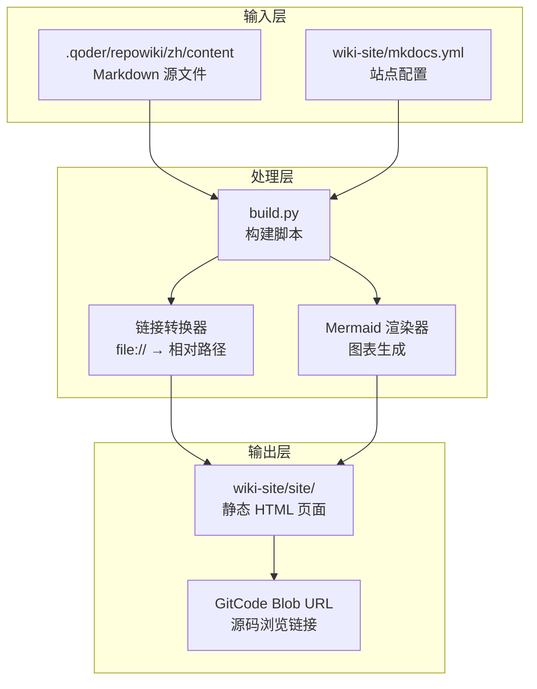
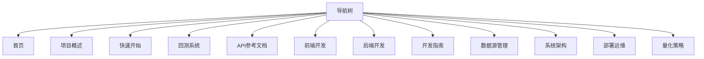

# 文档站点基础设施

<cite>
**本文引用的文件**   
- [wiki-site/build.py](../../../../../wiki-site/build.py)
- [wiki-site/mkdocs.yml](../../../../../wiki-site/mkdocs.yml)
- [wiki-site/extra.css](../../../../../wiki-site/extra.css)
- [wiki-site/requirements.txt](../../../../../wiki-site/requirements.txt)
</cite>

## 更新摘要
**变更内容**   
- 更新了 MkDocs Material 主题配置和构建流程
- 实现了 file:// 链接到相对路径的自动转换机制
- 完善了站点架构文档，包括导航结构和构建过程
- 添加了 GitCode 源码浏览链接重写功能

## 目录
1. [引言](#引言)
2. [构建系统架构](#构建系统架构)
3. [MkDocs 配置详解](#mkdocs-配置详解)
4. [链接转换机制](#链接转换机制)
5. [站点生成流程](#站点生成流程)
6. [自定义样式与主题](#自定义样式与主题)
7. [依赖管理](#依赖管理)
8. [故障排查指南](#故障排查指南)
9. [结论](#结论)

## 引言
本仓库采用现代化的 MkDocs Material 主题构建了完整的静态文档站点，支持中文导航、Mermaid 图表、代码高亮和搜索功能。文档站点的核心是通过自动化脚本将 Markdown 内容转换为高质量的静态网站，并实现智能链接重写到 GitCode 源码浏览地址。

该系统的主要特点包括：
- 自动化的文档构建流程
- file:// 链接到相对路径的智能转换
- GitCode 源码浏览链接重写
- 响应式 Material Design 主题
- 完整的中文化支持

## 构建系统架构



**图示来源**
- [wiki-site/build.py:24-31](../../../../../wiki-site/build.py#L24-L31)
- [wiki-site/build.py:66-90](../../../../../wiki-site/build.py#L66-L90)
- [wiki-site/build.py:201-266](../../../../../wiki-site/build.py#L201-L266)

**章节来源**
- [wiki-site/build.py:1-287](../../../../../wiki-site/build.py#L1-L287)

## MkDocs 配置详解

### 主题配置
文档站点使用 Material for MkDocs 主题，配置了完整的中文化支持和现代化特性：

```yaml
theme:
  name: material
  language: zh
  features:
    - navigation.indexes
    - navigation.top
    - navigation.sections
    - content.code.copy
  palette:
    - media: "(prefers-color-scheme: light)"
      scheme: default
      primary: indigo
      accent: indigo
    - media: "(prefers-color-scheme: dark)"
      scheme: slate
      primary: indigo
      accent: indigo
```

### Markdown 扩展
启用了丰富的 Markdown 扩展功能：

- **admonition**: 提示框和警告框
- **pymdownx.superfences**: Mermaid 图表支持
- **pymdownx.highlight**: 代码语法高亮
- **pymdownx.snippets**: 代码片段引用
- **pymdownx.tasklist**: 任务列表
- **attr_list**: HTML 属性支持
- **md_in_html**: HTML 中嵌入 Markdown
- **tables**: 表格支持
- **toc**: 目录自动生成

### 导航结构
导航树通过 `build.py` 脚本自动生成，保持与目录结构的一致性：



**图示来源**
- [wiki-site/mkdocs.yml:57-153](../../../../../wiki-site/mkdocs.yml#L57-L153)

**章节来源**
- [wiki-site/mkdocs.yml:1-153](../../../../../wiki-site/mkdocs.yml#L1-L153)

## 链接转换机制

### file:// 链接转换
构建脚本会自动将 Markdown 中的 `file://` 链接转换为相对路径链接：

```python
def fix_file_links() -> None:
    """把 file:// 引用链接转换为相对 Markdown 链接（GitCode 网页中可直接点击）。"""
    converted = missing = 0
    for md in sorted(CONTENT.rglob("*.md")):
        text = md.read_text(encoding="utf-8")
        
        def _replace(match: Match) -> str:
            raw = match.group(1)  # 形如 file://backend/main.py#L9-L27
            path = raw[len("file://"):].strip("/")
            anchor = ""
            if "#" in path:
                path, anchor = path.split("#", 1)
                anchor = "#" + anchor
            target = (ROOT / path).resolve()
            if not target.exists():
                missing += 1
            rel = os.path.relpath(target, md.parent).replace(os.sep, "/")
            converted += 1
            return f"]({rel}{anchor})"
        
        new_text = FILE_LINK_RE.sub(_replace, text)
        if new_text != text:
            md.write_text(new_text, encoding="utf-8")
```

### GitCode 源码链接重写
在站点生成后，脚本会将指向仓库文件的相对链接重写为 GitCode 源码浏览地址：

```python
def post_process_site() -> None:
    """把站点中指向仓库源码文件的相对链接重写为 GitCode blob URL。"""
    GITCODE_BLOB_BASE = "https://gitcode.com/jiashaoying/quant-ai/blob/main"
    
    # 解析 HTML 层级和源 md 层级
    # 命中站点内文件则保留；否则回到源 md 层级解析
    # 命中仓库文件则重写为 GitCode 源码浏览地址
```

**章节来源**
- [wiki-site/build.py:66-90](../../../../../wiki-site/build.py#L66-L90)
- [wiki-site/build.py:201-266](../../../../../wiki-site/build.py#L201-L266)

## 站点生成流程

### 构建步骤
整个构建流程包含五个主要步骤：

```mermaid
sequenceDiagram
participant User as "用户"
participant Build as "build.py"
participant Links as "链接转换"
participant Config as "配置生成"
participant MkDocs as "MkDocs 构建"
participant Post as "后处理"
User->>Build : python build.py
Build->>Links : fix_file_links()
Links-->>Build : 转换完成
Build->>Config : generate_mkdocs_config()
Config-->>Build : 配置生成
Build->>MkDocs : mkdocs build
MkDocs-->>Build : 站点构建
Build->>Post : post_process_site()
Post-->>User : 构建完成
```

### 命令行选项
构建脚本支持多种运行模式：

- `python build.py`: 全流程构建
- `python build.py links`: 仅执行链接转换
- `python build.py config`: 仅重新生成配置
- `python build.py postprocess`: 仅对产物做外部链接重写

**章节来源**
- [wiki-site/build.py:1-9](../../../../../wiki-site/build.py#L1-L9)
- [wiki-site/build.py:269-287](../../../../../wiki-site/build.py#L269-L287)

## 自定义样式与主题

### CSS 定制
项目提供了自定义 CSS 样式文件，主要用于美化文档中的引用区块：

```css
/* Repo Wiki 文档站自定义样式（构建时复制到 docs_dir 下） */

/* 引用文件区块（<cite>）：Repo Wiki 生成的文件引用说明 */
cite {
  display: block;
  margin: 1rem 0;
  padding: 0.6rem 1rem;
  border-left: 4px solid var(--md-primary-fg-color);
  border-radius: 0 4px 4px 0;
  background: var(--md-code-bg-color);
  font-size: 0.85rem;
}

cite strong {
  color: var(--md-primary-fg-color);
}

cite a {
  word-break: break-all;
}
```

### 主题特性
Material 主题提供了以下特性：

- **响应式设计**: 适配不同屏幕尺寸
- **深色模式**: 支持系统级深色模式切换
- **导航增强**: 顶部导航、章节导航、索引页
- **代码复制**: 一键复制代码块
- **搜索功能**: 全文搜索和索引
- **多语言支持**: 完整的中文化界面

**章节来源**
- [wiki-site/extra.css:1-21](../../../../../wiki-site/extra.css#L1-L21)
- [wiki-site/mkdocs.yml:6-28](../../../../../wiki-site/mkdocs.yml#L6-L28)

## 依赖管理

### Python 依赖
文档站点使用以下 Python 包：

```txt
mkdocs>=1.6.1
mkdocs-material>=9.5
```

### 扩展依赖
为了支持高级功能，还需要安装以下扩展：

- **PyYAML**: YAML 配置文件解析
- **Pymdown Extensions**: 高级 Markdown 扩展
- **Mermaid**: 图表绘制库

### 版本要求
- **MkDocs**: 1.6.1+ 确保兼容性
- **Material Theme**: 9.5+ 提供最新特性
- **Python**: 3.8+ 支持现代语法特性

**章节来源**
- [wiki-site/requirements.txt:1-3](../../../../../wiki-site/requirements.txt#L1-L3)

## 故障排查指南

### 常见问题

#### 构建失败
- **检查 Python 环境**: 确保安装了所有必需的依赖包
- **验证文件权限**: 确认对 wiki-site 目录有读写权限
- **检查网络连接**: GitCode 访问需要网络连接

#### 链接问题
- **file:// 链接未转换**: 检查 Markdown 文件中的链接格式
- **GitCode 链接失效**: 确认仓库地址和分支名称正确
- **相对路径错误**: 检查文件路径和目录结构

#### 样式问题
- **CSS 未加载**: 确认 extra.css 文件存在且路径正确
- **主题不生效**: 检查 mkdocs.yml 中的 theme 配置
- **中文字体显示**: 确认字体资源可正常加载

### 调试技巧

#### 日志输出
构建脚本提供了详细的日志输出：

```bash
[prepare] 已生成 index.md 与 stylesheets/extra.css
[links] 转换 150 个 file:// 链接（其中目标缺失 3 个）
[config] 已生成 wiki-site/mkdocs.yml
[build] 运行 mkdocs build ...
[post] 重写 45 个仓库文件链接（保留 120 个站内/外部链接）
✅ 文档站构建完成：wiki-site/site/
```

#### 手动验证
- **检查生成的 HTML**: 查看 wiki-site/site/index.html 是否正确生成
- **验证链接**: 在浏览器中测试各个链接是否正常工作
- **检查样式**: 确认自定义 CSS 是否正确应用

**章节来源**
- [wiki-site/build.py:53-63](../../../../../wiki-site/build.py#L53-L63)
- [wiki-site/build.py:90-90](../../../../../wiki-site/build.py#L90-L90)
- [wiki-site/build.py:187-187](../../../../../wiki-site/build.py#L187-L187)
- [wiki-site/build.py:266-282](../../../../../wiki-site/build.py#L266-L282)

## 结论
该文档站点基础设施采用了现代化的 MkDocs Material 主题，通过自动化的构建流程实现了高质量的静态文档生成。系统的核心优势在于：

1. **自动化程度高**: 从链接转换到站点构建完全自动化
2. **链接智能处理**: 支持 file:// 链接转换和 GitCode 源码链接重写
3. **主题现代化**: 使用 Material Design 提供优秀的用户体验
4. **扩展性强**: 支持丰富的 Markdown 扩展和自定义样式
5. **维护简单**: 通过脚本自动生成配置，减少手动维护工作

建议在未来的迭代中继续优化构建性能，增加更多的可视化图表支持，并完善错误处理和日志记录功能。