# 文档站点基础设施

<cite>
**本文引用的文件**   
- [README.md](../../../../../README.md)
- [backend/main.py](../../../../../backend/main.py)
- [backend/app/core/config.py](../../../../../backend/app/core/config.py)
- [backend/app/api/backtest.py](../../../../../backend/app/api/backtest.py)
- [backend/app/api/strategies.py](../../../../../backend/app/api/strategies.py)
- [backend/app/api/market.py](../../../../../backend/app/api/market.py)
- [frontend/src/App.tsx](../../../../../frontend/src/App.tsx)
- [frontend/src/components/StrategyList.tsx](../../../../../frontend/src/components/StrategyList.tsx)
- [frontend/src/components/BacktestForm.tsx](../../../../../frontend/src/components/BacktestForm.tsx)
- [wiki-site/mkdocs.yml](../../../../../wiki-site/mkdocs.yml)
</cite>

## 目录
1. [引言](#引言)
2. [项目结构](#项目结构)
3. [核心组件](#核心组件)
4. [架构总览](#架构总览)
5. [详细组件分析](#详细组件分析)
6. [依赖关系分析](#依赖关系分析)
7. [性能与可扩展性](#性能与可扩展性)
8. [故障排查指南](#故障排查指南)
9. [结论](#结论)
10. [附录](#附录)

## 引言
本仓库是一个本地运行的股票量化策略查看与回测系统，包含后端 FastAPI 服务、前端 React 应用以及基于 MkDocs 的静态文档站点。文档站点的目标是系统化呈现系统架构、前后端实现、数据源管理、策略引擎、部署运维等内容，并通过 Material for MkDocs 提供可搜索、可导航的中文技术文档。

该系统支持多种量化策略、多数据源智能切换、参数自定义与可视化回测结果展示；文档站点则围绕这些能力展开，覆盖从快速开始到高级扩展的全链路说明。

## 项目结构
仓库采用前后端分离与文档站点并列的组织方式：
- backend：FastAPI 后端，包含 API 路由、配置、数据库、模型、服务层、策略引擎与回测引擎。
- frontend：React + TypeScript + Vite 前端，包含主应用与三个核心 UI 组件。
- wiki-site：MkDocs 文档站点配置与构建产物，主题使用 Material，支持 Mermaid 图表与中文导航。

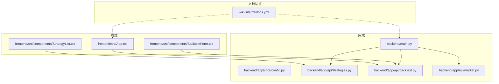

**图示来源**
- [backend/main.py:9-35](../../../../../backend/main.py#L9-L35)
- [backend/app/api/strategies.py:8-24](../../../../../backend/app/api/strategies.py#L8-L24)
- [backend/app/api/backtest.py:13-69](../../../../../backend/app/api/backtest.py#L13-L69)
- [backend/app/api/market.py:8-46](../../../../../backend/app/api/market.py#L8-L46)
- [frontend/src/App.tsx:1-100](../../../../../frontend/src/App.tsx#L1-L100)
- [frontend/src/components/StrategyList.tsx:1-69](../../../../../frontend/src/components/StrategyList.tsx#L1-L69)
- [frontend/src/components/BacktestForm.tsx:1-522](../../../../../frontend/src/components/BacktestForm.tsx#L1-L522)
- [wiki-site/mkdocs.yml:1-152](../../../../../wiki-site/mkdocs.yml#L1-L152)

**章节来源**
- [README.md:1-219](../../../../../README.md#L1-L219)

## 核心组件
- 后端 FastAPI 应用：负责初始化应用、注册 CORS、挂载路由组（策略、回测、市场数据），并提供健康检查接口。
- 配置模块：集中管理应用名称、版本、调试开关、数据库连接与默认市场等设置。
- API 路由：
  - 策略管理：列出可用策略与获取策略详情。
  - 回测执行：接收回测请求，调用市场数据服务、策略引擎与回测引擎，返回指标与交易记录。
  - 市场数据：获取股票历史数据、基本信息与代码搜索。
- 前端 React 应用：
  - App.tsx：顶层容器，组合策略列表、回测表单与结果展示，并发起回测请求。
  - StrategyList.tsx：从后端拉取策略列表，默认选中第一个策略。
  - BacktestForm.tsx：收集用户输入（股票代码、周期、初始资金、数据源、策略参数），提交给后端。
- 文档站点 MkDocs：定义站点元信息、主题、Markdown 扩展、插件与导航树。

**章节来源**
- [backend/main.py:9-35](../../../../../backend/main.py#L9-L35)
- [backend/app/core/config.py:8-24](../../../../../backend/app/core/config.py#L8-L24)
- [backend/app/api/strategies.py:8-24](../../../../../backend/app/api/strategies.py#L8-L24)
- [backend/app/api/backtest.py:13-69](../../../../../backend/app/api/backtest.py#L13-L69)
- [backend/app/api/market.py:8-46](../../../../../backend/app/api/market.py#L8-L46)
- [frontend/src/App.tsx:1-100](../../../../../frontend/src/App.tsx#L1-L100)
- [frontend/src/components/StrategyList.tsx:1-69](../../../../../frontend/src/components/StrategyList.tsx#L1-L69)
- [frontend/src/components/BacktestForm.tsx:1-522](../../../../../frontend/src/components/BacktestForm.tsx#L1-L522)
- [wiki-site/mkdocs.yml:1-152](../../../../../wiki-site/mkdocs.yml#L1-L152)

## 架构总览
后端以 FastAPI 为入口，通过中间件处理跨域，按功能划分路由组；前端通过 fetch 调用后端 API，渲染策略列表、表单与结果；文档站点独立于运行时，由 MkDocs 将 Markdown 内容编译为静态页面。

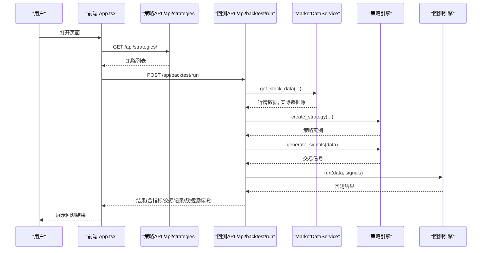

**图示来源**
- [frontend/src/App.tsx:13-36](../../../../../frontend/src/App.tsx#L13-L36)
- [backend/app/api/strategies.py:11-24](../../../../../backend/app/api/strategies.py#L11-L24)
- [backend/app/api/backtest.py:28-69](../../../../../backend/app/api/backtest.py#L28-L69)

## 详细组件分析

### 后端 FastAPI 应用与健康检查
- 应用初始化：设置标题、描述与版本。
- CORS 中间件：允许所有来源与方法，便于前端开发。
- 路由注册：策略、回测、市场数据三大路由组。
- 根路径与健康检查：用于基础连通性验证。

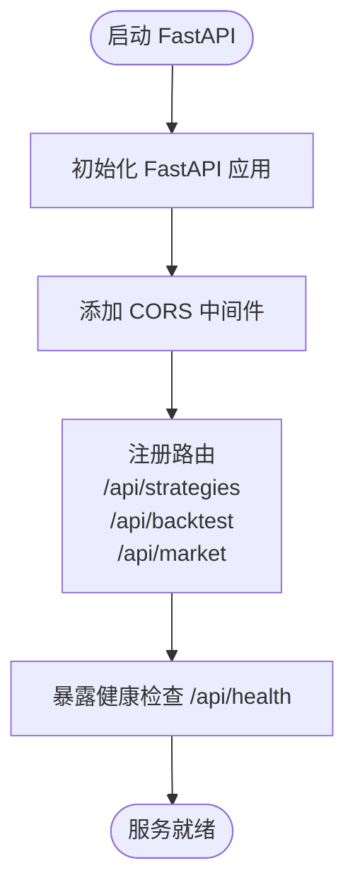

**图示来源**
- [backend/main.py:9-35](../../../../../backend/main.py#L9-L35)

**章节来源**
- [backend/main.py:9-35](../../../../../backend/main.py#L9-L35)

### 配置模块 Settings
- 应用元信息：名称、版本、调试开关。
- 数据库 URL：默认 SQLite。
- 默认市场：CN（A股）。
- 环境变量：支持 .env 文件加载。

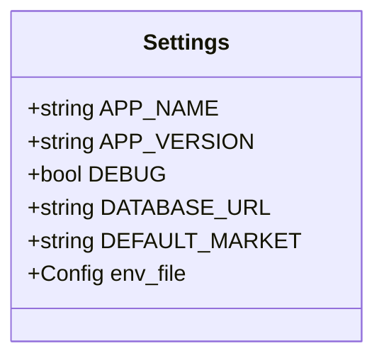

**图示来源**
- [backend/app/core/config.py:8-24](../../../../../backend/app/core/config.py#L8-L24)

**章节来源**
- [backend/app/core/config.py:8-24](../../../../../backend/app/core/config.py#L8-L24)

### 策略管理 API
- 列出策略：返回可用策略列表。
- 获取策略详情：根据 strategy_id 返回具体策略信息，未找到时返回 404。

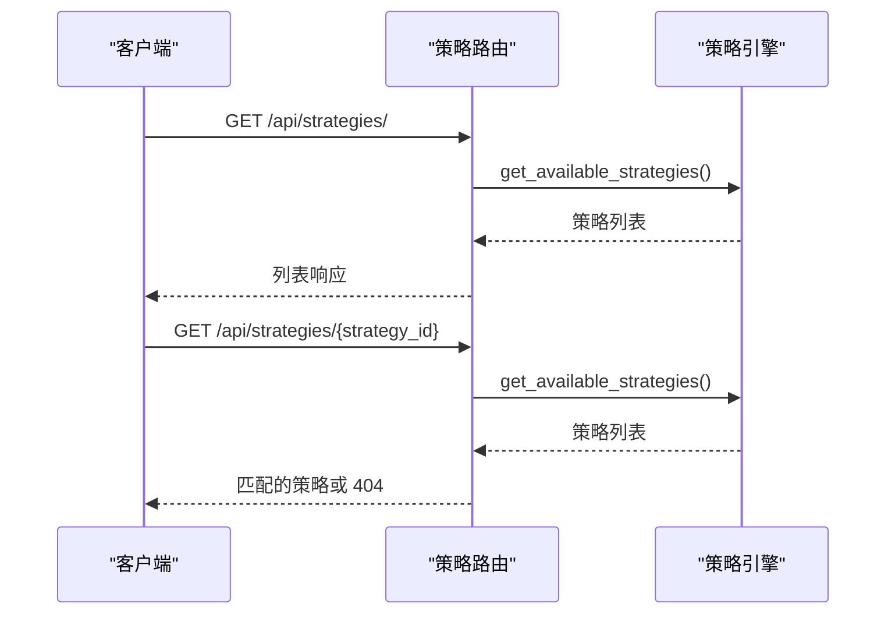

**图示来源**
- [backend/app/api/strategies.py:8-24](../../../../../backend/app/api/strategies.py#L8-L24)

**章节来源**
- [backend/app/api/strategies.py:8-24](../../../../../backend/app/api/strategies.py#L8-L24)

### 回测执行 API
- 请求体：策略 ID、股票代码、起止日期、周期、初始资金、数据源、策略参数。
- 处理流程：获取数据 → 创建策略 → 生成信号 → 运行回测 → 附加策略信息与数据源标识 → 返回结果。
- 错误处理：捕获异常并返回 HTTP 400。

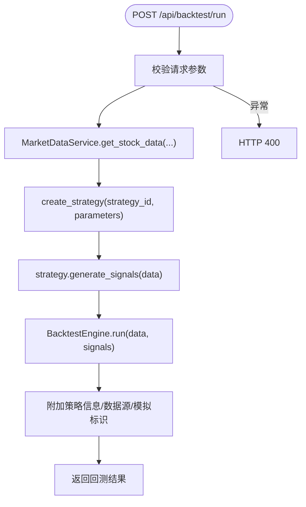

**图示来源**
- [backend/app/api/backtest.py:16-69](../../../../../backend/app/api/backtest.py#L16-L69)

**章节来源**
- [backend/app/api/backtest.py:16-69](../../../../../backend/app/api/backtest.py#L16-L69)

### 市场数据 API
- 获取股票数据：返回指定时间范围的历史数据。
- 获取股票信息：返回基本信息。
- 搜索股票代码：根据关键词返回匹配结果。

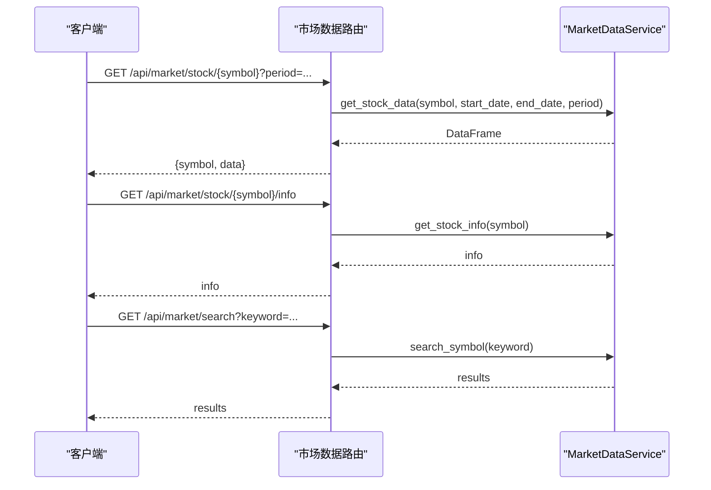

**图示来源**
- [backend/app/api/market.py:11-46](../../../../../backend/app/api/market.py#L11-L46)

**章节来源**
- [backend/app/api/market.py:11-46](../../../../../backend/app/api/market.py#L11-L46)

### 前端 App.tsx 与状态管理
- 状态：选中的策略、回测结果、加载状态。
- 回测流程：提交表单参数 → fetch 调用 /api/backtest/run → 解析 JSON → 更新结果状态。
- 条件渲染：根据 is_mock 显示“回测结果（模拟数据）”。

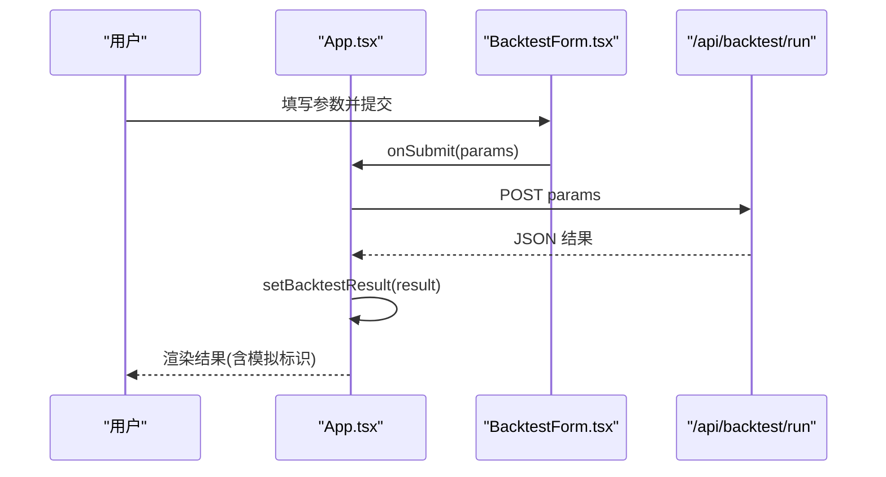

**图示来源**
- [frontend/src/App.tsx:13-36](../../../../../frontend/src/App.tsx#L13-L36)
- [frontend/src/App.tsx:83-90](../../../../../frontend/src/App.tsx#L83-L90)

**章节来源**
- [frontend/src/App.tsx:1-100](../../../../../frontend/src/App.tsx#L1-L100)

### 前端 StrategyList.tsx
- 生命周期：组件挂载后拉取策略列表。
- 默认选择：加载完成后自动选中第一个策略。
- 交互：点击策略卡片触发 onSelectStrategy。

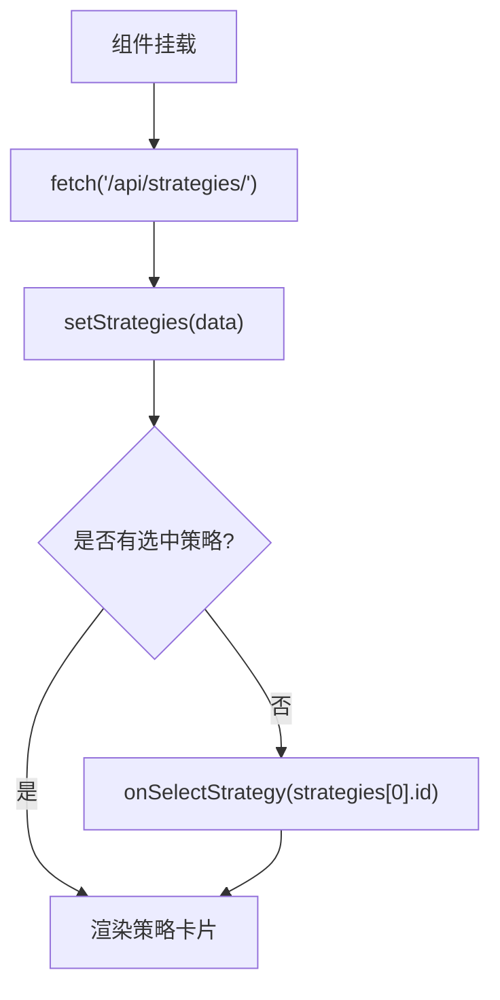

**图示来源**
- [frontend/src/components/StrategyList.tsx:20-29](../../../../../frontend/src/components/StrategyList.tsx#L20-L29)
- [frontend/src/components/StrategyList.tsx:31-41](../../../../../frontend/src/components/StrategyList.tsx#L31-L41)

**章节来源**
- [frontend/src/components/StrategyList.tsx:1-69](../../../../../frontend/src/components/StrategyList.tsx#L1-L69)

### 前端 BacktestForm.tsx
- 表单字段：股票代码、回测周期、初始资金、数据源、策略参数。
- 数据源选项：自动、腾讯财经、YFinance、AKShare、BaoStock、模拟数据。
- 策略参数：根据不同策略动态渲染输入控件。
- 提交逻辑：组装参数对象并调用父组件的 onSubmit。

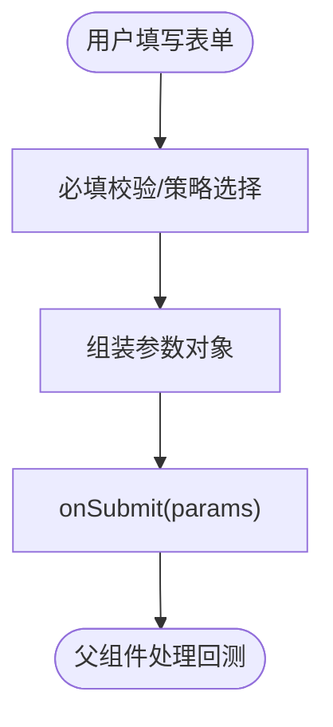

**图示来源**
- [frontend/src/components/BacktestForm.tsx:21-48](../../../../../frontend/src/components/BacktestForm.tsx#L21-L48)
- [frontend/src/components/BacktestForm.tsx:111-504](../../../../../frontend/src/components/BacktestForm.tsx#L111-L504)

**章节来源**
- [frontend/src/components/BacktestForm.tsx:1-522](../../../../../frontend/src/components/BacktestForm.tsx#L1-L522)

### 文档站点 MkDocs 配置
- 站点元信息：名称、描述、文档目录、输出目录。
- 主题：Material，语言 zh，启用多项特性与调色板。
- Markdown 扩展：admonition、superfences（Mermaid）、highlight、snippets、tasklist、attr_list、md_in_html、tables、toc。
- 插件：search。
- 导航树：首页、项目概述、快速开始、回测系统、API 参考、前端开发、后端开发、开发指南、数据源管理、系统架构、部署运维、量化策略。

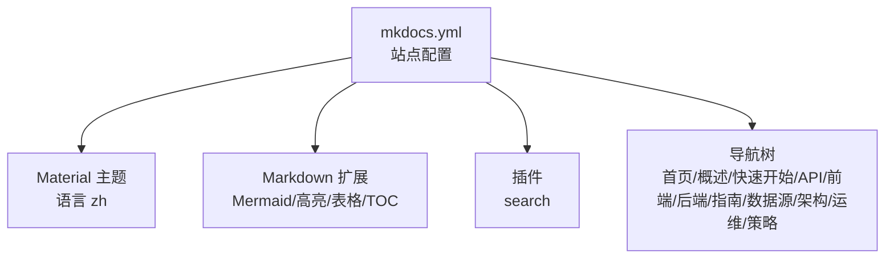

**图示来源**
- [wiki-site/mkdocs.yml:1-152](../../../../../wiki-site/mkdocs.yml#L1-L152)

**章节来源**
- [wiki-site/mkdocs.yml:1-152](../../../../../wiki-site/mkdocs.yml#L1-L152)

## 依赖关系分析
- 后端依赖：
  - FastAPI 与 Uvicorn：Web 框架与 ASGI 服务器。
  - pydantic-settings：Settings 配置类。
  - SQLAlchemy/SQLite：数据库连接（在配置中声明）。
  - Pandas/NumPy：数据处理（在 README 中提及）。
  - 数据源库：requests/yfinance/akshare/baostock（在 README 中提及）。
  - 可选深度学习：PyTorch（在 README 中提及）。
- 前端依赖：
  - React 18 + TypeScript：UI 框架与类型系统。
  - Vite：构建工具与开发服务器。
  - Recharts：图表库（在 README 中提及）。
  - Lucide 图标：图标库（在 README 中提及）。
- 文档站点依赖：
  - MkDocs + Material for MkDocs：静态站点生成器与主题。
  - Python Markdown 扩展：Mermaid、高亮、表格、任务列表等。

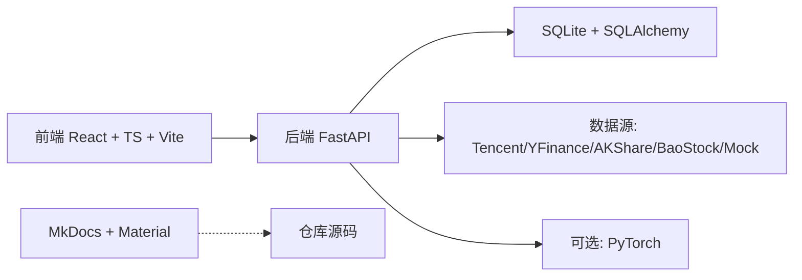

**图示来源**
- [README.md:53-68](../../../../../README.md#L53-L68)
- [backend/app/core/config.py:8-24](../../../../../backend/app/core/config.py#L8-L24)

**章节来源**
- [README.md:53-68](../../../../../README.md#L53-L68)
- [backend/app/core/config.py:8-24](../../../../../backend/app/core/config.py#L8-L24)

## 性能与可扩展性
- 后端可扩展点：
  - 新增策略：在策略引擎中注册新策略，并在前端 BacktestForm.tsx 中添加对应参数表单。
  - 新增数据源：在服务层实现新的数据源适配器，并在 MarketDataService 中集成降级逻辑。
  - 缓存与异步：对热点数据引入缓存层，或将耗时计算移至异步任务队列。
- 前端可扩展点：
  - 新增可视化组件：复用 Recharts 模式，封装为独立组件并在 App.tsx 中组合。
  - 主题与样式：通过全局 CSS 与组件级 CSS 进行主题定制。
- 文档站点可扩展点：
  - 新增章节：在 mkdocs.yml 的 nav 中添加条目，并在 docs_dir 下编写对应 Markdown。
  - 增强图表：利用 superfences 的 Mermaid 扩展绘制架构图与流程图。

[本节为通用指导，不直接分析具体文件]

## 故障排查指南
- 后端健康检查：访问 /api/health 确认服务是否正常运行。
- 跨域问题：确保后端已启用 CORS 中间件，且前端开发服务器代理正确。
- 数据源失败：当真实数据源不可用时，系统会降级至模拟数据，并在结果中标识 is_mock。
- 策略参数无效：前端会对不同策略的参数进行范围限制，若仍报错，请检查后端策略引擎的参数校验逻辑。
- 文档链接失效：MkDocs 配置中已忽略绝对链接与未识别链接的验证，可在构建日志中定位缺失资源。

**章节来源**
- [backend/main.py:33-35](../../../../../backend/main.py#L33-L35)
- [backend/app/api/backtest.py:68-69](../../../../../backend/app/api/backtest.py#L68-L69)
- [wiki-site/mkdocs.yml:50-56](../../../../../wiki-site/mkdocs.yml#L50-L56)

## 结论
该仓库以 FastAPI 与 React 为核心，构建了完整的量化策略回测系统，并通过 MkDocs 提供了结构化、可搜索的中文文档站点。后端职责清晰、API 设计简洁；前端组件化良好，易于扩展；文档站点覆盖了从入门到进阶的全链路知识。建议在后续迭代中持续完善数据源健壮性、策略性能优化与文档的可维护性。

[本节为总结性内容，不直接分析具体文件]

## 附录
- 快速开始与环境要求请参考 README。
- 后端启动命令与端口、前端开发服务器端口与 API 文档地址请参考 README。
- 深度学习依赖安装请参考 README。

**章节来源**
- [README.md:69-123](../../../../../README.md#L69-L123)