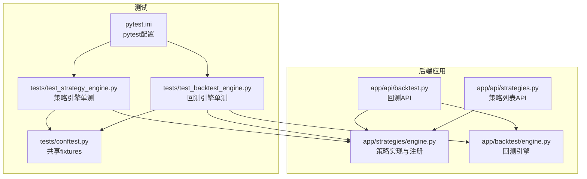
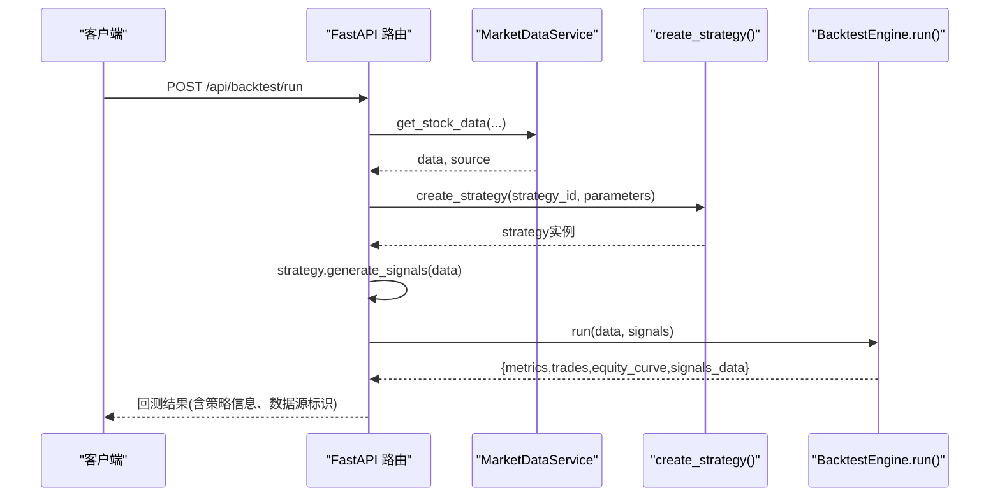
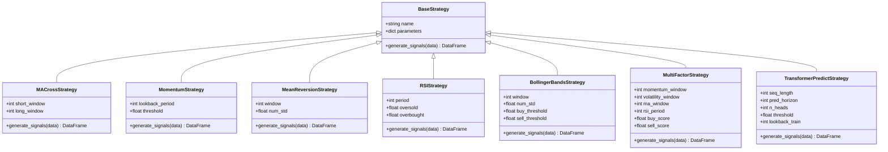
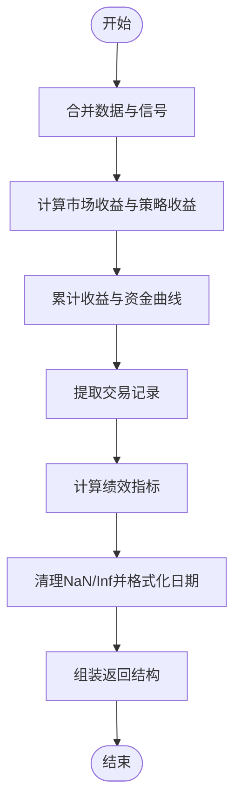
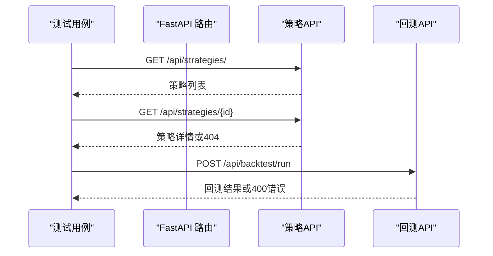
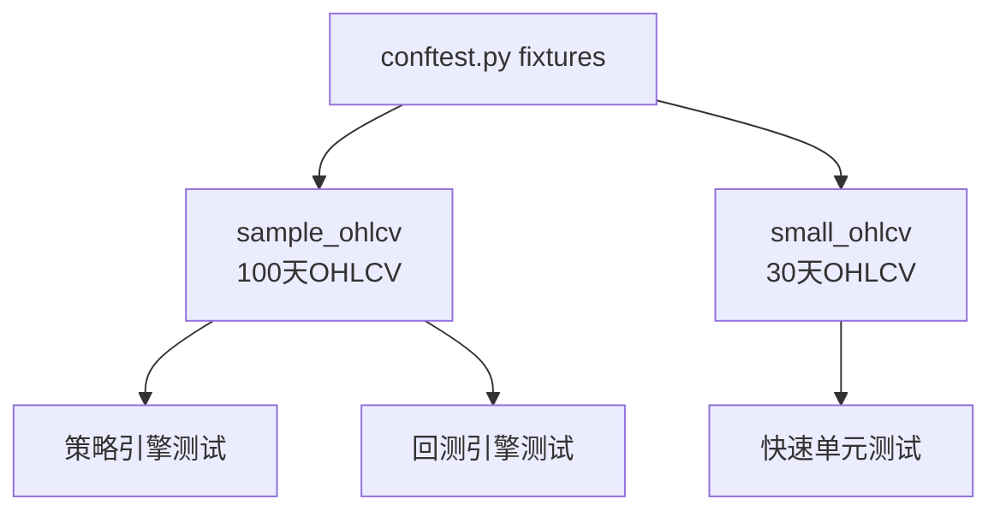
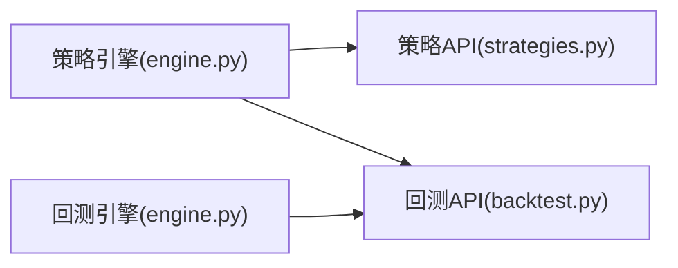

# 测试策略

<cite>
**本文引用的文件**   
- [conftest.py](../../../../../backend/tests/conftest.py)
- [test_backtest_engine.py](../../../../../backend/tests/test_backtest_engine.py)
- [test_strategy_engine.py](../../../../../backend/tests/test_strategy_engine.py)
- [engine.py（回测引擎）](../../../../../backend/app/backtest/engine.py)
- [engine.py（策略引擎）](../../../../../backend/app/strategies/engine.py)
- [backtest.py（回测API）](../../../../../backend/app/api/backtest.py)
- [strategies.py（策略API）](../../../../../backend/app/api/strategies.py)
- [pytest.ini](../../../../../backend/pytest.ini)
</cite>

## 目录
1. [引言](#引言)
2. [项目结构](#项目结构)
3. [核心组件](#核心组件)
4. [架构总览](#架构总览)
5. [详细组件分析](#详细组件分析)
6. [依赖关系分析](#依赖关系分析)
7. [性能与可扩展性考虑](#性能与可扩展性考虑)
8. [故障排查指南](#故障排查指南)
9. [结论](#结论)
10. [附录：覆盖率与质量门禁建议](#附录覆盖率与质量门禁建议)

## 引言
本测试策略文档面向量化交易系统的后端代码，目标是建立一套可执行、可维护、可扩展的测试体系。内容覆盖单元测试规范（基于 pytest）、集成测试设计思路（API 接口、端到端、数据流）、测试覆盖率与质量门禁建议，以及针对策略引擎、回测引擎和 API 接口的具体测试示例与最佳实践。同时给出模拟数据生成与测试环境配置方法，帮助团队在快速迭代中保持系统稳定性与正确性。

## 项目结构
后端测试位于 backend/tests 目录，采用 pytest 框架；业务逻辑分布在 app 子模块中，包括策略引擎、回测引擎、API 路由等。测试组织遵循“按被测对象分组 + 共享 fixtures”的模式，便于扩展与维护。

**图表来源**
- [engine.py（策略引擎）:1-656](../../../../../backend/app/strategies/engine.py#L1-L656)
- [engine.py（回测引擎）:1-163](../../../../../backend/app/backtest/engine.py#L1-L163)
- [backtest.py（回测API）:1-77](../../../../../backend/app/api/backtest.py#L1-L77)
- [strategies.py（策略API）:1-25](../../../../../backend/app/api/strategies.py#L1-L25)
- [test_strategy_engine.py:1-187](../../../../../backend/tests/test_strategy_engine.py#L1-L187)
- [test_backtest_engine.py:1-179](../../../../../backend/tests/test_backtest_engine.py#L1-L179)
- [conftest.py:1-47](../../../../../backend/tests/conftest.py#L1-L47)
- [pytest.ini:1-7](../../../../../backend/pytest.ini#L1-L7)

**章节来源**
- [pytest.ini:1-7](../../../../../backend/pytest.ini#L1-L7)
- [conftest.py:1-47](../../../../../backend/tests/conftest.py#L1-L47)

## 核心组件
- 策略引擎：提供多种经典与深度学习风格策略的实现，并通过工厂函数与注册表对外暴露。
- 回测引擎：接收 OHLCV 数据与信号，计算资金曲线、交易记录与绩效指标，保证输出可 JSON 序列化。
- API 层：FastAPI 路由封装策略创建、数据获取、回测运行流程，并返回结构化结果。
- 测试基础设施：pytest 配置与共享 fixtures，用于生成稳定、可复现的模拟 OHLCV 数据。

**章节来源**
- [engine.py（策略引擎）:17-656](../../../../../backend/app/strategies/engine.py#L17-L656)
- [engine.py（回测引擎）:10-163](../../../../../backend/app/backtest/engine.py#L10-L163)
- [backtest.py（回测API）:1-77](../../../../../backend/app/api/backtest.py#L1-L77)
- [strategies.py（策略API）:1-25](../../../../../backend/app/api/strategies.py#L1-L25)

## 架构总览
下图展示从 API 到策略与回测引擎的调用链，以及测试如何覆盖关键路径。

**图表来源**
- [backtest.py（回测API）:28-69](../../../../../backend/app/api/backtest.py#L28-L69)
- [engine.py（策略引擎）:600-656](../../../../../backend/app/strategies/engine.py#L600-L656)
- [engine.py（回测引擎）:15-70](../../../../../backend/app/backtest/engine.py#L15-L70)

## 详细组件分析

### 策略引擎测试
策略引擎包含多个策略类与工厂函数，测试重点包括：
- 注册表与工厂函数：可用策略列表完整性、参数校验、未知策略错误处理。
- 信号生成：各策略输出的 signal、position 列合法性，中间特征列存在性，边界条件（短数据、不修改输入）。
- Transformer 预测策略：需要较长序列数据，确保滚动窗口与注意力计算不会崩溃。

**图表来源**
- [engine.py（策略引擎）:17-504](../../../../../backend/app/strategies/engine.py#L17-L504)

测试要点与建议：
- 使用共享 fixtures 生成稳定随机种子下的 OHLCV 数据，确保用例可重复。
- 对每个策略断言信号列 schema 与取值范围（signal ∈ {-1,0,1}），并检查 position 为 signal 的一阶差分。
- 对 TransformerPredictStrategy 使用更长数据（如 100 天），避免训练窗口不足导致异常。
- 对工厂函数进行已知 ID 与未知 ID 的正反向测试，确保错误抛出语义明确。

**章节来源**
- [test_strategy_engine.py:26-50](../../../../../backend/tests/test_strategy_engine.py#L26-L50)
- [test_strategy_engine.py:70-187](../../../../../backend/tests/test_strategy_engine.py#L70-L187)
- [engine.py（策略引擎）:506-656](../../../../../backend/app/strategies/engine.py#L506-L656)

### 回测引擎测试
回测引擎负责将信号转化为交易记录与绩效指标，测试重点包括：
- 返回结构完整性：metrics、trades、equity_curve、signals_data 字段齐全。
- 指标合理性：初始资金匹配、无 NaN/Inf、最大回撤非正、胜率区间、交易计数一致性。
- 交易记录结构：日期字符串类型、必要字段齐全。
- 多策略集成：不同策略均能跑通回测引擎。
- JSON 安全：日期为字符串、数值有限且可序列化。

**图表来源**
- [engine.py（回测引擎）:15-70](../../../../../backend/app/backtest/engine.py#L15-L70)
- [engine.py（回测引擎）:72-163](../../../../../backend/app/backtest/engine.py#L72-L163)

测试要点与建议：
- 通过构造不同初始资金与数据集，验证指标计算的正确性与鲁棒性。
- 对 trades 为空的数据集进行跳过或断言，避免误判。
- 对 equity_curve 与 signals_data 的字段类型与值域进行断言，确保下游 JSON 序列化安全。

**章节来源**
- [test_backtest_engine.py:16-179](../../../../../backend/tests/test_backtest_engine.py#L16-L179)
- [engine.py（回测引擎）:10-163](../../../../../backend/app/backtest/engine.py#L10-L163)

### API 接口测试
API 层封装了策略创建、数据获取、回测运行的完整流程。测试应覆盖：
- 策略列表接口：返回结构与字段完整性。
- 策略详情接口：存在与不存在场景。
- 回测运行接口：请求参数校验、数据源选择、回测结果结构、错误处理。

**图表来源**
- [strategies.py（策略API）:11-24](../../../../../backend/app/api/strategies.py#L11-L24)
- [backtest.py（回测API）:28-69](../../../../../backend/app/api/backtest.py#L28-L69)

测试要点与建议：
- 使用 FastAPI TestClient 发起请求，断言响应状态码与数据结构。
- 对回测请求的参数组合进行参数化测试，覆盖不同策略、数据源与时间窗口。
- 对异常路径（非法参数、缺失数据）断言 HTTPException 的状态码与消息。

**章节来源**
- [strategies.py（策略API）:1-25](../../../../../backend/app/api/strategies.py#L1-L25)
- [backtest.py（回测API）:1-77](../../../../../backend/app/api/backtest.py#L1-L77)

### 测试数据准备与管理
- 共享 fixtures：conftest.py 提供 sample_ohlcv 与 small_ohlcv，分别用于常规与快速测试场景。
- 随机种子固定：np.random.seed 确保数据可复现。
- 数据字段规范：Date、Open、High、Low、Close、Volume，满足策略与回测引擎输入要求。

**图表来源**
- [conftest.py:9-47](../../../../../backend/tests/conftest.py#L9-L47)

**章节来源**
- [conftest.py:1-47](../../../../../backend/tests/conftest.py#L1-L47)

## 依赖关系分析
- 策略引擎被回测引擎与 API 层共同依赖。
- 回测引擎依赖策略生成的信号与 OHLCV 数据。
- API 层依赖策略工厂与回测引擎，形成清晰的单向依赖链。

**图表来源**
- [engine.py（策略引擎）:1-656](../../../../../backend/app/strategies/engine.py#L1-L656)
- [engine.py（回测引擎）:1-163](../../../../../backend/app/backtest/engine.py#L1-L163)
- [strategies.py（策略API）:1-25](../../../../../backend/app/api/strategies.py#L1-L25)
- [backtest.py（回测API）:1-77](../../../../../backend/app/api/backtest.py#L1-L77)

**章节来源**
- [engine.py（策略引擎）:1-656](../../../../../backend/app/strategies/engine.py#L1-L656)
- [engine.py（回测引擎）:1-163](../../../../../backend/app/backtest/engine.py#L1-L163)
- [strategies.py（策略API）:1-25](../../../../../backend/app/api/strategies.py#L1-L25)
- [backtest.py（回测API）:1-77](../../../../../backend/app/api/backtest.py#L1-L77)

## 性能与可扩展性考虑
- 策略计算向量化：优先使用 pandas/numpy 向量化操作，避免逐行循环。
- 回测引擎优化：减少不必要的 copy 与重复计算，缓存中间结果。
- 测试数据规模分层：小数据集用于快速回归，大数据集用于性能基准。
- 可扩展策略注册：新增策略时仅需在注册表中登记，并在测试中补充对应用例。

[本节为通用指导，不涉及具体文件分析]

## 故障排查指南
- 指标出现 NaN/Inf：检查回测引擎中对浮点数的清理逻辑与 safe_round 处理。
- 交易记录缺失：确认 position_change 信号是否产生有效买卖对。
- API 返回 400：检查请求参数合法性与数据源可用性。
- 策略未找到：核对 create_strategy 中的策略 ID 映射。

**章节来源**
- [engine.py（回测引擎）:105-163](../../../../../backend/app/backtest/engine.py#L105-L163)
- [backtest.py（回测API）:68-69](../../../../../backend/app/api/backtest.py#L68-L69)
- [engine.py（策略引擎）:654-656](../../../../../backend/app/strategies/engine.py#L654-L656)

## 结论
本测试策略以 pytest 为核心，围绕策略引擎与回测引擎构建完整的单元测试与集成测试体系。通过共享 fixtures 与参数化用例，确保测试的可重复性与覆盖面。API 层测试覆盖正向与异常路径，保障外部接口的稳定性。建议在持续集成中加入覆盖率统计与质量门禁，进一步提升代码质量与交付可靠性。

[本节为总结性内容，不涉及具体文件分析]

## 附录：覆盖率与质量门禁建议
- 覆盖率目标：
  - 语句覆盖率 ≥ 80%
  - 分支覆盖率 ≥ 70%
  - 关键模块（策略引擎、回测引擎、API）覆盖率 ≥ 90%
- 质量门禁：
  - 所有测试必须通过
  - 新增代码需附带相应测试用例
  - 禁止引入新的 NaN/Inf 到输出结构
  - API 异常路径需有明确状态码与消息
- 工具建议：
  - pytest-cov 统计覆盖率
  - pre-commit hooks 执行 lint 与测试
  - CI 流水线集成覆盖率阈值检查

[本节为通用建议，不涉及具体文件分析]