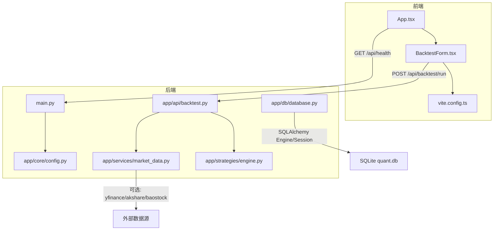
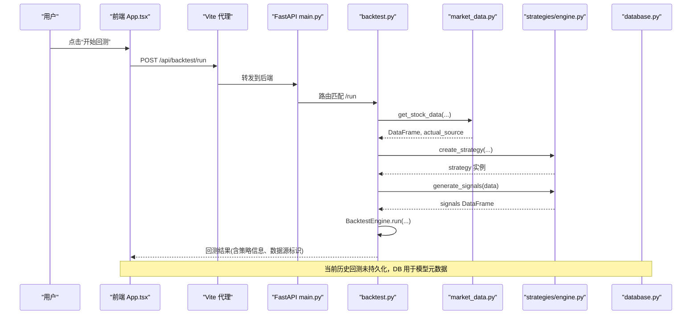
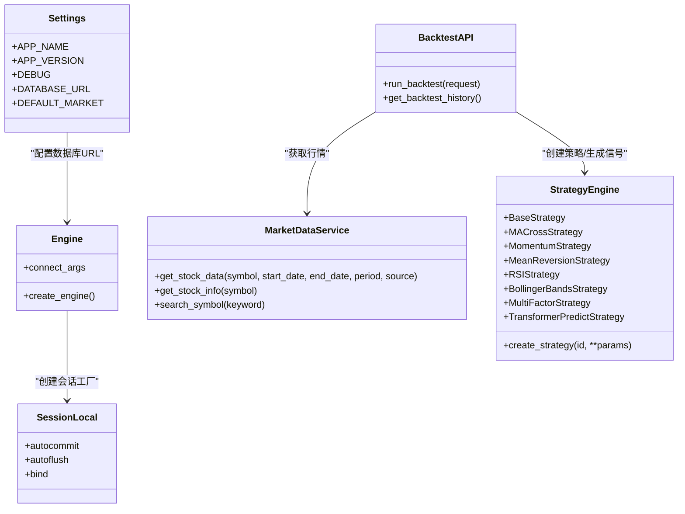

# 调试与优化

<cite>
**本文引用的文件**   
- [backend/main.py](file://backend/main.py)
- [backend/app/core/config.py](file://backend/app/core/config.py)
- [backend/app/db/database.py](file://backend/app/db/database.py)
- [backend/app/api/backtest.py](file://backend/app/api/backtest.py)
- [backend/app/strategies/engine.py](file://backend/app/strategies/engine.py)
- [backend/app/services/market_data.py](file://backend/app/services/market_data.py)
- [frontend/src/App.tsx](file://frontend/src/App.tsx)
- [frontend/src/components/BacktestForm.tsx](file://frontend/src/components/BacktestForm.tsx)
- [frontend/vite.config.ts](file://frontend/vite.config.ts)
- [frontend/package.json](file://frontend/package.json)
- [backend/requirements.txt](file://backend/requirements.txt)
</cite>

## 目录
1. [简介](#简介)
2. [项目结构](#项目结构)
3. [核心组件](#核心组件)
4. [架构总览](#架构总览)
5. [详细组件分析](#详细组件分析)
6. [依赖关系分析](#依赖关系分析)
7. [性能考虑](#性能考虑)
8. [故障排除指南](#故障排除指南)
9. [监控与日志](#监控与日志)
10. [结论](#结论)

## 简介
本指南面向量化策略查看系统的开发者，聚焦后端与前端的调试技巧、性能瓶颈识别与优化策略，以及生产环境的可观测性与排障方法。内容覆盖 FastAPI 日志配置、数据库查询优化、内存泄漏排查；React DevTools、网络请求调试、前端性能分析；以及缓存、异步处理等通用优化手段。

## 项目结构
系统采用前后端分离：
- 后端基于 FastAPI + SQLAlchemy，提供策略回测、市场数据获取等 API。
- 前端基于 React + Vite，通过代理转发到后端 API，展示策略列表、回测表单与结果。

图表来源
- [backend/main.py:9-35](file://backend/main.py#L9-L35)
- [backend/app/api/backtest.py:28-69](file://backend/app/api/backtest.py#L28-L69)
- [backend/app/strategies/engine.py:17-25](file://backend/app/strategies/engine.py#L17-L25)
- [backend/app/services/market_data.py:11-41](file://backend/app/services/market_data.py#L11-L41)
- [backend/app/db/database.py:9-14](file://backend/app/db/database.py#L9-L14)
- [backend/app/core/config.py:8-24](file://backend/app/core/config.py#L8-L24)
- [frontend/src/App.tsx:13-36](file://frontend/src/App.tsx#L13-L36)
- [frontend/src/components/BacktestForm.tsx:21-44](file://frontend/src/components/BacktestForm.tsx#L21-L44)
- [frontend/vite.config.ts:4-15](file://frontend/vite.config.ts#L4-L15)

章节来源
- [backend/main.py:1-36](file://backend/main.py#L1-L36)
- [frontend/src/App.tsx:1-100](file://frontend/src/App.tsx#L1-L100)
- [frontend/vite.config.ts:1-16](file://frontend/vite.config.ts#L1-L16)

## 核心组件
- FastAPI 应用入口与路由注册：定义健康检查、CORS、路由前缀。
- 回测 API：接收参数，调用市场数据服务、策略引擎与回测引擎，返回结构化结果。
- 策略引擎：多种策略实现（均线交叉、动量、均值回归、RSI、布林带、多因子、Transformer 预测），统一接口生成交易信号。
- 市场数据服务：封装多数据源选择逻辑，支持自动选择或指定数据源。
- 数据库层：SQLAlchemy Engine/Session 管理，当前为 SQLite。
- 前端 App：发起回测请求，渲染结果；Vite 代理将 /api 转发至后端。

章节来源
- [backend/main.py:9-35](file://backend/main.py#L9-L35)
- [backend/app/api/backtest.py:16-69](file://backend/app/api/backtest.py#L16-L69)
- [backend/app/strategies/engine.py:17-25](file://backend/app/strategies/engine.py#L17-L25)
- [backend/app/services/market_data.py:11-41](file://backend/app/services/market_data.py#L11-L41)
- [backend/app/db/database.py:9-28](file://backend/app/db/database.py#L9-L28)
- [frontend/src/App.tsx:13-36](file://frontend/src/App.tsx#L13-L36)

## 架构总览
以下序列图展示了“用户在前端提交回测”的端到端流程，包括网络代理、FastAPI 路由、市场数据获取、策略信号生成与回测执行。

图表来源
- [frontend/src/App.tsx:13-36](file://frontend/src/App.tsx#L13-L36)
- [frontend/vite.config.ts:6-14](file://frontend/vite.config.ts#L6-L14)
- [backend/main.py:24-35](file://backend/main.py#L24-L35)
- [backend/app/api/backtest.py:28-69](file://backend/app/api/backtest.py#L28-L69)
- [backend/app/services/market_data.py:14-41](file://backend/app/services/market_data.py#L14-L41)
- [backend/app/strategies/engine.py:600-655](file://backend/app/strategies/engine.py#L600-L655)

## 详细组件分析

### 后端调试技巧

#### FastAPI 日志配置与中间件
- 现状：应用入口已启用 CORS 中间件与健康检查路由，便于基础连通性验证。
- 建议：
  - 在开发环境开启详细日志（例如 uvicorn 的 --log-level=debug），并记录请求 ID、耗时、异常堆栈。
  - 使用自定义中间件对关键路径（如 /api/backtest/run）打点，统计 P95/P99 延迟与错误率。
  - 结合 pydantic-settings 的 DEBUG 开关控制日志级别与敏感信息输出。

章节来源
- [backend/main.py:15-35](file://backend/main.py#L15-L35)
- [backend/app/core/config.py:8-24](file://backend/app/core/config.py#L8-L24)

#### 数据库查询优化
- 现状：使用 SQLAlchemy 创建 Engine 与 SessionLocal，SQLite 默认单文件存储。
- 建议：
  - 避免 N+1 查询：批量加载关联数据，使用 joinedload/subqueryload。
  - 合理索引：对高频过滤字段建立索引（如股票代码、时间范围）。
  - 连接池与线程安全：SQLite 的 check_same_thread=False 仅适合本地调试；生产应切换 PostgreSQL/MySQL 并使用连接池。
  - 事务边界清晰：短事务、尽早提交，减少锁竞争。

章节来源
- [backend/app/db/database.py:9-28](file://backend/app/db/database.py#L9-L28)

#### 内存泄漏排查
- 常见原因：
  - 大型 DataFrame 未及时释放（策略计算中多次 copy 与中间列）。
  - 全局缓存无过期策略（如行情缓存、模型权重）。
  - 循环引用导致 GC 无法回收。
- 排查步骤：
  - 使用 tracemalloc 或 memory_profiler 定位热点对象。
  - 对长任务进行分片处理，及时 flush 中间结果。
  - 避免在请求级持有大对象引用，必要时显式 del 或 gc.collect。

[本节为通用指导，不直接分析具体文件]

### 前端调试方法

#### React DevTools 使用
- 组件树与状态：观察 state/props 变化，定位重复渲染与不必要更新。
- Profiler：捕获渲染时间，识别重渲染热点组件（如 BacktestResult 大数据可视化）。
- Hooks 面板：检查 useEffect/useMemo/useCallback 的使用是否合理。

[本节为通用指导，不直接分析具体文件]

#### 网络请求调试
- 使用浏览器 Network 面板查看：
  - 请求 URL、方法、请求体、响应体、状态码、耗时。
  - 代理是否正确转发（/api → http://localhost:8000）。
- 常见问题：
  - CORS 被拒绝：确认后端允许跨域。
  - 404/500：核对路由与后端实现。
  - 大响应体：检查是否返回了冗余字段。

章节来源
- [frontend/vite.config.ts:6-14](file://frontend/vite.config.ts#L6-L14)
- [backend/main.py:15-22](file://backend/main.py#L15-L22)

#### 性能分析工具
- Lighthouse：评估首屏加载、资源体积、可访问性。
- Chrome Performance：录制页面交互，分析主线程阻塞与布局抖动。
- 针对图表库（recharts）：减少频繁重绘，使用 memoization 与虚拟滚动。

[本节为通用指导，不直接分析具体文件]

### 常见性能瓶颈与优化策略

#### 数据库查询优化
- 批量写入/读取，避免逐条操作。
- 分页与游标：对长列表使用分页，降低单次负载。
- 读写分离：读多写少场景引入只读副本。

[本节为通用指导，不直接分析具体文件]

#### 缓存策略
- 行情数据缓存：按 symbol+period+source 维度缓存，设置 TTL。
- 策略参数校验缓存：预编译参数校验规则，减少重复解析。
- 结果缓存：对相同参数的回测结果短期缓存，提升重复查询性能。

[本节为通用指导，不直接分析具体文件]

#### 异步处理
- 将耗时任务（如深度学习策略训练）放入后台队列（Celery/RQ），前端轮询进度。
- 使用 FastAPI BackgroundTasks 处理轻量异步任务（如发送通知、落盘）。
- 前端使用 AbortController 取消长时间请求，避免 UI 卡死。

[本节为通用指导，不直接分析具体文件]

## 依赖关系分析

图表来源
- [backend/app/core/config.py:8-24](file://backend/app/core/config.py#L8-L24)
- [backend/app/db/database.py:9-14](file://backend/app/db/database.py#L9-L14)
- [backend/app/services/market_data.py:11-41](file://backend/app/services/market_data.py#L11-L41)
- [backend/app/api/backtest.py:28-69](file://backend/app/api/backtest.py#L28-L69)
- [backend/app/strategies/engine.py:17-25](file://backend/app/strategies/engine.py#L17-L25)

章节来源
- [backend/app/core/config.py:8-24](file://backend/app/core/config.py#L8-L24)
- [backend/app/db/database.py:9-28](file://backend/app/db/database.py#L9-L28)
- [backend/app/services/market_data.py:11-106](file://backend/app/services/market_data.py#L11-L106)
- [backend/app/api/backtest.py:16-77](file://backend/app/api/backtest.py#L16-L77)
- [backend/app/strategies/engine.py:17-655](file://backend/app/strategies/engine.py#L17-L655)

## 性能考虑
- 后端：
  - 限制请求体大小，避免恶意大包。
  - 对策略计算进行向量化优化，减少 Python 循环。
  - 对深度学习策略（transformer_dl）进行 GPU 加速与批处理。
- 前端：
  - 懒加载图表组件，按需渲染。
  - 对大数据集使用虚拟滚动与增量更新。
  - 压缩静态资源，启用 Gzip/Brotli。

[本节为通用指导，不直接分析具体文件]

## 故障排除指南

### 快速自检清单
- 后端启动
  - 健康检查是否返回 healthy。
  - CORS 是否允许前端域名。
- 网络连通
  - 前端代理是否将 /api 转发到后端端口。
  - 防火墙/代理是否放行 8000 端口。
- 数据源
  - 指定 mock 数据源是否能正常返回。
  - 真实数据源（yfinance/akshare/baostock）是否安装依赖且网络可达。
- 数据库
  - SQLite 文件是否存在且可写。
  - 表结构是否初始化成功。
- 策略
  - 传入的参数是否在允许范围内。
  - 深度学习策略是否安装了 torch/scikit-learn。

章节来源
- [backend/main.py:29-35](file://backend/main.py#L29-L35)
- [frontend/vite.config.ts:6-14](file://frontend/vite.config.ts#L6-L14)
- [backend/app/services/market_data.py:43-82](file://backend/app/services/market_data.py#L43-L82)
- [backend/app/db/database.py:17-19](file://backend/app/db/database.py#L17-L19)
- [backend/app/strategies/engine.py:647-655](file://backend/app/strategies/engine.py#L647-L655)

### 常见问题与解决方案
- 问题：前端请求 404
  - 检查 Vite 代理配置与后端路由前缀。
  - 确认后端已 include_router 对应模块。
- 问题：CORS 错误
  - 检查后端 CORSMiddleware 的 allow_origins 是否包含前端地址。
- 问题：回测失败（400）
  - 检查请求体字段是否符合 Pydantic 模型定义。
  - 查看后端日志中的异常详情。
- 问题：深度学习策略导入失败
  - 安装 torch 与 scikit-learn，确保版本兼容。
- 问题：数据库写入失败
  - 检查 SQLite 文件权限与磁盘空间。
  - 生产环境迁移到 PostgreSQL/MySQL 并配置连接池。

章节来源
- [frontend/vite.config.ts:6-14](file://frontend/vite.config.ts#L6-L14)
- [backend/main.py:15-27](file://backend/main.py#L15-L27)
- [backend/app/api/backtest.py:28-69](file://backend/app/api/backtest.py#L28-L69)
- [backend/app/strategies/engine.py:647-655](file://backend/app/strategies/engine.py#L647-L655)
- [backend/app/db/database.py:9-19](file://backend/app/db/database.py#L9-L19)

## 监控与日志

### 后端日志与可观测性
- 日志级别：开发环境 debug，生产环境 info/warning/error。
- 结构化日志：JSON 格式，包含 request_id、user_id、latency_ms、status_code。
- 指标采集：暴露 /metrics 端点，收集 QPS、延迟分布、错误率、GC 次数。
- 链路追踪：集成 OpenTelemetry，记录跨服务调用链。

[本节为通用指导，不直接分析具体文件]

### 前端监控
- 错误上报：捕获未处理的 Promise 拒绝与运行时错误，上报到监控系统。
- 性能埋点：记录关键交互耗时（如“开始回测”到“结果渲染”）。
- 用户行为：匿名化记录功能使用频率，辅助优化优先级。

[本节为通用指导，不直接分析具体文件]

### 生产环境调试技巧
- 灰度发布：逐步放量，观察错误率与性能指标。
- 远程调试：谨慎开启，配合限流与白名单。
- 快照与回放：对复现性问题保存请求/响应快照，便于离线分析。
- 容量规划：根据峰值 QPS 与 CPU/内存使用率调整实例数与资源配置。

[本节为通用指导，不直接分析具体文件]

## 结论
通过合理的日志与监控、严格的参数校验、高效的缓存与异步策略，以及前端性能优化，可以显著提升系统的稳定性与用户体验。建议在开发阶段即引入自动化测试与性能基准，持续回归验证关键路径的性能与正确性。