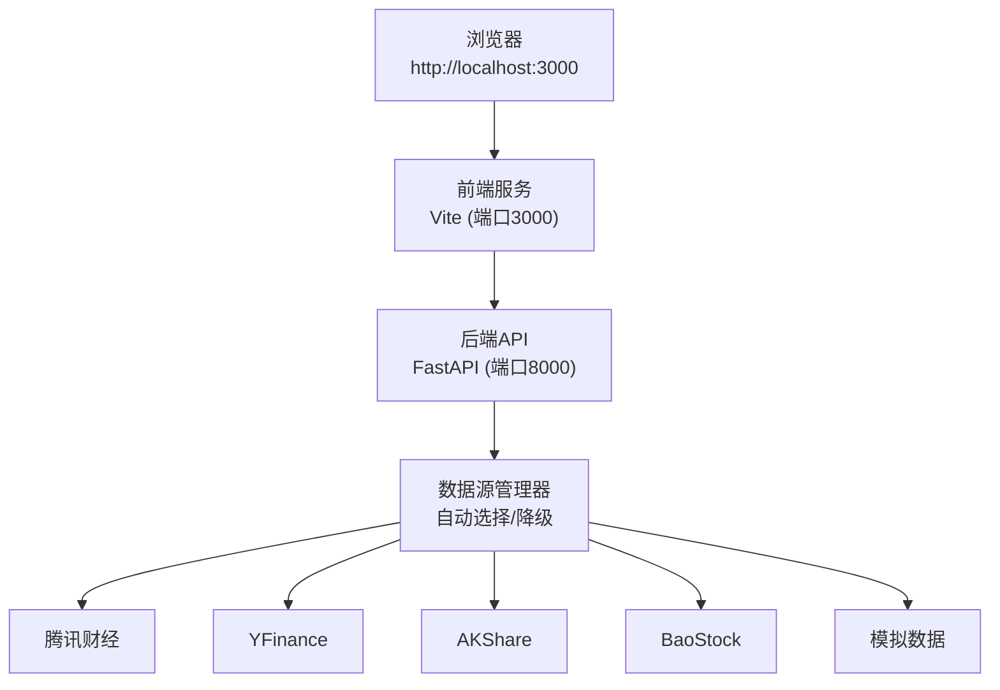

# 快速开始

<cite>
**本文引用的文件**   
- [start.sh](../../../../start.sh)
- [start.bat](../../../../start.bat)
- [QUICKSTART.md](../../../../QUICKSTART.md)
- [DATA_SOURCES.md](../../../../DATA_SOURCES.md)
- [backend/requirements.txt](../../../../backend/requirements.txt)
- [frontend/package.json](../../../../frontend/package.json)
- [backend/main.py](../../../../backend/main.py)
- [frontend/src/App.tsx](../../../../frontend/src/App.tsx)
- [backend/app/services/data_source_manager.py](../../../../backend/app/services/data_source_manager.py)
</cite>

## 目录
1. [简介](#简介)
2. [系统要求检查](#系统要求检查)
3. [一键启动方法](#一键启动方法)
4. [手动安装与启动](#手动安装与启动)
5. [数据源选择与安装建议](#数据源选择与安装建议)
6. [首次使用完整流程示例](#首次使用完整流程示例)
7. [常见问题与故障排除](#常见问题与故障排除)
8. [架构概览](#架构概览)
9. [性能与稳定性建议](#性能与稳定性建议)
10. [结论](#结论)

## 简介
本指南帮助你在5分钟内成功运行量化交易平台，包括环境检查、一键启动、手动安装、数据源配置、命令行示例以及常见问题的解决方案。启动成功后，请在浏览器访问 http://localhost:3000 打开前端界面。

## 系统要求检查
- Python 3.8+
- Node.js 16+
- npm（随Node.js安装）

验证命令：
- Python：python3 --version 或 python --version
- Node：node --version
- npm：npm --version

说明：
- 脚本会检测Python和Node是否可用；若未检测到，将提示先安装对应环境。
- 后端默认监听端口 8000，前端默认监听端口 3000。

章节来源
- [QUICKSTART.md:3-8](../../../../QUICKSTART.md#L3-L8)
- [start.sh:8-22](../../../../start.sh#L8-L22)
- [start.bat:7-27](../../../../start.bat#L7-L27)

## 一键启动方法
### Mac/Linux
在项目根目录执行：
- ./start.sh

该脚本会：
- 检查Python与Node版本
- 创建并激活Python虚拟环境
- 安装后端依赖
- 启动后端服务（http://localhost:8000）
- 安装前端依赖（如尚未安装）
- 启动前端服务（http://localhost:3000）

### Windows
双击 start.bat 或在命令行执行：
- start.bat

该批处理会：
- 检查Python与Node版本
- 创建并激活Python虚拟环境
- 安装后端依赖
- 启动后端服务（http://localhost:8000）
- 安装前端依赖（如尚未安装）
- 启动前端服务（http://localhost:3000）

注意：
- 如果端口被占用，请先释放端口后再启动。
- 首次运行可能需要几分钟用于安装依赖。

章节来源
- [QUICKSTART.md:9-23](../../../../QUICKSTART.md#L9-L23)
- [start.sh:24-53](../../../../start.sh#L24-L53)
- [start.bat:29-56](../../../../start.bat#L29-L56)

## 手动安装与启动
### 后端环境配置
1. 进入后端目录：cd backend
2. 创建并激活虚拟环境：
   - Mac/Linux：python3 -m venv venv && source venv/bin/activate
   - Windows：python -m venv venv && venv\Scripts\activate
3. 安装依赖：pip install -r requirements.txt
4. 启动服务：uvicorn main:app --reload --host 0.0.0.0 --port 8000

说明：
- 后端API文档地址：http://localhost:8000/docs
- 健康检查接口：/api/health

章节来源
- [QUICKSTART.md:27-43](../../../../QUICKSTART.md#L27-L43)
- [backend/main.py:9-35](../../../../backend/main.py#L9-L35)
- [backend/requirements.txt:1-16](../../../../backend/requirements.txt#L1-L16)

### 前端依赖安装与启动
1. 进入前端目录：cd frontend
2. 安装依赖（首次运行）：npm install
3. 启动开发服务器：npm run dev

说明：
- 前端默认监听端口 3000
- 构建命令：npm run build
- 预览构建产物：npm run preview

章节来源
- [QUICKSTART.md:45-56](../../../../QUICKSTART.md#L45-L56)
- [frontend/package.json:6-12](../../../../frontend/package.json#L6-L12)

## 数据源选择与安装建议
### 数据源总览
- 🤖 自动选择：根据股票市场自动选择最佳数据源
- 🐧 腾讯财经：A股、港股，免费、无需注册，推荐用于A股
- 🌍 YFinance：美股、港股，已内置依赖
- 📊 AKShare：A股全面数据，需安装 akshare
- 📈 BaoStock：A股历史数据，需安装 baostock
- 🎲 模拟数据：无需网络，用于测试

### 安装建议
- 仅基础使用：不安装额外数据源也可运行（YFinance + 模拟数据）
- A股优先：安装 akshare（pip install akshare），提升A股数据质量
- 备用数据源：安装 baostock（pip install baostock）作为AKShare的备用

### 智能降级策略
- A股/港股：腾讯财经 → YFinance → AKShare → BaoStock → 模拟数据
- 美股：YFinance → 模拟数据
- 当真实数据获取失败时，系统会自动降级到下一个可用数据源，最终兜底为模拟数据

章节来源
- [QUICKSTART.md:114-137](../../../../QUICKSTART.md#L114-L137)
- [DATA_SOURCES.md:1-58](../../../../DATA_SOURCES.md#L1-L58)
- [backend/app/services/data_source_manager.py:14-49](../../../../backend/app/services/data_source_manager.py#L14-L49)

## 首次使用完整流程示例
以下示例帮助你完成一次完整的回测操作：

### 示例1：A股回测（腾讯财经）
- 打开 http://localhost:3000
- 选择“均线交叉策略”
- 输入股票代码：600519.SS（贵州茅台）
- 数据源选择：🐧 腾讯财经
- 回测周期：1年
- 点击“开始回测”

### 示例2：美股回测（YFinance）
- 选择策略：动量策略
- 输入股票代码：AAPL（苹果）
- 数据源选择：🌍 YFinance
- 调整参数：回看周期 20，阈值 0.05
- 点击“开始回测”

### 示例3：多因子选股策略
- 选择策略：多因子选股策略
- 输入股票代码：000858.SZ（五粮液）
- 调整参数：
  - 动量周期：20
  - 波动率周期：20
  - 买入阈值：0.6
  - 卖出阈值：0.4
- 点击“开始回测”

### 示例4：布林带策略
- 选择策略：布林带策略
- 输入股票代码：601318.SS（中国平安）
- 调整参数：
  - 布林带周期：20
  - 标准差倍数：2.0
  - 买入阈值(%B)：0.05
  - 卖出阈值(%B)：0.95
- 点击“开始回测”

### 示例5：无网络环境测试（模拟数据）
- 选择任意策略
- 数据源选择：🎲 模拟数据
- 输入任意股票代码
- 点击“开始回测”
- 结果标题显示“回测结果（模拟数据）”

章节来源
- [QUICKSTART.md:66-113](../../../../QUICKSTART.md#L66-L113)

## 常见问题与故障排除
### 1. 模块未找到（后端）
问题：ModuleNotFoundError: No module named 'xxx'
解决：
- cd backend
- source venv/bin/activate（Mac/Linux）或 venv\Scripts\activate（Windows）
- pip install -r requirements.txt

章节来源
- [QUICKSTART.md:238-248](../../../../QUICKSTART.md#L238-L248)

### 2. 前端启动失败（Cannot find module）
问题：Cannot find module
解决：
- cd frontend
- rm -rf node_modules package-lock.json
- npm install

章节来源
- [QUICKSTART.md:249-258](../../../../QUICKSTART.md#L249-L258)

### 3. 端口被占用（Address already in use）
问题：端口 8000 或 3000 被占用
解决：
- Mac/Linux：lsof -ti:8000 | xargs kill -9 与 lsof -ti:3000 | xargs kill -9
- Windows：使用任务管理器结束占用端口的进程，或使用 netstat 查找并终止

章节来源
- [QUICKSTART.md:260-269](../../../../QUICKSTART.md#L260-L269)

### 4. 获取股票数据失败
问题：回测结果显示“（模拟数据）”
解决：
- 检查网络连接
- 尝试手动切换数据源（如选择“腾讯财经”）
- A股代码格式：600519.SS（上证）/ 000858.SZ（深证）
- 使用模拟数据不影响系统功能，但回测结果仅供参考

章节来源
- [QUICKSTART.md:271-280](../../../../QUICKSTART.md#L271-L280)

### 5. Transformer深度学习策略不可用
问题：选择该策略后提示需要安装 PyTorch
解决：
- cd backend
- source venv/bin/activate
- pip install torch --index-url https://download.pytorch.org/whl/cpu
- pip install scikit-learn

章节来源
- [QUICKSTART.md:281-291](../../../../QUICKSTART.md#L281-L291)

## 架构概览
系统由前后端组成：
- 前端：React + Vite，提供用户界面与交互
- 后端：FastAPI + Uvicorn，提供REST API与回测引擎
- 数据源：支持多种数据源（腾讯财经、YFinance、AKShare、BaoStock、模拟数据），具备自动选择与降级能力

图表来源
- [backend/main.py:9-35](../../../../backend/main.py#L9-L35)
- [frontend/src/App.tsx:13-36](../../../../frontend/src/App.tsx#L13-L36)
- [backend/app/services/data_source_manager.py:14-49](../../../../backend/app/services/data_source_manager.py#L14-L49)

章节来源
- [backend/main.py:1-36](../../../../backend/main.py#L1-L36)
- [frontend/src/App.tsx:1-100](../../../../frontend/src/App.tsx#L1-L100)
- [backend/app/services/data_source_manager.py:1-49](../../../../backend/app/services/data_source_manager.py#L1-L49)

## 性能与稳定性建议
- 首次运行依赖安装可能较慢，建议使用稳定的网络环境
- 如需加速前端开发体验，可清理缓存后重新安装依赖
- 对于A股数据，优先安装AKShare以提升数据质量与速度
- 在离线或弱网环境下，可使用模拟数据进行本地测试
- 避免同时运行多个占用相同端口的服务，防止冲突

[本节为通用指导，不涉及具体文件分析]

## 结论
按照本指南完成环境检查、一键或手动启动、数据源配置后，你将能够在 http://localhost:3000 访问量化交易平台的前端界面，并进行策略回测。如遇问题，请参考常见问题与故障排除部分进行定位与修复。

[本节为总结性内容，不涉及具体文件分析]