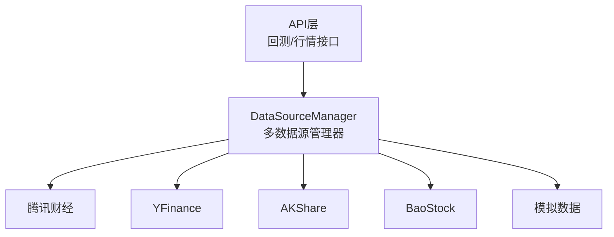
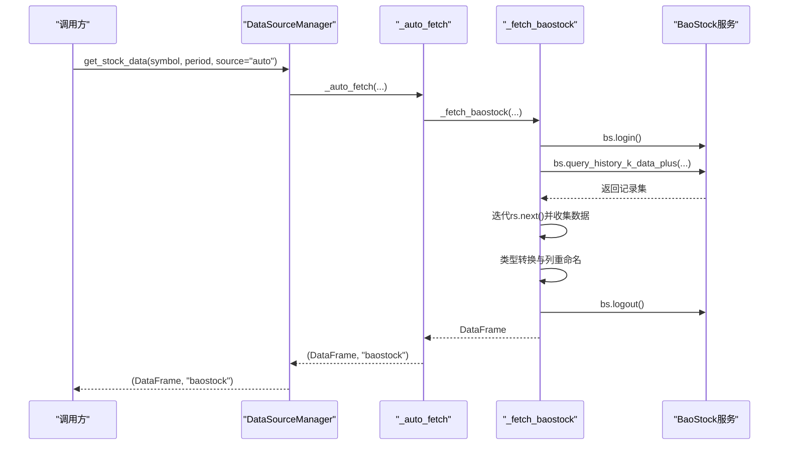
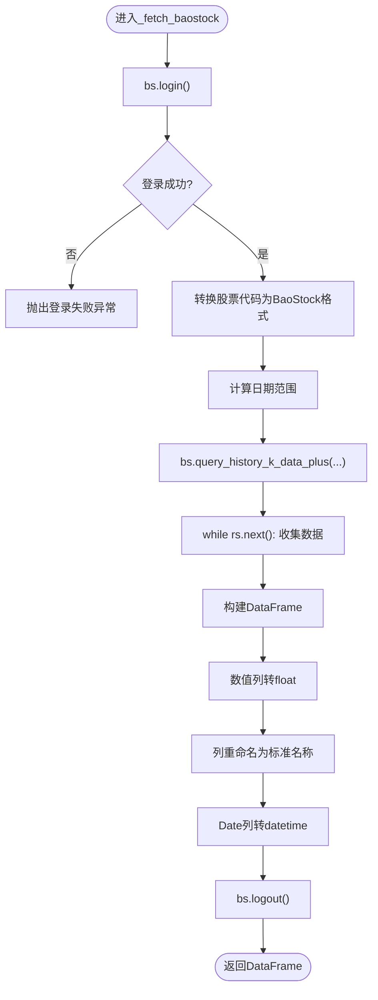
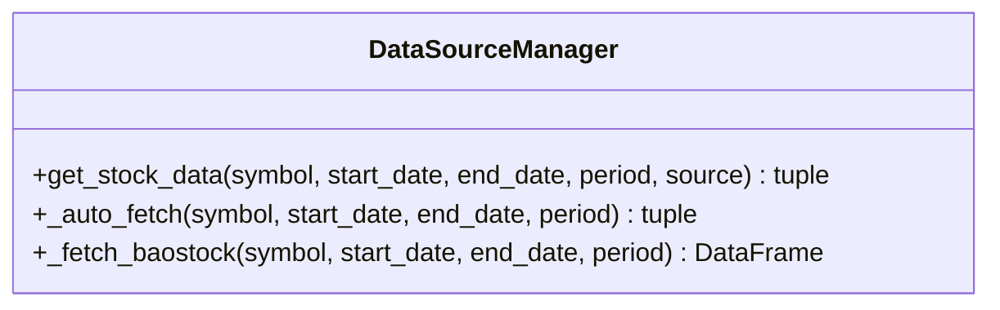
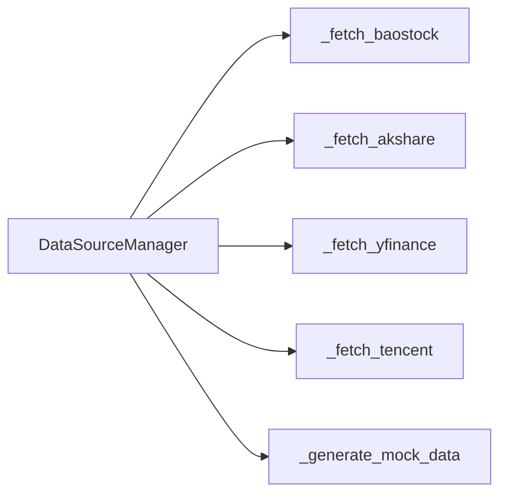

# BaoStock数据源

<cite>
**本文引用的文件**   
- [data_source_manager.py](file://backend/app/services/data_source_manager.py)
- [DATA_SOURCES.md](file://DATA_SOURCES.md)
</cite>

## 目录
1. [简介](#简介)
2. [项目结构](#项目结构)
3. [核心组件](#核心组件)
4. [架构总览](#架构总览)
5. [详细组件分析](#详细组件分析)
6. [依赖关系分析](#依赖关系分析)
7. [性能与资源管理](#性能与资源管理)
8. [故障排查指南](#故障排查指南)
9. [结论](#结论)
10. [附录：使用示例](#附录使用示例)

## 简介
本章节聚焦于BaoStock数据源的实现与使用，涵盖以下要点：
- BaoStock库的登录机制与生命周期管理（bs.login()与bs.logout()）
- 股票代码格式转换逻辑（从标准格式到BaoStock格式，如sh.600519、sz.000858）
- query_history_k_data_plus函数的使用方法（字段选择、复权设置）
- 数据迭代处理与类型转换流程（确保数值类型正确）
- 该数据源的特点：专业金融数据、历史数据完整、需要登录认证
- 连接池管理与资源释放的最佳实践建议
- A股历史数据的获取与清理完整示例

## 项目结构
本项目在后端服务中通过“多数据源管理器”统一接入不同数据源。BaoStock作为A股数据源之一，被集成在数据源管理器中，并在自动降级策略中被调用。

图表来源
- [data_source_manager.py:14-54](file://backend/app/services/data_source_manager.py#L14-L54)

章节来源
- [data_source_manager.py:14-54](file://backend/app/services/data_source_manager.py#L14-L54)
- [DATA_SOURCES.md:1-25](file://DATA_SOURCES.md#L1-L25)

## 核心组件
- DataSourceManager：统一的数据源入口，负责根据市场与可用性自动选择或指定数据源。
- BaoStock数据获取方法：封装了登录、查询、迭代、类型转换、列重命名与登出等步骤。

章节来源
- [data_source_manager.py:14-54](file://backend/app/services/data_source_manager.py#L14-L54)
- [data_source_manager.py:337-416](file://backend/app/services/data_source_manager.py#L337-L416)

## 架构总览
下图展示了BaoStock在整体数据获取流程中的位置，以及与自动降级策略的关系。

图表来源
- [data_source_manager.py:56-109](file://backend/app/services/data_source_manager.py#L56-L109)
- [data_source_manager.py:337-416](file://backend/app/services/data_source_manager.py#L337-L416)

## 详细组件分析

### BaoStock数据获取流程
- 登录机制与生命周期管理
  - 在进入BaoStock数据获取时调用bs.login()进行登录，若登录失败则抛出异常。
  - 在finally块中调用bs.logout()确保无论成功或异常都会释放连接资源。
- 股票代码格式转换
  - 将标准格式（如600519.SS、000858.SZ）转换为BaoStock格式（sh.600519、sz.000858）。
- 日期范围计算
  - 若未提供start_date与end_date，则根据period计算起止日期。
- 数据查询与迭代
  - 使用bs.query_history_k_data_plus获取日K线数据，字段包括date、open、high、low、close、volume。
  - 通过while循环迭代rs.next()，逐行收集数据。
- 类型转换与列重命名
  - 将open、high、low、close、volume转换为float类型。
  - 将date转换为datetime类型。
  - 将列名重命名为Date、Open、High、Low、Close、Volume以统一输出格式。

图表来源
- [data_source_manager.py:337-416](file://backend/app/services/data_source_manager.py#L337-L416)

章节来源
- [data_source_manager.py:337-416](file://backend/app/services/data_source_manager.py#L337-L416)

### 代码级类与方法关系

图表来源
- [data_source_manager.py:14-54](file://backend/app/services/data_source_manager.py#L14-L54)
- [data_source_manager.py:337-416](file://backend/app/services/data_source_manager.py#L337-L416)

### query_history_k_data_plus函数使用说明
- 参数说明
  - symbol：BaoStock格式的股票代码（如sh.600519、sz.000858）
  - fields：字段字符串，例如“date,open,high,low,close,volume”
  - start_date/end_date：起止日期（YYYY-MM-DD）
  - frequency：频率，“d”表示日线
  - adjustflag：复权方式，“2”表示前复权
- 返回值
  - 返回记录集对象，可通过rs.fields获取字段名，通过rs.next()迭代数据行

章节来源
- [data_source_manager.py:374-382](file://backend/app/services/data_source_manager.py#L374-L382)

### 数据迭代与类型转换
- 迭代过程
  - 使用while循环检查rs.error_code是否为'0'且rs.next()为真，逐行追加数据。
- 类型转换
  - open/high/low/close/volume均转换为float类型，确保后续计算的数值精度。
- 列重命名与日期解析
  - 将BaoStock原始列名映射为标准列名，并将Date列解析为datetime类型。

章节来源
- [data_source_manager.py:384-410](file://backend/app/services/data_source_manager.py#L384-L410)

### BaoStock数据源特点
- 专业金融数据：面向A股市场，提供高质量的历史K线数据。
- 历史数据完整：支持较长历史区间的数据查询。
- 需要登录认证：每次使用前需调用bs.login()，使用后必须调用bs.logout()释放资源。

章节来源
- [DATA_SOURCES.md:12-15](file://DATA_SOURCES.md#L12-L15)
- [data_source_manager.py:347-350](file://backend/app/services/data_source_manager.py#L347-L350)
- [data_source_manager.py:414-416](file://backend/app/services/data_source_manager.py#L414-L416)

## 依赖关系分析
- 模块内依赖
  - DataSourceManager统一管理多个数据源，BaoStock作为其中一个分支。
- 外部依赖
  - BaoStock库用于A股历史数据获取。
- 自动降级策略
  - 当首选数据源不可用时，系统会尝试其他数据源，最终回退到模拟数据。

图表来源
- [data_source_manager.py:14-54](file://backend/app/services/data_source_manager.py#L14-L54)
- [data_source_manager.py:56-109](file://backend/app/services/data_source_manager.py#L56-L109)

章节来源
- [data_source_manager.py:14-54](file://backend/app/services/data_source_manager.py#L14-L54)
- [data_source_manager.py:56-109](file://backend/app/services/data_source_manager.py#L56-L109)

## 性能与资源管理
- 连接池管理
  - BaoStock库内部维护连接状态；当前实现每次获取数据时执行一次登录与登出，适合低频调用场景。
  - 对于高频调用，建议在应用层维护一个会话上下文，避免频繁登录/登出带来的开销。
- 资源释放最佳实践
  - 始终在finally块中调用bs.logout()，确保异常路径也能释放资源。
  - 在批量数据处理场景中，可考虑复用登录会话，减少网络握手次数。
- 数据类型与内存优化
  - 对数值列进行float转换，确保计算精度；必要时可使用更高效的数值类型（如np.float32）以降低内存占用。
  - 对大数据集进行分块处理，避免一次性加载过多数据导致内存压力。

[本节为通用指导，不直接分析具体文件]

## 故障排查指南
- 登录失败
  - 现象：抛出“BaoStock login failed”异常。
  - 可能原因：网络问题、BaoStock服务不可用、账户限制。
  - 处理建议：重试登录、检查网络与服务状态。
- 数据为空
  - 现象：返回空DataFrame。
  - 可能原因：股票不存在、日期范围无效、权限不足。
  - 处理建议：校验股票代码与日期范围，确认数据源可用性。
- 类型错误
  - 现象：数值列无法参与计算。
  - 可能原因：未进行类型转换或数据源返回非数值类型。
  - 处理建议：确保open/high/low/close/volume已转换为float类型。

章节来源
- [data_source_manager.py:347-350](file://backend/app/services/data_source_manager.py#L347-L350)
- [data_source_manager.py:384-410](file://backend/app/services/data_source_manager.py#L384-L410)

## 结论
BaoStock数据源在本项目中通过DataSourceManager统一接入，提供了专业的A股历史数据能力。其实现涵盖了完整的登录生命周期管理、股票代码格式转换、数据查询与迭代、类型转换与列重命名等关键环节。尽管需要登录认证，但其在历史数据完整性与专业性方面具有显著优势。结合自动降级策略，系统在多种数据源之间灵活切换，提升了整体的可用性与鲁棒性。

[本节为总结性内容，不直接分析具体文件]

## 附录：使用示例
以下为A股历史数据获取与清理的完整示例流程（概念性步骤，不包含具体代码内容）：
- 选择数据源
  - 指定source为“baostock”，或直接使用“auto”让系统自动选择。
- 准备输入参数
  - symbol：A股代码，如“600519.SS”（贵州茅台）、“000858.SZ”（五粮液）。
  - period：时间周期，如“1y”、“3mo”。
  - start_date/end_date：可选，若不提供则由系统根据period计算。
- 获取数据
  - 调用DataSourceManager.get_stock_data(...)，系统将执行BaoStock登录、查询、迭代、类型转换与列重命名。
- 数据清理
  - 检查返回DataFrame是否为空。
  - 验证Date列为datetime类型，Open/High/Low/Close/Volume为float类型。
  - 过滤缺失值与异常值（如成交量为0或负数）。
- 结果输出
  - 将清洗后的DataFrame用于后续的回测或分析。

章节来源
- [data_source_manager.py:17-54](file://backend/app/services/data_source_manager.py#L17-L54)
- [data_source_manager.py:337-416](file://backend/app/services/data_source_manager.py#L337-L416)