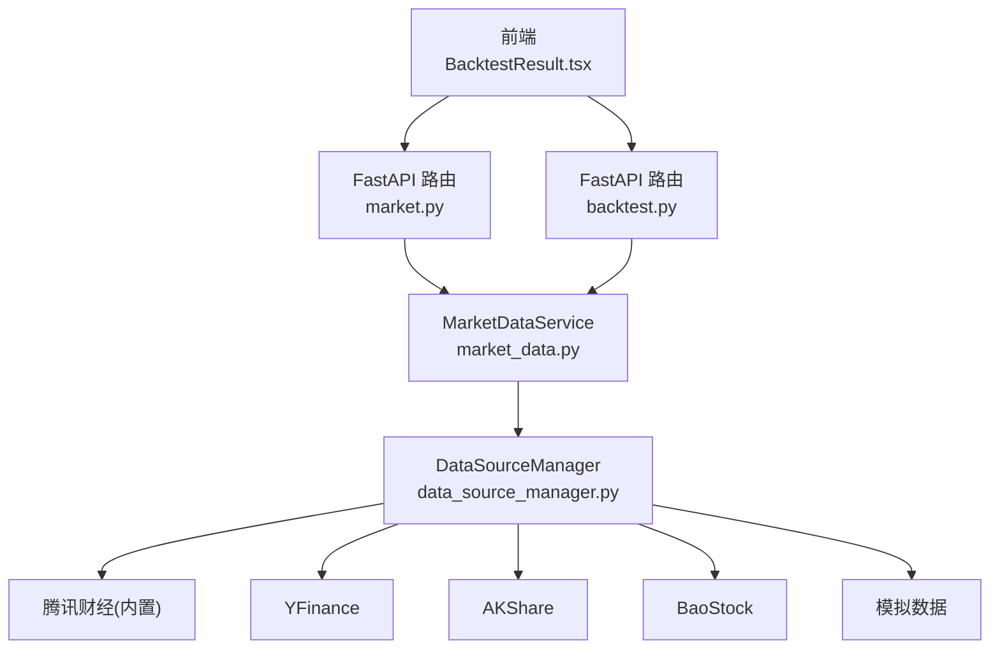
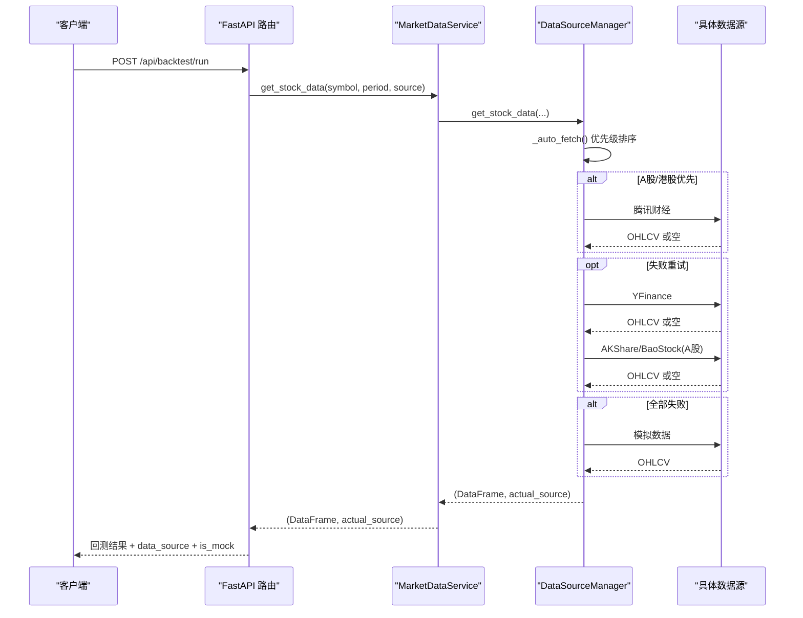
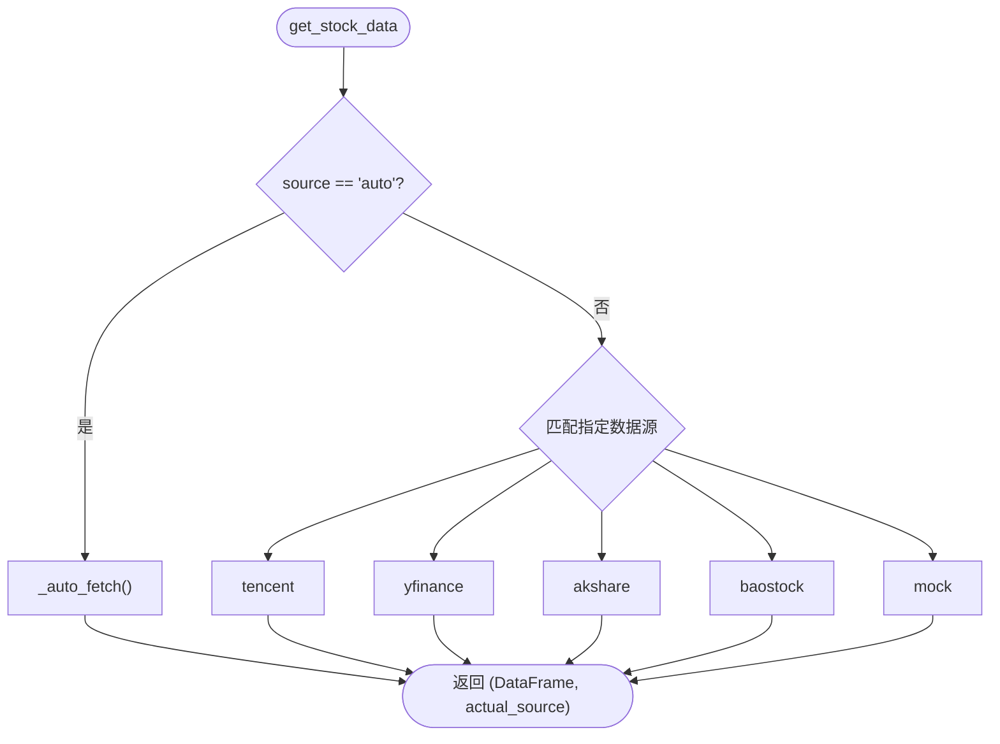
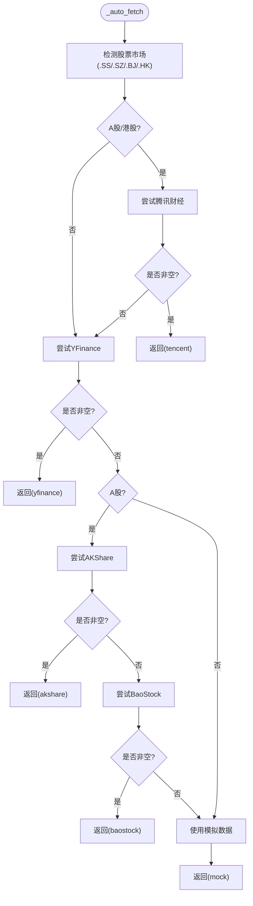
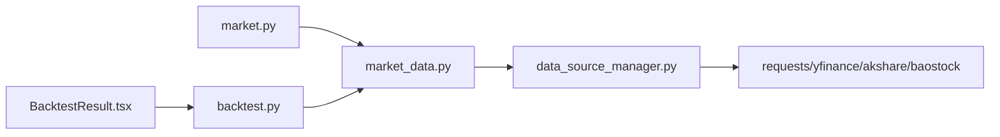

# 数据源管理

<cite>
**本文引用的文件**   
- [DATA_SOURCES.md](file://DATA_SOURCES.md)
- [data_source_manager.py](file://backend/app/services/data_source_manager.py)
- [market_data.py](file://backend/app/services/market_data.py)
- [market.py](file://backend/app/api/market.py)
- [backtest.py](file://backend/app/api/backtest.py)
- [BacktestResult.tsx](file://frontend/src/components/BacktestResult.tsx)
</cite>

## 目录
1. [引言](#引言)
2. [项目结构](#项目结构)
3. [核心组件](#核心组件)
4. [架构总览](#架构总览)
5. [详细组件分析](#详细组件分析)
6. [依赖关系分析](#依赖关系分析)
7. [性能与并发](#性能与并发)
8. [故障排查指南](#故障排查指南)
9. [结论](#结论)
10. [附录：新增数据源完整指南](#附录新增数据源完整指南)

## 引言
本文件面向平台的数据源管理与智能降级机制，系统性阐述多数据源架构设计、统一接口抽象、数据格式标准化、错误处理策略，以及各数据源的优缺点与适用场景。重点覆盖腾讯财经（A股推荐）、YFinance（全球市场）、AKShare（A股全面数据）、BaoStock（A股历史数据）和模拟数据源。同时给出智能降级算法的工作原理、缓存与性能优化建议、并发处理方案，并提供添加新数据源的完整实践指南。

## 项目结构
后端服务通过 FastAPI 暴露市场数据与回测接口；服务层封装数据获取逻辑；数据源管理器负责多数据源调度与降级；前端展示数据来源标识与结果。

图表来源
- [market.py:11-46](file://backend/app/api/market.py#L11-L46)
- [backtest.py:16-66](file://backend/app/api/backtest.py#L16-L66)
- [market_data.py:11-41](file://backend/app/services/market_data.py#L11-L41)
- [data_source_manager.py:14-109](file://backend/app/services/data_source_manager.py#L14-L109)

章节来源
- [market.py:1-47](file://backend/app/api/market.py#L1-L47)
- [backtest.py:1-77](file://backend/app/api/backtest.py#L1-L77)
- [market_data.py:1-106](file://backend/app/services/market_data.py#L1-L106)
- [data_source_manager.py:1-469](file://backend/app/services/data_source_manager.py#L1-L469)

## 核心组件
- DataSourceManager：统一数据获取入口，实现自动选择与降级策略，封装各数据源的具体获取方法，并输出标准化的 OHLCV DataFrame。
- MarketDataService：对外服务层，透传参数至 DataSourceManager，提供股票信息与搜索等辅助能力。
- FastAPI 路由：暴露 /stock/{symbol}、/stock/{symbol}/info、/search 与 /api/backtest/run 等接口，串联业务调用链。
- 前端 BacktestResult：根据返回的 data_source 与 is_mock 字段，展示数据来源与提示。

章节来源
- [data_source_manager.py:14-109](file://backend/app/services/data_source_manager.py#L14-L109)
- [market_data.py:11-41](file://backend/app/services/market_data.py#L11-L41)
- [market.py:11-46](file://backend/app/api/market.py#L11-L46)
- [backtest.py:28-66](file://backend/app/api/backtest.py#L28-L66)
- [BacktestResult.tsx:12-20](file://frontend/src/components/BacktestResult.tsx#L12-L20)

## 架构总览
系统采用“服务层 + 数据源管理器”的分层架构。服务层屏蔽底层差异，数据源管理器负责具体实现与降级。所有数据源均输出统一的 OHLCV 标准格式（Date, Open, High, Low, Close, Volume），便于上层策略与回测引擎消费。

图表来源
- [backtest.py:28-66](file://backend/app/api/backtest.py#L28-L66)
- [market_data.py:14-41](file://backend/app/services/market_data.py#L14-L41)
- [data_source_manager.py:56-109](file://backend/app/services/data_source_manager.py#L56-L109)

## 详细组件分析

### 数据源抽象与统一接口
- 统一入口：DataSourceManager.get_stock_data 接收 symbol、start_date、end_date、period、source 五个参数，返回 (DataFrame, actual_source)。
- 自动模式：当 source="auto" 时，进入 _auto_fetch 进行优先级判断与降级。
- 指定模式：支持 tencent、yfinance、akshare、baostock、mock 五种数据源直取。
- 统一输出：所有数据源最终输出包含 Date/Open/High/Low/Close/Volume 的标准列名 DataFrame。

图表来源
- [data_source_manager.py:17-54](file://backend/app/services/data_source_manager.py#L17-L54)

章节来源
- [data_source_manager.py:17-54](file://backend/app/services/data_source_manager.py#L17-L54)

### 智能降级算法
- 优先级规则（按代码实现顺序）：
  - A股/港股：优先腾讯财经；若失败则尝试 YFinance；A股继续尝试 AKShare、BaoStock；最后兜底模拟数据。
  - 美股：优先 YFinance；失败后兜底模拟数据。
- 降级触发条件：
  - 网络异常、API 返回错误码、数据为空等异常路径。
- 降级流程：
  - 每个数据源调用被 try/except 包裹，捕获异常后继续下一个候选。
  - 任一数据源返回非空 DataFrame 即终止后续尝试。
  - 全部失败则生成模拟数据作为最终保障。

图表来源
- [data_source_manager.py:56-109](file://backend/app/services/data_source_manager.py#L56-L109)

章节来源
- [data_source_manager.py:56-109](file://backend/app/services/data_source_manager.py#L56-L109)

### 各数据源实现要点与对比

#### 腾讯财经（A股推荐）
- 特点：无需额外安装，内置请求；对 A 股与港股友好；需将股票代码转换为内部格式（如 sh600519/sz000858/hk00700）。
- 数据格式：[日期, 开盘, 收盘, 最高, 最低, 成交量]，映射为标准 OHLCV。
- 适用场景：A 股与港股实时/历史 K 线快速拉取；在网络不稳定时作为首选。
- 风险点：外部接口可用性依赖第三方；需处理不同 key 的兼容（qfqday/day/qfqweek/qfqmonth）。

章节来源
- [data_source_manager.py:111-208](file://backend/app/services/data_source_manager.py#L111-L208)
- [data_source_manager.py:210-248](file://backend/app/services/data_source_manager.py#L210-L248)

#### YFinance（全球市场）
- 特点：覆盖美股、港股、指数等；跨市场能力强；但速度相对较慢且稳定性中等。
- 数据格式：直接返回标准 OHLCV 列。
- 适用场景：美股与港股数据获取；作为通用后备数据源。
- 风险点：网络波动、限频、部分标的不可用。

章节来源
- [data_source_manager.py:250-274](file://backend/app/services/data_source_manager.py#L250-L274)

#### AKShare（A股全面数据）
- 特点：免费、无需注册、数据全面；适合 A 股日 K 前复权数据。
- 数据格式：中文列名映射为 Date/Open/High/Low/Close/Volume。
- 适用场景：A 股历史数据补充；在腾讯财经不可用时作为强备选。
- 风险点：依赖第三方库与上游数据源稳定性。

章节来源
- [data_source_manager.py:276-335](file://backend/app/services/data_source_manager.py#L276-L335)

#### BaoStock（A股历史数据）
- 特点：专业 A 股数据，历史数据丰富；需要登录/登出。
- 数据格式：查询结果映射为标准 OHLCV。
- 适用场景：A 股深度历史数据；作为 AKShare 的备用。
- 风险点：登录状态管理、连接池与资源释放需严谨处理。

章节来源
- [data_source_manager.py:337-416](file://backend/app/services/data_source_manager.py#L337-L416)

#### 模拟数据（兜底）
- 特点：无需网络、立即可用；基于随机过程生成合理价格序列。
- 数据格式：标准 OHLCV。
- 适用场景：测试、演示、离线环境；作为最终兜底保障。
- 风险点：数据非真实，仅用于验证流程与 UI。

章节来源
- [data_source_manager.py:418-469](file://backend/app/services/data_source_manager.py#L418-L469)

### 数据格式标准化
- 统一列名：Date/Open/High/Low/Close/Volume。
- 日期类型：统一为 datetime。
- 数值类型：Open/High/Low/Close/Volume 均为浮点数。
- 过滤范围：按 start_date/end_date 过滤，确保时间窗口一致。

章节来源
- [data_source_manager.py:181-208](file://backend/app/services/data_source_manager.py#L181-L208)
- [data_source_manager.py:315-331](file://backend/app/services/data_source_manager.py#L315-L331)
- [data_source_manager.py:393-412](file://backend/app/services/data_source_manager.py#L393-L412)

### 错误处理策略
- 网络与 API 异常：try/except 捕获并记录日志，继续降级。
- 空数据：返回空 DataFrame，触发下一候选数据源。
- 非法参数：未知 source 抛出 ValueError。
- 前端展示：根据 data_source 与 is_mock 提示数据来源与是否为模拟数据。

章节来源
- [data_source_manager.py:51-54](file://backend/app/services/data_source_manager.py#L51-L54)
- [data_source_manager.py:72-109](file://backend/app/services/data_source_manager.py#L72-L109)
- [BacktestResult.tsx:12-20](file://frontend/src/components/BacktestResult.tsx#L12-L20)

## 依赖关系分析
- FastAPI 路由依赖 MarketDataService。
- MarketDataService 依赖 DataSourceManager。
- DataSourceManager 依赖多个外部库：requests、yfinance、akshare、baostock、pandas/numpy。
- 前端依赖后端返回的 data_source 与 is_mock 字段进行展示。

图表来源
- [market.py:1-47](file://backend/app/api/market.py#L1-L47)
- [backtest.py:1-77](file://backend/app/api/backtest.py#L1-L77)
- [market_data.py:1-106](file://backend/app/services/market_data.py#L1-L106)
- [data_source_manager.py:1-469](file://backend/app/services/data_source_manager.py#L1-L469)
- [BacktestResult.tsx:1-41](file://frontend/src/components/BacktestResult.tsx#L1-L41)

章节来源
- [market.py:1-47](file://backend/app/api/market.py#L1-L47)
- [backtest.py:1-77](file://backend/app/api/backtest.py#L1-L77)
- [market_data.py:1-106](file://backend/app/services/market_data.py#L1-L106)
- [data_source_manager.py:1-469](file://backend/app/services/data_source_manager.py#L1-L469)
- [BacktestResult.tsx:1-41](file://frontend/src/components/BacktestResult.tsx#L1-L41)

## 性能与并发
- 当前实现为同步串行调用，未引入显式缓存与并发控制。
- 潜在瓶颈：
  - 外部 API 延迟与限频（尤其是 YFinance）。
  - BaoStock 登录/查询开销。
  - 大量并行请求导致外部服务压力增大。
- 优化建议：
  - 引入本地缓存（Redis/内存）以缓存热门标的的 OHLCV 数据，设置过期时间与版本控制。
  - 使用异步 I/O（asyncio + httpx/aiohttp）提升并发吞吐。
  - 增加熔断与退避重试（指数退避）以降低雪崩风险。
  - 针对高频访问的标的建立预取队列与批量拉取。
  - 对 BaoStock 连接进行复用与连接池管理。

[本节为通用性能指导，不直接分析具体文件]

## 故障排查指南
- 症状：返回空数据或频繁降级到模拟数据。
  - 检查网络连通性与第三方 API 可用性。
  - 确认股票代码格式是否正确（如 .SS/.SZ/.HK）。
  - 查看控制台日志中各数据源的失败信息。
- 症状：BaoStock 登录失败。
  - 检查 baostock 服务状态与网络。
  - 确认登录/登出逻辑正确执行。
- 症状：YFinance 速度慢或不稳定。
  - 考虑切换至 AKShare/AKShare 失败再切 BaoStock。
  - 增加重试与超时配置。
- 症状：前端显示“模拟数据”。
  - 确认实际使用的 data_source 是否为 mock。
  - 检查后端降级逻辑与日志。

章节来源
- [data_source_manager.py:72-109](file://backend/app/services/data_source_manager.py#L72-L109)
- [data_source_manager.py:337-416](file://backend/app/services/data_source_manager.py#L337-L416)
- [BacktestResult.tsx:12-20](file://frontend/src/components/BacktestResult.tsx#L12-L20)

## 结论
平台通过 DataSourceManager 实现了多数据源的统一抽象与智能降级，确保在不同市场与网络环境下都能稳定返回标准化的 OHLCV 数据。腾讯财经作为 A 股/港股的首选，YFinance 作为全球市场的通用后备，AKShare 与 BaoStock 作为 A 股的强力补充，模拟数据作为最终兜底。建议在后续迭代中加入缓存、异步与熔断机制，以提升整体性能与鲁棒性。

[本节为总结性内容，不直接分析具体文件]

## 附录：新增数据源完整指南

### 步骤一：实现数据源获取方法
- 在 DataSourceManager 中添加新的私有静态方法，例如 _fetch_newsource(...)。
- 输入参数：symbol、start_date、end_date、period。
- 输出：标准的 pandas.DataFrame，包含 Date/Open/High/Low/Close/Volume 列。
- 错误处理：捕获异常并返回空 DataFrame 或抛出明确异常以便上层降级。

章节来源
- [data_source_manager.py:111-208](file://backend/app/services/data_source_manager.py#L111-L208)
- [data_source_manager.py:276-335](file://backend/app/services/data_source_manager.py#L276-L335)
- [data_source_manager.py:337-416](file://backend/app/services/data_source_manager.py#L337-L416)

### 步骤二：注册到自动选择与指定模式
- 在 get_stock_data 的 dispatch 分支中添加 newsource 选项。
- 在 _auto_fetch 中插入合适的优先级位置（根据市场与稳定性决定）。
- 确保返回元组 (DataFrame, "newsource")。

章节来源
- [data_source_manager.py:17-54](file://backend/app/services/data_source_manager.py#L17-L54)
- [data_source_manager.py:56-109](file://backend/app/services/data_source_manager.py#L56-L109)

### 步骤三：更新文档与前端映射
- 在 DATA_SOURCES.md 中补充新数据源的安装说明、优势与限制。
- 在前端 BacktestResult.tsx 中新增数据源名称映射，以便用户识别。

章节来源
- [DATA_SOURCES.md:1-125](file://DATA_SOURCES.md#L1-L125)
- [BacktestResult.tsx:12-20](file://frontend/src/components/BacktestResult.tsx#L12-L20)

### 步骤四：测试与验证
- 单元测试：
  - 验证新数据源返回的 DataFrame 列名与数据类型符合标准。
  - 验证空数据与异常路径能正确触发降级。
- 集成测试：
  - 通过 /api/backtest/run 发起回测，确认 data_source 字段为新数据源。
  - 前端展示数据来源名称正确。
- 回归测试：
  - 确保其他数据源与降级逻辑不受影响。

章节来源
- [backtest.py:28-66](file://backend/app/api/backtest.py#L28-L66)
- [BacktestResult.tsx:12-20](file://frontend/src/components/BacktestResult.tsx#L12-L20)