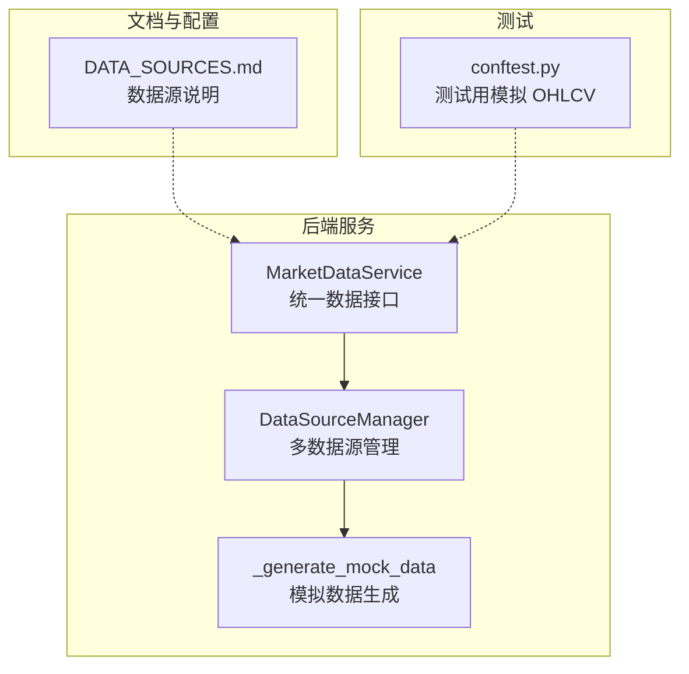
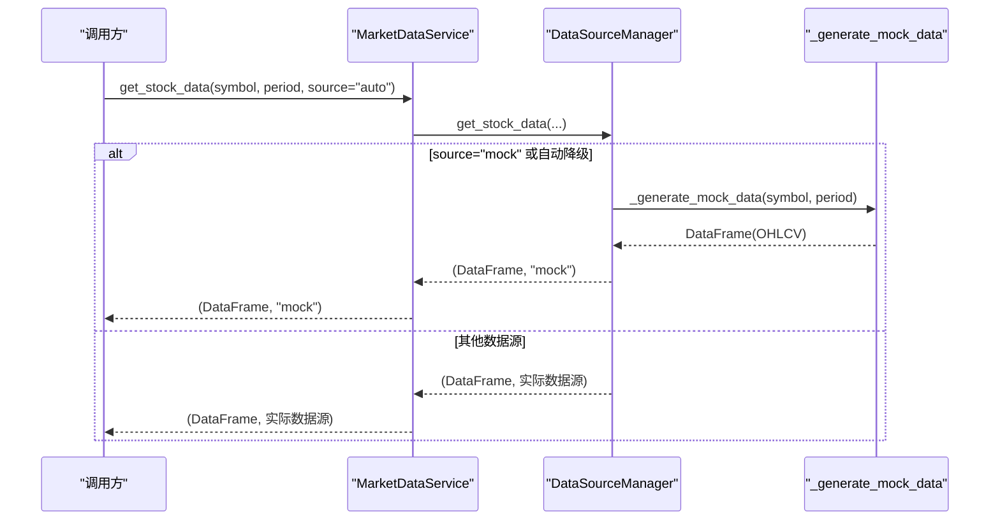
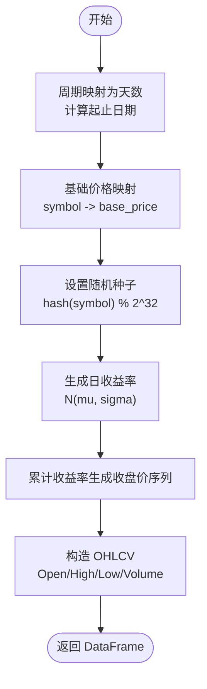
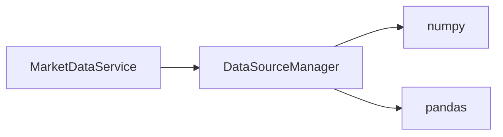

# 模拟数据源

<cite>
**本文引用的文件**   
- [data_source_manager.py](../../../../../backend/app/services/data_source_manager.py)
- [market_data.py](../../../../../backend/app/services/market_data.py)
- [DATA_SOURCES.md](../../../../../DATA_SOURCES.md)
- [conftest.py](../../../../../backend/tests/conftest.py)
</cite>

## 目录
1. [引言](#引言)
2. [项目结构](#项目结构)
3. [核心组件](#核心组件)
4. [架构总览](#架构总览)
5. [详细组件分析](#详细组件分析)
6. [依赖关系分析](#依赖关系分析)
7. [性能与可扩展性](#性能与可扩展性)
8. [使用示例](#使用示例)
9. [数据质量控制与随机种子最佳实践](#数据质量控制与随机种子最佳实践)
10. [故障排查](#故障排查)
11. [结论](#结论)

## 引言
本文件聚焦于系统中的“模拟数据源”实现，系统性讲解其随机价格生成算法、基础价格映射、收益率分布参数、OHLCV 构造逻辑，以及该数据源在开发测试、策略验证和性能测试中的作用。同时提供可操作的使用示例和数据质量保障建议，帮助读者在不依赖外部网络的情况下快速获得稳定、可复现的行情数据。

## 项目结构
模拟数据源位于后端服务层的数据源管理器中，并通过市场数据服务对外暴露统一接口。整体结构如下：

图表来源
- [market_data.py:11-41](../../../../../backend/app/services/market_data.py#L11-L41)
- [data_source_manager.py:14-54](../../../../../backend/app/services/data_source_manager.py#L14-L54)
- [data_source_manager.py:418-468](../../../../../backend/app/services/data_source_manager.py#L418-L468)
- [DATA_SOURCES.md:1-125](../../../../../DATA_SOURCES.md#L1-L125)
- [conftest.py:9-46](../../../../../backend/tests/conftest.py#L9-L46)

章节来源
- [market_data.py:11-41](../../../../../backend/app/services/market_data.py#L11-L41)
- [data_source_manager.py:14-54](../../../../../backend/app/services/data_source_manager.py#L14-L54)
- [DATA_SOURCES.md:1-125](../../../../../DATA_SOURCES.md#L1-L125)
- [conftest.py:9-46](../../../../../backend/tests/conftest.py#L9-L46)

## 核心组件
- DataSourceManager：负责多数据源的自动选择与降级，包含模拟数据生成入口。
- MarketDataService：对外统一数据接口，内部委托 DataSourceManager。
- _generate_mock_data：核心模拟数据生成函数，基于随机收益率序列构建 OHLCV。
- DATA_SOURCES.md：数据源使用说明与对比。
- conftest.py：测试用例中的模拟 OHLCV 生成器，用于单元测试与策略回测。

章节来源
- [data_source_manager.py:14-54](../../../../../backend/app/services/data_source_manager.py#L14-L54)
- [data_source_manager.py:418-468](../../../../../backend/app/services/data_source_manager.py#L418-L468)
- [market_data.py:11-41](../../../../../backend/app/services/market_data.py#L11-L41)
- [DATA_SOURCES.md:1-125](../../../../../DATA_SOURCES.md#L1-L125)
- [conftest.py:9-46](../../../../../backend/tests/conftest.py#L9-L46)

## 架构总览
系统通过 MarketDataService.get_stock_data 暴露统一接口；当 source=mock 或自动降级到 mock 时，调用 DataSourceManager._generate_mock_data 生成 OHLCV 数据。

图表来源
- [market_data.py:14-41](../../../../../backend/app/services/market_data.py#L14-L41)
- [data_source_manager.py:17-54](../../../../../backend/app/services/data_source_manager.py#L17-L54)
- [data_source_manager.py:418-468](../../../../../backend/app/services/data_source_manager.py#L418-L468)

## 详细组件分析

### 模拟数据生成流程（_generate_mock_data）
该函数按以下步骤生成 OHLCV：
- 周期映射：将 period 转换为天数，并计算起止日期。
- 基础价格映射：根据股票代码前缀映射初始价格，未匹配则使用默认值。
- 随机种子：以股票代码哈希作为随机种子，保证同代码可复现。
- 收益率生成：从正态分布采样日收益率，均值 mu 与标准差 sigma 固定。
- 收盘价序列：以基础价格为起点，按累计收益率生成收盘价序列。
- OHLCV 构造：基于收盘价生成开盘价、最高价、最低价与成交量，确保基本合理性。

图表来源
- [data_source_manager.py:418-468](../../../../../backend/app/services/data_source_manager.py#L418-L468)

章节来源
- [data_source_manager.py:418-468](../../../../../backend/app/services/data_source_manager.py#L418-L468)

### 几何布朗运动模型的应用与参数
- 模型形式：采用离散时间近似，价格按 P_{t} = P_{t-1} * (1 + r_t) 更新，其中 r_t ~ N(mu, sigma)。
- 参数设置：
  - mu（日漂移）：0.0005
  - sigma（日波动率）：0.02
- 说明：当前实现并非严格连续时间的 GBM 对数收益建模，而是以算术收益率近似；适用于快速生成具有趋势与波动的价格路径。

章节来源
- [data_source_manager.py:441-448](../../../../../backend/app/services/data_source_manager.py#L441-L448)

### 基础价格设定逻辑与股票符号映射
- 映射表包含常见美股与 A 股代码的基础价格，例如 AAPL、GOOGL、MSFT、AMZN、TSLA 以及 600519、000858、601318、000001。
- 解析规则：取 symbol 点号前的纯代码部分进行匹配；若未命中，则使用默认基础价格。
- 作用：使不同标的具备合理量级的起始价格，便于策略在不同价位区间进行测试。

章节来源
- [data_source_manager.py:431-437](../../../../../backend/app/services/data_source_manager.py#L431-L437)

### 随机收益率生成过程
- 分布：正态分布 N(mu, sigma)，长度等于交易日数量。
- 均值与方差：
  - 均值 mu = 0.0005（微正漂移）
  - 标准差 sigma = 0.02（日波动约 2%）
- 可复现性：通过 np.random.seed(hash(symbol) % 2**32) 固定随机种子。

章节来源
- [data_source_manager.py:439-443](../../../../../backend/app/services/data_source_manager.py#L439-L443)

### OHLCV 数据的构造与合理性约束
- 收盘价：由累计收益率生成的价格序列。
- 开盘价：在收盘价附近小幅随机扰动（±1%）。
- 最高价：不低于 max(开盘, 收盘)，并在其上附加非负扰动（0~2%）。
- 最低价：不高于 min(开盘, 收盘)，并在其下附加非负扰动（0~2%）。
- 成交量：在固定区间内随机整数，体现交易活跃度。
- 合理性：确保 High ≥ Open/Close 且 Low ≤ Open/Close，避免异常 K 线。

章节来源
- [data_source_manager.py:450-465](../../../../../backend/app/services/data_source_manager.py#L450-L465)

### 模拟数据源的作用
- 开发测试：无需网络即可运行，适合本地开发与联调。
- 策略验证：提供稳定、可复现的价格序列，便于策略逻辑验证与回归测试。
- 性能测试：大规模数据生成开销低，可用于压力测试与基准评估。

章节来源
- [DATA_SOURCES.md:22-25](../../../../../DATA_SOURCES.md#L22-L25)

## 依赖关系分析
- MarketDataService 依赖 DataSourceManager 完成数据获取。
- DataSourceManager 内部依赖 numpy/pandas 进行数值计算与数据结构化。
- 模拟数据生成不依赖外部网络，仅依赖 Python 标准库与第三方数值库。

图表来源
- [market_data.py:11-41](../../../../../backend/app/services/market_data.py#L11-L41)
- [data_source_manager.py:1-11](../../../../../backend/app/services/data_source_manager.py#L1-L11)

章节来源
- [market_data.py:11-41](../../../../../backend/app/services/market_data.py#L11-L41)
- [data_source_manager.py:1-11](../../../../../backend/app/services/data_source_manager.py#L1-L11)

## 性能与可扩展性
- 时间复杂度：收益率采样 O(n)，价格序列累积 O(n)，OHLCV 构造 O(n)，总体 O(n)。
- 空间复杂度：存储 prices 与最终 DataFrame，O(n)。
- 扩展建议：
  - 支持更多基础价格映射与自定义映射表。
  - 引入更复杂的随机过程（如 GBM 对数收益、跳跃扩散）。
  - 增加成交量建模（如与波动率相关）。

[本节为通用指导，不涉及具体文件分析]

## 使用示例
以下示例展示如何通过统一接口获取模拟数据，以及如何调整关键参数以获得不同的数据特征。

- 获取模拟数据（source="mock"）
  - 输入：symbol（如 "AAPL"）、period（如 "1y"）
  - 输出：(DataFrame, "mock")
  - 说明：直接调用 DataSourceManager 或 MarketDataService 的 get_stock_data，指定 source="mock"。

- 自定义参数调整建议
  - 基础价格：修改基础价格映射表，适配不同市场与标的。
  - 收益率参数：调整 mu 与 sigma，控制趋势与波动强度。
  - 随机种子：如需跨进程复现，可在调用前显式设置全局随机种子或使用固定 seed。

- 测试数据生成（参考 conftest.py）
  - 使用固定随机种子生成短周期 OHLCV，便于单元测试与快速回归。

章节来源
- [data_source_manager.py:17-54](../../../../../backend/app/services/data_source_manager.py#L17-L54)
- [data_source_manager.py:418-468](../../../../../backend/app/services/data_source_manager.py#L418-L468)
- [conftest.py:9-46](../../../../../backend/tests/conftest.py#L9-L46)

## 数据质量控制与随机种子最佳实践
- 数据质量检查清单
  - 日期连续性：确保 Date 列无缺失与重复。
  - 价格合理性：High ≥ Open/Close，Low ≤ Open/Close。
  - 成交量非负：Volume > 0。
  - 缺失值处理：填充或删除含 NaN 的行。
  - 异常波动检测：剔除极端收益率或价格跳变。
- 随机种子设置
  - 单进程复现：在生成前设置 np.random.seed(seed_value)。
  - 多进程安全：使用独立种子或线程局部随机状态，避免共享状态污染。
  - 可追溯性：记录使用的 seed、mu、sigma、base_prices 映射版本，便于结果回溯。

章节来源
- [data_source_manager.py:439-443](../../../../../backend/app/services/data_source_manager.py#L439-L443)
- [data_source_manager.py:450-465](../../../../../backend/app/services/data_source_manager.py#L450-L465)
- [conftest.py:12-18](../../../../../backend/tests/conftest.py#L12-L18)

## 故障排查
- 常见问题
  - 数据为空：检查 symbol 是否在基础价格映射表中，或确认 period 与日期范围是否有效。
  - 价格不合理：检查 OHLCV 构造逻辑是否被修改，确保 High/Low 约束未被破坏。
  - 随机不可复现：确认随机种子设置是否正确，避免多次调用覆盖全局种子。
- 定位步骤
  - 打印 symbol、period、base_price、mu、sigma、seed。
  - 校验收益率序列统计特征（均值、方差、极值）。
  - 校验 OHLCV 字段约束（High/Low/Open/Close/Volume）。

章节来源
- [data_source_manager.py:431-465](../../../../../backend/app/services/data_source_manager.py#L431-L465)

## 结论
模拟数据源通过简洁的随机收益率模型与合理的 OHLCV 构造，提供了稳定、可复现的行情数据，适用于开发测试、策略验证与性能测试。通过对基础价格映射、收益率参数与随机种子的精细控制，用户可以在不同市场与策略场景下获得高质量、可控的测试数据。建议在工程实践中加入数据质量检查与种子管理，以提升结果的稳定性与可追溯性。