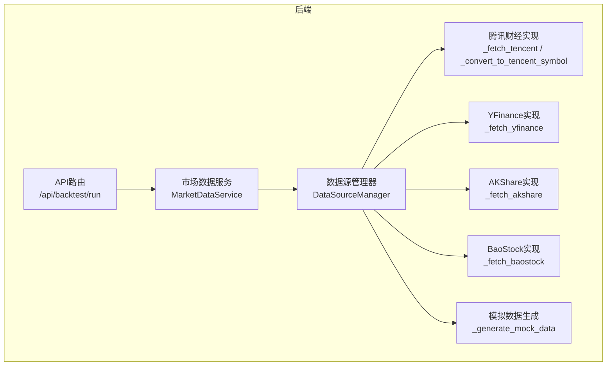
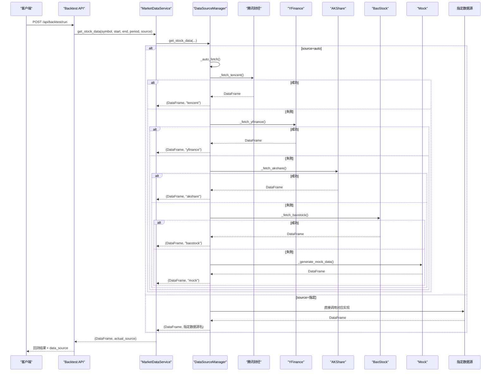
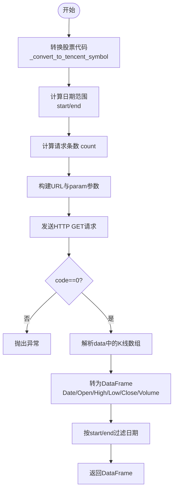
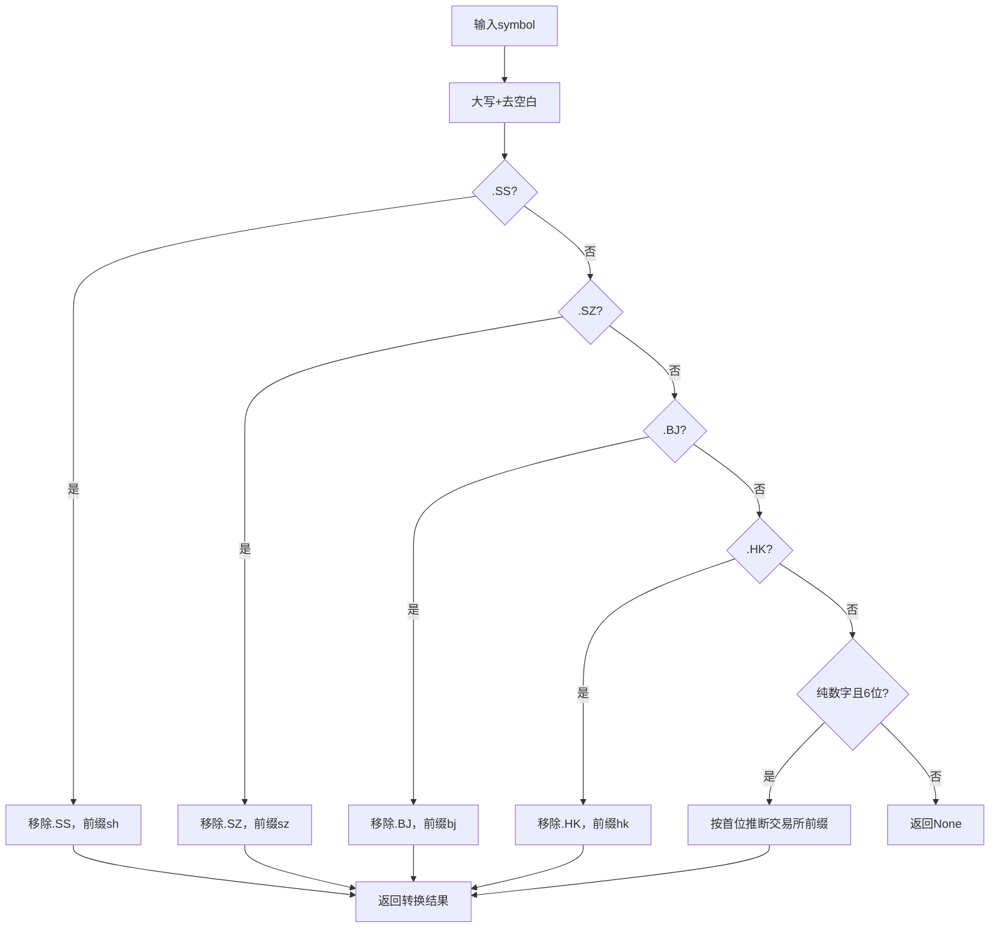
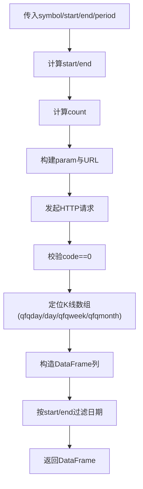
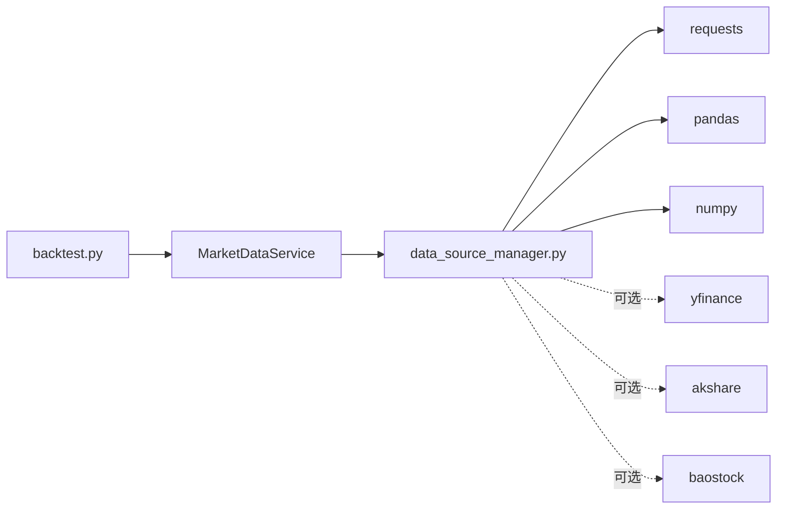

# 腾讯财经数据源

<cite>
**本文引用的文件**   
- [data_source_manager.py](../../../../../backend/app/services/data_source_manager.py)
- [backtest.py](../../../../../backend/app/api/backtest.py)
- [DATA_SOURCES.md](../../../../../DATA_SOURCES.md)
</cite>

## 目录
1. [引言](#引言)
2. [项目结构](#项目结构)
3. [核心组件](#核心组件)
4. [架构总览](#架构总览)
5. [详细组件分析](#详细组件分析)
6. [依赖关系分析](#依赖关系分析)
7. [性能与稳定性](#性能与稳定性)
8. [故障排查指南](#故障排查指南)
9. [结论](#结论)
10. [附录：使用示例与最佳实践](#附录使用示例与最佳实践)

## 引言
本文件聚焦于“腾讯财经数据源”的实现与使用，围绕以下目标展开：
- 讲解腾讯财经API的调用机制：HTTP请求构建、参数配置与响应解析。
- 说明股票代码转换逻辑：将标准代码格式（如 600519.SS）转换为腾讯财经格式（如 sh600519）。
- 描述K线数据获取流程：日期范围计算、请求参数构建、数据解析与前复权处理、日期过滤。
- 总结该数据源的优势：内置无需额外安装、A股与港股支持、数据质量稳定。
- 提供可直接调用的完整示例路径与常见问题解决方案（网络问题、API限制等）。

## 项目结构
本项目后端采用分层组织方式，数据获取能力集中在服务层的数据源管理器中，并通过API路由暴露给前端或外部调用方。

图示来源
- [backtest.py:28-66](../../../../../backend/app/api/backtest.py#L28-L66)
- [data_source_manager.py:14-54](../../../../../backend/app/services/data_source_manager.py#L14-L54)

章节来源
- [backtest.py:1-77](../../../../../backend/app/api/backtest.py#L1-L77)
- [data_source_manager.py:1-54](../../../../../backend/app/services/data_source_manager.py#L1-L54)

## 核心组件
- 数据源管理器 DataSourceManager：统一入口，负责自动选择数据源、调度具体实现、返回标准化DataFrame与实际使用的数据源名称。
- 腾讯财经实现 _fetch_tencent：封装HTTP请求、参数拼接、JSON响应解析、前复权数据处理与日期过滤。
- 股票代码转换器 _convert_to_tencent_symbol：将 .SS/.SZ/.BJ/.HK 后缀转换为腾讯财经前缀 sh/sz/bj/hk。
- API路由 backtest.py：对外暴露回测接口，透传 symbol、start_date、end_date、period、source 等参数，并返回实际数据源标识。

章节来源
- [data_source_manager.py:14-248](../../../../../backend/app/services/data_source_manager.py#L14-L248)
- [backtest.py:16-66](../../../../../backend/app/api/backtest.py#L16-L66)

## 架构总览
下图展示从API到数据源的调用链路与自动降级策略。

图示来源
- [backtest.py:28-66](../../../../../backend/app/api/backtest.py#L28-L66)
- [data_source_manager.py:17-109](../../../../../backend/app/services/data_source_manager.py#L17-L109)

## 详细组件分析

### 腾讯财经API调用机制
- 接口地址：https://web.ifzq.gtimg.cn/appstock/app/fqkline/get
- 请求方法：GET
- 关键参数：param=tencent_symbol,day,start,end,count,qfq
  - tencent_symbol：经转换后的腾讯格式代码（如 sh600519）
  - day：K线周期（日K）
  - start/end：起止日期（YYYY-MM-DD）
  - count：请求条数（至少覆盖日期范围）
  - qfq：前复权
- 请求头：User-Agent、Referer（用于模拟浏览器访问）
- 响应体：JSON，code=0表示成功；data中包含按股票代码分组的K线数组，优先取 qfqday，其次 day/qfqweek/qfqmonth

图示来源
- [data_source_manager.py:112-208](../../../../../backend/app/services/data_source_manager.py#L112-L208)

章节来源
- [data_source_manager.py:112-208](../../../../../backend/app/services/data_source_manager.py#L112-L208)

### 股票代码转换逻辑
- 输入格式：600519.SS、000858.SZ、00700.HK、纯数字6位代码
- 输出格式：sh600519、sz000858、hk00700、bjxxxxxx
- 规则要点：
  - .SS -> sh
  - .SZ -> sz
  - .BJ -> bj
  - .HK -> hk
  - 纯数字6位时根据首位判断交易所：6/9->sh，0/2/3->sz，4/8->bj

图示来源
- [data_source_manager.py:211-248](../../../../../backend/app/services/data_source_manager.py#L211-L248)

章节来源
- [data_source_manager.py:211-248](../../../../../backend/app/services/data_source_manager.py#L211-L248)

### K线数据获取流程
- 日期范围计算：
  - 若传入 start_date 与 end_date，则直接使用
  - 否则根据 period 映射天数（1mo/3mo/6mo/1y/2y/5y），以当前日期为 end，倒推 start
- 请求条数计算：
  - count = max(365, (end-start).days + 10)，确保覆盖节假日与周末
- 参数构建：
  - param=tencent_symbol,day,start,end,count,qfq
- 数据解析：
  - 优先读取 qfqday，其次 day/qfqweek/qfqmonth
  - 每条记录包含[日期, 开盘, 收盘, 最高, 最低, 成交量]
- 前复权处理：
  - 通过 qfq 参数获取前复权K线
- 日期过滤：
  - 在DataFrame层面再次按 start_date/end_date 过滤

图示来源
- [data_source_manager.py:131-208](../../../../../backend/app/services/data_source_manager.py#L131-L208)

章节来源
- [data_source_manager.py:131-208](../../../../../backend/app/services/data_source_manager.py#L131-L208)

### 前复权数据处理与日期过滤机制
- 前复权：
  - 通过 qfq 参数向腾讯财经请求前复权K线
  - 解析时优先取 qfqday，保证价格已进行前复权调整
- 日期过滤：
  - 在DataFrame构建后，对 Date 列进行 >= start_date 与 <= end_date 的条件过滤
  - 重置索引以保证连续行号

章节来源
- [data_source_manager.py:149-208](../../../../../backend/app/services/data_source_manager.py#L149-L208)

### 自动选择与降级策略
- 当 source="auto" 时：
  - 若检测到A股或港股后缀（.SS/.SZ/.BJ/.HK），优先尝试腾讯财经
  - 失败后依次尝试 yfinance、akshare、baostock
  - 最终兜底为 mock 模拟数据
- 当 source 指定为具体数据源时：
  - 直接调用对应实现，不触发自动降级

章节来源
- [data_source_manager.py:56-109](../../../../../backend/app/services/data_source_manager.py#L56-L109)

## 依赖关系分析
- 模块耦合：
  - API层仅依赖 MarketDataService 与策略引擎，数据获取细节由 DataSourceManager 封装
  - DataSourceManager 内部聚合多个数据源实现，保持高内聚低耦合
- 外部依赖：
  - requests：HTTP请求
  - pandas/numpy：数据处理与模拟数据生成
  - yfinance/akshare/baostock：可选第三方数据源（按需安装）

图示来源
- [backtest.py:1-77](../../../../../backend/app/api/backtest.py#L1-L77)
- [data_source_manager.py:1-11](../../../../../backend/app/services/data_source_manager.py#L1-L11)

章节来源
- [backtest.py:1-77](../../../../../backend/app/api/backtest.py#L1-L77)
- [data_source_manager.py:1-11](../../../../../backend/app/services/data_source_manager.py#L1-L11)

## 性能与稳定性
- 性能特征：
  - 腾讯财经接口轻量、延迟较低，适合快速拉取A股/港股历史K线
  - 自动降级机制保障可用性，但频繁切换数据源会增加整体耗时
- 稳定性优势：
  - 内置无需额外安装，开箱即用
  - 对A股与港股有良好支持，数据质量稳定
  - 前复权数据可直接用于回测，减少预处理成本

章节来源
- [DATA_SOURCES.md:1-125](../../../../../DATA_SOURCES.md#L1-L125)

## 故障排查指南
- 网络连接问题：
  - 现象：请求超时或无法连接
  - 排查：检查网络连通性、代理设置、防火墙策略
  - 建议：适当增大 timeout，或在企业网络环境下配置代理
- API限制与错误码：
  - 现象：返回 code!=0 或空数据
  - 排查：确认股票代码是否正确、是否支持该市场（A股/港股）
  - 建议：先使用 _convert_to_tencent_symbol 验证转换结果，再重试
- 数据为空：
  - 现象：返回空DataFrame
  - 排查：确认日期范围是否合理、是否存在非交易日
  - 建议：扩大日期范围或改用其他数据源作为备用
- 频率限制：
  - 现象：短时间内多次请求被限流
  - 建议：增加请求间隔、批量合并请求、缓存常用标的数据

章节来源
- [data_source_manager.py:152-164](../../../../../backend/app/services/data_source_manager.py#L152-L164)
- [data_source_manager.py:166-179](../../../../../backend/app/services/data_source_manager.py#L166-L179)

## 结论
腾讯财经数据源在本项目中提供了开箱即用的A股与港股K线数据获取能力，具备以下特点：
- 内置无需额外安装，降低部署复杂度
- 支持前复权K线，便于量化回测
- 自动选择与降级机制提升鲁棒性
- 代码结构清晰，易于扩展与维护

## 附录：使用示例与最佳实践

### 直接调用腾讯财经数据源
- 通过API路由：
  - 端点：POST /api/backtest/run
  - 字段：strategy_id、symbol、start_date、end_date、period、initial_capital、source、parameters
  - 示例：设置 source="tencent"，symbol="600519.SS"，period="1y"
- 通过服务层：
  - 调用 DataSourceManager.get_stock_data(symbol, start_date, end_date, period, source="tencent")
  - 返回值：(DataFrame, "tencent")

章节来源
- [backtest.py:16-66](../../../../../backend/app/api/backtest.py#L16-L66)
- [data_source_manager.py:17-54](../../../../../backend/app/services/data_source_manager.py#L17-L54)

### 最佳实践
- 优先使用 source="auto"，让系统自动选择最优数据源
- 对于A股/港股场景，腾讯财经通常为首选
- 对高频调用场景，建议缓存热门标的的历史K线以减少重复请求
- 对日期范围较大的查询，注意分页或分批拉取以避免单次请求过大

章节来源
- [data_source_manager.py:56-109](../../../../../backend/app/services/data_source_manager.py#L56-L109)