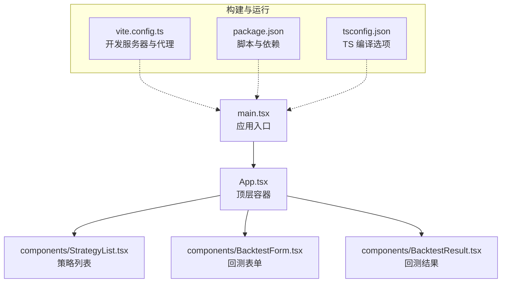
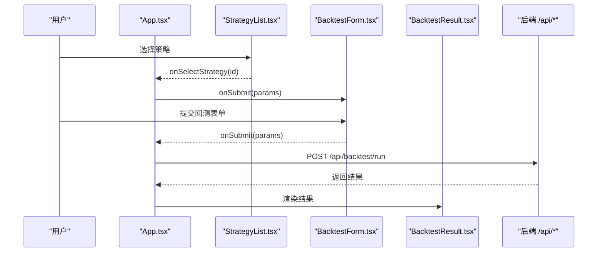
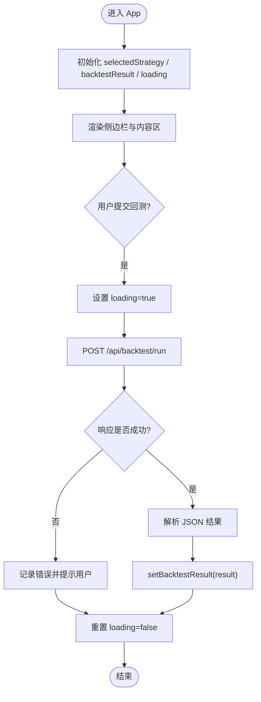
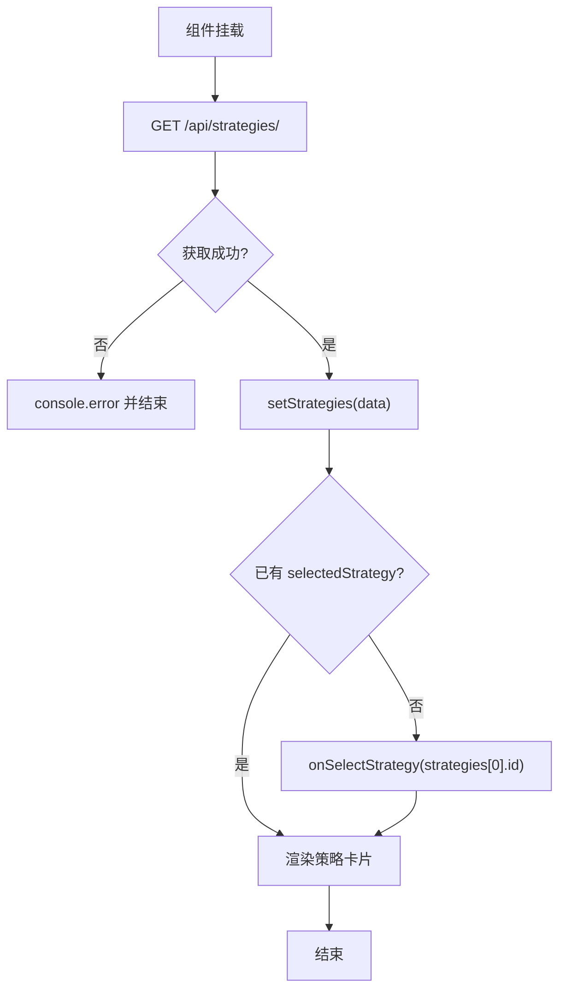
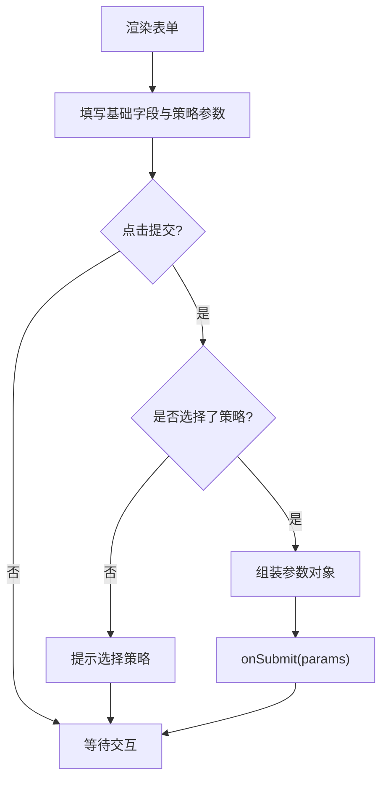
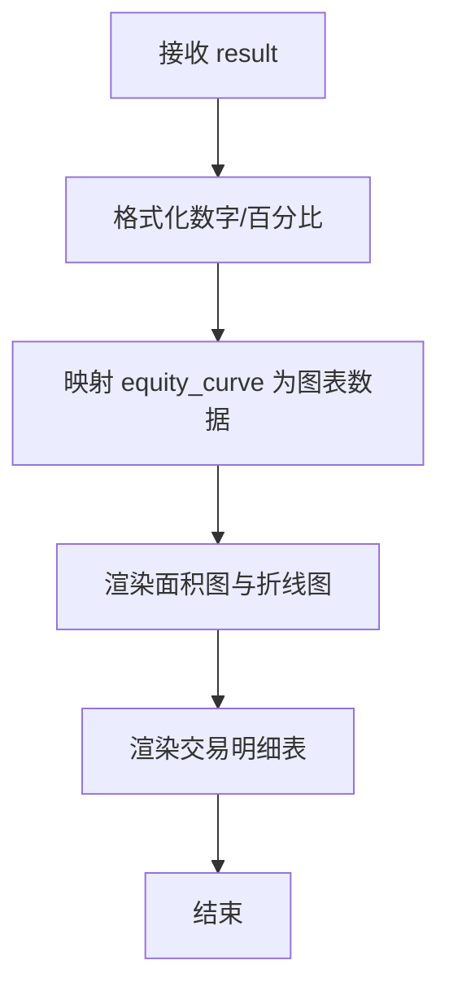
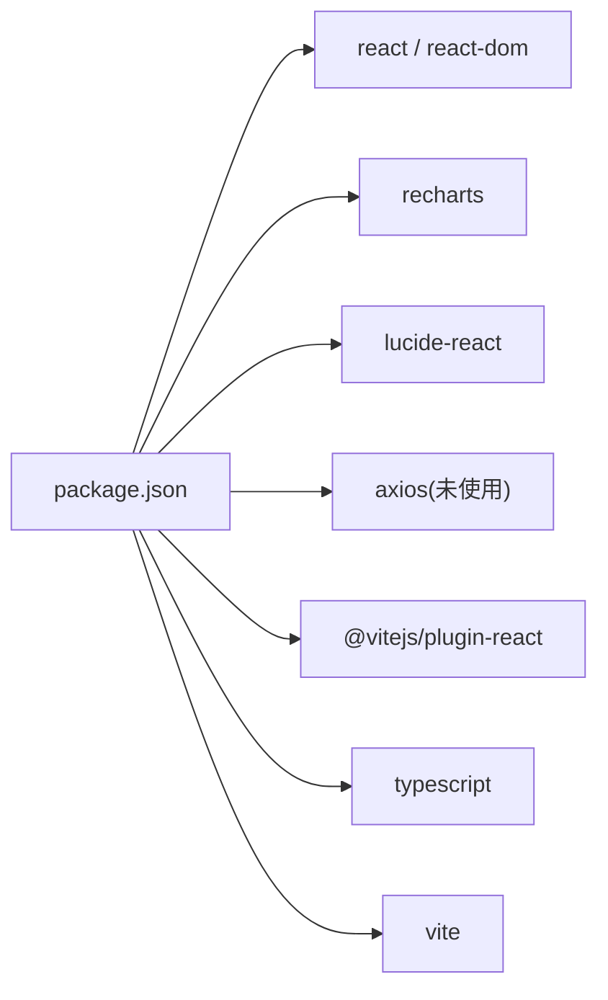
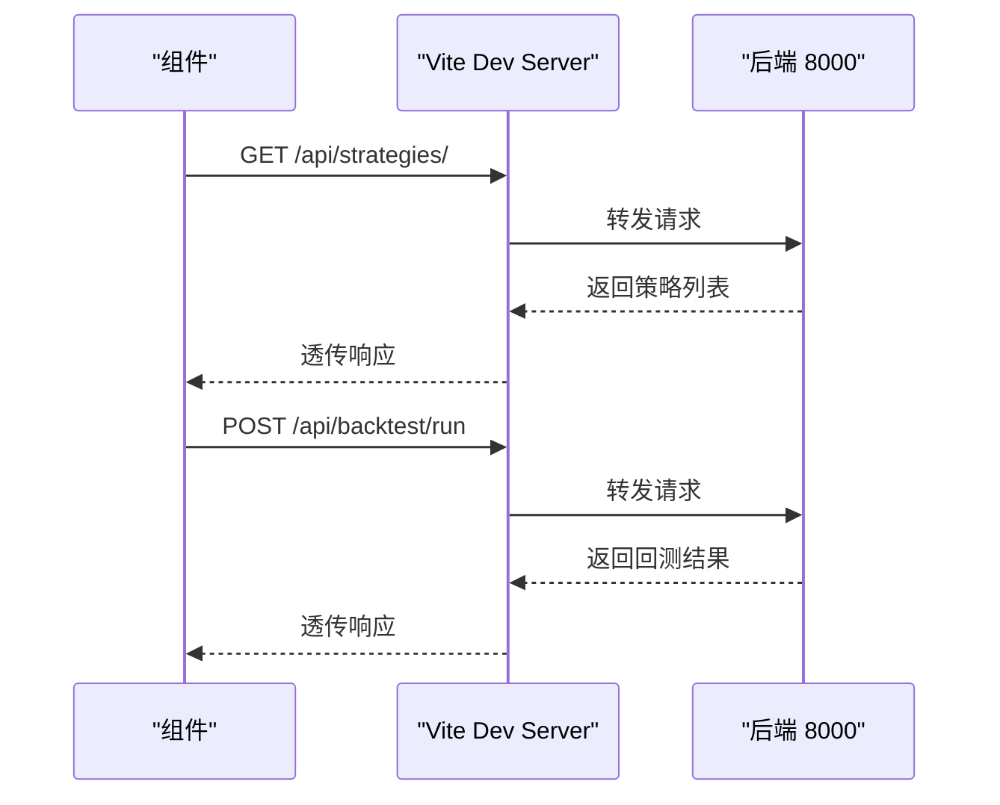

# 前端架构设计

<cite>
**本文引用的文件**   
- [frontend/src/App.tsx](file://frontend/src/App.tsx)
- [frontend/src/main.tsx](file://frontend/src/main.tsx)
- [frontend/vite.config.ts](file://frontend/vite.config.ts)
- [frontend/package.json](file://frontend/package.json)
- [frontend/tsconfig.json](file://frontend/tsconfig.json)
- [frontend/src/components/StrategyList.tsx](file://frontend/src/components/StrategyList.tsx)
- [frontend/src/components/BacktestForm.tsx](file://frontend/src/components/BacktestForm.tsx)
- [frontend/src/components/BacktestResult.tsx](file://frontend/src/components/BacktestResult.tsx)
</cite>

## 目录
1. [引言](#引言)
2. [项目结构](#项目结构)
3. [核心组件](#核心组件)
4. [架构总览](#架构总览)
5. [详细组件分析](#详细组件分析)
6. [依赖关系分析](#依赖关系分析)
7. [性能与优化](#性能与优化)
8. [前后端通信与错误处理](#前后端通信与错误处理)
9. [开发规范与最佳实践](#开发规范与最佳实践)
10. [故障排查指南](#故障排查指南)
11. [结论](#结论)

## 引言
本文件面向量化策略查看系统的前端工程，系统性阐述 React 组件化架构、状态管理方式、Vite 构建配置优化、TypeScript 类型系统与模块化开发模式。文档重点覆盖主应用 App.tsx 的组件树结构、路由（当前为单页无路由）与全局状态管理，说明前后端通信机制（HTTP 请求封装、错误处理与加载状态），并给出组件间数据传递、事件处理与性能优化策略，以及可落地的组件开发规范与最佳实践。

## 项目结构
前端采用 Vite + React + TypeScript 的现代工程结构，按功能域组织组件：
- src/main.tsx：应用入口，挂载根组件到 DOM
- src/App.tsx：顶层容器，负责布局、全局状态与子组件编排
- src/components：业务组件目录，包含策略列表、回测表单与结果展示
- vite.config.ts：Vite 开发与代理配置
- package.json：脚本、依赖与模块类型声明
- tsconfig.json：TypeScript 编译与严格性规则

图表来源
- [frontend/src/main.tsx:1-11](file://frontend/src/main.tsx#L1-L11)
- [frontend/src/App.tsx:1-100](file://frontend/src/App.tsx#L1-L100)
- [frontend/vite.config.ts:1-16](file://frontend/vite.config.ts#L1-L16)
- [frontend/package.json:1-28](file://frontend/package.json#L1-L28)
- [frontend/tsconfig.json:1-26](file://frontend/tsconfig.json#L1-L26)

章节来源
- [frontend/src/main.tsx:1-11](file://frontend/src/main.tsx#L1-L11)
- [frontend/src/App.tsx:1-100](file://frontend/src/App.tsx#L1-L100)
- [frontend/vite.config.ts:1-16](file://frontend/vite.config.ts#L1-L16)
- [frontend/package.json:1-28](file://frontend/package.json#L1-L28)
- [frontend/tsconfig.json:1-26](file://frontend/tsconfig.json#L1-L26)

## 核心组件
- App.tsx：作为顶层容器，维护“选中策略”“回测结果”“加载状态”，并通过 props 将状态与回调传递给子组件；发起回测 HTTP 请求，统一处理成功与失败分支。
- StrategyList.tsx：负责从后端获取策略列表，默认选中第一个策略，并将选中项通过回调向父级提升。
- BacktestForm.tsx：根据所选策略动态渲染参数表单，收集用户输入并提交给父级处理函数。
- BacktestResult.tsx：接收回测结果，进行指标格式化与图表渲染，展示资金曲线、股价走势与交易明细。

章节来源
- [frontend/src/App.tsx:1-100](file://frontend/src/App.tsx#L1-L100)
- [frontend/src/components/StrategyList.tsx:1-69](file://frontend/src/components/StrategyList.tsx#L1-L69)
- [frontend/src/components/BacktestForm.tsx:1-522](file://frontend/src/components/BacktestForm.tsx#L1-L522)
- [frontend/src/components/BacktestResult.tsx:1-221](file://frontend/src/components/BacktestResult.tsx#L1-L221)

## 架构总览
整体为单页应用，无路由框架。数据流自上而下：
- 父组件持有状态与副作用逻辑
- 子组件通过 props 接收数据与回调
- 子组件通过回调向父组件触发事件，实现状态提升
- 网络请求在父组件或需要数据的子组件内发起，集中处理加载与错误状态

图表来源
- [frontend/src/App.tsx:8-36](file://frontend/src/App.tsx#L8-L36)
- [frontend/src/components/StrategyList.tsx:16-29](file://frontend/src/components/StrategyList.tsx#L16-L29)
- [frontend/src/components/BacktestForm.tsx:21-44](file://frontend/src/components/BacktestForm.tsx#L21-L44)
- [frontend/src/components/BacktestResult.tsx:5-10](file://frontend/src/components/BacktestResult.tsx#L5-L10)

## 详细组件分析

### App.tsx：顶层容器与全局状态
- 职责
  - 维护全局状态：selectedStrategy、backtestResult、loading
  - 编排子组件：StrategyList、BacktestForm、BacktestResult
  - 发起回测请求，统一处理响应与异常
- 关键流程
  - handleBacktest：设置 loading -> 调用 fetch 发起 POST -> 解析 JSON -> 更新 backtestResult -> finally 重置 loading
- 组件树
  - 侧边栏：StrategyList
  - 内容区：BacktestForm 与条件渲染的 BacktestResult

图表来源
- [frontend/src/App.tsx:8-36](file://frontend/src/App.tsx#L8-L36)

章节来源
- [frontend/src/App.tsx:1-100](file://frontend/src/App.tsx#L1-L100)

### StrategyList.tsx：策略列表与默认选中
- 职责
  - 拉取策略列表，维护本地 strategies 与 loading
  - 首次加载完成后自动选中首个策略，通过 onSelectStrategy 通知父级
- 数据流
  - useEffect 中调用 fetch('/api/strategies/')
  - 成功后 setStrategies，并在第二个 useEffect 中判断是否需要默认选中

图表来源
- [frontend/src/components/StrategyList.tsx:20-41](file://frontend/src/components/StrategyList.tsx#L20-L41)

章节来源
- [frontend/src/components/StrategyList.tsx:1-69](file://frontend/src/components/StrategyList.tsx#L1-L69)

### BacktestForm.tsx：动态参数表单
- 职责
  - 收集股票代码、周期、初始资金、数据源与策略参数
  - 校验必填项，组装参数对象并通过 onSubmit 提交
- 特性
  - 根据 selectedStrategy 动态渲染不同参数组
  - 使用本地 state 管理各字段值，onChange 更新 parameters
  - 提交按钮受 loading 控制禁用

图表来源
- [frontend/src/components/BacktestForm.tsx:21-44](file://frontend/src/components/BacktestForm.tsx#L21-L44)

章节来源
- [frontend/src/components/BacktestForm.tsx:1-522](file://frontend/src/components/BacktestForm.tsx#L1-L522)

### BacktestResult.tsx：结果可视化
- 职责
  - 接收 result 对象，进行数值与百分比格式化
  - 渲染资金曲线与股价走势图，展示交易明细表
- 数据处理
  - equity_curve 映射为图表所需数据结构
  - 根据 is_mock 显示模拟数据提示

图表来源
- [frontend/src/components/BacktestResult.tsx:9-41](file://frontend/src/components/BacktestResult.tsx#L9-L41)

章节来源
- [frontend/src/components/BacktestResult.tsx:1-221](file://frontend/src/components/BacktestResult.tsx#L1-L221)

## 依赖关系分析
- 运行时依赖
  - react、react-dom：React 运行时
  - recharts：图表库
  - lucide-react：图标库
  - axios：已引入但未在当前代码中使用
- 开发依赖
  - @vitejs/plugin-react：React 插件
  - typescript、@types/react、@types/react-dom：类型支持
  - vite：构建工具

图表来源
- [frontend/package.json:13-25](file://frontend/package.json#L13-L25)

章节来源
- [frontend/package.json:1-28](file://frontend/package.json#L1-L28)

## 性能与优化
- 构建与打包
  - Vite 提供快速热更新与按需编译，适合开发体验
  - 生产构建使用 tsc 类型检查后再执行 vite build，确保类型安全
- 组件渲染
  - 避免在子组件中进行不必要的重渲染，必要时可使用 useMemo/useCallback（当前未使用，可按需引入）
  - 列表渲染使用稳定 key（如 strategy.id），已在 StrategyList 中体现
- 网络请求
  - 当前使用原生 fetch，简单直接；建议后续封装为统一的 HTTP 客户端以复用拦截器、重试与缓存逻辑
- 资源体积
  - 按需引入 recharts 与 lucide-react 图标，减少打包体积
- 类型系统
  - 启用 strict 模式与 noUnusedLocals/Parameters，有助于提前发现潜在问题

章节来源
- [frontend/vite.config.ts:1-16](file://frontend/vite.config.ts#L1-L16)
- [frontend/package.json:6-11](file://frontend/package.json#L6-L11)
- [frontend/tsconfig.json:1-26](file://frontend/tsconfig.json#L1-L26)
- [frontend/src/components/StrategyList.tsx:47-66](file://frontend/src/components/StrategyList.tsx#L47-L66)

## 前后端通信与错误处理
- 接口约定
  - GET /api/strategies/：返回策略列表
  - POST /api/backtest/run：提交回测参数，返回回测结果
- 代理配置
  - 开发环境通过 Vite server.proxy 将 /api 转发至 http://localhost:8000
- 请求封装现状
  - 当前直接在组件内使用 fetch，未抽象为独立服务层
- 错误处理
  - App.tsx 对非 ok 响应抛出错误，catch 中记录日志并提示用户
  - StrategyList.tsx 捕获异常并输出 console.error
- 加载状态
  - App.tsx 使用 loading 控制提交按钮与 UI 反馈
  - StrategyList.tsx 使用 loading 显示“加载中...”

图表来源
- [frontend/vite.config.ts:6-14](file://frontend/vite.config.ts#L6-L14)
- [frontend/src/components/StrategyList.tsx:31-41](file://frontend/src/components/StrategyList.tsx#L31-L41)
- [frontend/src/App.tsx:13-36](file://frontend/src/App.tsx#L13-L36)

章节来源
- [frontend/vite.config.ts:1-16](file://frontend/vite.config.ts#L1-L16)
- [frontend/src/components/StrategyList.tsx:31-41](file://frontend/src/components/StrategyList.tsx#L31-L41)
- [frontend/src/App.tsx:13-36](file://frontend/src/App.tsx#L13-L36)

## 开发规范与最佳实践
- 组件设计
  - 单一职责：每个组件只承担一个明确职责（列表、表单、结果）
  - 单向数据流：父组件持有状态，子组件通过 props 接收数据与回调
  - 事件冒泡：子组件通过回调向父组件上报事件，避免跨层级直接修改状态
- 类型定义
  - 为组件 props 与数据模型定义明确的 interface/type，避免 any
  - 保持 tsconfig.strict 开启，利用编译器约束潜在错误
- 样式组织
  - 组件级 CSS 文件与组件一一对应，便于维护与复用
- 网络层
  - 建议抽取统一的 request 模块，集中处理 baseURL、拦截器、错误码映射与重试
- 可访问性与用户体验
  - 表单控件添加必要 label 与提示信息
  - 长耗时操作提供 loading 与取消能力
- 测试
  - 为关键组件编写单元测试与集成测试，覆盖正常与异常路径

章节来源
- [frontend/tsconfig.json:17-21](file://frontend/tsconfig.json#L17-L21)
- [frontend/src/components/BacktestForm.tsx:50-109](file://frontend/src/components/BacktestForm.tsx#L50-L109)
- [frontend/src/components/BacktestResult.tsx:12-33](file://frontend/src/components/BacktestResult.tsx#L12-L33)

## 故障排查指南
- 无法连接后端
  - 确认后端服务在 localhost:8000 启动
  - 检查浏览器控制台是否有 CORS 或代理相关错误
- 策略列表为空
  - 检查 /api/strategies/ 是否返回有效数组
  - 查看 StrategyList.tsx 的 catch 分支日志
- 回测失败
  - 检查 /api/backtest/run 的请求体是否符合后端期望
  - 查看 App.tsx 的 catch 分支与 alert 提示
- 图表不显示
  - 确认 BacktestResult.tsx 接收到的 equity_curve 数据格式正确
  - 检查浏览器控制台是否存在 recharts 相关报错

章节来源
- [frontend/src/components/StrategyList.tsx:31-41](file://frontend/src/components/StrategyList.tsx#L31-L41)
- [frontend/src/App.tsx:24-35](file://frontend/src/App.tsx#L24-L35)
- [frontend/src/components/BacktestResult.tsx:35-41](file://frontend/src/components/BacktestResult.tsx#L35-L41)

## 结论
该前端工程采用清晰的 React 组件化架构与自顶向下的状态管理模式，结合 Vite 的开发体验与 TypeScript 的类型保障，形成了简洁高效的量化策略查看界面。当前网络层尚未抽象，建议在后续迭代中引入统一的 HTTP 客户端与服务层，以提升可维护性与扩展性。同时，持续完善类型定义、错误处理与性能优化，将为产品长期演进奠定坚实基础。