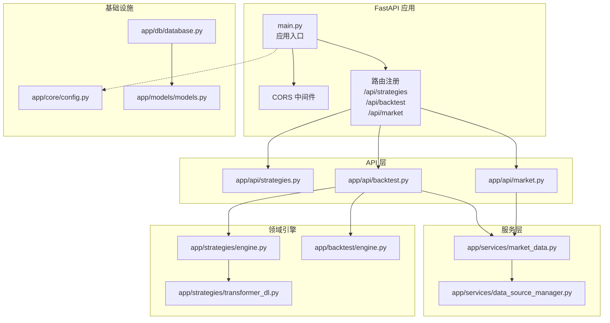
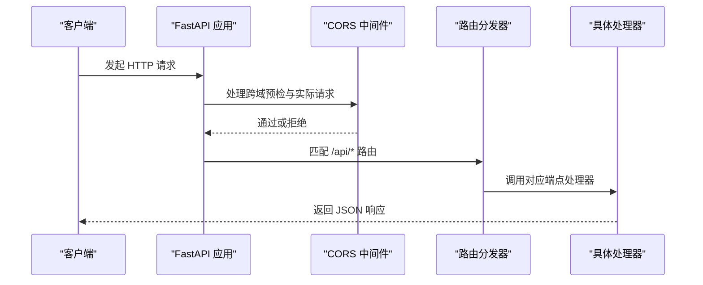
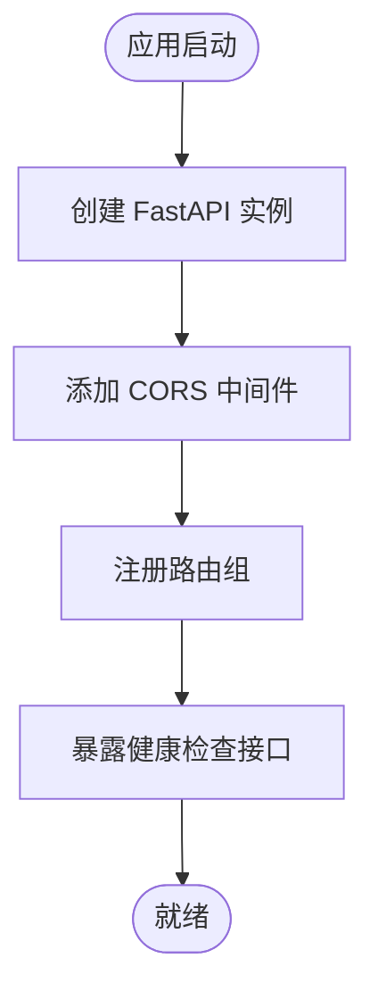
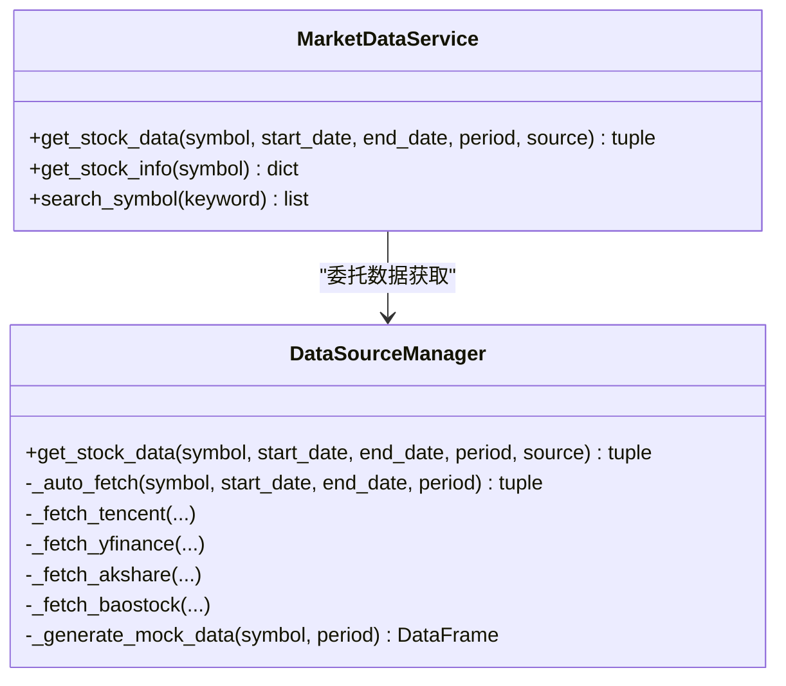
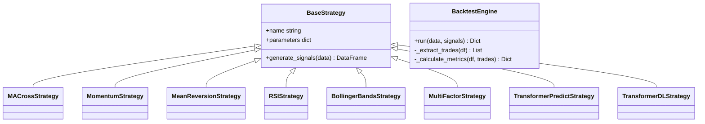
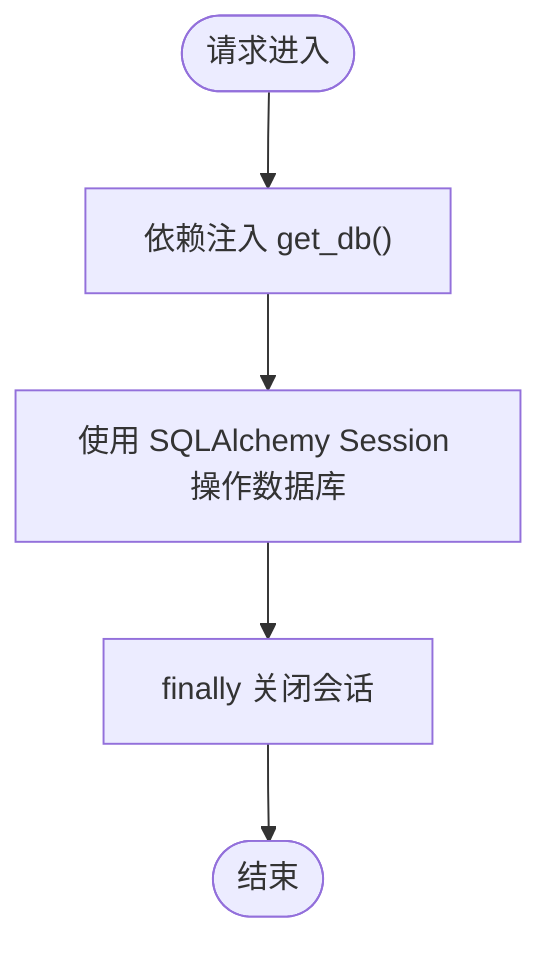
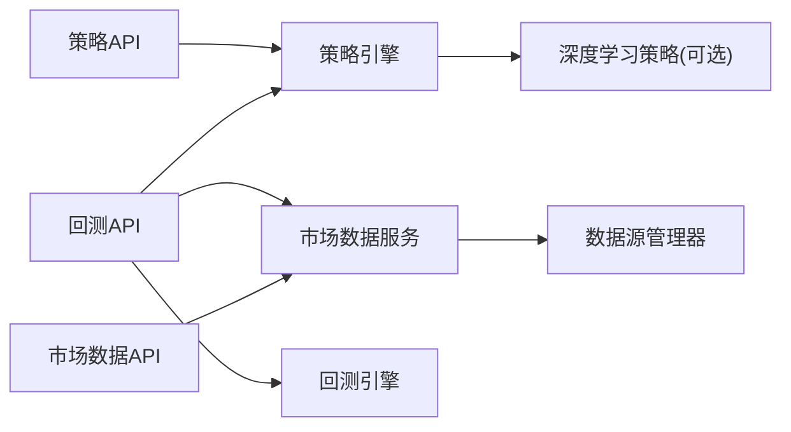

# 后端架构设计

<cite>
**本文引用的文件**   
- [main.py](../../../../../backend/main.py)
- [config.py](../../../../../backend/app/core/config.py)
- [backtest.py](../../../../../backend/app/api/backtest.py)
- [market.py](../../../../../backend/app/api/market.py)
- [strategies.py](../../../../../backend/app/api/strategies.py)
- [database.py](../../../../../backend/app/db/database.py)
- [models.py](../../../../../backend/app/models/models.py)
- [data_source_manager.py](../../../../../backend/app/services/data_source_manager.py)
- [market_data.py](../../../../../backend/app/services/market_data.py)
- [engine.py（回测引擎）](../../../../../backend/app/backtest/engine.py)
- [engine.py（策略引擎）](../../../../../backend/app/strategies/engine.py)
- [transformer_dl.py](../../../../../backend/app/strategies/transformer_dl.py)
</cite>

## 目录
1. [引言](#引言)
2. [项目结构](#项目结构)
3. [核心组件](#核心组件)
4. [架构总览](#架构总览)
5. [详细组件分析](#详细组件分析)
6. [依赖关系分析](#依赖关系分析)
7. [性能与可扩展性](#性能与可扩展性)
8. [故障排查指南](#故障排查指南)
9. [结论](#结论)
10. [附录：扩展新API端点示例](#附录扩展新api端点示例)

## 引言
本文件面向量化策略查看系统的后端架构，聚焦 FastAPI 应用的组织方式、初始化流程、跨域配置、路由注册、中间件使用，以及分层架构中 API 层的职责边界。文档同时说明策略管理、回测执行与市场数据三大核心模块的设计思路，覆盖应用生命周期、依赖注入与配置管理，并提供扩展新 API 端点的实践指引。

## 项目结构
后端采用按功能域划分的模块化组织方式：
- API 层：RESTful 接口定义与请求校验
- 服务层：业务编排与外部数据源协调
- 领域引擎：策略信号生成与回测计算
- 基础设施：数据库模型与连接、配置管理

图表来源
- [main.py:9-27](../../../../../backend/main.py#L9-L27)
- [strategies.py:8-24](../../../../../backend/app/api/strategies.py#L8-L24)
- [backtest.py:13-76](../../../../../backend/app/api/backtest.py#L13-L76)
- [market.py:8-46](../../../../../backend/app/api/market.py#L8-L46)
- [market_data.py:11-41](../../../../../backend/app/services/market_data.py#L11-L41)
- [data_source_manager.py:14-54](../../../../../backend/app/services/data_source_manager.py#L14-L54)
- [engine.py（策略引擎）:17-25](../../../../../backend/app/strategies/engine.py#L17-L25)
- [engine.py（回测引擎）:10-70](../../../../../backend/app/backtest/engine.py#L10-L70)
- [database.py:9-28](../../../../../backend/app/db/database.py#L9-L28)
- [models.py:11-44](../../../../../backend/app/models/models.py#L11-L44)
- [config.py:8-24](../../../../../backend/app/core/config.py#L8-L24)

章节来源
- [main.py:1-36](../../../../../backend/main.py#L1-L36)

## 核心组件
- 应用入口与中间件：FastAPI 实例创建、CORS 跨域配置、健康检查与根路径返回。
- 配置系统：基于 pydantic-settings 的 Settings，支持环境变量与 .env 文件。
- 数据库层：SQLAlchemy Engine、SessionLocal、Base 元数据与 get_db 依赖注入函数。
- 数据模型：策略与回测结果表结构。
- 市场数据服务：统一封装多数据源获取逻辑，提供股票信息与搜索能力。
- 策略引擎：多种经典策略与 Transformer 深度学习策略的信号生成实现。
- 回测引擎：将信号与价格序列结合，计算收益曲线与绩效指标。

章节来源
- [main.py:9-35](../../../../../backend/main.py#L9-L35)
- [config.py:8-24](../../../../../backend/app/core/config.py#L8-L24)
- [database.py:9-28](../../../../../backend/app/db/database.py#L9-L28)
- [models.py:11-44](../../../../../backend/app/models/models.py#L11-L44)
- [market_data.py:11-106](../../../../../backend/app/services/market_data.py#L11-L106)
- [data_source_manager.py:14-469](../../../../../backend/app/services/data_source_manager.py#L14-L469)
- [engine.py（策略引擎）:17-656](../../../../../backend/app/strategies/engine.py#L17-L656)
- [engine.py（回测引擎）:10-163](../../../../../backend/app/backtest/engine.py#L10-L163)

## 架构总览
FastAPI 应用启动后，依次完成以下关键步骤：
- 创建 FastAPI 实例并设置标题、描述与版本
- 挂载 CORS 中间件，允许所有来源与方法
- 注册三个业务路由组：策略、回测、市场数据
- 暴露根路径与健康检查接口

图表来源
- [main.py:9-35](../../../../../backend/main.py#L9-L35)

章节来源
- [main.py:9-35](../../../../../backend/main.py#L9-L35)

## 详细组件分析

### 应用初始化与生命周期
- 应用初始化：在 main.py 中创建 FastAPI 实例，设置元信息。
- 中间件：添加 CORSMiddleware，允许所有来源、方法与头，启用凭据。
- 路由注册：include_router 将策略、回测、市场数据路由分组挂载到 /api/strategies、/api/backtest、/api/market。
- 生命周期钩子：当前未显式定义 lifespan 事件；如需数据库初始化可在 startup 事件中调用 init_db。

图表来源
- [main.py:9-35](../../../../../backend/main.py#L9-L35)

章节来源
- [main.py:9-35](../../../../../backend/main.py#L9-L35)

### CORS 跨域配置
- 允许来源：*
- 允许方法：*
- 允许头：*
- 允许凭据：True

该配置适合前后端分离开发环境，生产环境建议收紧 allow_origins 为前端域名白名单。

章节来源
- [main.py:15-22](../../../../../backend/main.py#L15-L22)

### 路由注册机制
- 策略路由：/api/strategies
- 回测路由：/api/backtest
- 市场数据路由：/api/market

每个路由组内部定义具体的 RESTful 端点，遵循资源命名与动词语义规范。

章节来源
- [main.py:24-27](../../../../../backend/main.py#L24-L27)
- [strategies.py:8-24](../../../../../backend/app/api/strategies.py#L8-L24)
- [backtest.py:13-76](../../../../../backend/app/api/backtest.py#L13-L76)
- [market.py:8-46](../../../../../backend/app/api/market.py#L8-L46)

### API 层职责与 RESTful 设计规范
- 职责边界：API 层仅负责接收请求、参数校验、调用服务层、格式化响应与错误转换。
- 请求体与查询参数：使用 Pydantic BaseModel 进行结构化校验。
- 响应格式：统一返回包含业务数据的字典，必要时附加元信息（如数据源标识）。
- 错误处理：捕获异常并转换为 HTTPException，保持状态码与消息一致。

#### 策略管理 API
- GET /api/strategies：列出可用策略
- GET /api/strategies/{strategy_id}：获取策略详情

章节来源
- [strategies.py:8-24](../../../../../backend/app/api/strategies.py#L8-L24)

#### 回测执行 API
- POST /api/backtest/run：运行策略回测
- GET /api/backtest/history：获取历史回测结果（待实现）

章节来源
- [backtest.py:13-76](../../../../../backend/app/api/backtest.py#L13-L76)

#### 市场数据 API
- GET /api/market/stock/{symbol}：获取股票行情数据
- GET /api/market/stock/{symbol}/info：获取股票基本信息
- GET /api/market/search：搜索股票代码

章节来源
- [market.py:8-46](../../../../../backend/app/api/market.py#L8-L46)

### 服务层：市场数据与多数据源管理
- MarketDataService：对外暴露统一的股票数据获取、信息查询与搜索接口。
- DataSourceManager：根据 source 参数选择具体数据源（腾讯财经、yfinance、AKShare、BaoStock、模拟数据），并在 auto 模式下自动回退。

图表来源
- [market_data.py:11-106](../../../../../backend/app/services/market_data.py#L11-L106)
- [data_source_manager.py:14-469](../../../../../backend/app/services/data_source_manager.py#L14-L469)

章节来源
- [market_data.py:11-106](../../../../../backend/app/services/market_data.py#L11-L106)
- [data_source_manager.py:14-469](../../../../../backend/app/services/data_source_manager.py#L14-L469)

### 领域引擎：策略与回测
- 策略引擎：定义 BaseStrategy 及多种策略实现（均线交叉、动量、均值回归、RSI、布林带、多因子、Transformer 预测、Transformer 深度学习）。
- 回测引擎：合并数据与信号，计算策略收益、资金曲线、交易记录与绩效指标。

图表来源
- [engine.py（策略引擎）:17-656](../../../../../backend/app/strategies/engine.py#L17-L656)
- [engine.py（回测引擎）:10-163](../../../../../backend/app/backtest/engine.py#L10-L163)
- [transformer_dl.py:324-516](../../../../../backend/app/strategies/transformer_dl.py#L324-L516)

章节来源
- [engine.py（策略引擎）:17-656](../../../../../backend/app/strategies/engine.py#L17-L656)
- [engine.py（回测引擎）:10-163](../../../../../backend/app/backtest/engine.py#L10-L163)
- [transformer_dl.py:324-516](../../../../../backend/app/strategies/transformer_dl.py#L324-L516)

### 依赖注入与数据库会话
- 数据库会话：通过 get_db 提供 SessionLocal 的上下文管理器，便于在 FastAPI 依赖注入中使用。
- 模型定义：Strategy 与 BacktestResult 表结构已定义，但当前 API 尚未持久化回测结果。

图表来源
- [database.py:22-28](../../../../../backend/app/db/database.py#L22-L28)
- [models.py:11-44](../../../../../backend/app/models/models.py#L11-L44)

章节来源
- [database.py:9-28](../../../../../backend/app/db/database.py#L9-L28)
- [models.py:11-44](../../../../../backend/app/models/models.py#L11-L44)

### 配置管理系统
- Settings 类集中管理应用名称、版本、调试开关、数据库 URL、默认市场等配置项。
- 支持从 .env 加载环境变量，便于不同环境切换。

章节来源
- [config.py:8-24](../../../../../backend/app/core/config.py#L8-L24)

## 依赖关系分析
- API 层依赖服务层：策略与回测 API 调用 MarketDataService 与策略/回测引擎。
- 服务层依赖数据源管理器：MarketDataService 委托 DataSourceManager 进行多数据源调度。
- 策略引擎可依赖深度学习模块：当 PyTorch 可用时启用 Transformer 深度学习策略。
- 数据库层独立于 API 层：当前 API 未直接使用数据库，但提供了完整的 ORM 模型与会话管理。

图表来源
- [strategies.py:8-24](../../../../../backend/app/api/strategies.py#L8-L24)
- [backtest.py:13-76](../../../../../backend/app/api/backtest.py#L13-L76)
- [market.py:8-46](../../../../../backend/app/api/market.py#L8-L46)
- [market_data.py:11-106](../../../../../backend/app/services/market_data.py#L11-L106)
- [data_source_manager.py:14-469](../../../../../backend/app/services/data_source_manager.py#L14-L469)
- [engine.py（策略引擎）:17-656](../../../../../backend/app/strategies/engine.py#L17-L656)
- [engine.py（回测引擎）:10-163](../../../../../backend/app/backtest/engine.py#L10-L163)
- [transformer_dl.py:324-516](../../../../../backend/app/strategies/transformer_dl.py#L324-L516)

章节来源
- [backtest.py:13-76](../../../../../backend/app/api/backtest.py#L13-L76)
- [market.py:8-46](../../../../../backend/app/api/market.py#L8-L46)
- [strategies.py:8-24](../../../../../backend/app/api/strategies.py#L8-L24)

## 性能与可扩展性
- 数据源自动回退：DataSourceManager 在 auto 模式下优先尝试本地可用的数据源，失败则回退至 yfinance/AKShare/BaoStock，最终使用模拟数据，保证可用性。
- 向量化计算：策略与回测引擎大量使用 pandas/numpy 的向量化运算，避免逐行循环，提升性能。
- 可扩展策略：新增策略只需继承 BaseStrategy 并在工厂函数中注册，即可被 API 层直接调用。
- 可扩展数据源：在 DataSourceManager 中添加新的 _fetch_xxx 方法并接入 get_stock_data 分支，即可扩展数据源。
- 异步 I/O：当前 API 使用 async def，但底层数据获取多为同步阻塞调用；若引入 aiohttp/httpx 可实现真正的异步数据拉取。

[本节为通用指导，不直接分析具体文件]

## 故障排查指南
- 数据源不可用：检查网络连通性与第三方库安装情况（yfinance、akshare、baostock、torch）。
- 日期与周期参数：确保 start_date/end_date 符合 YYYY-MM-DD 格式，period 取值在支持的范围内。
- 模拟数据：当所有真实数据源失败时，系统将返回模拟数据，is_mock 字段可用于前端提示。
- 回测历史：GET /api/backtest/history 目前返回占位响应，需后续实现数据库持久化与查询。

章节来源
- [data_source_manager.py:56-109](../../../../../backend/app/services/data_source_manager.py#L56-L109)
- [backtest.py:72-76](../../../../../backend/app/api/backtest.py#L72-L76)

## 结论
本后端以 FastAPI 为核心，采用清晰的分层架构：API 层专注接口契约与服务编排，服务层抽象数据源差异，领域引擎封装策略与回测逻辑，基础设施提供配置与数据库能力。整体具备良好的可扩展性与容错性，适合持续迭代更多策略与数据源。

[本节为总结性内容，不直接分析具体文件]

## 附录：扩展新API端点示例
以下以“新增策略列表过滤”为例，展示如何在现有架构下扩展一个端点：

- 在 app/api/strategies.py 中新增路由：
  - 定义 GET /api/strategies/filter?tags=... 用于按标签或类型筛选策略
  - 复用 get_available_strategies 获取策略清单，并进行过滤
- 在 app/strategies/engine.py 中扩展策略元数据：
  - 在 get_available_strategies 返回的策略字典中加入 tags 字段
- 在 app/api/strategies.py 中实现过滤逻辑：
  - 解析 Query 参数，对策略列表进行过滤并返回

参考路径
- [strategies.py:8-24](../../../../../backend/app/api/strategies.py#L8-L24)
- [engine.py（策略引擎）:506-597](../../../../../backend/app/strategies/engine.py#L506-L597)

[本节为概念性示例，不直接分析具体代码片段]