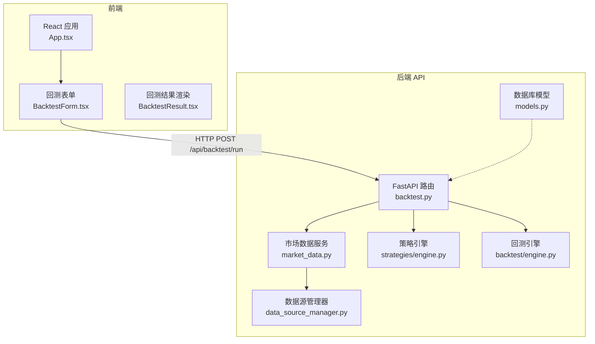
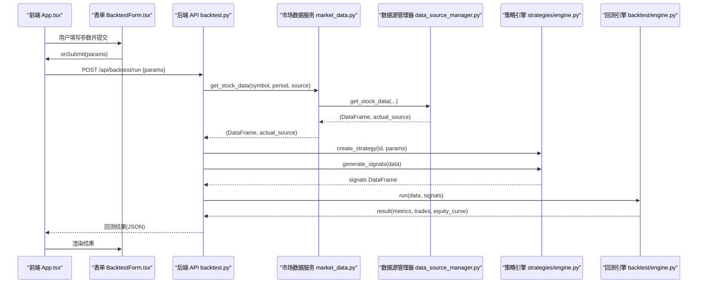
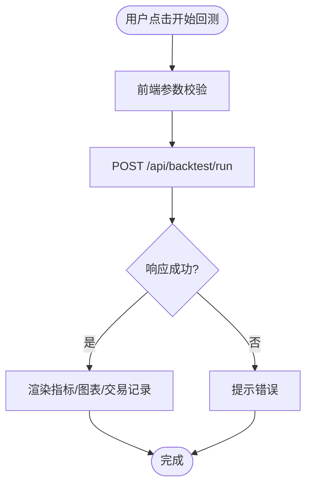
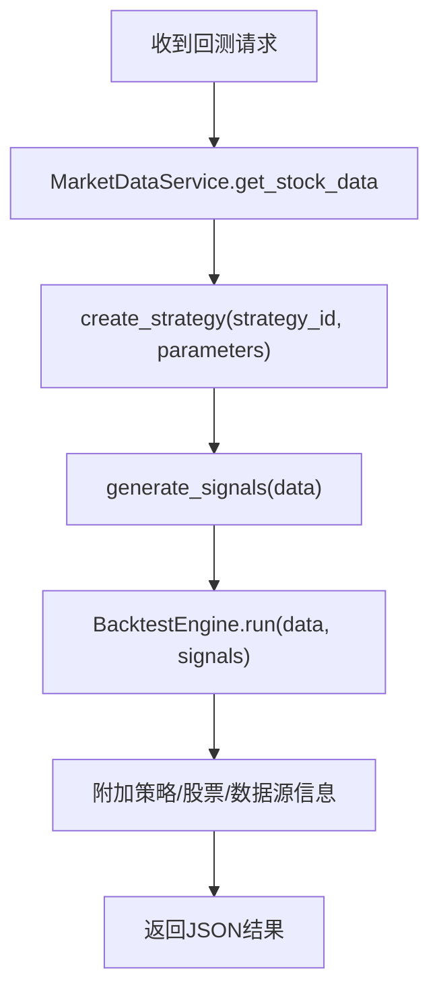
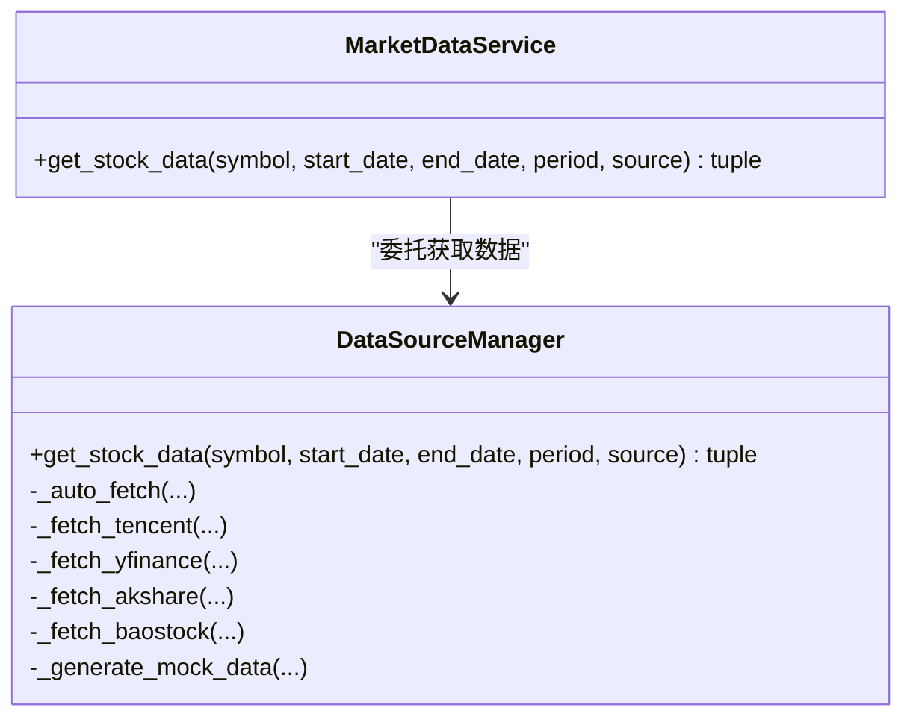
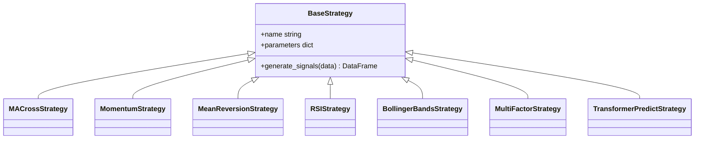
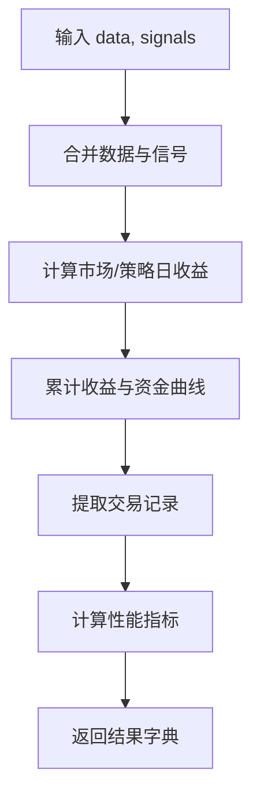
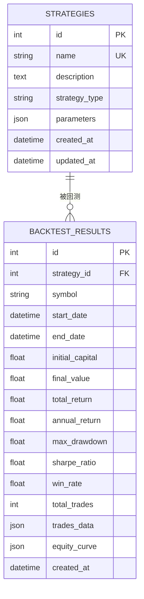
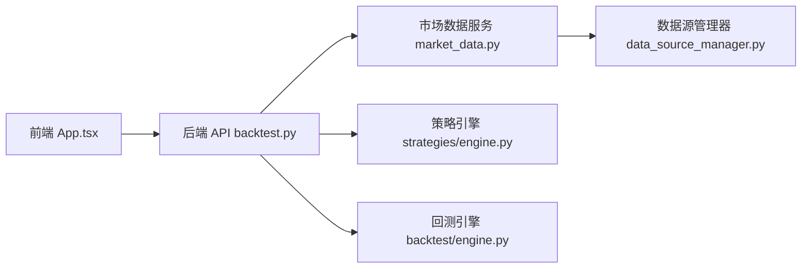

# 数据流设计

<cite>
**本文引用的文件**   
- [main.py](../../../../../backend/main.py)
- [backtest.py](../../../../../backend/app/api/backtest.py)
- [data_source_manager.py](../../../../../backend/app/services/data_source_manager.py)
- [market_data.py](../../../../../backend/app/services/market_data.py)
- [engine.py（策略引擎）](../../../../../backend/app/strategies/engine.py)
- [engine.py（回测引擎）](../../../../../backend/app/backtest/engine.py)
- [models.py](../../../../../backend/app/models/models.py)
- [BacktestForm.tsx](../../../../../frontend/src/components/BacktestForm.tsx)
- [BacktestResult.tsx](../../../../../frontend/src/components/BacktestResult.tsx)
- [App.tsx](../../../../../frontend/src/App.tsx)
</cite>

## 目录
1. [引言](#引言)
2. [项目结构](#项目结构)
3. [核心组件](#核心组件)
4. [架构总览](#架构总览)
5. [详细组件分析](#详细组件分析)
6. [依赖关系分析](#依赖关系分析)
7. [性能与可扩展性](#性能与可扩展性)
8. [故障排查指南](#故障排查指南)
9. [结论](#结论)

## 引言
本设计文档聚焦于“从用户输入到结果展示”的完整数据流转过程，覆盖前端表单提交、后端API请求处理、多数据源抽象层、策略信号生成、回测计算与结果返回。重点说明：
- 多数据源抽象层的设计：数据源管理器、适配器模式与智能降级机制
- 数据模型定义、数据验证规则与格式标准化
- 缓存策略、异步处理机制与错误恢复方案
- 关键业务流程的数据流图与时序图

## 项目结构
系统采用前后端分离架构：
- 前端：React + TypeScript，提供策略选择、参数配置、回测执行与结果可视化
- 后端：FastAPI，提供策略、回测与市场数据相关API；内部按职责分层为API路由、服务层、策略引擎、回测引擎、数据源管理器等

**图表来源**
- [main.py:1-36](../../../../../backend/main.py#L1-L36)
- [backtest.py:1-77](../../../../../backend/app/api/backtest.py#L1-L77)
- [market_data.py:1-106](../../../../../backend/app/services/market_data.py#L1-L106)
- [data_source_manager.py:1-469](../../../../../backend/app/services/data_source_manager.py#L1-L469)
- [engine.py（策略引擎）:1-656](../../../../../backend/app/strategies/engine.py#L1-L656)
- [engine.py（回测引擎）:1-163](../../../../../backend/app/backtest/engine.py#L1-L163)
- [models.py:1-44](../../../../../backend/app/models/models.py#L1-L44)
- [App.tsx:1-100](../../../../../frontend/src/App.tsx#L1-L100)
- [BacktestForm.tsx:1-522](../../../../../frontend/src/components/BacktestForm.tsx#L1-L522)
- [BacktestResult.tsx:1-221](../../../../../frontend/src/components/BacktestResult.tsx#L1-L221)

**章节来源**
- [main.py:1-36](../../../../../backend/main.py#L1-L36)
- [App.tsx:1-100](../../../../../frontend/src/App.tsx#L1-L100)

## 核心组件
- 前端交互层
  - App.tsx：页面编排、调用后端回测接口、状态管理
  - BacktestForm.tsx：表单校验、参数组装、触发回测
  - BacktestResult.tsx：指标、资金曲线、交易记录可视化
- 后端API层
  - backtest.py：接收回测请求、编排数据获取、策略执行、回测计算、结果封装
- 数据访问层
  - market_data.py：统一的市场数据服务入口
  - data_source_manager.py：多数据源适配与智能降级
- 策略与回测层
  - strategies/engine.py：策略基类与各策略实现，负责信号生成
  - backtest/engine.py：回测引擎，计算收益、回撤、夏普等指标
- 数据模型
  - models.py：策略与回测结果的持久化模型（当前未接入API）

**章节来源**
- [backtest.py:1-77](../../../../../backend/app/api/backtest.py#L1-L77)
- [market_data.py:1-106](../../../../../backend/app/services/market_data.py#L1-L106)
- [data_source_manager.py:1-469](../../../../../backend/app/services/data_source_manager.py#L1-L469)
- [engine.py（策略引擎）:1-656](../../../../../backend/app/strategies/engine.py#L1-L656)
- [engine.py（回测引擎）:1-163](../../../../../backend/app/backtest/engine.py#L1-L163)
- [models.py:1-44](../../../../../backend/app/models/models.py#L1-L44)

## 架构总览
下图展示了从前端到后端的端到端数据流，包括数据源选择、策略信号生成与回测计算的关键路径。

**图表来源**
- [App.tsx:13-36](../../../../../frontend/src/App.tsx#L13-L36)
- [BacktestForm.tsx:28-44](../../../../../frontend/src/components/BacktestForm.tsx#L28-L44)
- [backtest.py:28-69](../../../../../backend/app/api/backtest.py#L28-L69)
- [market_data.py:14-41](../../../../../backend/app/services/market_data.py#L14-L41)
- [data_source_manager.py:17-109](../../../../../backend/app/services/data_source_manager.py#L17-L109)
- [engine.py（策略引擎）:600-656](../../../../../backend/app/strategies/engine.py#L600-L656)
- [engine.py（回测引擎）:15-70](../../../../../backend/app/backtest/engine.py#L15-L70)

## 详细组件分析

### 前端数据流与交互
- 表单提交
  - BacktestForm.tsx 收集股票代码、周期、初始资金、数据源与策略参数，调用父组件传入的 onSubmit
  - App.tsx 将参数序列化为JSON并POST至 /api/backtest/run，处理响应并设置回测结果
- 结果展示
  - BacktestResult.tsx 解析 metrics、trades、equity_curve、strategy、symbol、data_source、is_mock，进行指标格式化与图表渲染

**图表来源**
- [BacktestForm.tsx:28-44](../../../../../frontend/src/components/BacktestForm.tsx#L28-L44)
- [App.tsx:13-36](../../../../../frontend/src/App.tsx#L13-L36)
- [BacktestResult.tsx:9-41](../../../../../frontend/src/components/BacktestResult.tsx#L9-L41)

**章节来源**
- [BacktestForm.tsx:1-522](../../../../../frontend/src/components/BacktestForm.tsx#L1-L522)
- [App.tsx:1-100](../../../../../frontend/src/App.tsx#L1-L100)
- [BacktestResult.tsx:1-221](../../../../../frontend/src/components/BacktestResult.tsx#L1-L221)

### 后端API与编排逻辑
- 请求校验
  - BacktestRequest(BaseModel) 定义 strategy_id、symbol、start_date、end_date、period、initial_capital、source、parameters
- 流程编排
  - 通过 MarketDataService.get_stock_data 获取标准化OHLCV数据与实际数据源
  - 使用 create_strategy 构造策略实例并生成信号
  - 使用 BacktestEngine.run 计算回测结果
  - 附加策略信息、股票信息与数据源标识，返回JSON

**图表来源**
- [backtest.py:16-69](../../../../../backend/app/api/backtest.py#L16-L69)

**章节来源**
- [backtest.py:1-77](../../../../../backend/app/api/backtest.py#L1-L77)

### 多数据源抽象层与智能降级
- 数据源管理器 DataSourceManager
  - 支持 tencent、yfinance、akshare、baostock、mock
  - auto 模式下优先A股/港股腾讯财经，其次 yfinance，再 akshare/baostock，最后 mock
  - 各适配器统一输出标准列：Date、Open、High、Low、Close、Volume
- 市场数据服务 MarketDataService
  - 作为对外统一入口，委托 DataSourceManager 获取数据并返回实际数据源名称

**图表来源**
- [data_source_manager.py:14-109](../../../../../backend/app/services/data_source_manager.py#L14-L109)
- [market_data.py:11-41](../../../../../backend/app/services/market_data.py#L11-L41)

**章节来源**
- [data_source_manager.py:1-469](../../../../../backend/app/services/data_source_manager.py#L1-L469)
- [market_data.py:1-106](../../../../../backend/app/services/market_data.py#L1-L106)

### 策略引擎与信号生成
- BaseStrategy 定义统一接口 generate_signals
- 具体策略：均线交叉、动量、均值回归、RSI、布林带、多因子、Transformer预测等
- create_strategy 根据 strategy_id 动态创建策略实例

**图表来源**
- [engine.py（策略引擎）:17-54](../../../../../backend/app/strategies/engine.py#L17-L54)
- [engine.py（策略引擎）:57-81](../../../../../backend/app/strategies/engine.py#L57-L81)
- [engine.py（策略引擎）:84-111](../../../../../backend/app/strategies/engine.py#L84-L111)
- [engine.py（策略引擎）:114-150](../../../../../backend/app/strategies/engine.py#L114-L150)
- [engine.py（策略引擎）:153-205](../../../../../backend/app/strategies/engine.py#L153-L205)
- [engine.py（策略引擎）:208-324](../../../../../backend/app/strategies/engine.py#L208-L324)
- [engine.py（策略引擎）:327-503](../../../../../backend/app/strategies/engine.py#L327-L503)

**章节来源**
- [engine.py（策略引擎）:1-656](../../../../../backend/app/strategies/engine.py#L1-L656)

### 回测引擎与指标计算
- BacktestEngine.run
  - 合并数据与信号，计算策略日收益与累计收益
  - 提取交易记录，计算总收益、年化收益、最大回撤、夏普比率、胜率、盈亏比等
  - 输出 metrics、trades、equity_curve、signals_data

**图表来源**
- [engine.py（回测引擎）:15-70](../../../../../backend/app/backtest/engine.py#L15-L70)
- [engine.py（回测引擎）:72-103](../../../../../backend/app/backtest/engine.py#L72-L103)
- [engine.py（回测引擎）:105-163](../../../../../backend/app/backtest/engine.py#L105-L163)

**章节来源**
- [engine.py（回测引擎）:1-163](../../../../../backend/app/backtest/engine.py#L1-L163)

### 数据模型与持久化
- Strategy：策略元数据（名称、类型、参数、时间戳）
- BacktestResult：回测结果（策略ID、标的、起止日期、初始资金、最终价值、收益率、回撤、夏普、胜率、交易次数、交易明细、资金曲线）

**图表来源**
- [models.py:11-44](../../../../../backend/app/models/models.py#L11-L44)

**章节来源**
- [models.py:1-44](../../../../../backend/app/models/models.py#L1-L44)

## 依赖关系分析
- API 层依赖服务层与引擎层
- 服务层依赖数据源管理器
- 策略引擎与回测引擎相互独立，由API层编排
- 前端依赖后端API，无直接数据库访问

**图表来源**
- [App.tsx:13-36](../../../../../frontend/src/App.tsx#L13-L36)
- [backtest.py:1-77](../../../../../backend/app/api/backtest.py#L1-L77)
- [market_data.py:1-106](../../../../../backend/app/services/market_data.py#L1-L106)
- [data_source_manager.py:1-469](../../../../../backend/app/services/data_source_manager.py#L1-L469)
- [engine.py（策略引擎）:1-656](../../../../../backend/app/strategies/engine.py#L1-L656)
- [engine.py（回测引擎）:1-163](../../../../../backend/app/backtest/engine.py#L1-L163)

**章节来源**
- [main.py:1-36](../../../../../backend/main.py#L1-L36)
- [backtest.py:1-77](../../../../../backend/app/api/backtest.py#L1-L77)

## 性能与可扩展性
- 数据源选择与降级
  - 自动模式按市场类型与可用性顺序尝试多个数据源，失败时回退到模拟数据，保证可用性
  - 建议增加连接超时、重试与熔断机制，避免外部网络抖动影响整体体验
- 数据标准化
  - 所有数据源统一输出 OHLCV 标准列，便于策略与回测引擎复用
- 缓存策略
  - 当前未实现本地缓存；可引入基于 symbol+period+date_range 的键值缓存，减少重复请求
- 异步处理
  - 当前为同步阻塞式处理；对于长耗时策略（如深度学习），建议改为后台任务队列（Celery/RQ）+ WebSocket/SSE 推送进度与结果
- 扩展点
  - 新增数据源：在 DataSourceManager 中实现新适配器，并在 auto 模式中注册优先级
  - 新增策略：继承 BaseStrategy 并在 create_strategy 中注册映射

[本节为通用指导，不直接分析具体代码文件]

## 故障排查指南
- 常见错误与定位
  - 数据源不可用或返回空数据：检查网络连接、股票代码格式、数据源限制（如仅A股）
  - 策略参数非法：确认前端表单约束与后端策略默认值一致
  - 回测结果为空或指标异常：检查信号列是否存在、日期列是否可解析、数值是否为NaN/Inf
- 错误处理现状
  - API层捕获异常并返回HTTP 400
  - 回测引擎对数值进行安全舍入，避免NaN/Inf污染结果
- 改进建议
  - 细化错误码与消息，区分数据源错误、策略错误、回测计算错误
  - 增加日志与追踪，便于问题复现与定位

**章节来源**
- [backtest.py:68-69](../../../../../backend/app/api/backtest.py#L68-L69)
- [engine.py（回测引擎）:144-148](../../../../../backend/app/backtest/engine.py#L144-L148)

## 结论
本系统实现了从前端表单到后端回测结果的完整数据流，并通过多数据源抽象层与智能降级机制保障数据获取的稳定性。策略引擎与回测引擎解耦清晰，便于扩展新的策略与数据源。建议在后续版本中引入缓存、异步任务与更完善的错误处理，以提升性能与用户体验。