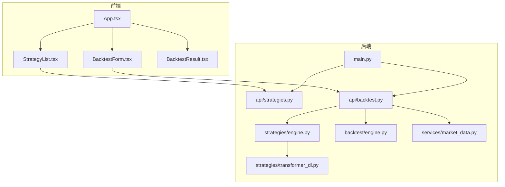
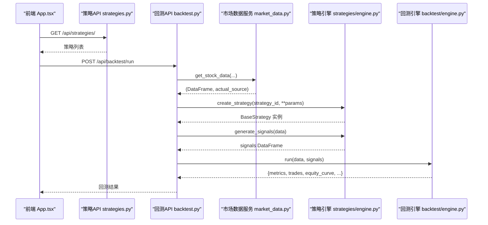
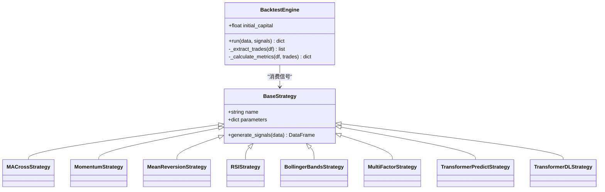
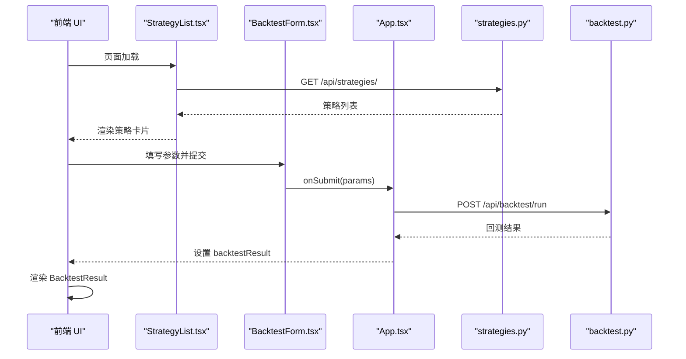
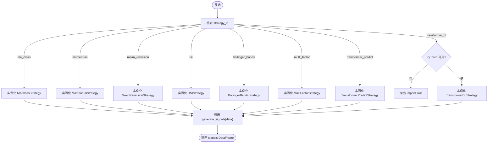
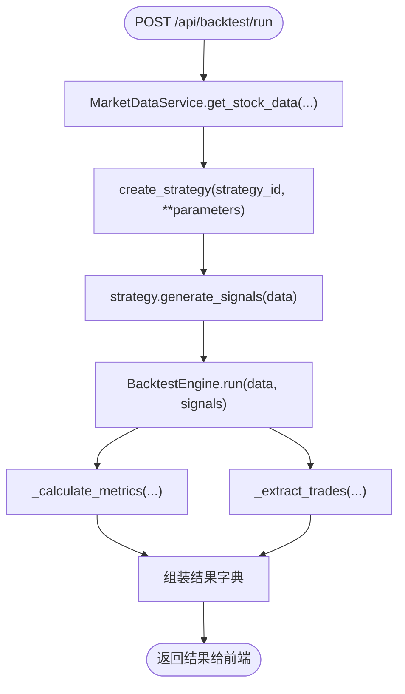
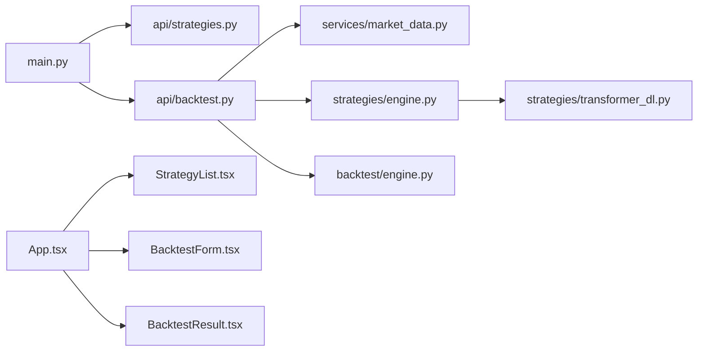

# 组件交互关系

<cite>
**本文引用的文件**   
- [backend/main.py](../../../../../backend/main.py)
- [backend/app/api/backtest.py](../../../../../backend/app/api/backtest.py)
- [backend/app/api/strategies.py](../../../../../backend/app/api/strategies.py)
- [backend/app/backtest/engine.py](../../../../../backend/app/backtest/engine.py)
- [backend/app/strategies/engine.py](../../../../../backend/app/strategies/engine.py)
- [backend/app/services/market_data.py](../../../../../backend/app/services/market_data.py)
- [backend/app/strategies/transformer_dl.py](../../../../../backend/app/strategies/transformer_dl.py)
- [frontend/src/App.tsx](../../../../../frontend/src/App.tsx)
- [frontend/src/components/BacktestForm.tsx](../../../../../frontend/src/components/BacktestForm.tsx)
- [frontend/src/components/StrategyList.tsx](../../../../../frontend/src/components/StrategyList.tsx)
- [frontend/src/components/BacktestResult.tsx](../../../../../frontend/src/components/BacktestResult.tsx)
</cite>

## 目录
1. [引言](#引言)
2. [项目结构](#项目结构)
3. [核心组件](#核心组件)
4. [架构总览](#架构总览)
5. [详细组件分析](#详细组件分析)
6. [依赖关系分析](#依赖关系分析)
7. [性能与可扩展性](#性能与可扩展性)
8. [故障排查指南](#故障排查指南)
9. [结论](#结论)

## 引言
本文件面向量化策略查看系统的“组件交互关系”，重点说明：
- 策略引擎与回测引擎的协作模式，包括策略实例化、信号生成与执行流程。
- 前端组件与后端服务的交互模式，包括 API 调用、状态同步和用户反馈机制。
- 组件间的依赖关系、接口契约与版本兼容性考虑。
- 组件生命周期管理、错误传播机制与日志记录策略。
- 通过组件关系图与交互序列图展示关键业务场景的协作过程。

## 项目结构
系统采用前后端分离架构：
- 后端基于 FastAPI，提供策略列表、回测运行等 REST API；内部包含策略引擎、回测引擎与市场数据服务。
- 前端基于 React + TypeScript，提供策略选择、参数配置、回测结果可视化。

图表来源
- [backend/main.py:9-27](../../../../../backend/main.py#L9-L27)
- [backend/app/api/strategies.py:8-14](../../../../../backend/app/api/strategies.py#L8-L14)
- [backend/app/api/backtest.py:13-69](../../../../../backend/app/api/backtest.py#L13-L69)
- [backend/app/strategies/engine.py:506-656](../../../../../backend/app/strategies/engine.py#L506-L656)
- [backend/app/backtest/engine.py:10-70](../../../../../backend/app/backtest/engine.py#L10-L70)
- [backend/app/services/market_data.py:11-41](../../../../../backend/app/services/market_data.py#L11-L41)
- [backend/app/strategies/transformer_dl.py:324-487](../../../../../backend/app/strategies/transformer_dl.py#L324-L487)
- [frontend/src/App.tsx:8-36](../../../../../frontend/src/App.tsx#L8-L36)
- [frontend/src/components/StrategyList.tsx:16-41](../../../../../frontend/src/components/StrategyList.tsx#L16-L41)
- [frontend/src/components/BacktestForm.tsx:21-44](../../../../../frontend/src/components/BacktestForm.tsx#L21-L44)
- [frontend/src/components/BacktestResult.tsx:9-28](../../../../../frontend/src/components/BacktestResult.tsx#L9-L28)

章节来源
- [backend/main.py:1-36](../../../../../backend/main.py#L1-L36)
- [frontend/src/App.tsx:1-100](../../../../../frontend/src/App.tsx#L1-L100)

## 核心组件
- 后端入口与路由注册：FastAPI 应用初始化、CORS 配置、路由挂载。
- 策略 API：暴露策略列表与详情查询。
- 回测 API：接收回测请求，协调市场数据、策略引擎与回测引擎。
- 策略引擎：定义策略基类与多种策略实现，提供工厂函数创建策略实例。
- 回测引擎：根据信号计算收益曲线、交易记录与绩效指标。
- 市场数据服务：统一获取股票数据，支持多数据源自动选择。
- Transformer 深度学习策略：可选的深度学习策略实现（依赖 PyTorch）。
- 前端 App：组合子组件，发起 API 调用，管理加载状态与结果展示。
- 前端 StrategyList：拉取策略列表并渲染卡片。
- 前端 BacktestForm：收集用户参数并提交回测请求。
- 前端 BacktestResult：渲染回测指标、资金曲线、股价走势与交易明细。

章节来源
- [backend/main.py:9-27](../../../../../backend/main.py#L9-L27)
- [backend/app/api/strategies.py:8-24](../../../../../backend/app/api/strategies.py#L8-L24)
- [backend/app/api/backtest.py:16-69](../../../../../backend/app/api/backtest.py#L16-L69)
- [backend/app/strategies/engine.py:17-25](../../../../../backend/app/strategies/engine.py#L17-L25)
- [backend/app/backtest/engine.py:10-70](../../../../../backend/app/backtest/engine.py#L10-L70)
- [backend/app/services/market_data.py:11-41](../../../../../backend/app/services/market_data.py#L11-L41)
- [backend/app/strategies/transformer_dl.py:324-487](../../../../../backend/app/strategies/transformer_dl.py#L324-L487)
- [frontend/src/App.tsx:8-36](../../../../../frontend/src/App.tsx#L8-L36)
- [frontend/src/components/StrategyList.tsx:16-41](../../../../../frontend/src/components/StrategyList.tsx#L16-L41)
- [frontend/src/components/BacktestForm.tsx:21-44](../../../../../frontend/src/components/BacktestForm.tsx#L21-L44)
- [frontend/src/components/BacktestResult.tsx:9-28](../../../../../frontend/src/components/BacktestResult.tsx#L9-L28)

## 架构总览
系统以 FastAPI 为后端网关，对外暴露 /api/strategies 与 /api/backtest 两个主要命名空间。前端通过浏览器 fetch 直接调用这些 API。策略引擎负责将历史行情转化为交易信号，回测引擎负责将信号转化为可度量的绩效结果。市场数据服务屏蔽不同数据源的差异，向上层提供统一的 DataFrame 数据格式。

图表来源
- [frontend/src/App.tsx:13-36](../../../../../frontend/src/App.tsx#L13-L36)
- [backend/app/api/strategies.py:11-14](../../../../../backend/app/api/strategies.py#L11-L14)
- [backend/app/api/backtest.py:28-69](../../../../../backend/app/api/backtest.py#L28-L69)
- [backend/app/services/market_data.py:14-41](../../../../../backend/app/services/market_data.py#L14-L41)
- [backend/app/strategies/engine.py:600-656](../../../../../backend/app/strategies/engine.py#L600-L656)
- [backend/app/backtest/engine.py:15-70](../../../../../backend/app/backtest/engine.py#L15-L70)

## 详细组件分析

### 策略引擎与回测引擎协作
- 策略引擎提供统一的 BaseStrategy 抽象，具体策略实现均实现 generate_signals(data) -> DataFrame，返回 signal 与 position 列。
- 回测引擎接收 data 与 signals，合并后计算市场收益、策略收益、累计收益与资金曲线，并提取交易记录与绩效指标。
- 工厂函数 create_strategy 根据 strategy_id 动态实例化对应策略，支持可选的深度学习策略（需 PyTorch）。

图表来源
- [backend/app/strategies/engine.py:17-25](../../../../../backend/app/strategies/engine.py#L17-L25)
- [backend/app/strategies/engine.py:28-54](../../../../../backend/app/strategies/engine.py#L28-L54)
- [backend/app/strategies/engine.py:57-81](../../../../../backend/app/strategies/engine.py#L57-L81)
- [backend/app/strategies/engine.py:84-111](../../../../../backend/app/strategies/engine.py#L84-L111)
- [backend/app/strategies/engine.py:114-150](../../../../../backend/app/strategies/engine.py#L114-L150)
- [backend/app/strategies/engine.py:153-205](../../../../../backend/app/strategies/engine.py#L153-L205)
- [backend/app/strategies/engine.py:208-324](../../../../../backend/app/strategies/engine.py#L208-L324)
- [backend/app/strategies/engine.py:327-503](../../../../../backend/app/strategies/engine.py#L327-L503)
- [backend/app/strategies/transformer_dl.py:324-487](../../../../../backend/app/strategies/transformer_dl.py#L324-L487)
- [backend/app/backtest/engine.py:10-70](../../../../../backend/app/backtest/engine.py#L10-L70)

章节来源
- [backend/app/strategies/engine.py:17-503](../../../../../backend/app/strategies/engine.py#L17-L503)
- [backend/app/backtest/engine.py:10-163](../../../../../backend/app/backtest/engine.py#L10-L163)

### 前端与后端交互
- 前端 App 组件在用户提交表单时，调用 /api/backtest/run，携带策略 ID、股票代码、周期、初始资金、数据源与策略参数。
- StrategyList 组件启动时调用 /api/strategies/ 获取策略元信息，用于渲染参数面板。
- BacktestResult 组件解析后端返回的结构，展示指标、资金曲线、股价走势与交易明细，并根据 is_mock 字段提示是否使用模拟数据。

图表来源
- [frontend/src/components/StrategyList.tsx:20-41](../../../../../frontend/src/components/StrategyList.tsx#L20-L41)
- [frontend/src/components/BacktestForm.tsx:28-44](../../../../../frontend/src/components/BacktestForm.tsx#L28-L44)
- [frontend/src/App.tsx:13-36](../../../../../frontend/src/App.tsx#L13-L36)
- [backend/app/api/strategies.py:11-14](../../../../../backend/app/api/strategies.py#L11-L14)
- [backend/app/api/backtest.py:28-69](../../../../../backend/app/api/backtest.py#L28-L69)

章节来源
- [frontend/src/App.tsx:8-36](../../../../../frontend/src/App.tsx#L8-L36)
- [frontend/src/components/BacktestForm.tsx:21-44](../../../../../frontend/src/components/BacktestForm.tsx#L21-L44)
- [frontend/src/components/StrategyList.tsx:16-41](../../../../../frontend/src/components/StrategyList.tsx#L16-L41)
- [frontend/src/components/BacktestResult.tsx:9-28](../../../../../frontend/src/components/BacktestResult.tsx#L9-L28)

### 策略实例化与信号生成流程
- 工厂函数 create_strategy 根据 strategy_id 匹配具体策略类，并将前端传入的参数映射到构造函数。
- 对于 transformer_dl，若未安装 PyTorch，会抛出 ImportError，由上层捕获并返回错误。
- 各策略的 generate_signals 返回 DataFrame，包含 signal 与 position 列，供回测引擎消费。

图表来源
- [backend/app/strategies/engine.py:600-656](../../../../../backend/app/strategies/engine.py#L600-L656)
- [backend/app/strategies/engine.py:28-54](../../../../../backend/app/strategies/engine.py#L28-L54)
- [backend/app/strategies/engine.py:57-81](../../../../../backend/app/strategies/engine.py#L57-L81)
- [backend/app/strategies/engine.py:84-111](../../../../../backend/app/strategies/engine.py#L84-L111)
- [backend/app/strategies/engine.py:114-150](../../../../../backend/app/strategies/engine.py#L114-L150)
- [backend/app/strategies/engine.py:153-205](../../../../../backend/app/strategies/engine.py#L153-L205)
- [backend/app/strategies/engine.py:208-324](../../../../../backend/app/strategies/engine.py#L208-L324)
- [backend/app/strategies/engine.py:327-503](../../../../../backend/app/strategies/engine.py#L327-L503)
- [backend/app/strategies/transformer_dl.py:492-516](../../../../../backend/app/strategies/transformer_dl.py#L492-L516)

章节来源
- [backend/app/strategies/engine.py:600-656](../../../../../backend/app/strategies/engine.py#L600-L656)
- [backend/app/strategies/transformer_dl.py:492-516](../../../../../backend/app/strategies/transformer_dl.py#L492-L516)

### 回测执行流程
- 回测 API 先通过 MarketDataService 获取股票数据，再创建策略实例并生成信号，最后交由 BacktestEngine.run 计算指标与交易记录。
- 回测引擎内部对日期类型进行兼容处理，并对数值列做 NaN/Inf 清理，确保 JSON 序列化安全。

图表来源
- [backend/app/api/backtest.py:28-69](../../../../../backend/app/api/backtest.py#L28-L69)
- [backend/app/services/market_data.py:14-41](../../../../../backend/app/services/market_data.py#L14-L41)
- [backend/app/backtest/engine.py:15-70](../../../../../backend/app/backtest/engine.py#L15-L70)
- [backend/app/backtest/engine.py:72-103](../../../../../backend/app/backtest/engine.py#L72-L103)
- [backend/app/backtest/engine.py:105-163](../../../../../backend/app/backtest/engine.py#L105-L163)

章节来源
- [backend/app/api/backtest.py:28-69](../../../../../backend/app/api/backtest.py#L28-L69)
- [backend/app/backtest/engine.py:15-163](../../../../../backend/app/backtest/engine.py#L15-L163)

### 前端状态同步与用户反馈
- StrategyList 在首次加载时拉取策略列表，并在有数据后默认选中第一个策略。
- BacktestForm 校验是否已选择策略，组装参数后调用父组件的 onSubmit。
- App 组件在提交时设置 loading 状态，成功后更新 backtestResult，失败则弹出错误提示。
- BacktestResult 根据 is_mock 显示模拟数据提示，并以图表形式呈现资金曲线与股价走势。

章节来源
- [frontend/src/components/StrategyList.tsx:20-41](../../../../../frontend/src/components/StrategyList.tsx#L20-L41)
- [frontend/src/components/BacktestForm.tsx:28-44](../../../../../frontend/src/components/BacktestForm.tsx#L28-L44)
- [frontend/src/App.tsx:13-36](../../../../../frontend/src/App.tsx#L13-L36)
- [frontend/src/components/BacktestResult.tsx:9-28](../../../../../frontend/src/components/BacktestResult.tsx#L9-L28)

## 依赖关系分析
- 后端入口 main.py 注册三个路由组：策略、回测、市场数据。
- 回测 API 依赖市场数据服务、策略引擎与回测引擎。
- 策略引擎依赖多个具体策略实现，其中深度学习策略依赖 PyTorch。
- 前端 App 组合 StrategyList、BacktestForm、BacktestResult 三个子组件。

图表来源
- [backend/main.py:24-27](../../../../../backend/main.py#L24-L27)
- [backend/app/api/backtest.py:9-11](../../../../../backend/app/api/backtest.py#L9-L11)
- [backend/app/strategies/engine.py:9-14](../../../../../backend/app/strategies/engine.py#L9-L14)
- [backend/app/strategies/transformer_dl.py:18-25](../../../../../backend/app/strategies/transformer_dl.py#L18-L25)
- [frontend/src/App.tsx:3-5](../../../../../frontend/src/App.tsx#L3-L5)

章节来源
- [backend/main.py:24-27](../../../../../backend/main.py#L24-L27)
- [backend/app/api/backtest.py:9-11](../../../../../backend/app/api/backtest.py#L9-L11)
- [backend/app/strategies/engine.py:9-14](../../../../../backend/app/strategies/engine.py#L9-L14)
- [backend/app/strategies/transformer_dl.py:18-25](../../../../../backend/app/strategies/transformer_dl.py#L18-L25)
- [frontend/src/App.tsx:3-5](../../../../../frontend/src/App.tsx#L3-L5)

## 性能与可扩展性
- 回测引擎对数值列进行 NaN/Inf 清理，避免 JSON 序列化异常，提升稳定性。
- 深度学习策略支持滚动窗口训练与周期性重训，适合长序列时间序列预测。
- 市场数据服务支持多数据源自动选择，便于扩展新的数据源接入。
- 前端图表组件使用响应式容器，适配不同屏幕尺寸。

[本节为通用指导，不直接分析具体文件]

## 故障排查指南
- 回测失败：
  - 检查前端是否正确传递 strategy_id、symbol、period、initial_capital、source、parameters。
  - 确认后端 /api/backtest/run 返回的错误信息，常见原因为数据获取失败或策略参数无效。
- 深度学习策略不可用：
  - 若未安装 PyTorch，create_transformer_dl_strategy 会抛出 ImportError，需在环境安装 torch。
- 模拟数据提示：
  - 当 data_source 实际为 mock 时，前端会显示模拟数据横幅，建议切换真实数据源以获得更可靠结果。
- CORS 与跨域：
  - 后端已启用 CORS 中间件，允许所有来源与方法，便于本地开发联调。

章节来源
- [backend/app/api/backtest.py:68-69](../../../../../backend/app/api/backtest.py#L68-L69)
- [backend/app/strategies/engine.py:647-653](../../../../../backend/app/strategies/engine.py#L647-L653)
- [backend/app/strategies/transformer_dl.py:492-516](../../../../../backend/app/strategies/transformer_dl.py#L492-L516)
- [frontend/src/components/BacktestResult.tsx:45-49](../../../../../frontend/src/components/BacktestResult.tsx#L45-L49)
- [backend/main.py:15-22](../../../../../backend/main.py#L15-L22)

## 结论
本系统通过清晰的职责划分与稳定的接口契约，实现了从前端交互到策略信号生成再到回测评估的完整闭环。策略引擎与回测引擎解耦，便于扩展新策略；市场数据服务屏蔽底层数据源差异，提升可维护性。前端组件通过明确的 API 调用与状态管理，为用户提供直观的回测体验。建议在后续迭代中完善错误码体系、增加异步任务队列以提升长耗时任务的并发能力，并引入结构化日志与监控指标以增强可观测性。