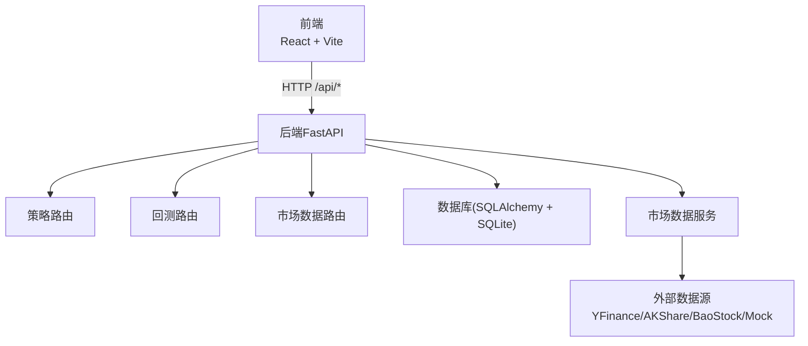
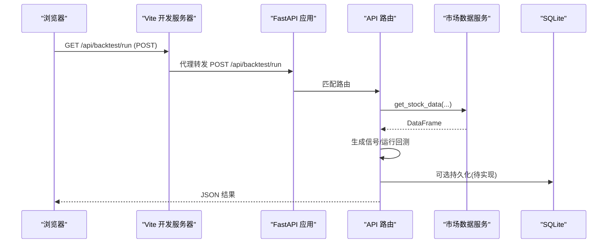
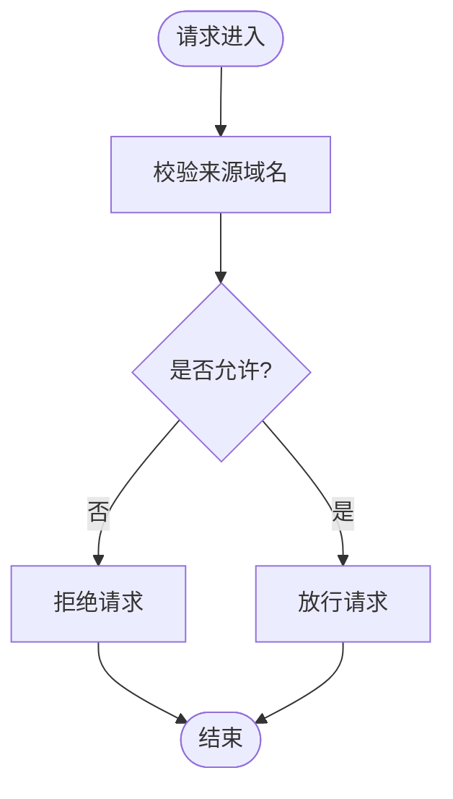
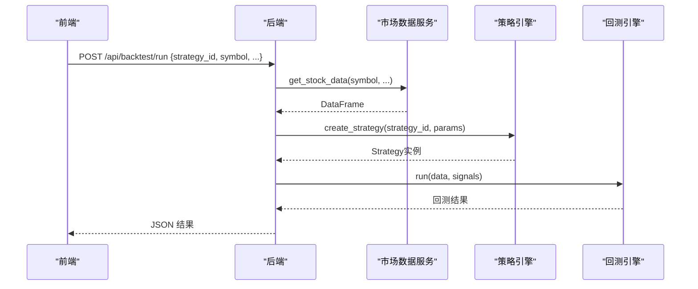
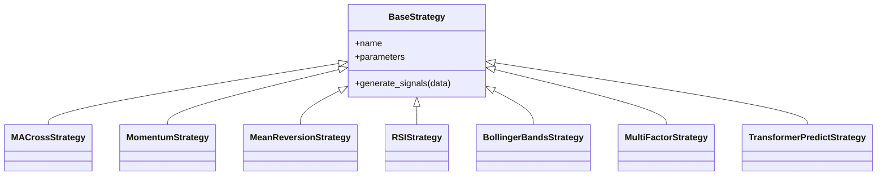
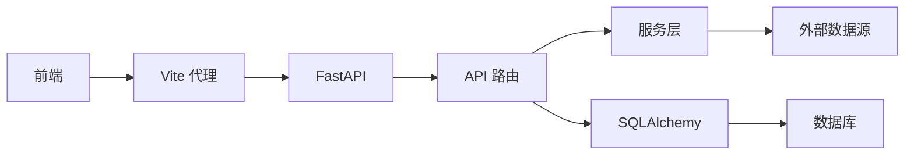
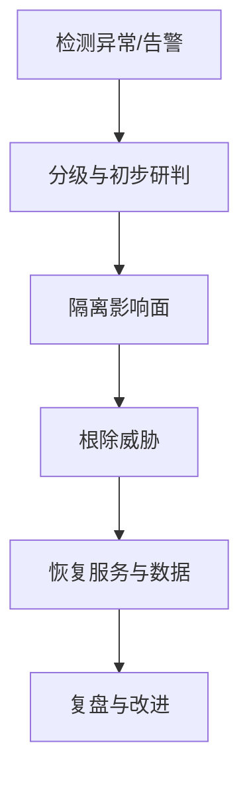

# 安全运维

<cite>
**本文引用的文件**   
- [backend/main.py](../../../../../backend/main.py)
- [backend/app/core/config.py](../../../../../backend/app/core/config.py)
- [backend/app/api/backtest.py](../../../../../backend/app/api/backtest.py)
- [backend/app/api/market.py](../../../../../backend/app/api/market.py)
- [backend/app/api/strategies.py](../../../../../backend/app/api/strategies.py)
- [backend/app/db/database.py](../../../../../backend/app/db/database.py)
- [backend/app/models/models.py](../../../../../backend/app/models/models.py)
- [backend/app/services/market_data.py](../../../../../backend/app/services/market_data.py)
- [backend/app/strategies/engine.py](../../../../../backend/app/strategies/engine.py)
- [backend/app/backtest/engine.py](../../../../../backend/app/backtest/engine.py)
- [frontend/src/App.tsx](../../../../../frontend/src/App.tsx)
- [frontend/vite.config.ts](../../../../../frontend/vite.config.ts)
- [DATA_SOURCES.md](../../../../../DATA_SOURCES.md)
</cite>

## 目录
1. [引言](#引言)
2. [项目结构](#项目结构)
3. [核心组件](#核心组件)
4. [架构总览](#架构总览)
5. [详细组件分析](#详细组件分析)
6. [依赖关系分析](#依赖关系分析)
7. [性能与容量规划](#性能与容量规划)
8. [故障排查与安全事件响应](#故障排查与安全事件响应)
9. [结论](#结论)
10. [附录：合规、隐私与备份恢复](#附录合规隐私与备份恢复)

## 引言
本指南面向量化策略查看系统的生产化部署与持续运营，覆盖应用安全、数据安全、网络安全、身份认证与授权、API访问控制、跨域配置、传输加密、敏感数据加密存储、密钥管理、防火墙与DDoS防护、SQL注入与XSS防护、审计日志、入侵检测、漏洞扫描、合规与隐私保护、数据备份与灾难恢复、业务连续性等主题。文档基于仓库现有代码进行现状评估，并给出可落地的加固方案与实施建议。

## 项目结构
系统采用前后端分离架构：
- 前端使用 React + Vite，开发时通过代理转发到后端。
- 后端使用 FastAPI，提供策略、回测与市场数据相关API。
- 数据层使用 SQLAlchemy + SQLite（默认），模型定义在 models.py。
- 市场数据通过服务层抽象多数据源自动切换。

**图示来源**
- [backend/main.py:9-35](../../../../../backend/main.py#L9-L35)
- [backend/app/api/strategies.py:11-24](../../../../../backend/app/api/strategies.py#L11-L24)
- [backend/app/api/backtest.py:28-76](../../../../../backend/app/api/backtest.py#L28-L76)
- [backend/app/api/market.py:11-46](../../../../../backend/app/api/market.py#L11-L46)
- [backend/app/db/database.py:9-28](../../../../../backend/app/db/database.py#L9-L28)
- [backend/app/services/market_data.py:14-41](../../../../../backend/app/services/market_data.py#L14-L41)
- [frontend/vite.config.ts:6-14](../../../../../frontend/vite.config.ts#L6-L14)

**章节来源**
- [backend/main.py:1-36](../../../../../backend/main.py#L1-L36)
- [frontend/vite.config.ts:1-16](../../../../../frontend/vite.config.ts#L1-L16)

## 核心组件
- 应用入口与中间件：FastAPI 应用初始化、CORS 中间件、健康检查与根路径。
- 配置中心：Pydantic Settings 加载环境变量与默认值。
- API 路由：策略列表与详情、回测执行与历史查询、市场数据获取与搜索。
- 数据层：SQLAlchemy Engine/Session、模型定义（策略表、回测结果表）。
- 业务服务：市场数据服务（多数据源）、回测引擎（收益曲线与指标计算）、策略引擎（多种策略实现）。

**章节来源**
- [backend/main.py:9-35](../../../../../backend/main.py#L9-L35)
- [backend/app/core/config.py:8-24](../../../../../backend/app/core/config.py#L8-L24)
- [backend/app/api/strategies.py:11-24](../../../../../backend/app/api/strategies.py#L11-L24)
- [backend/app/api/backtest.py:16-76](../../../../../backend/app/api/backtest.py#L16-L76)
- [backend/app/api/market.py:11-46](../../../../../backend/app/api/market.py#L11-L46)
- [backend/app/db/database.py:9-28](../../../../../backend/app/db/database.py#L9-L28)
- [backend/app/models/models.py:11-44](../../../../../backend/app/models/models.py#L11-L44)
- [backend/app/services/market_data.py:11-106](../../../../../backend/app/services/market_data.py#L11-L106)
- [backend/app/backtest/engine.py:10-163](../../../../../backend/app/backtest/engine.py#L10-L163)
- [backend/app/strategies/engine.py:17-656](../../../../../backend/app/strategies/engine.py#L17-L656)

## 架构总览
当前架构为轻量级本地开发形态，存在若干安全风险点需要加固：
- CORS 允许所有来源且允许凭据，存在跨站请求伪造风险。
- 未实现身份认证与权限控制，API 完全开放。
- 未启用 HTTPS，仅通过 Vite 开发代理转发。
- 数据库使用 SQLite，无连接池与强密码机制。
- 未实现输入校验、速率限制、审计日志、WAF/DDoS 防护。
- 未实现密钥管理与敏感信息加密存储。

**图示来源**
- [frontend/src/App.tsx:13-36](../../../../../frontend/src/App.tsx#L13-L36)
- [frontend/vite.config.ts:6-14](../../../../../frontend/vite.config.ts#L6-L14)
- [backend/main.py:24-35](../../../../../backend/main.py#L24-L35)
- [backend/app/api/backtest.py:28-66](../../../../../backend/app/api/backtest.py#L28-L66)
- [backend/app/services/market_data.py:14-41](../../../../../backend/app/services/market_data.py#L14-L41)
- [backend/app/db/database.py:9-28](../../../../../backend/app/db/database.py#L9-L28)

## 详细组件分析

### 应用入口与跨域配置
- 现状：CORS 允许任意来源、方法与头，并允许携带凭据；存在被恶意站点利用的风险。
- 风险：跨站请求伪造、敏感接口被第三方站点调用。
- 加固建议：
  - 将 allow_origins 改为白名单域名集合，禁止通配符。
  - 仅在必要时允许 credentials，并配合 CSRF 防护。
  - 明确 allow_methods 与 allow_headers，最小化暴露面。
  - 在生产环境前置反向代理或网关统一处理 TLS 终止与跨域策略。

**图示来源**
- [backend/main.py:15-22](../../../../../backend/main.py#L15-L22)

**章节来源**
- [backend/main.py:9-22](../../../../../backend/main.py#L9-L22)

### 配置与环境变量
- 现状：使用 Pydantic Settings 读取 .env，包含数据库 URL、默认市场等。
- 风险：敏感信息（如数据库连接串）可能以明文形式出现在 .env 中。
- 加固建议：
  - 引入密钥管理服务（如云厂商 KMS、HashiCorp Vault）注入敏感配置。
  - 对 DATABASE_URL 中的密码进行加密存储与动态解密。
  - 区分开发与生产配置，禁用 DEBUG 模式。

**章节来源**
- [backend/app/core/config.py:8-24](../../../../../backend/app/core/config.py#L8-L24)

### 策略API路由
- 现状：提供策略列表与详情查询，无鉴权与限流。
- 风险：策略元数据泄露、枚举攻击。
- 加固建议：
  - 增加认证与授权（见下节）。
  - 添加参数校验与最小返回字段。
  - 记录访问审计日志。

**章节来源**
- [backend/app/api/strategies.py:11-24](../../../../../backend/app/api/strategies.py#L11-L24)

### 回测API路由
- 现状：接收策略ID、标的、时间范围、初始资金、数据源与参数，执行回测并返回结果；异常统一抛出 HTTPException。
- 风险：
  - 参数未严格校验，可能导致资源耗尽或逻辑错误。
  - 未限制并发与频率，易被滥用。
  - 未持久化回测历史，无法审计与追溯。
- 加固建议：
  - 对 strategy_id 做白名单校验；对数值型参数设置上下界。
  - 增加速率限制与任务队列，避免长时间阻塞。
  - 将 is_mock 与 data_source 纳入审计日志。
  - 实现历史持久化并加入访问控制。

**图示来源**
- [backend/app/api/backtest.py:28-66](../../../../../backend/app/api/backtest.py#L28-L66)
- [backend/app/services/market_data.py:14-41](../../../../../backend/app/services/market_data.py#L14-L41)
- [backend/app/strategies/engine.py:600-656](../../../../../backend/app/strategies/engine.py#L600-L656)
- [backend/app/backtest/engine.py:15-70](../../../../../backend/app/backtest/engine.py#L15-L70)

**章节来源**
- [backend/app/api/backtest.py:16-76](../../../../../backend/app/api/backtest.py#L16-L76)

### 市场数据API路由
- 现状：提供股票数据、基本信息与搜索接口；异常统一抛出 HTTPException。
- 风险：
  - 未对 symbol 与 keyword 做格式校验，可能存在注入或越权访问。
  - 未限制返回字段大小，可能被用于数据爬取。
- 加固建议：
  - 对 symbol 与 keyword 进行白名单或正则校验。
  - 增加分页与最大返回条数限制。
  - 接入审计日志与访问统计。

**章节来源**
- [backend/app/api/market.py:11-46](../../../../../backend/app/api/market.py#L11-L46)

### 数据库与模型
- 现状：使用 SQLAlchemy 创建 SQLite 引擎与会话；定义策略与回测结果表。
- 风险：
  - SQLite 不适合高并发与多进程写入。
  - 无迁移脚本，变更表结构需重建库。
  - 无加密与访问控制。
- 加固建议：
  - 生产环境迁移至 PostgreSQL/MySQL，启用 SSL 连接与连接池。
  - 引入 Alembic 进行版本化迁移。
  - 对敏感字段（如策略参数、交易记录）进行加密存储。
  - 启用数据库审计与慢查询监控。

**图示来源**
- [backend/app/strategies/engine.py:17-656](../../../../../backend/app/strategies/engine.py#L17-L656)

**章节来源**
- [backend/app/db/database.py:9-28](../../../../../backend/app/db/database.py#L9-L28)
- [backend/app/models/models.py:11-44](../../../../../backend/app/models/models.py#L11-L44)

### 市场数据服务
- 现状：封装多数据源选择逻辑，支持 auto/yfinance/akshare/baostock/mock。
- 风险：
  - 外部网络依赖导致可用性波动。
  - 模拟数据与真实数据混用，需明确标识。
- 加固建议：
  - 增加超时、重试与熔断机制。
  - 对每个数据源进行健康检查与权重调度。
  - 记录实际使用的数据源与失败原因，便于审计与排障。

**章节来源**
- [backend/app/services/market_data.py:11-106](../../../../../backend/app/services/market_data.py#L11-L106)
- [DATA_SOURCES.md:45-58](../../../../../DATA_SOURCES.md#L45-L58)

### 回测引擎
- 现状：计算策略收益、累计收益、资金曲线、交易记录与多项绩效指标。
- 风险：
  - 大周期回测可能占用大量内存与CPU。
  - 数值边界情况（NaN/Inf）已做清理，但需关注极端行情下的稳定性。
- 加固建议：
  - 引入任务队列与异步执行，限制并发与时长。
  - 对超大标的或长周期进行配额与审批。
  - 输出可审计的指标与中间状态。

**章节来源**
- [backend/app/backtest/engine.py:10-163](../../../../../backend/app/backtest/engine.py#L10-L163)

### 前端与代理
- 现状：Vite 开发服务器监听 3000 端口，并将 /api 代理到后端 8000 端口。
- 风险：
  - 开发代理仅用于本地调试，生产环境应使用反向代理或网关。
- 加固建议：
  - 生产环境使用 Nginx/Traefik 作为入口，统一TLS、限流、WAF。
  - 前端静态资源启用缓存与完整性校验。

**章节来源**
- [frontend/vite.config.ts:6-14](../../../../../frontend/vite.config.ts#L6-L14)
- [frontend/src/App.tsx:13-36](../../../../../frontend/src/App.tsx#L13-L36)

## 依赖关系分析
- 后端依赖 FastAPI、SQLAlchemy、Pandas/Numpy、外部数据源库（可选）。
- 前端依赖 React、Vite、代理转发。
- 关键耦合点：
  - API 路由与服务层之间的数据契约。
  - 服务层与外部数据源的兼容性。
  - 模型与数据库驱动的版本一致性。

**图示来源**
- [backend/main.py:4-7](../../../../../backend/main.py#L4-L7)
- [backend/app/api/backtest.py:4-11](../../../../../backend/app/api/backtest.py#L4-L11)
- [backend/app/services/market_data.py:1-8](../../../../../backend/app/services/market_data.py#L1-L8)
- [backend/app/db/database.py:4-7](../../../../../backend/app/db/database.py#L4-L7)
- [frontend/vite.config.ts:1-14](../../../../../frontend/vite.config.ts#L1-L14)

**章节来源**
- [backend/main.py:1-36](../../../../../backend/main.py#L1-L36)
- [backend/app/api/backtest.py:1-77](../../../../../backend/app/api/backtest.py#L1-L77)
- [backend/app/services/market_data.py:1-106](../../../../../backend/app/services/market_data.py#L1-L106)
- [backend/app/db/database.py:1-29](../../../../../backend/app/db/database.py#L1-L29)
- [frontend/vite.config.ts:1-16](../../../../../frontend/vite.config.ts#L1-L16)

## 性能与容量规划
- 回测任务：
  - 使用异步任务队列（如 Celery/RQ）与 Worker 池，限制单任务时长与内存上限。
  - 对大数据集进行分片与增量计算，避免全量重算。
- 数据库：
  - 生产环境迁移至关系型数据库，启用连接池与索引优化。
  - 定期归档历史回测结果，降低热数据体积。
- 外部数据源：
  - 增加缓存层（Redis）减少重复请求。
  - 设置超时、重试与熔断，保障整体可用性。

[本节为通用指导，不直接分析具体文件]

## 故障排查与安全事件响应

### 常见错误与定位
- 回测失败：
  - 检查策略ID是否存在、参数是否在允许范围内。
  - 确认数据源可用性与网络连通性。
  - 查看异常堆栈与审计日志。
- 市场数据不可用：
  - 检查外部数据源状态与配额。
  - 验证代理与DNS解析。
- 数据库问题：
  - 检查连接串与权限。
  - 观察锁竞争与慢查询。

**章节来源**
- [backend/app/api/backtest.py:68-69](../../../../../backend/app/api/backtest.py#L68-L69)
- [backend/app/api/market.py:26-27](../../../../../backend/app/api/market.py#L26-L27)
- [backend/app/services/market_data.py:47-62](../../../../../backend/app/services/market_data.py#L47-L62)

### 安全事件响应流程

[本节为概念流程，不直接映射具体代码文件]

## 结论
当前系统在功能上具备完整的策略回测能力，但在生产安全方面仍存在较大提升空间。建议优先完成以下加固：
- 实施身份认证与授权、API 访问控制与速率限制。
- 收紧 CORS 策略，启用 HTTPS 与反向代理。
- 迁移数据库至生产级RDBMS，启用加密与审计。
- 建立密钥管理体系，避免敏感信息明文。
- 引入WAF、DDoS防护、漏洞扫描与入侵检测。
- 完善审计日志、备份恢复与灾备演练，确保业务连续性。

[本节为总结性内容，不直接分析具体文件]

## 附录：合规、隐私与备份恢复

### 合规与隐私保护
- 数据分类分级：区分公开市场数据与用户私有策略/回测结果。
- 最小化采集：仅收集必要字段，避免过度暴露。
- 同意与告知：如涉及用户数据，需提供隐私政策与用户同意流程。
- 跨境传输：遵循当地法规，必要时进行数据本地化。

[本节为通用指导，不直接分析具体文件]

### 数据备份与恢复
- 备份策略：
  - 每日全量备份 + 每小时增量备份。
  - 异地容灾与多副本存储。
- 恢复演练：
  - 定期演练RTO/RPO目标，验证恢复流程。
- 数据脱敏：
  - 测试与审计环境使用脱敏数据。

[本节为通用指导，不直接分析具体文件]