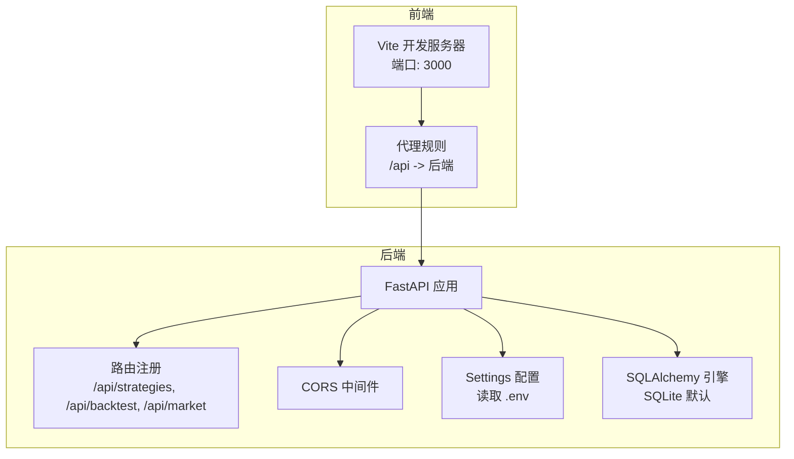
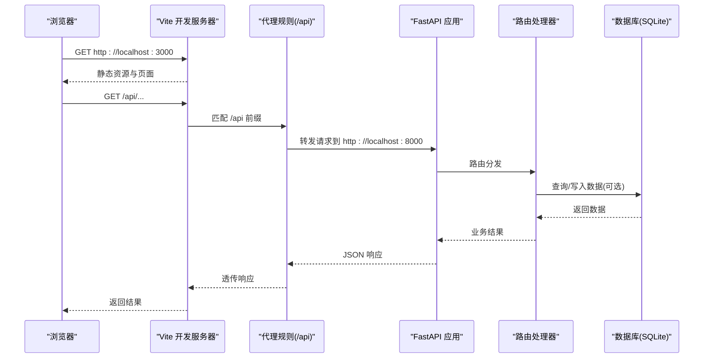
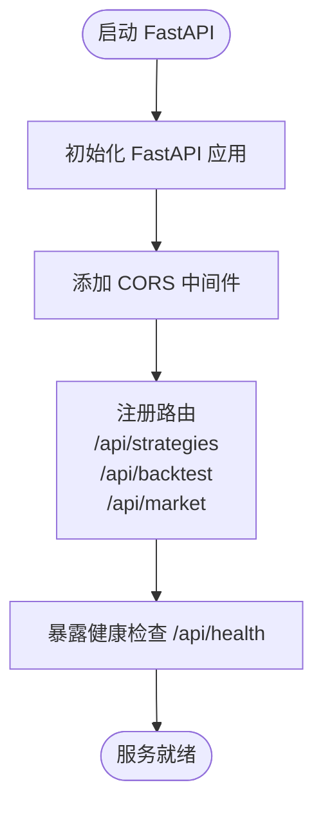
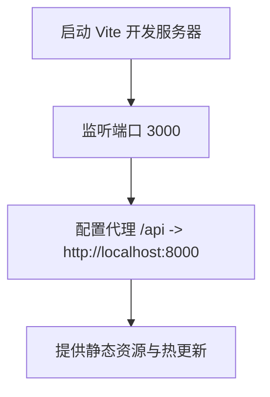
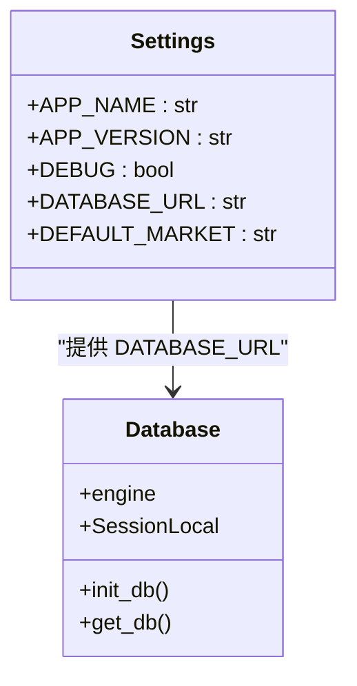
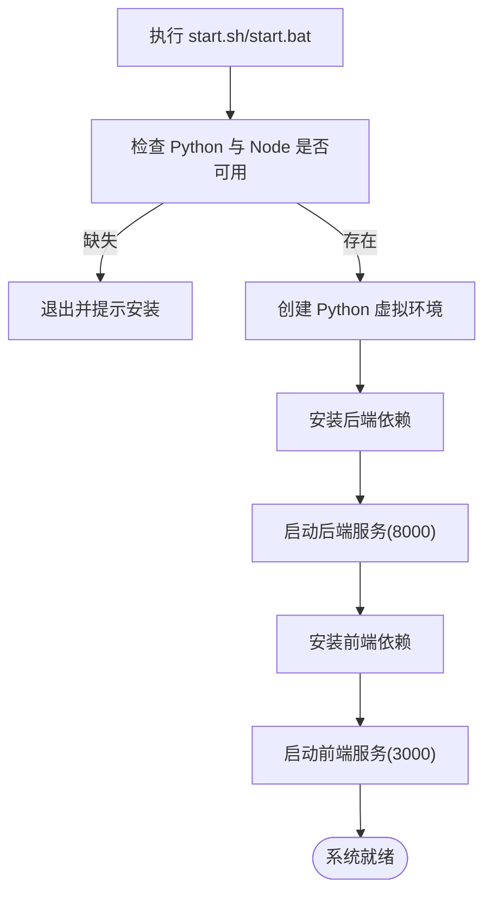
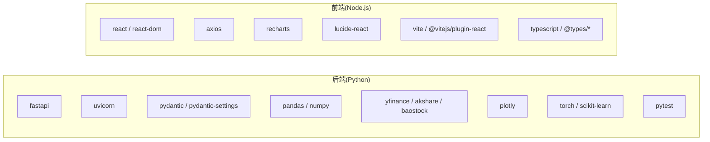

# 环境配置

<cite>
**本文引用的文件**   
- [backend/requirements.txt](file://backend/requirements.txt)
- [frontend/package.json](file://frontend/package.json)
- [backend/app/core/config.py](file://backend/app/core/config.py)
- [backend/main.py](file://backend/main.py)
- [frontend/vite.config.ts](file://frontend/vite.config.ts)
- [backend/app/db/database.py](file://backend/app/db/database.py)
- [start.sh](file://start.sh)
- [start.bat](file://start.bat)
- [QUICKSTART.md](file://QUICKSTART.md)
</cite>

## 目录
1. [简介](#简介)
2. [项目结构](#项目结构)
3. [核心组件](#核心组件)
4. [架构总览](#架构总览)
5. [详细组件分析](#详细组件分析)
6. [依赖关系分析](#依赖关系分析)
7. [性能与扩展性考虑](#性能与扩展性考虑)
8. [故障排查指南](#故障排查指南)
9. [结论](#结论)
10. [附录](#附录)

## 简介
本环境配置文档面向开发者和运维人员，提供从本地开发到生产部署的完整环境搭建流程。内容涵盖：
- Python 与 Node.js 环境要求、虚拟环境创建与依赖安装
- 后端 FastAPI 服务配置（端口、CORS、路由）
- 前端 Vite 开发服务器配置（端口、代理）
- 环境变量与数据库连接配置
- 跨平台兼容性（Windows、Linux、macOS）
- 常见环境问题排查与解决方案（权限、网络代理、系统依赖等）

## 项目结构
本项目采用前后端分离架构：
- 后端使用 FastAPI + Uvicorn，提供 REST API
- 前端使用 React + TypeScript + Vite，提供 Web 界面
- 通过 Vite 开发代理将 /api 请求转发至后端
- 默认使用 SQLite 作为数据库，支持切换为其他数据库

**图表来源**
- [frontend/vite.config.ts:4-14](file://frontend/vite.config.ts#L4-L14)
- [backend/main.py:9-27](file://backend/main.py#L9-L27)
- [backend/app/core/config.py:8-24](file://backend/app/core/config.py#L8-L24)
- [backend/app/db/database.py:9-14](file://backend/app/db/database.py#L9-L14)

**章节来源**
- [QUICKSTART.md:1-8](file://QUICKSTART.md#L1-L8)
- [frontend/package.json:1-28](file://frontend/package.json#L1-L28)
- [backend/requirements.txt:1-16](file://backend/requirements.txt#L1-L16)

## 核心组件
- 后端 FastAPI 应用
  - 启动入口与路由注册
  - CORS 中间件配置
  - Settings 配置类加载 .env
- 前端 Vite 开发服务器
  - 开发端口与代理配置
  - React 插件与构建脚本
- 数据库层
  - SQLAlchemy 引擎与会话管理
  - 默认 SQLite 连接字符串

**章节来源**
- [backend/main.py:9-35](file://backend/main.py#L9-L35)
- [backend/app/core/config.py:8-24](file://backend/app/core/config.py#L8-L24)
- [frontend/vite.config.ts:4-14](file://frontend/vite.config.ts#L4-L14)
- [backend/app/db/database.py:9-28](file://backend/app/db/database.py#L9-L28)

## 架构总览
下图展示开发环境下的请求流转：浏览器访问前端，Vite 将 /api 请求代理到后端 FastAPI；后端根据路由分发到具体接口，必要时访问数据库。

**图表来源**
- [frontend/vite.config.ts:6-13](file://frontend/vite.config.ts#L6-L13)
- [backend/main.py:24-27](file://backend/main.py#L24-L27)
- [backend/app/db/database.py:9-14](file://backend/app/db/database.py#L9-L14)

## 详细组件分析

### 后端 FastAPI 服务配置
- 应用初始化与版本信息
- CORS 中间件允许跨域访问
- 路由注册：策略、回测、市场数据
- 健康检查与根路径

**图表来源**
- [backend/main.py:9-35](file://backend/main.py#L9-L35)

**章节来源**
- [backend/main.py:9-35](file://backend/main.py#L9-L35)

### 前端 Vite 开发服务器配置
- 开发端口：3000
- 代理规则：将 /api 请求转发到 http://localhost:8000
- React 插件启用

**图表来源**
- [frontend/vite.config.ts:4-14](file://frontend/vite.config.ts#L4-L14)

**章节来源**
- [frontend/vite.config.ts:4-14](file://frontend/vite.config.ts#L4-L14)

### 环境变量与数据库连接
- Settings 类从 .env 文件加载配置
- 默认数据库 URL 指向 SQLite 文件
- 可通过环境变量覆盖默认值

**图表来源**
- [backend/app/core/config.py:8-24](file://backend/app/core/config.py#L8-L24)
- [backend/app/db/database.py:9-28](file://backend/app/db/database.py#L9-L28)

**章节来源**
- [backend/app/core/config.py:8-24](file://backend/app/core/config.py#L8-L24)
- [backend/app/db/database.py:9-28](file://backend/app/db/database.py#L9-L28)

### 一键启动脚本（跨平台）
- start.sh（Linux/macOS）
  - 检查 Python3 与 Node
  - 创建并激活 Python 虚拟环境
  - 安装后端依赖
  - 启动 Uvicorn（端口 8000）
  - 安装前端依赖并启动 Vite（端口 3000）
- start.bat（Windows）
  - 检查 Python 与 Node
  - 创建并激活 Python 虚拟环境
  - 安装后端依赖
  - 启动 Uvicorn（端口 8000）
  - 安装前端依赖并启动 Vite（端口 3000）

**图表来源**
- [start.sh:8-53](file://start.sh#L8-L53)
- [start.bat:7-56](file://start.bat#L7-L56)

**章节来源**
- [start.sh:8-53](file://start.sh#L8-L53)
- [start.bat:7-56](file://start.bat#L7-L56)

## 依赖关系分析
- 后端依赖（Python）
  - Web 框架：fastapi、uvicorn
  - 配置与校验：pydantic、pydantic-settings
  - 数据处理：pandas、numpy
  - 数据源：yfinance、akshare、baostock
  - 可视化：plotly
  - 机器学习：torch、scikit-learn
  - 测试：pytest
- 前端依赖（Node.js）
  - React 生态：react、react-dom
  - HTTP 客户端：axios
  - 图表库：recharts
  - 图标库：lucide-react
  - 构建工具：vite、@vitejs/plugin-react
  - 类型定义：typescript、@types/react、@types/react-dom

**图表来源**
- [backend/requirements.txt:1-16](file://backend/requirements.txt#L1-L16)
- [frontend/package.json:13-26](file://frontend/package.json#L13-L26)

**章节来源**
- [backend/requirements.txt:1-16](file://backend/requirements.txt#L1-L16)
- [frontend/package.json:1-28](file://frontend/package.json#L1-L28)

## 性能与扩展性考虑
- 后端
  - 使用 Uvicorn ASGI 服务器，适合高并发 I/O
  - 可结合 Gunicorn 多进程部署提升吞吐
  - 数据库建议在生产环境切换到 PostgreSQL/MySQL 以获得更好并发与持久化能力
- 前端
  - Vite 提供快速冷启动与热更新
  - 生产构建时开启代码分割与压缩优化
- 代理
  - 开发阶段通过 Vite 代理减少跨域问题
  - 生产环境建议使用反向代理（Nginx/Caddy）统一入口与 HTTPS

[本节为通用指导，不直接分析具体文件]

## 故障排查指南

### 环境与版本
- 确保 Python 3.8+、Node.js 16+ 已安装
- 若使用 macOS/Linux，优先使用 python3；Windows 可使用 python

**章节来源**
- [QUICKSTART.md:3-8](file://QUICKSTART.md#L3-L8)

### 虚拟环境创建失败
- 现象：无法创建 venv 或激活失败
- 排查：
  - 确认 Python 可执行文件在 PATH 中
  - Windows 下使用 venv\Scripts\activate；Linux/macOS 使用 source venv/bin/activate
  - 清理旧 venv 后重试

**章节来源**
- [start.sh:28-34](file://start.sh#L28-L34)
- [start.bat:33-39](file://start.bat#L33-L39)

### 依赖安装失败
- 现象：pip install 报错或下载缓慢
- 解决：
  - 更换 pip 镜像源（如阿里云、清华镜像）
  - 对 torch/scikit-learn 等科学计算包，优先使用 CPU 精简版以减小体积
  - 遇到编译错误，检查系统编译器与头文件是否齐全

**章节来源**
- [backend/requirements.txt:1-16](file://backend/requirements.txt#L1-L16)
- [QUICKSTART.md:206-234](file://QUICKSTART.md#L206-L234)

### 前端依赖安装失败
- 现象：npm install 报错或模块缺失
- 解决：
  - 删除 node_modules 与 package-lock.json 后重装
  - 使用国内 npm 镜像源加速

**章节来源**
- [QUICKSTART.md:249-258](file://QUICKSTART.md#L249-L258)

### 端口被占用
- 现象：Address already in use
- 解决：
  - Linux/macOS：释放 8000/3000 端口
  - Windows：结束占用端口的进程或修改启动参数中的端口号

**章节来源**
- [QUICKSTART.md:260-269](file://QUICKSTART.md#L260-L269)

### 网络代理与数据源问题
- 现象：股票数据获取失败，回测显示“模拟数据”
- 解决：
  - 检查网络连接与防火墙设置
  - 配置系统或终端代理（HTTP_PROXY/HTTPS_PROXY）
  - 手动切换数据源（如腾讯财经、YFinance、AKShare、BaoStock）
  - 使用模拟数据进行离线测试

**章节来源**
- [QUICKSTART.md:114-137](file://QUICKSTART.md#L114-L137)
- [QUICKSTART.md:271-279](file://QUICKSTART.md#L271-L279)

### 深度学习相关功能不可用
- 现象：Transformer 深度学习策略不可用
- 解决：
  - 安装 PyTorch（CPU 精简版）与 scikit-learn
  - 确认 Python 虚拟环境中已安装对应包

**章节来源**
- [QUICKSTART.md:281-291](file://QUICKSTART.md#L281-L291)

### 权限问题
- 现象：无法写入 venv 或 node_modules
- 解决：
  - Linux/macOS：避免使用 sudo 安装依赖，改用用户级虚拟环境
  - Windows：以管理员身份运行终端或使用非系统盘路径

[本节为通用指导，不直接分析具体文件]

## 结论
通过本文档，您可以完成以下目标：
- 在 Windows、Linux、macOS 上正确搭建开发与运行环境
- 理解后端 FastAPI 与前端 Vite 的配置要点
- 掌握环境变量与数据库连接的配置方式
- 高效定位和解决常见的环境、网络与依赖问题

[本节为总结性内容，不直接分析具体文件]

## 附录

### 环境变量清单（示例）
- APP_NAME：应用名称
- APP_VERSION：应用版本
- DEBUG：调试模式开关
- DATABASE_URL：数据库连接字符串（默认 SQLite）
- DEFAULT_MARKET：默认市场（CN/US/HK）

说明：
- 上述变量由 Settings 类从 .env 文件加载
- 可在 .env 中覆盖默认值，无需修改代码

**章节来源**
- [backend/app/core/config.py:8-24](file://backend/app/core/config.py#L8-L24)

### 端口与代理配置
- 后端默认端口：8000
- 前端默认端口：3000
- 开发代理：/api -> http://localhost:8000

**章节来源**
- [backend/main.py:24-27](file://backend/main.py#L24-L27)
- [frontend/vite.config.ts:6-13](file://frontend/vite.config.ts#L6-L13)

### 数据库连接配置
- 默认使用 SQLite，数据库文件位于项目根目录
- 可通过 DATABASE_URL 切换为其他数据库（如 PostgreSQL/MySQL）

**章节来源**
- [backend/app/db/database.py:9-14](file://backend/app/db/database.py#L9-L14)
- [backend/app/core/config.py:14-16](file://backend/app/core/config.py#L14-L16)