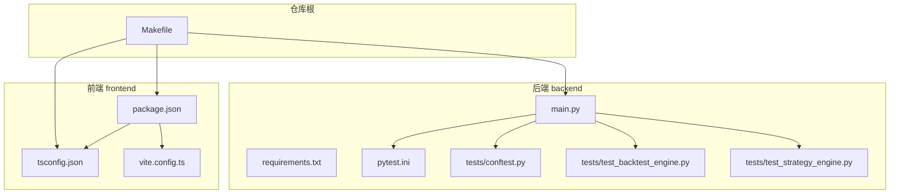
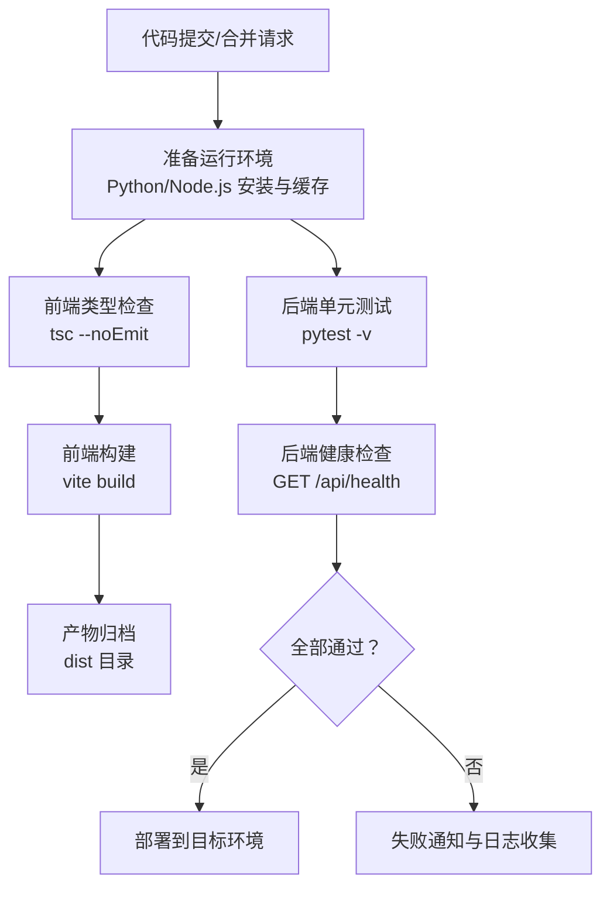
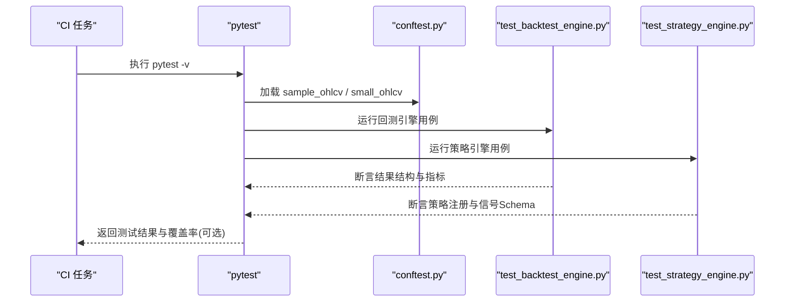
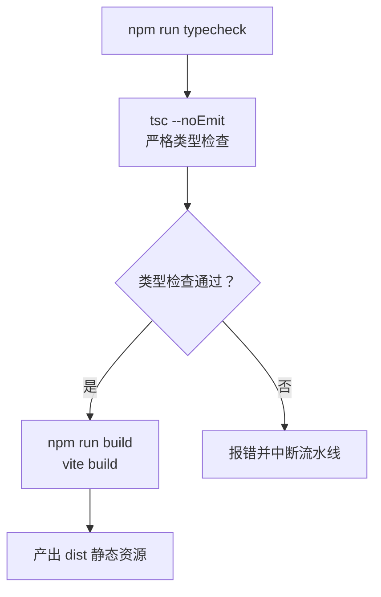
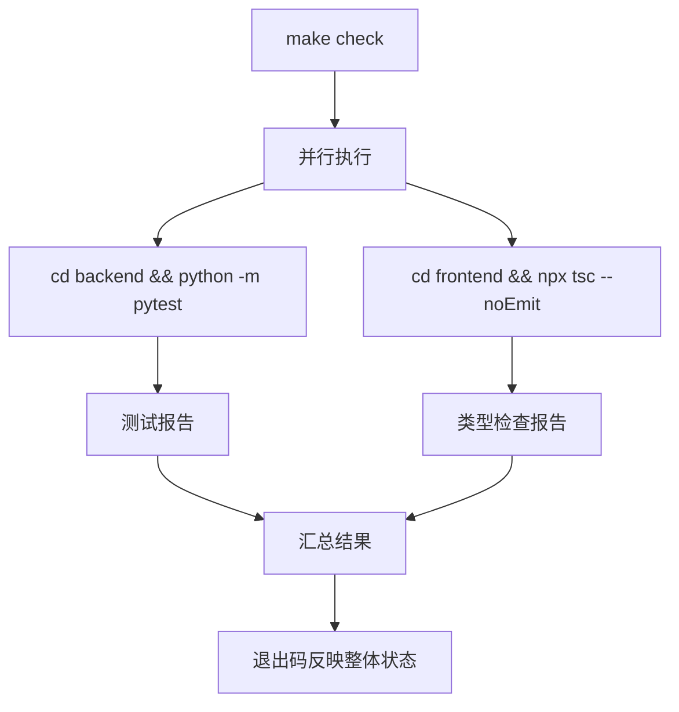
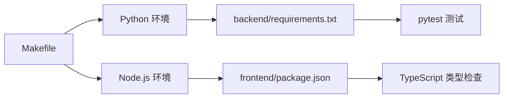

# CI/CD流水线

<cite>
**本文引用的文件**   
- [Makefile](file://Makefile)
- [backend/main.py](file://backend/main.py)
- [backend/requirements.txt](file://backend/requirements.txt)
- [backend/pytest.ini](file://backend/pytest.ini)
- [backend/tests/conftest.py](file://backend/tests/conftest.py)
- [backend/tests/test_backtest_engine.py](file://backend/tests/test_backtest_engine.py)
- [backend/tests/test_strategy_engine.py](file://backend/tests/test_strategy_engine.py)
- [frontend/package.json](file://frontend/package.json)
- [frontend/tsconfig.json](file://frontend/tsconfig.json)
- [frontend/vite.config.ts](file://frontend/vite.config.ts)
</cite>

## 目录
1. [简介](#简介)
2. [项目结构](#项目结构)
3. [核心组件](#核心组件)
4. [架构总览](#架构总览)
5. [详细组件分析](#详细组件分析)
6. [依赖关系分析](#依赖关系分析)
7. [性能与质量保障](#性能与质量保障)
8. [故障排查指南](#故障排查指南)
9. [结论](#结论)
10. [附录：CI/CD 配置示例](#附录cicd-配置示例)

## 简介
本文件为量化策略查看系统的持续集成与持续交付（CI/CD）流水线文档。目标是在代码提交后自动执行代码规范检查、类型检查、单元测试，并在通过后完成前端构建与后端健康检查验证；同时提供分支策略、版本标签管理、回滚机制以及安全扫描、性能测试等高级能力的落地方案。

本项目采用前后端分离架构：
- 后端基于 FastAPI，提供策略、回测与市场数据接口，并包含完整的 pytest 单元测试。
- 前端基于 React + TypeScript + Vite，提供可视化界面，并通过开发代理访问后端 API。

当前仓库未内置 GitHub Actions、Jenkins 或 GitLab CI 的流水线配置文件，因此本文在“附录”中给出可直接落地的多平台配置示例，并结合现有 Makefile、pytest 与 TypeScript 配置进行说明。

## 项目结构
仓库根目录包含后端 backend、前端 frontend 与通用脚本 Makefile。关键职责如下：
- backend：FastAPI 应用、业务模块、数据库与模型、策略引擎、回测引擎、API 路由、pytest 测试。
- frontend：React 应用、TypeScript 类型检查、Vite 构建与开发服务器。
- Makefile：统一入口，聚合后端测试与前端类型检查。

**图表来源**
- [Makefile:1-21](file://Makefile#L1-L21)
- [backend/main.py:1-36](file://backend/main.py#L1-L36)
- [backend/requirements.txt:1-16](file://backend/requirements.txt#L1-L16)
- [backend/pytest.ini:1-7](file://backend/pytest.ini#L1-L7)
- [backend/tests/conftest.py:1-47](file://backend/tests/conftest.py#L1-L47)
- [backend/tests/test_backtest_engine.py:1-179](file://backend/tests/test_backtest_engine.py#L1-L179)
- [backend/tests/test_strategy_engine.py:1-187](file://backend/tests/test_strategy_engine.py#L1-L187)
- [frontend/package.json:1-28](file://frontend/package.json#L1-L28)
- [frontend/tsconfig.json:1-26](file://frontend/tsconfig.json#L1-L26)
- [frontend/vite.config.ts:1-16](file://frontend/vite.config.ts#L1-L16)

**章节来源**
- [Makefile:1-21](file://Makefile#L1-L21)
- [backend/main.py:1-36](file://backend/main.py#L1-L36)
- [frontend/package.json:1-28](file://frontend/package.json#L1-L28)

## 核心组件
- 后端服务入口：FastAPI 应用定义、CORS 中间件、路由注册与健康检查接口。
- 测试框架：pytest 配置与共享 fixtures，覆盖回测引擎与策略引擎的核心路径。
- 前端构建：TypeScript 严格模式类型检查、Vite 构建脚本与开发代理。
- 统一命令：Makefile 聚合 check-backend 与 check-frontend，便于 CI 一键执行。

**章节来源**
- [backend/main.py:1-36](file://backend/main.py#L1-L36)
- [backend/pytest.ini:1-7](file://backend/pytest.ini#L1-L7)
- [backend/tests/conftest.py:1-47](file://backend/tests/conftest.py#L1-L47)
- [backend/tests/test_backtest_engine.py:1-179](file://backend/tests/test_backtest_engine.py#L1-L179)
- [backend/tests/test_strategy_engine.py:1-187](file://backend/tests/test_strategy_engine.py#L1-L187)
- [frontend/package.json:1-28](file://frontend/package.json#L1-L28)
- [frontend/tsconfig.json:1-26](file://frontend/tsconfig.json#L1-L26)
- [frontend/vite.config.ts:1-16](file://frontend/vite.config.ts#L1-L16)
- [Makefile:1-21](file://Makefile#L1-L21)

## 架构总览
下图展示从代码提交到自动化验证的关键流程：触发器 → 环境准备 → 代码质量检查 → 单元测试 → 前端构建 → 后端健康检查。

[本图为概念性流程图，不直接映射具体源码文件]

## 详细组件分析

### 后端服务与测试
- FastAPI 应用启动时启用 CORS，注册策略、回测、市场数据路由，并提供根路径与健康检查接口。
- pytest 配置指定测试目录与命名约定，使用 -v 输出详细信息。
- conftest.py 提供模拟 OHLCV 数据的 fixtures，用于策略与回测测试。
- test_backtest_engine.py 覆盖回测结果结构、指标完整性、交易记录字段与 JSON 序列化安全性。
- test_strategy_engine.py 覆盖策略注册表、工厂函数、信号生成 Schema、边界条件与输入不可变性。

**图表来源**
- [backend/pytest.ini:1-7](file://backend/pytest.ini#L1-L7)
- [backend/tests/conftest.py:1-47](file://backend/tests/conftest.py#L1-L47)
- [backend/tests/test_backtest_engine.py:1-179](file://backend/tests/test_backtest_engine.py#L1-L179)
- [backend/tests/test_strategy_engine.py:1-187](file://backend/tests/test_strategy_engine.py#L1-L187)

**章节来源**
- [backend/main.py:1-36](file://backend/main.py#L1-L36)
- [backend/pytest.ini:1-7](file://backend/pytest.ini#L1-L7)
- [backend/tests/conftest.py:1-47](file://backend/tests/conftest.py#L1-L47)
- [backend/tests/test_backtest_engine.py:1-179](file://backend/tests/test_backtest_engine.py#L1-L179)
- [backend/tests/test_strategy_engine.py:1-187](file://backend/tests/test_strategy_engine.py#L1-L187)

### 前端类型检查与构建
- package.json 定义了 dev/build/preview/typecheck/check 脚本，其中 typecheck 使用 tsc --noEmit 进行纯类型检查。
- tsconfig.json 开启 strict、noUnusedLocals、noUnusedParameters 等严格规则，确保类型安全。
- vite.config.ts 配置开发端口与 /api 代理至本地后端，便于联调。

**图表来源**
- [frontend/package.json:1-28](file://frontend/package.json#L1-L28)
- [frontend/tsconfig.json:1-26](file://frontend/tsconfig.json#L1-L26)
- [frontend/vite.config.ts:1-16](file://frontend/vite.config.ts#L1-L16)

**章节来源**
- [frontend/package.json:1-28](file://frontend/package.json#L1-L28)
- [frontend/tsconfig.json:1-26](file://frontend/tsconfig.json#L1-L26)
- [frontend/vite.config.ts:1-16](file://frontend/vite.config.ts#L1-L16)

### 统一命令与 CI 入口
- Makefile 提供 check、check-backend、check-frontend、install-deps 目标，便于在 CI 中统一调用。
- check-backend 进入 backend 目录执行 pytest。
- check-frontend 进入 frontend 目录执行 npx tsc --noEmit。

**图表来源**
- [Makefile:1-21](file://Makefile#L1-L21)

**章节来源**
- [Makefile:1-21](file://Makefile#L1-L21)

## 依赖关系分析
- 后端依赖 FastAPI、Uvicorn、Pydantic、Pandas、NumPy、yfinance、Plotly、SQLAlchemy、AkShare、Baostock、Torch、Scikit-learn、pytest。
- 前端依赖 React、Axios、Recharts、Lucide React，开发依赖 TypeScript、Vite、React 插件。
- Makefile 作为编排层，串联后端测试与前端类型检查。

**图表来源**
- [Makefile:1-21](file://Makefile#L1-L21)
- [backend/requirements.txt:1-16](file://backend/requirements.txt#L1-L16)
- [frontend/package.json:1-28](file://frontend/package.json#L1-L28)

**章节来源**
- [backend/requirements.txt:1-16](file://backend/requirements.txt#L1-L16)
- [frontend/package.json:1-28](file://frontend/package.json#L1-L28)
- [Makefile:1-21](file://Makefile#L1-L21)

## 性能与质量保障
- 代码质量
  - 后端：pytest 单元测试覆盖回测引擎与策略引擎核心路径，断言结果结构、指标范围与 JSON 序列化安全。
  - 前端：TypeScript 严格模式类型检查，避免运行时类型错误。
- 性能测试
  - 可在 CI 中增加基准测试阶段，对回测引擎在固定数据集上的运行时间进行阈值校验。
- 安全扫描
  - 建议在后端依赖扫描（如 pip-audit）、前端依赖漏洞扫描（如 npm audit）阶段阻断高危漏洞。
- 构建优化
  - 缓存 Python 包与 Node_modules，减少重复安装时间。
  - 前端构建产物可压缩并启用 CDN 缓存策略。

[本节为通用指导，不直接分析具体源码文件]

## 故障排查指南
- 后端测试失败
  - 检查 pytest 配置是否正确加载 tests 目录与命名约定。
  - 确认 fixtures 生成的 OHLCV 数据是否满足策略参数要求。
  - 查看测试输出中的断言失败位置，定位指标缺失或数值异常。
- 前端类型检查失败
  - 根据 tsc 报错信息修复未使用变量、参数或类型不匹配问题。
  - 确认 tsconfig.json 的 include 与 moduleResolution 设置正确。
- 构建失败
  - 检查 Node.js 与 npm 版本是否与 package.json 兼容。
  - 若代理配置异常，确认 vite.config.ts 的 proxy target 指向正确的后端地址。

**章节来源**
- [backend/pytest.ini:1-7](file://backend/pytest.ini#L1-L7)
- [backend/tests/conftest.py:1-47](file://backend/tests/conftest.py#L1-L47)
- [frontend/tsconfig.json:1-26](file://frontend/tsconfig.json#L1-L26)
- [frontend/vite.config.ts:1-16](file://frontend/vite.config.ts#L1-L16)

## 结论
本项目已具备清晰的测试与类型检查基础，配合 Makefile 可实现统一的 CI 入口。建议在仓库中添加平台化的 CI/CD 配置，实现自动化构建、镜像推送与应用部署，并引入分支策略、版本标签管理与回滚机制，以支撑稳定可靠的发布流程。

[本节为总结性内容，不直接分析具体源码文件]

## 附录：CI/CD 配置示例

以下提供 GitHub Actions、Jenkins、GitLab CI 的参考配置思路与步骤说明。由于当前仓库未包含这些平台的配置文件，以下为落地建议与模板指引，请结合团队环境与基础设施进行调整。

### GitHub Actions 流水线建议
- 触发条件
  - push 到 main/master 分支与 pull_request 事件。
- 矩阵构建
  - Python 3.11/3.12 与 Node.js 18/20 矩阵，确保跨版本兼容性。
- 阶段设计
  - 准备环境：安装 Python、Node.js，缓存依赖。
  - 代码质量：后端 pytest、前端 tsc --noEmit。
  - 构建产物：前端 vite build，归档 dist。
  - 后端健康检查：启动 Uvicorn，调用 GET /api/health。
  - 部署：仅 main/master 分支且所有阶段通过时，推送 Docker 镜像并更新部署。
- 分支策略
  - feature/* 分支仅运行 lint 与测试。
  - main/master 分支运行完整流水线并触发部署。
- 版本标签
  - 使用语义化版本（SemVer），在 main/master 合并后打 tag v*.*.*。
- 回滚机制
  - 保留最近 N 个镜像版本，支持快速回滚到上一稳定版本。

[本节为概念性指导，不直接映射具体源码文件]

### Jenkins 流水线建议
- 使用 Declarative Pipeline 定义 stages：checkout、build-backend、build-frontend、test、deploy。
- 利用 Jenkins Agent 池分别运行 Python 与 Node.js 任务。
- 使用 Credentials 管理敏感信息（如镜像仓库凭据）。
- 使用 Artifact 归档前端构建产物与测试报告。
- 使用 Post-build Actions 发送通知（邮件/Slack）。

[本节为概念性指导，不直接映射具体源码文件]

### GitLab CI 流水线建议
- 使用 .gitlab-ci.yml 定义 stages：lint、test、build、deploy。
- 使用 cache 加速依赖安装。
- 使用 rules 控制仅在特定分支或标签触发部署。
- 使用 artifacts 保存测试报告与构建产物。
- 使用 variables 管理环境变量与镜像仓库地址。

[本节为概念性指导，不直接映射具体源码文件]

### 镜像推送与应用部署
- 镜像构建
  - 后端：基于官方 Python 镜像，复制 backend 目录，安装 requirements.txt，暴露端口并启动 Uvicorn。
  - 前端：基于 Nginx 镜像，复制 dist 目录，配置反向代理到后端。
- 推送镜像
  - 登录镜像仓库，推送带语义化版本的镜像标签。
- 应用部署
  - 使用 Kubernetes Deployment/Service 或容器编排平台滚动更新。
  - 部署完成后执行健康检查，失败则自动回滚。

[本节为概念性指导，不直接映射具体源码文件]

### 分支策略与版本标签管理
- 分支模型
  - main/master：稳定分支，仅接受经过完整测试的代码。
  - develop：集成分支，日常开发合并。
  - feature/*：功能分支，完成后合并至 develop。
  - release/*：预发布分支，进行回归测试与验收。
- 版本标签
  - 使用 git tag v*.*.* 标记发布版本。
  - 在 CI 中解析标签并生成变更日志。

[本节为概念性指导，不直接映射具体源码文件]

### 回滚机制
- 镜像回滚
  - 保留历史镜像，支持按版本号回滚。
- 配置回滚
  - 将应用配置外置（环境变量或配置中心），支持热更新。
- 数据迁移
  - 数据库迁移脚本需幂等，支持向前与向后回滚。

[本节为概念性指导，不直接映射具体源码文件]

### 高级功能：性能测试与安全扫描
- 性能测试
  - 在 CI 中增加基准测试阶段，对比历史性能指标，设置阈值告警。
- 安全扫描
  - 后端：pip-audit 扫描已知漏洞。
  - 前端：npm audit 扫描依赖漏洞。
  - 容器镜像：Trivy 扫描镜像漏洞。

[本节为概念性指导，不直接映射具体源码文件]