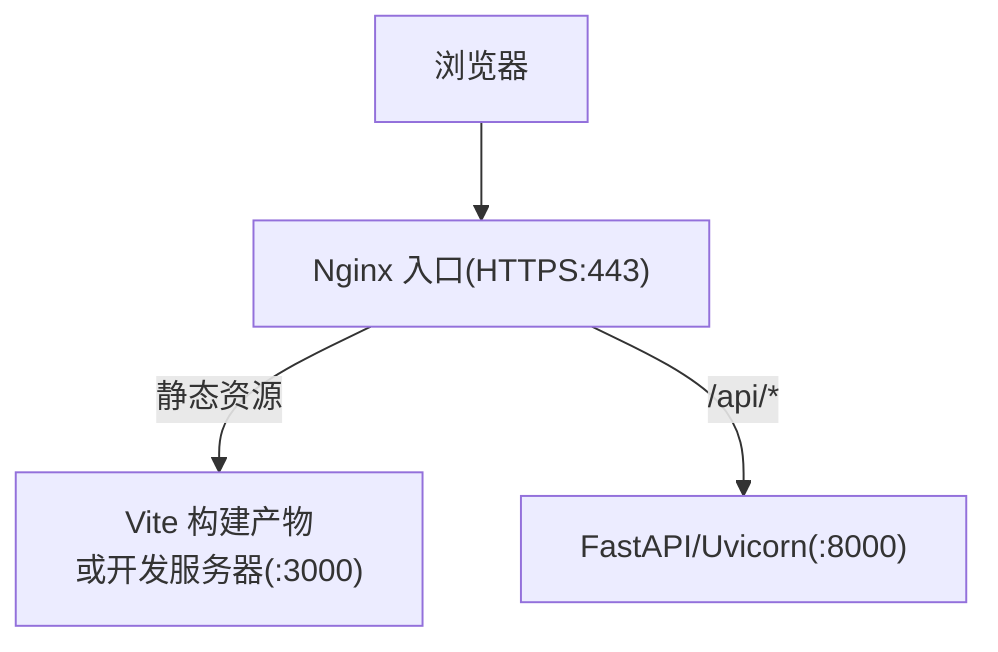
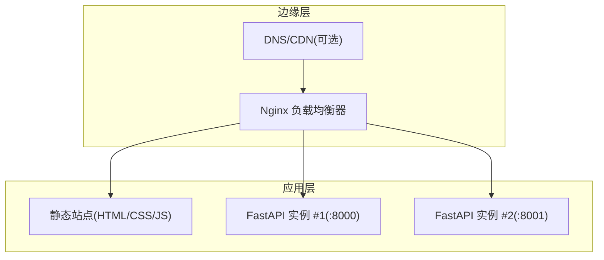
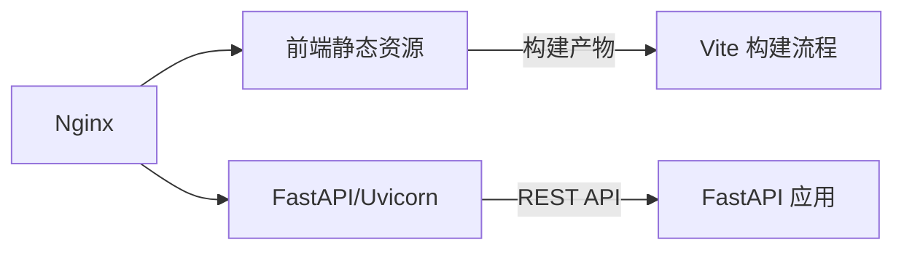
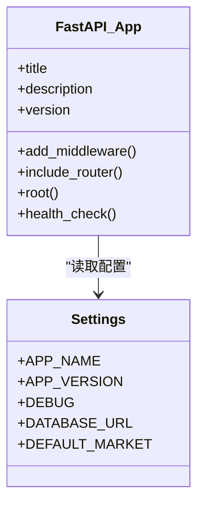
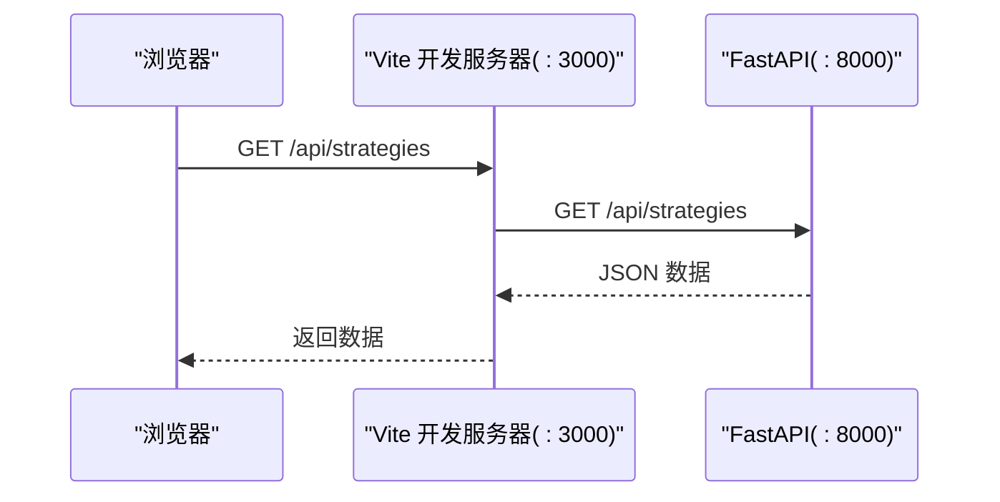

# Web服务器配置

<cite>
**本文引用的文件**   
- [QUICKSTART.md](file://QUICKSTART.md)
- [backend/main.py](file://backend/main.py)
- [backend/app/core/config.py](file://backend/app/core/config.py)
- [frontend/vite.config.ts](file://frontend/vite.config.ts)
- [frontend/package.json](file://frontend/package.json)
</cite>

## 目录
1. [简介](#简介)
2. [项目结构](#项目结构)
3. [核心组件](#核心组件)
4. [架构总览](#架构总览)
5. [详细组件分析](#详细组件分析)
6. [依赖关系分析](#依赖关系分析)
7. [性能考虑](#性能考虑)
8. [故障排除指南](#故障排除指南)
9. [结论](#结论)
10. [附录](#附录)

## 简介
本指南面向部署与运维人员，提供基于 Nginx 的完整 Web 服务器配置方案，覆盖反向代理、SSL/HTTPS、负载均衡、静态资源缓存、Gzip 压缩、CORS、请求头与安全头部、性能调优、连接池与超时、WebSocket、文件上传限制、访问日志与错误日志管理、监控与排错。文档结合仓库中后端 FastAPI 服务与前端 Vite 开发服务器的实际行为，给出生产环境可落地的配置建议与最佳实践。

## 项目结构
本项目包含前后端两个独立服务：
- 后端：FastAPI + Uvicorn，默认监听本地端口 8000，暴露 REST API 与 OpenAPI 文档。
- 前端：Vite 开发服务器，默认监听本地端口 3000，并通过内置代理将 /api 转发到后端。

**图示来源**
- [QUICKSTART.md:25-64](file://QUICKSTART.md#L25-L64)
- [frontend/vite.config.ts:4-14](file://frontend/vite.config.ts#L4-L14)

**章节来源**
- [QUICKSTART.md:25-64](file://QUICKSTART.md#L25-L64)
- [frontend/vite.config.ts:4-14](file://frontend/vite.config.ts#L4-L14)

## 核心组件
- 后端应用：FastAPI 应用实例，注册路由并启用 CORS 中间件。
- 配置中心：Pydantic Settings 读取环境变量与 .env 文件。
- 前端开发服务器：Vite 提供热更新与 API 代理。

关键实现要点（不展示代码内容）：
- FastAPI 应用创建、CORS 中间件启用、路由注册与健康检查端点定义。
- Settings 类定义应用名、版本、调试开关、数据库 URL、默认市场等配置项，支持从 .env 加载。
- Vite 开发服务器端口与 /api 代理目标指向本地后端。

**章节来源**
- [backend/main.py:1-36](file://backend/main.py#L1-L36)
- [backend/app/core/config.py:1-25](file://backend/app/core/config.py#L1-L25)
- [frontend/vite.config.ts:4-14](file://frontend/vite.config.ts#L4-L14)

## 架构总览
生产环境推荐拓扑：
- Nginx 作为统一入口，终止 TLS，提供 HTTPS。
- 静态资源由 Nginx 直接响应，减少后端压力。
- API 请求经 Nginx 反向代理至后端 FastAPI 服务。
- 可选：多后端实例通过 upstream 实现负载均衡；WebSocket 通过 upgrade 透传。

[此图为概念性架构图，无需图示来源]

## 详细组件分析

### Nginx 反向代理与 HTTPS
- 监听 443 端口，启用 SSL，指定证书与私钥路径。
- 使用 http2 提升并发性能。
- 将 /api 路径反向代理到后端 FastAPI 服务。
- 为 OpenAPI 文档(/docs, /redoc)设置安全策略，避免在生产环境暴露敏感信息。

参考要点（不展示具体配置内容）：
- server 块监听 443 ssl http2。
- ssl_certificate 与 ssl_certificate_key 指向证书文件。
- location /api 使用 proxy_pass 指向后端上游。
- location /docs 与 /redoc 根据需求限制访问或关闭。

**章节来源**
- [QUICKSTART.md:25-64](file://QUICKSTART.md#L25-L64)

### 负载均衡与高可用
- 使用 upstream 定义多个后端实例，按权重或轮询分发。
- 健康检查：结合 Nginx plus 或第三方模块进行主动探测；或使用外部健康检查脚本配合 keepalived 做主备切换。
- 会话保持：如需状态化，可使用 ip_hash 或 cookie 持久化。

参考要点（不展示具体配置内容）：
- upstream backend_servers { ... }
- server 指令分配权重与 down 标记。
- location /api 使用 proxy_pass http://backend_servers;

**章节来源**
- [QUICKSTART.md:25-64](file://QUICKSTART.md#L25-L64)

### 静态资源缓存策略
- 对 HTML、CSS、JS、图片等资源设置合适的 Cache-Control 与 ETag。
- 开启 gzip/brotli 压缩以减少传输体积。
- 针对长缓存资源采用文件名哈希（构建时生成），便于 CDN 缓存更新。

参考要点（不展示具体配置内容）：
- location ~* \.(js|css|png|jpg|jpeg|gif|ico)$ 设置 expires 与 cache-control。
- add_header Cache-Control "public, max-age=...";
- gzip_types 包含 text/css、application/javascript 等。

**章节来源**
- [frontend/package.json:6-11](file://frontend/package.json#L6-L11)

### Gzip 压缩配置
- 启用 gzip 与 gzip_comp_level/gzip_min_length。
- 仅对文本类型启用压缩，避免二进制文件重复压缩。
- 在 Nginx 层压缩，减轻后端压力。

参考要点（不展示具体配置内容）：
- gzip on;
- gzip_types text/plain text/css application/json application/javascript;
- gzip_vary on;

**章节来源**
- [frontend/package.json:6-11](file://frontend/package.json#L6-L11)

### CORS 跨域与安全头部
- 后端已启用 FastAPI CORSMiddleware，允许所有来源与方法，适合开发环境。
- 生产环境建议收紧 allow_origins 为具体域名，并显式声明允许的头部与方法。
- 在 Nginx 层补充安全头部：X-Frame-Options、X-Content-Type-Options、Strict-Transport-Security、Referrer-Policy、Permissions-Policy 等。

参考要点（不展示具体配置内容）：
- add_header X-Frame-Options "SAMEORIGIN";
- add_header X-Content-Type-Options "nosniff";
- add_header Strict-Transport-Security "max-age=...; includeSubDomains";
- add_header Referrer-Policy "strict-origin-when-cross-origin";

**章节来源**
- [backend/main.py:15-22](file://backend/main.py#L15-L22)

### WebSocket 支持
- FastAPI 原生支持 WebSocket，Nginx 需透传 Upgrade 与 Connection 头。
- 在 location /ws 或特定路径下启用 proxy_http_version 1.1、proxy_set_header Upgrade $http_upgrade、Connection "upgrade"。

参考要点（不展示具体配置内容）：
- location /ws {
    proxy_pass http://backend;
    proxy_http_version 1.1;
    proxy_set_header Upgrade $http_upgrade;
    proxy_set_header Connection "upgrade";
  }

**章节来源**
- [QUICKSTART.md:25-64](file://QUICKSTART.md#L25-L64)

### 文件上传限制
- 在 Nginx 层设置 client_max_body_size 限制上传大小。
- 在后端 FastAPI 中也可设置最大文件大小校验，双重保护。

参考要点（不展示具体配置内容）：
- client_max_body_size 10m;
- 后端校验上传字段大小与类型。

**章节来源**
- [QUICKSTART.md:25-64](file://QUICKSTART.md#L25-L64)

### 访问日志与错误日志管理
- 自定义 access_log 与 error_log 格式，记录客户端 IP、请求时间、方法、URI、状态码、耗时等。
- 按天或按月轮转，保留合理周期，避免磁盘占满。
- 对敏感 URI（如 /docs）单独记录或屏蔽。

参考要点（不展示具体配置内容）：
- log_format main '$remote_addr - $remote_user [$time_local] "$request" '
                  '$status $body_bytes_sent "$http_referer" '
                  '"$http_user_agent" "$http_x_forwarded_for"';
- access_log /var/log/nginx/access.log main;
- error_log /var/log/nginx/error.log warn;

**章节来源**
- [QUICKSTART.md:25-64](file://QUICKSTART.md#L25-L64)

### 性能调优参数
- worker_processes auto;
- worker_connections 与 multi_accept on;
- sendfile on; tcp_nopush on; tcp_nodelay on;
- keepalive_timeout 与 keepalive_requests;
- proxy_connect_timeout、proxy_send_timeout、proxy_read_timeout;
- 调整后端进程数与线程数（Uvicorn workers）。

参考要点（不展示具体配置内容）：
- events { worker_connections 1024; multi_accept on; }
- http { sendfile on; tcp_nopush on; tcp_nodelay on; keepalive_timeout 65; }
- upstream/backend 与 location 中的 proxy_*_timeout 设置。

**章节来源**
- [QUICKSTART.md:25-64](file://QUICKSTART.md#L25-L64)

### 连接池与超时设置
- Nginx 与后端之间使用 HTTP/1.1 长连接，减少握手开销。
- 合理设置 proxy_connect_timeout、proxy_send_timeout、proxy_read_timeout，避免慢请求堆积。
- 后端 Uvicorn 的 workers 数量建议设置为 CPU 核数的 2-4 倍。

参考要点（不展示具体配置内容）：
- proxy_http_version 1.1;
- proxy_set_header Connection "";
- proxy_connect_timeout 5s; proxy_send_timeout 30s; proxy_read_timeout 60s;

**章节来源**
- [QUICKSTART.md:25-64](file://QUICKSTART.md#L25-L64)

### 前端代理与开发体验
- Vite 开发服务器将 /api 代理到后端，便于本地联调。
- 生产环境应使用 Nginx 统一代理，不再依赖前端代理。

参考要点（不展示具体配置内容）：
- server.proxy['/api'] 指向 http://localhost:8000。

**章节来源**
- [frontend/vite.config.ts:4-14](file://frontend/vite.config.ts#L4-L14)

## 依赖关系分析
- 后端 FastAPI 应用依赖 Uvicorn 作为 ASGI 服务器。
- 前端 Vite 开发服务器依赖 Node.js 生态，并在开发阶段代理后端 API。
- 生产环境通过 Nginx 解耦前端静态资源与后端 API，降低耦合度。

**图示来源**
- [backend/main.py:1-36](file://backend/main.py#L1-L36)
- [frontend/vite.config.ts:4-14](file://frontend/vite.config.ts#L4-L14)

**章节来源**
- [backend/main.py:1-36](file://backend/main.py#L1-L36)
- [frontend/vite.config.ts:4-14](file://frontend/vite.config.ts#L4-L14)

## 性能考虑
- 静态资源优先由 Nginx 处理，开启 gzip/brotli 与强缓存。
- 后端只处理动态 API，减少不必要的计算与 I/O。
- 合理设置 worker 与连接数，避免上下文切换过多。
- 使用 HTTP/2 与 Keep-Alive 提升并发能力。
- 对大响应体启用分块传输与流式输出。
- 监控关键指标：QPS、延迟、错误率、CPU/内存、连接数、带宽。

[本节为通用指导，无需章节来源]

## 故障排除指南
常见问题与定位步骤：
- 无法访问 HTTPS：检查证书路径与权限、Nginx 是否成功加载证书、防火墙放行 443。
- 404/502 错误：确认 Nginx 反向代理目标可达、后端服务运行正常、端口与协议匹配。
- CORS 报错：核对后端 allow_origins 与前端域名一致，必要时在 Nginx 层添加 Access-Control-* 头。
- WebSocket 断开：检查 Upgrade 与 Connection 头是否正确透传，后端是否支持 WS。
- 上传失败：检查 client_max_body_size 与后端校验逻辑。
- 性能瓶颈：观察 Nginx 与后端日志，定位慢请求与热点接口，优化查询与缓存。

**章节来源**
- [QUICKSTART.md:236-291](file://QUICKSTART.md#L236-L291)

## 结论
通过 Nginx 统一入口、HTTPS 终止、静态资源缓存与压缩、合理的反向代理与安全头部，可将前端与后端解耦，获得更高的安全性与性能。结合负载均衡、WebSocket 透传、上传限制与完善的日志监控，可在生产环境中稳定运行。建议逐步收紧 CORS 与安全策略，持续监控与优化关键指标。

[本节为总结性内容，无需章节来源]

## 附录

### 后端 FastAPI 应用结构概览
- 应用初始化、CORS 中间件、路由注册、根路径与健康检查端点。
- 配置类集中管理环境变量与默认值。

**图示来源**
- [backend/main.py:9-35](file://backend/main.py#L9-L35)
- [backend/app/core/config.py:8-24](file://backend/app/core/config.py#L8-L24)

**章节来源**
- [backend/main.py:1-36](file://backend/main.py#L1-L36)
- [backend/app/core/config.py:1-25](file://backend/app/core/config.py#L1-L25)

### 前端开发服务器代理流程
- Vite 开发服务器监听 3000 端口。
- 将 /api 请求代理到 http://localhost:8000。

**图示来源**
- [frontend/vite.config.ts:4-14](file://frontend/vite.config.ts#L4-L14)
- [QUICKSTART.md:45-64](file://QUICKSTART.md#L45-L64)

**章节来源**
- [frontend/vite.config.ts:4-14](file://frontend/vite.config.ts#L4-L14)
- [QUICKSTART.md:45-64](file://QUICKSTART.md#L45-L64)