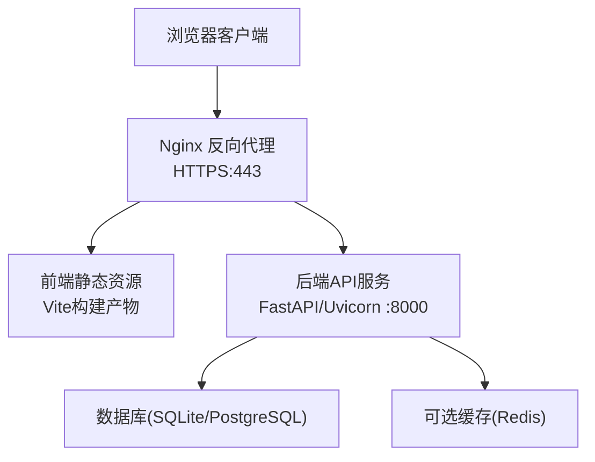
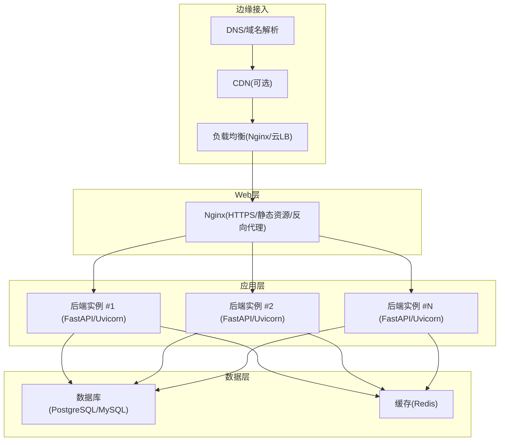
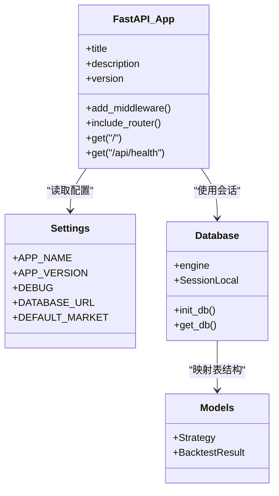
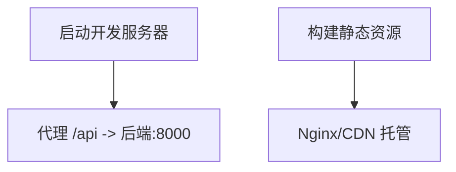
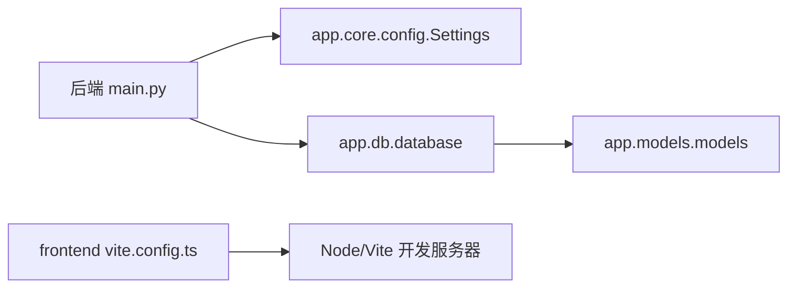
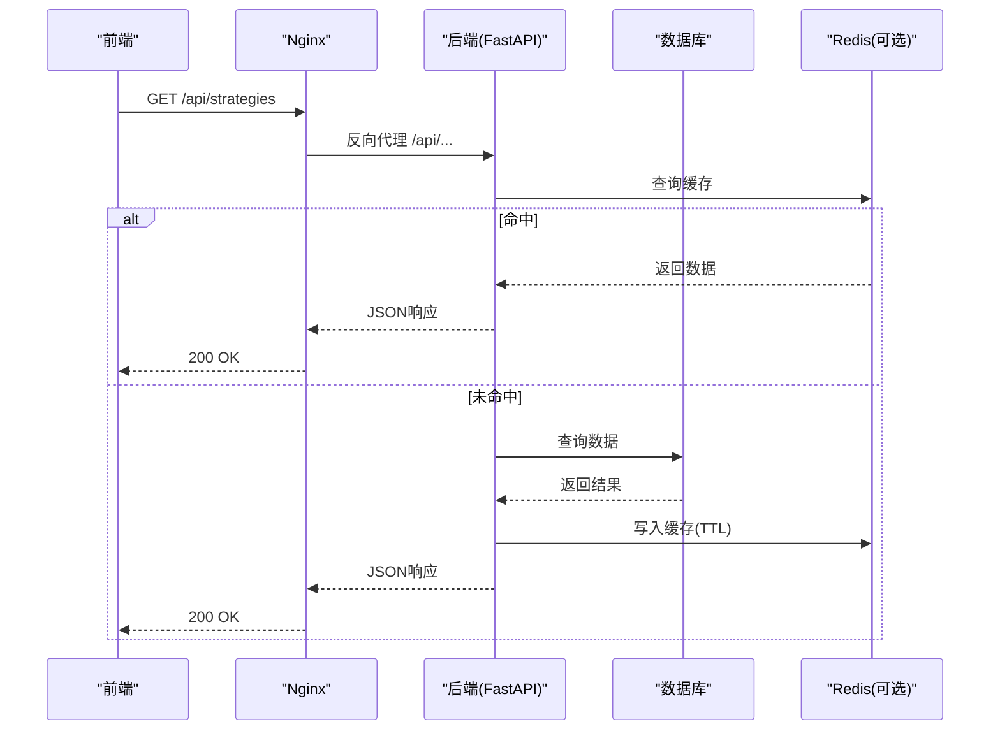

# 生产部署

<cite>
**本文引用的文件**   
- [backend/main.py](file://backend/main.py)
- [backend/app/core/config.py](file://backend/app/core/config.py)
- [backend/app/db/database.py](file://backend/app/db/database.py)
- [backend/app/models/models.py](file://backend/app/models/models.py)
- [backend/requirements.txt](file://backend/requirements.txt)
- [frontend/package.json](file://frontend/package.json)
- [frontend/vite.config.ts](file://frontend/vite.config.ts)
- [Makefile](file://Makefile)
- [start.sh](file://start.sh)
</cite>

## 目录
1. [简介](#简介)
2. [项目结构](#项目结构)
3. [核心组件](#核心组件)
4. [架构总览](#架构总览)
5. [详细组件分析](#详细组件分析)
6. [依赖关系分析](#依赖关系分析)
7. [性能与容量规划](#性能与容量规划)
8. [容器化与编排](#容器化与编排)
9. [反向代理与SSL](#反向代理与ssl)
10. [进程管理与高可用](#进程管理与高可用)
11. [数据库与缓存](#数据库与缓存)
12. [前端静态资源与CDN](#前端静态资源与cdn)
13. [自动化部署与CI/CD](#自动化部署与cicd)
14. [版本管理与回滚策略](#版本管理与回滚策略)
15. [故障排查指南](#故障排查指南)
16. [结论](#结论)

## 简介
本指南面向将“量化策略查看系统”从开发环境平滑迁移到生产环境的工程师与运维人员。文档覆盖后端FastAPI服务、前端React/Vite应用、反向代理与SSL、进程管理、负载均衡、数据库与缓存、容器化与编排、CI/CD流水线、版本管理与回滚，以及性能调优与监控告警等生产关键主题。所有建议均结合仓库现有代码结构与配置进行说明，确保可落地执行。

## 项目结构
仓库采用前后端分离：
- 后端：Python FastAPI + Uvicorn，默认监听 8000 端口，提供 /api/* 接口与健康检查 /api/health。
- 前端：React + Vite，默认开发监听 3000 端口，通过代理转发 /api 到后端。
- 根级脚本：Makefile 用于统一测试与依赖安装；start.sh 用于本地一键启动前后端。

**图表来源**
- [backend/main.py:9-35](file://backend/main.py#L9-L35)
- [frontend/vite.config.ts:4-15](file://frontend/vite.config.ts#L4-L15)

**章节来源**
- [backend/main.py:1-36](file://backend/main.py#L1-L36)
- [frontend/vite.config.ts:1-16](file://frontend/vite.config.ts#L1-L16)
- [Makefile:1-21](file://Makefile#L1-L21)
- [start.sh:1-69](file://start.sh#L1-L69)

## 核心组件
- 后端入口与路由：FastAPI 应用初始化、CORS 中间件、路由注册与健康检查。
- 配置中心：基于 pydantic-settings 的环境变量加载（支持 .env）。
- 数据层：SQLAlchemy 引擎与会话管理，模型定义策略与回测结果表。
- 前端构建：Vite + React，开发模式代理 /api 到后端。
- 构建与验证：Makefile 聚合 pytest 与 TypeScript 类型检查。

**章节来源**
- [backend/main.py:9-35](file://backend/main.py#L9-L35)
- [backend/app/core/config.py:8-24](file://backend/app/core/config.py#L8-L24)
- [backend/app/db/database.py:9-28](file://backend/app/db/database.py#L9-L28)
- [backend/app/models/models.py:11-44](file://backend/app/models/models.py#L11-L44)
- [frontend/vite.config.ts:4-15](file://frontend/vite.config.ts#L4-L15)
- [Makefile:1-21](file://Makefile#L1-L21)

## 架构总览
生产环境推荐拓扑：
- 用户流量经 Nginx 进入，HTTPS 终止，静态资源直接返回，API 请求反向代理至后端集群。
- 后端多实例运行于独立容器或进程组，共享外部数据库与缓存。
- 前端构建产物由 Nginx 托管或通过 CDN 分发。

[本图为概念性架构图，不直接映射具体源码文件]

## 详细组件分析

### 后端服务（FastAPI + Uvicorn）
- 应用初始化：设置标题、描述、版本，启用 CORS 中间件允许跨域访问。
- 路由组织：按模块拆分策略、回测、市场数据 API，统一前缀 /api/strategies、/api/backtest、/api/market。
- 健康检查：/api/health 返回状态，供探针与负载均衡器使用。
- 配置加载：Settings 类从环境变量或 .env 读取 APP_NAME、APP_VERSION、DEBUG、DATABASE_URL、DEFAULT_MARKET。

**图表来源**
- [backend/main.py:9-35](file://backend/main.py#L9-L35)
- [backend/app/core/config.py:8-24](file://backend/app/core/config.py#L8-L24)
- [backend/app/db/database.py:9-28](file://backend/app/db/database.py#L9-L28)
- [backend/app/models/models.py:11-44](file://backend/app/models/models.py#L11-L44)

**章节来源**
- [backend/main.py:9-35](file://backend/main.py#L9-L35)
- [backend/app/core/config.py:8-24](file://backend/app/core/config.py#L8-L24)
- [backend/app/db/database.py:9-28](file://backend/app/db/database.py#L9-L28)
- [backend/app/models/models.py:11-44](file://backend/app/models/models.py#L11-L44)

### 前端应用（React + Vite）
- 开发服务器：监听 3000 端口，并将 /api 请求代理到 http://localhost:8000。
- 构建脚本：npm run build 输出静态资源，适合由 Nginx 托管或上传至 CDN。
- 依赖管理：package.json 声明运行时与开发时依赖。

**图表来源**
- [frontend/vite.config.ts:4-15](file://frontend/vite.config.ts#L4-L15)
- [frontend/package.json:6-12](file://frontend/package.json#L6-L12)

**章节来源**
- [frontend/vite.config.ts:1-16](file://frontend/vite.config.ts#L1-L16)
- [frontend/package.json:1-28](file://frontend/package.json#L1-L28)

### 构建与验证（Makefile）
- check-backend：运行 pytest 对后端进行测试。
- check-frontend：TypeScript 类型检查。
- install-deps：安装 Python 与 Node 依赖。

**章节来源**
- [Makefile:1-21](file://Makefile#L1-L21)

### 本地启动脚本（start.sh）
- 检查 Python3 与 Node 是否安装。
- 创建并激活 Python 虚拟环境，安装 requirements.txt。
- 启动 Uvicorn（--reload, port=8000）与前端 dev server（port=3000）。
- 捕获中断信号并清理子进程。

**章节来源**
- [start.sh:1-69](file://start.sh#L1-L69)

## 依赖关系分析
- 后端依赖：FastAPI、Uvicorn、Pydantic、SQLAlchemy、pandas/numpy、yfinance、akshare/baostock、torch/scikit-learn、pytest。
- 前端依赖：React、Recharts、Axios、Lucide图标库；开发依赖 Vite、TypeScript、React插件。

**图表来源**
- [backend/main.py:9-35](file://backend/main.py#L9-L35)
- [backend/app/core/config.py:8-24](file://backend/app/core/config.py#L8-L24)
- [backend/app/db/database.py:9-28](file://backend/app/db/database.py#L9-L28)
- [backend/app/models/models.py:11-44](file://backend/app/models/models.py#L11-L44)
- [frontend/vite.config.ts:4-15](file://frontend/vite.config.ts#L4-L15)

**章节来源**
- [backend/requirements.txt:1-16](file://backend/requirements.txt#L1-L16)
- [frontend/package.json:13-26](file://frontend/package.json#L13-L26)

## 性能与容量规划
- 后端并发与线程
  - Uvicorn workers：根据CPU核数设置 worker 数量，通常等于CPU核数或核数×2。
  - GIL限制：I/O密集型任务可受益于多线程worker；计算密集型建议使用多进程workers。
  - 连接池：数据库连接池大小需与workers和并发量匹配，避免连接耗尽。
- 内存与GC
  - 为每个worker设置合理内存上限，配合进程管理器自动重启异常进程。
  - 针对大数据处理（如pandas/torch）注意分块处理与显存/内存释放。
- 前端优化
  - 开启Gzip/Brotli压缩，静态资源长缓存（Cache-Control），按需懒加载组件。
  - 图片与图表资源走CDN，减少主站带宽压力。
- 数据库与缓存
  - 读写分离、连接池参数、慢查询日志与索引优化。
  - Redis作为热点数据缓存，设置过期策略与持久化方案。

[本节为通用指导，不直接分析具体文件]

## 容器化与编排
- 后端镜像
  - 基础镜像：选择精简的Python镜像（如 python:3.11-slim）。
  - 依赖安装：复制 requirements.txt 并 pip install --no-cache-dir。
  - 运行命令：uvicorn main:app --host 0.0.0.0 --port 8000 --workers <N>。
  - 健康检查：HTTP GET /api/health。
- 前端镜像
  - 构建阶段：node 镜像执行 npm ci && npm run build。
  - 运行阶段：nginx 镜像托管 dist 目录，或直接由 Nginx 反向代理静态资源。
- 编排建议
  - 使用 Docker Compose 在单机编排后端、数据库、Redis、Nginx。
  - 生产环境推荐使用 Kubernetes Deployment/Service/HPA，实现弹性扩缩容与滚动更新。

[本节为通用指导，不直接分析具体文件]

## 反向代理与SSL
- Nginx 角色
  - HTTPS 终止：证书与私钥由 Nginx 管理，前端静态资源直接返回。
  - 反向代理：/api 转发至后端集群（多个 upstream 节点）。
  - 安全头：HSTS、X-Frame-Options、CSP 等。
- SSL 证书
  - 使用 Let’s Encrypt 自动续期，证书路径挂载到容器。
  - 强制 HTTPS，HTTP 301 重定向。
- 负载均衡
  - upstream 轮询或加权，健康检查失败自动摘除。
  - 超时与重试策略：合理设置 proxy_connect_timeout、proxy_read_timeout。

[本节为通用指导，不直接分析具体文件]

## 进程管理与高可用
- systemd（Linux）
  - 定义 service 文件，指定 WorkingDirectory、User、ExecStart（uvicorn）、Restart=always、EnvironmentFile（.env）。
  - 使用 journalctl 查看日志，systemctl enable/start/stop/restart 管理服务。
- PM2（Node生态，也可用于Python）
  - 使用 pm2 start 启动 uvicorn，配置 max_memory_restart、instances、watch。
  - 日志轮转与监控面板便于日常运维。
- 健康检查与自愈
  - 后端暴露 /api/health，系统探针定期探测，失败则重启或摘除节点。
  - 数据库连接失败时快速失败并记录错误，避免雪崩。

**章节来源**
- [backend/main.py:33-35](file://backend/main.py#L33-L35)

## 数据库与缓存
- 数据库
  - 当前默认 SQLite（settings.DATABASE_URL），适合开发与轻量场景。
  - 生产建议切换至 PostgreSQL/MySQL，调整连接池、事务隔离级别与备份策略。
  - 初始化：启动时调用 init_db 创建表结构。
- 缓存
  - 引入 Redis 作为热点数据缓存（如行情快照、策略参数缓存）。
  - 设置合理的 TTL 与淘汰策略，保证一致性。

**图表来源**
- [backend/app/db/database.py:17-28](file://backend/app/db/database.py#L17-L28)
- [backend/app/core/config.py:14-18](file://backend/app/core/config.py#L14-L18)

**章节来源**
- [backend/app/db/database.py:9-28](file://backend/app/db/database.py#L9-L28)
- [backend/app/core/config.py:14-18](file://backend/app/core/config.py#L14-L18)

## 前端静态资源与CDN
- 构建产物
  - npm run build 生成 dist 目录，包含HTML/CSS/JS与静态资源。
  - 建议开启 gzip/brotli 压缩，并为静态资源设置长期缓存。
- CDN 集成
  - 将 dist 内容上传至对象存储（OSS/S3）并通过 CDN 分发。
  - 配置版本号或哈希文件名，便于缓存失效与灰度发布。
- 代理与跨域
  - 开发阶段通过 Vite proxy 转发 /api 到后端。
  - 生产阶段由 Nginx 统一处理跨域与安全头。

**章节来源**
- [frontend/package.json:6-12](file://frontend/package.json#L6-L12)
- [frontend/vite.config.ts:6-14](file://frontend/vite.config.ts#L6-L14)

## 自动化部署与CI/CD
- 构建与测试
  - CI 触发条件：push/PR 到 main/release 分支。
  - 步骤：安装依赖、运行 make check（pytest + tsc）、构建前端、打包镜像。
- 镜像发布
  - 使用 Docker Buildx 构建多架构镜像，推送至镜像仓库（Harbor/ECR/ACR）。
  - 镜像标签：语义化版本（v1.2.3）与 latest。
- 部署流水线
  - 预发环境：Kubernetes 滚动更新，自动健康检查通过后切换流量。
  - 生产环境：蓝绿或金丝雀发布，逐步放量并观察指标。
- 回滚策略
  - 保留最近N个镜像版本，一键回滚到上一稳定版本。
  - 数据库变更采用向后兼容的迁移脚本，支持回滚。

[本节为通用指导，不直接分析具体文件]

## 版本管理与回滚策略
- 版本规范
  - 遵循语义化版本（主.次.修订），在镜像标签与环境变量中体现。
  - 前端构建产物加入版本号或哈希，避免缓存污染。
- 配置管理
  - 使用环境变量或配置中心注入不同环境配置（数据库URL、缓存地址、Feature Flags）。
  - 敏感信息（密钥、证书）通过密钥管理服务注入。
- 回滚流程
  - 停止新版本流量，恢复旧版本镜像与配置，验证健康检查与核心接口。
  - 数据库回滚仅在必要时执行，优先保持向前兼容。

[本节为通用指导，不直接分析具体文件]

## 故障排查指南
- 后端不可用
  - 检查 /api/health 是否返回正常状态。
  - 查看 Uvicorn 日志与系统日志（journalctl 或容器日志）。
  - 确认数据库连接与权限、磁盘空间与网络连通性。
- 前端无法访问
  - 检查 Nginx 静态资源路径与权限。
  - 确认 CDN 缓存与源站回源是否正常。
- 性能问题
  - 监控 CPU/内存/IO 指标，定位瓶颈（数据库慢查询、缓存未命中、GC 频繁）。
  - 调整 Uvicorn workers、数据库连接池与缓存TTL。

**章节来源**
- [backend/main.py:33-35](file://backend/main.py#L33-L35)

## 结论
通过将后端 FastAPI 服务与前端 Vite 应用解耦，并以 Nginx 作为统一的HTTPS入口与反向代理，结合容器化与编排、CI/CD 自动化、版本与回滚策略，可实现稳定、可扩展且易于维护的生产环境。在生产环境中，应重点关注并发与内存调优、数据库与缓存设计、安全与合规、监控与告警体系，持续迭代优化系统性能与可靠性。