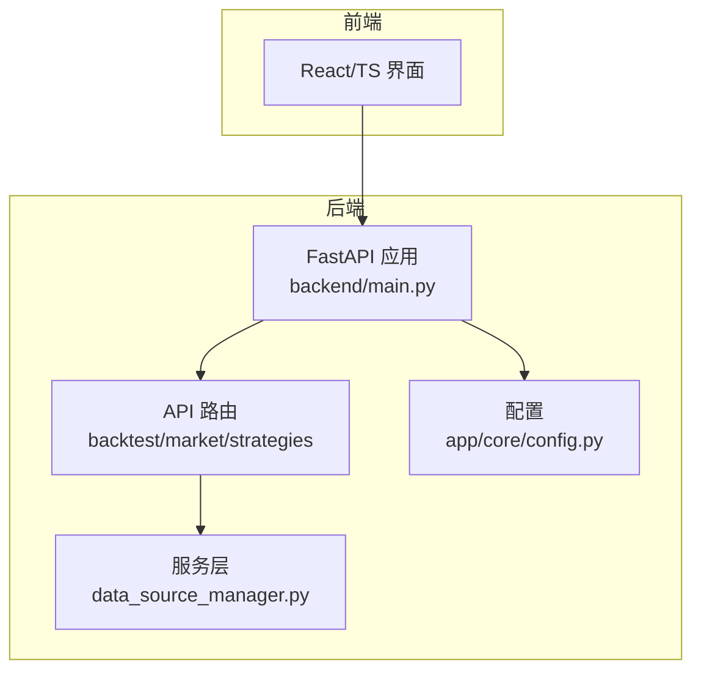
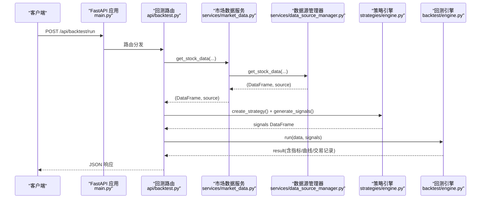
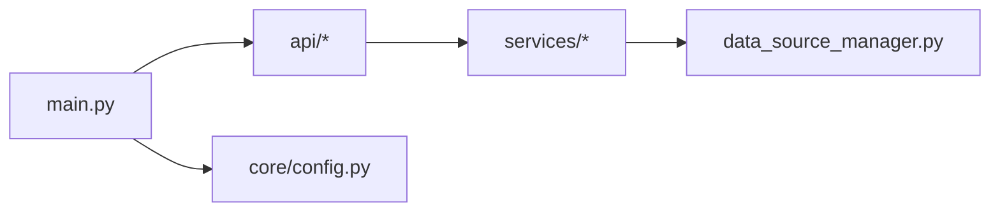
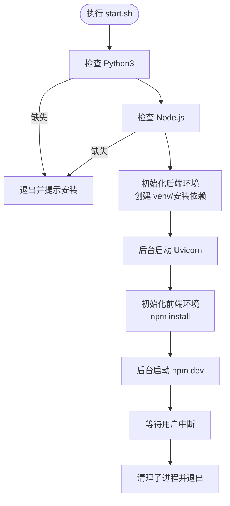

# 进程管理服务

<cite>
**本文引用的文件**   
- [backend/main.py](../../../../../../backend/main.py)
- [backend/app/core/config.py](../../../../../../backend/app/core/config.py)
- [backend/app/api/backtest.py](../../../../../../backend/app/api/backtest.py)
- [backend/app/services/data_source_manager.py](../../../../../../backend/app/services/data_source_manager.py)
- [start.sh](../../../../../../start.sh)
- [Makefile](../../../../../../Makefile)
</cite>

## 目录
1. [简介](#简介)
2. [项目结构](#项目结构)
3. [核心组件](#核心组件)
4. [架构总览](#架构总览)
5. [详细组件分析](#详细组件分析)
6. [依赖关系分析](#依赖关系分析)
7. [性能与资源限制](#性能与资源限制)
8. [故障恢复与告警](#故障恢复与告警)
9. [运维自动化脚本](#运维自动化脚本)
10. [结论](#结论)

## 简介
本文件面向“量化策略查看系统”的后端服务，围绕进程管理、服务自动启动、崩溃重启、日志轮转、健康检查、优雅关闭、信号处理、多实例部署、进程间通信与共享内存、监控指标、故障恢复与告警、以及运维自动化脚本进行系统化说明。后端基于 FastAPI + Uvicorn，前端为 React/TypeScript；当前仓库未内置 systemd 单元或 PM2 配置文件，但提供了开发用启动脚本与 Makefile。文档将结合现有代码给出可落地的生产化配置建议与最佳实践。

## 项目结构
后端采用 FastAPI 应用入口 + API 路由 + 业务服务层 + 数据源管理器 + 回测引擎的分层组织：
- 应用入口：注册路由、CORS、健康检查
- API 层：策略、回测、市场数据接口
- 服务层：统一数据访问与降级策略
- 配置：Pydantic Settings，支持 .env
- 启动脚本：一键拉起前后端（开发）
- Makefile：测试与类型检查

图表来源
- [backend/main.py:9-35](../../../../../../backend/main.py#L9-L35)
- [backend/app/api/backtest.py:13-77](../../../../../../backend/app/api/backtest.py#L13-L77)
- [backend/app/services/data_source_manager.py:14-54](../../../../../../backend/app/services/data_source_manager.py#L14-L54)
- [backend/app/core/config.py:8-24](../../../../../../backend/app/core/config.py#L8-L24)

章节来源
- [backend/main.py:1-36](../../../../../../backend/main.py#L1-L36)
- [backend/app/core/config.py:1-25](../../../../../../backend/app/core/config.py#L1-L25)
- [backend/app/api/backtest.py:1-77](../../../../../../backend/app/api/backtest.py#L1-L77)
- [backend/app/services/data_source_manager.py:1-469](../../../../../../backend/app/services/data_source_manager.py#L1-L469)
- [start.sh:1-69](../../../../../../start.sh#L1-L69)
- [Makefile:1-21](../../../../../../Makefile#L1-L21)

## 核心组件
- FastAPI 应用与健康检查
  - 提供根路径与健康检查端点 /api/health，用于负载均衡器与编排系统的存活探测。
- 配置中心
  - 使用 Pydantic Settings 加载环境变量与 .env，包含数据库 URL、默认市场等。
- 回测 API
  - 接收策略参数、股票代码、时间范围，调用数据源管理器获取 OHLCV，生成交易信号并执行回测，返回绩效指标与资金曲线。
- 数据源管理器
  - 封装多数据源（腾讯财经、yfinance、AKShare、BaoStock、模拟数据），实现自动选择与降级逻辑。

章节来源
- [backend/main.py:29-35](../../../../../../backend/main.py#L29-L35)
- [backend/app/core/config.py:8-24](../../../../../../backend/app/core/config.py#L8-L24)
- [backend/app/api/backtest.py:16-69](../../../../../../backend/app/api/backtest.py#L16-L69)
- [backend/app/services/data_source_manager.py:14-109](../../../../../../backend/app/services/data_source_manager.py#L14-L109)

## 架构总览
下图展示从请求到数据获取、信号生成、回测计算与结果返回的完整流程，并标注关键文件位置。

图表来源
- [backend/main.py:24-35](../../../../../../backend/main.py#L24-L35)
- [backend/app/api/backtest.py:28-69](../../../../../../backend/app/api/backtest.py#L28-L69)
- [backend/app/services/data_source_manager.py:14-109](../../../../../../backend/app/services/data_source_manager.py#L14-L109)

## 详细组件分析

### 健康检查与就绪探针
- 健康检查端点
  - GET /api/health 返回 {"status": "healthy"}，可用于 Liveness/Readiness 探针。
- 扩展建议
  - 在就绪阶段增加数据库连接、外部数据源连通性检测，避免将未就绪实例暴露给流量。

章节来源
- [backend/main.py:33-35](../../../../../../backend/main.py#L33-L35)

### 优雅关闭与信号处理
- 现状
  - 后端通过 Uvicorn 运行，Uvicorn 自身会处理 SIGTERM/SIGINT 以完成请求收尾与线程池清理。
- 建议
  - 在应用生命周期钩子中注册信号处理器，确保长时间任务（如回测）能感知退出信号并安全中断。
  - 对异步任务使用取消令牌或超时控制，避免阻塞关闭流程。

章节来源
- [backend/main.py:9-27](../../../../../../backend/main.py#L9-L27)

### 多实例部署与负载均衡
- 部署模式
  - 使用多 worker 进程（Uvicorn workers）或水平扩展多个容器实例，配合反向代理（Nginx/Traefik/K8s Service）做负载均衡。
- 会话与状态
  - 保持无状态设计；如需会话，使用外部存储（Redis）。
- 端口与绑定
  - 每个实例绑定独立端口或通过容器网络暴露端口，由网关统一转发。

[本节为通用部署建议，不直接分析具体文件]

### 进程间通信与共享内存
- 现状
  - 当前代码未实现显式进程间通信或共享内存。
- 建议
  - 若需跨进程共享大对象（如缓存行情），可使用 Redis、共享内存库（如 multiprocessing.shared_memory）或消息队列（RabbitMQ/Kafka）。
  - 注意序列化开销与一致性模型（最终一致 vs 强一致）。

[本节为通用设计建议，不直接分析具体文件]

### 监控指标收集
- 现状
  - 未内置 Prometheus 指标导出。
- 建议
  - 集成 prometheus-fastapi-instrumentor 暴露 /metrics，采集 QPS、延迟、错误率、GC、CPU/内存（配合 cAdvisor 或 Node Exporter）。
  - 对回测耗时、数据源失败率、重试次数等自定义指标进行埋点。

[本节为通用监控建议，不直接分析具体文件]

### 资源使用限制
- 操作系统级
  - systemd 或容器运行时（cgroups）限制 CPU、内存、文件句柄、打开文件数。
- 应用级
  - Uvicorn workers 数量按 CPU 核数设置；长任务限流与并发上限；数据库连接池大小限制。
- 数据源侧
  - 对外部 API 设置超时与重试退避，防止雪崩。

[本节为通用资源限制建议，不直接分析具体文件]

## 依赖关系分析
- FastAPI 应用依赖 API 路由模块，API 路由依赖服务层与策略/回测引擎。
- 数据源管理器聚合多种第三方数据源，具备自动选择与降级能力。
- 配置模块集中管理环境变量与默认值。

图表来源
- [backend/main.py:4-27](../../../../../../backend/main.py#L4-L27)
- [backend/app/api/backtest.py:1-13](../../../../../../backend/app/api/backtest.py#L1-L13)
- [backend/app/services/data_source_manager.py:1-14](../../../../../../backend/app/services/data_source_manager.py#L1-L14)
- [backend/app/core/config.py:1-8](../../../../../../backend/app/core/config.py#L1-L8)

章节来源
- [backend/main.py:1-36](../../../../../../backend/main.py#L1-L36)
- [backend/app/api/backtest.py:1-77](../../../../../../backend/app/api/backtest.py#L1-L77)
- [backend/app/services/data_source_manager.py:1-469](../../../../../../backend/app/services/data_source_manager.py#L1-L469)
- [backend/app/core/config.py:1-25](../../../../../../backend/app/core/config.py#L1-L25)

## 性能与资源限制
- 回测计算
  - 回测属于 CPU/内存密集型任务，建议：
    - 使用独立 Worker 或任务队列（Celery/RQ）隔离长任务。
    - 限制并发回测数量，避免 OOM。
    - 对大数据集进行分片与增量计算。
- 数据源调用
  - 外部 HTTP 调用需设置超时、重试与熔断，避免拖慢整体吞吐。
- 数据库
  - SQLite 适合开发；生产建议迁移至 PostgreSQL/MySQL，并启用连接池与索引优化。

[本节为通用性能建议，不直接分析具体文件]

## 故障恢复与告警
- 数据源降级
  - 数据源管理器已实现自动选择与降级：优先本地/内置源，失败时依次尝试 yfinance、AKShare、BaoStock，最后回退到模拟数据。
- 异常处理
  - 回测 API 捕获异常并返回 400，便于上层统一处理与告警。
- 建议
  - 增加重试与指数退避、断路器模式。
  - 对关键错误（数据源不可用、回测失败）接入告警通道（邮件/钉钉/Slack/PagerDuty）。

章节来源
- [backend/app/services/data_source_manager.py:56-109](../../../../../../backend/app/services/data_source_manager.py#L56-L109)
- [backend/app/api/backtest.py:68-69](../../../../../../backend/app/api/backtest.py#L68-L69)

## 运维自动化脚本
- 开发启动脚本 start.sh
  - 检查 Python3 与 Node 环境，创建虚拟环境，安装依赖，分别以后台进程方式启动后端（Uvicorn）与前端（npm dev），并在 Ctrl+C 时清理子进程。
- Makefile
  - 提供 check-backend（pytest）、check-frontend（tsc --noEmit）、install-deps 等常用命令。

图表来源
- [start.sh:8-68](../../../../../../start.sh#L8-L68)

章节来源
- [start.sh:1-69](../../../../../../start.sh#L1-L69)
- [Makefile:1-21](../../../../../../Makefile#L1-L21)

## 生产化进程管理建议

### systemd 服务配置要点
- 基本要素
  - Type=simple，User/Group 指定非 root 用户，WorkingDirectory 指向后端目录。
  - ExecStart 使用虚拟环境中的 uvicorn，绑定 127.0.0.1，workers 根据 CPU 核数设置。
  - Restart=always，RestartSec 设置重启间隔。
  - EnvironmentFile 引入 .env，LimitNOFILE 提高文件描述符上限。
  - StandardOutput/StandardError 输出到 journald，或使用 journalctl 查看。
- 健康检查
  - 使用 ExecStartPre 校验 /api/health 可达，或在编排层使用 Readiness 探针。
- 优雅关闭
  - systemd 默认发送 SIGTERM，Uvicorn 会处理；必要时在应用内注册信号处理器，确保任务安全退出。
- 日志轮转
  - 使用 journald 或 logrotate 对 stdout/stderr 进行轮转；也可将日志输出到文件并通过 logrotate 管理。

[本节为通用 systemd 配置建议，不直接分析具体文件]

### PM2 进程管理器使用要点
- 进程定义
  - 使用 ecosystem.config.js 定义 app 名称、cwd、exec_mode（cluster 多 worker）、instances、max_memory_restart、autorestart、watch、ignore_watch、log_date_format、error_file、out_file、merge_logs。
- 自动启动
  - pm2 startup 生成自启动脚本，pm2 save 保存进程列表。
- 崩溃重启
  - autorestart=true，max_restarts 限制频繁重启，避免死循环。
- 日志轮转
  - 使用 pm2 logs 与 pm2 flush，或结合 logrotate 对 out/error 文件轮转。
- 健康检查
  - 通过 pm2 status 与自定义 health 端点配合外部探针。
- 优雅关闭
  - pm2 gracefulReload 或 pm2 reload，应用内监听 SIGUSR2/SIGTERM 完成优雅关闭。
- 多实例部署
  - instances > 1 开启 cluster 模式；对外暴露单端口，内部多 worker 并行。
- 进程间通信
  - PM2 提供 IPC；对于复杂场景建议使用消息队列或共享存储。
- 监控与指标
  - 使用 pm2 monit 与 pm2 metrics；同时集成应用级指标（Prometheus）。

[本节为通用 PM2 配置建议，不直接分析具体文件]

### 健康检查端点与就绪探针
- 健康检查
  - GET /api/health 返回 {"status": "healthy"}。
- 就绪探针
  - 建议在启动完成后标记就绪，并在探针中检查数据库、外部数据源连通性。

章节来源
- [backend/main.py:33-35](../../../../../../backend/main.py#L33-L35)

### 优雅关闭机制与信号处理
- 应用内
  - 注册 SIGTERM/SIGINT 处理器，停止接受新请求，等待进行中请求完成，释放资源。
- 外部编排
  - systemd/PM2/容器编排均会发送 SIGTERM；确保应用正确处理以避免数据不一致。

[本节为通用优雅关闭建议，不直接分析具体文件]

### 多实例部署与负载均衡
- 多 worker
  - Uvicorn workers 数量建议等于 CPU 核数；长任务应放入任务队列。
- 水平扩展
  - 多实例部署于不同节点/容器，通过反向代理或 K8s Service 负载均衡。
- 会话与状态
  - 保持无状态；会话与缓存外置（Redis/Memcached）。

[本节为通用多实例部署建议，不直接分析具体文件]

### 进程间通信与共享内存
- 推荐方案
  - 消息队列（RabbitMQ/Kafka）用于异步任务与事件驱动。
  - 共享内存（multiprocessing.shared_memory）用于高性能数值计算场景。
  - 分布式缓存（Redis）用于热点数据与全局状态。
- 注意事项
  - 序列化成本、一致性、锁竞争、幂等性与重试。

[本节为通用 IPC 与共享内存建议，不直接分析具体文件]

### 监控指标与告警
- 指标采集
  - 集成 Prometheus 指标导出；采集系统级与应用级指标。
- 告警规则
  - 针对错误率、延迟 P95/P99、OOM、数据源失败率、回测失败等设定阈值与通知渠道。
- 可视化
  - Grafana 仪表盘展示关键指标趋势与分布。

[本节为通用监控与告警建议，不直接分析具体文件]

### 故障恢复策略
- 数据源降级
  - 自动选择与降级逻辑已在数据源管理器中实现，保障可用性。
- 重试与退避
  - 对外部 API 调用增加重试与指数退避，避免瞬时抖动导致失败。
- 熔断与隔离
  - 对不稳定数据源启用熔断，保护主流程；对回测任务进行隔离与限流。

章节来源
- [backend/app/services/data_source_manager.py:56-109](../../../../../../backend/app/services/data_source_manager.py#L56-L109)

### 运维自动化脚本
- 启动与停止
  - 使用 start.sh 快速拉起前后端；生产环境改用 systemd/PM2/容器编排。
- 测试与验证
  - Makefile 提供 pytest 与 tsc 类型检查，保证质量门禁。
- 发布流水线
  - CI/CD 构建镜像、运行测试、推送制品、滚动更新与回滚。

章节来源
- [start.sh:1-69](../../../../../../start.sh#L1-L69)
- [Makefile:1-21](../../../../../../Makefile#L1-L21)

## 结论
本项目后端基于 FastAPI + Uvicorn，具备清晰的分层结构与可扩展的数据源管理能力。当前仓库未内置 systemd 单元或 PM2 配置，但提供了开发用启动脚本与 Makefile。在生产环境中，建议：
- 使用 systemd 或 PM2 管理进程，配置自动启动、崩溃重启、日志轮转与优雅关闭。
- 暴露 /api/health 作为健康检查端点，并结合就绪探针提升稳定性。
- 引入监控与告警体系，采集系统与应用指标，设置合理阈值与通知渠道。
- 对回测等长任务进行隔离与限流，避免影响主流程。
- 采用多实例部署与负载均衡，保持无状态设计，会话与缓存外置。
- 完善故障恢复策略，包括重试、退避、熔断与降级。