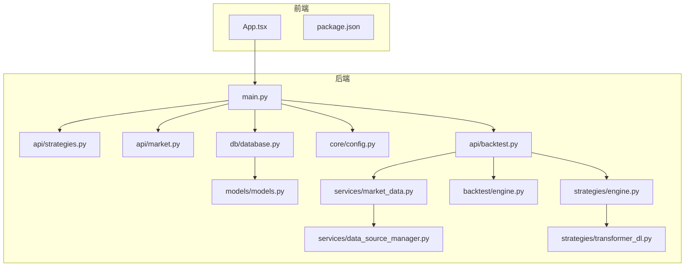
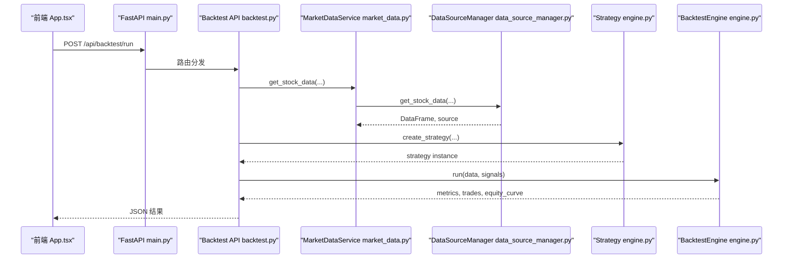
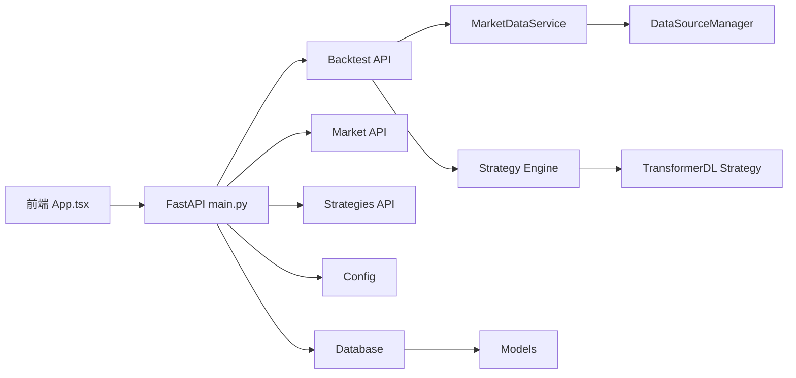

# 监控日志

<cite>
**本文引用的文件**   
- [backend/main.py](file://backend/main.py)
- [backend/app/core/config.py](file://backend/app/core/config.py)
- [backend/app/api/backtest.py](file://backend/app/api/backtest.py)
- [backend/app/api/market.py](file://backend/app/api/market.py)
- [backend/app/api/strategies.py](file://backend/app/api/strategies.py)
- [backend/app/db/database.py](file://backend/app/db/database.py)
- [backend/app/models/models.py](file://backend/app/models/models.py)
- [backend/app/services/data_source_manager.py](file://backend/app/services/data_source_manager.py)
- [backend/app/services/market_data.py](file://backend/app/services/market_data.py)
- [backend/app/backtest/engine.py](file://backend/app/backtest/engine.py)
- [backend/app/strategies/engine.py](file://backend/app/strategies/engine.py)
- [backend/app/strategies/transformer_dl.py](file://backend/app/strategies/transformer_dl.py)
- [frontend/package.json](file://frontend/package.json)
- [frontend/src/App.tsx](file://frontend/src/App.tsx)
</cite>

## 目录
1. [简介](#简介)
2. [项目结构](#项目结构)
3. [核心组件](#核心组件)
4. [架构总览](#架构总览)
5. [详细组件分析](#详细组件分析)
6. [依赖关系分析](#依赖关系分析)
7. [性能与可观测性设计](#性能与可观测性设计)
8. [告警与通知](#告警与通知)
9. [日志规范与安全](#日志规范与安全)
10. [故障诊断指南](#故障诊断指南)
11. [结论](#结论)
12. [附录：指标与面板清单](#附录指标与面板清单)

## 简介
本文件面向“量化策略查看系统”的监控与日志体系建设，覆盖应用级与基础设施级监控、错误追踪、日志采集与分析、可视化与告警。目标是在现有 FastAPI 后端与 React 前端基础上，构建以 Prometheus + Grafana 为核心的指标体系，以及以 ELK（Elasticsearch、Logstash、Kibana）为核心的日志栈，实现从请求到回测引擎的全链路可观测性。

## 项目结构
本项目采用前后端分离架构：
- 后端：FastAPI 提供 REST API，包含策略管理、市场数据获取、回测执行等能力；使用 SQLAlchemy + SQLite 进行持久化。
- 前端：React + Vite 提供策略选择、参数配置与回测结果可视化。

图表来源
- [backend/main.py:1-36](file://backend/main.py#L1-L36)
- [backend/app/api/strategies.py:1-25](file://backend/app/api/strategies.py#L1-L25)
- [backend/app/api/market.py:1-47](file://backend/app/api/market.py#L1-L47)
- [backend/app/api/backtest.py:1-77](file://backend/app/api/backtest.py#L1-L77)
- [backend/app/core/config.py:1-25](file://backend/app/core/config.py#L1-L25)
- [backend/app/db/database.py:1-29](file://backend/app/db/database.py#L1-L29)
- [backend/app/models/models.py:1-44](file://backend/app/models/models.py#L1-L44)
- [backend/app/services/market_data.py:1-106](file://backend/app/services/market_data.py#L1-L106)
- [backend/app/services/data_source_manager.py:1-469](file://backend/app/services/data_source_manager.py#L1-L469)
- [backend/app/backtest/engine.py:1-163](file://backend/app/backtest/engine.py#L1-L163)
- [backend/app/strategies/engine.py:1-656](file://backend/app/strategies/engine.py#L1-L656)
- [backend/app/strategies/transformer_dl.py:1-516](file://backend/app/strategies/transformer_dl.py#L1-L516)
- [frontend/src/App.tsx:1-100](file://frontend/src/App.tsx#L1-L100)
- [frontend/package.json:1-28](file://frontend/package.json#L1-L28)

章节来源
- [backend/main.py:1-36](file://backend/main.py#L1-L36)
- [frontend/src/App.tsx:1-100](file://frontend/src/App.tsx#L1-L100)
- [frontend/package.json:1-28](file://frontend/package.json#L1-L28)

## 核心组件
- FastAPI 应用入口与健康检查：定义路由、CORS、健康探针。
- 策略 API：列出策略与详情查询。
- 市场数据 API：获取行情、股票信息与搜索。
- 回测 API：组装数据、策略信号与回测引擎，返回结果。
- 数据源管理器：多数据源自动切换与模拟数据生成。
- 回测引擎：计算收益曲线、交易记录与关键指标。
- 策略引擎：多种经典策略与深度学习 Transformer 策略。
- 数据库层：SQLAlchemy 引擎与会话管理，模型定义。

章节来源
- [backend/main.py:1-36](file://backend/main.py#L1-L36)
- [backend/app/api/strategies.py:1-25](file://backend/app/api/strategies.py#L1-L25)
- [backend/app/api/market.py:1-47](file://backend/app/api/market.py#L1-L47)
- [backend/app/api/backtest.py:1-77](file://backend/app/api/backtest.py#L1-L77)
- [backend/app/services/data_source_manager.py:1-469](file://backend/app/services/data_source_manager.py#L1-L469)
- [backend/app/backtest/engine.py:1-163](file://backend/app/backtest/engine.py#L1-L163)
- [backend/app/strategies/engine.py:1-656](file://backend/app/strategies/engine.py#L1-L656)
- [backend/app/strategies/transformer_dl.py:1-516](file://backend/app/strategies/transformer_dl.py#L1-L516)
- [backend/app/db/database.py:1-29](file://backend/app/db/database.py#L1-L29)
- [backend/app/models/models.py:1-44](file://backend/app/models/models.py#L1-L44)

## 架构总览
下图展示从前端发起回测请求到后端处理、数据获取、策略信号生成与回测执行的完整调用链。

图表来源
- [frontend/src/App.tsx:13-36](file://frontend/src/App.tsx#L13-L36)
- [backend/main.py:24-35](file://backend/main.py#L24-L35)
- [backend/app/api/backtest.py:28-69](file://backend/app/api/backtest.py#L28-L69)
- [backend/app/services/market_data.py:14-41](file://backend/app/services/market_data.py#L14-L41)
- [backend/app/services/data_source_manager.py:17-54](file://backend/app/services/data_source_manager.py#L17-L54)
- [backend/app/strategies/engine.py:600-656](file://backend/app/strategies/engine.py#L600-L656)
- [backend/app/backtest/engine.py:15-70](file://backend/app/backtest/engine.py#L15-L70)

## 详细组件分析

### 应用级监控（API 响应时间、错误率、吞吐量）
- 建议引入中间件统计每个接口的耗时、状态码分布与 QPS，并暴露为 Prometheus 指标。
- 对关键路径（如 /api/backtest/run、/api/market/stock/{symbol}）增加细粒度计时与异常计数。
- 在健康检查接口 /api/health 中集成依赖项探测（数据库、外部数据源连通性）。

章节来源
- [backend/main.py:29-35](file://backend/main.py#L29-L35)
- [backend/app/api/backtest.py:28-69](file://backend/app/api/backtest.py#L28-L69)
- [backend/app/api/market.py:11-46](file://backend/app/api/market.py#L11-L46)

### 基础设施监控（CPU、内存、磁盘使用率）
- 通过 Node Exporter 或系统代理采集主机级指标（CPU、内存、磁盘 I/O、网络）。
- 针对 Python 进程，可使用 python_exporter 或自研指标导出器，暴露 GIL 等待、GC 次数、线程数等。
- 将容器资源限制（若使用 Docker/K8s）纳入监控，避免资源争用影响回测性能。

[本节为通用指导，不直接分析具体文件]

### 错误追踪与结构化日志
- 统一异常捕获与结构化日志输出（包含 request_id、strategy_id、symbol、source、elapsed_ms 等字段）。
- 对第三方数据源调用失败、策略参数校验失败、回测引擎异常进行分类打点与告警。
- 建议在 FastAPI 全局异常处理器中注入上下文信息，便于后续检索与关联。

章节来源
- [backend/app/api/backtest.py:68-69](file://backend/app/api/backtest.py#L68-L69)
- [backend/app/api/market.py:26-27](file://backend/app/api/market.py#L26-L27)

### 数据源管理与可用性
- DataSourceManager 支持多数据源自动切换与降级至模拟数据，需监控各数据源的可用性与延迟。
- 对腾讯财经、yfinance、AKShare、BaoStock 分别设置超时、重试与熔断策略，避免雪崩。
- 记录实际使用的数据源与是否使用模拟数据，便于审计与质量评估。

章节来源
- [backend/app/services/data_source_manager.py:17-109](file://backend/app/services/data_source_manager.py#L17-L109)
- [backend/app/services/market_data.py:14-41](file://backend/app/services/market_data.py#L14-L41)

### 回测引擎与策略执行
- BacktestEngine 负责合并数据与信号、计算收益曲线与关键指标，需监控其运行时长与内存占用。
- 策略引擎提供多种策略实现，包括深度学习 Transformer 策略，需注意 GPU/CPU 资源与训练耗时。
- 对长耗时任务（如 Transformer 训练）建议异步化与进度上报，避免阻塞请求。

章节来源
- [backend/app/backtest/engine.py:15-70](file://backend/app/backtest/engine.py#L15-L70)
- [backend/app/strategies/engine.py:17-656](file://backend/app/strategies/engine.py#L17-L656)
- [backend/app/strategies/transformer_dl.py:324-487](file://backend/app/strategies/transformer_dl.py#L324-L487)

### 数据库与持久化
- 当前使用 SQLite，适合本地开发；生产环境建议迁移至 PostgreSQL/MySQL，并启用连接池与慢查询日志。
- 模型包含策略与回测结果表，可用于历史回测结果的存储与查询。

章节来源
- [backend/app/db/database.py:1-29](file://backend/app/db/database.py#L1-L29)
- [backend/app/models/models.py:11-44](file://backend/app/models/models.py#L11-L44)

## 依赖关系分析

图表来源
- [frontend/src/App.tsx:13-36](file://frontend/src/App.tsx#L13-L36)
- [backend/main.py:24-35](file://backend/main.py#L24-L35)
- [backend/app/api/backtest.py:28-69](file://backend/app/api/backtest.py#L28-L69)
- [backend/app/api/market.py:11-46](file://backend/app/api/market.py#L11-L46)
- [backend/app/api/strategies.py:11-24](file://backend/app/api/strategies.py#L11-L24)
- [backend/app/services/market_data.py:14-41](file://backend/app/services/market_data.py#L14-L41)
- [backend/app/services/data_source_manager.py:17-54](file://backend/app/services/data_source_manager.py#L17-L54)
- [backend/app/strategies/engine.py:600-656](file://backend/app/strategies/engine.py#L600-L656)
- [backend/app/strategies/transformer_dl.py:324-487](file://backend/app/strategies/transformer_dl.py#L324-L487)
- [backend/app/core/config.py:8-24](file://backend/app/core/config.py#L8-L24)
- [backend/app/db/database.py:9-28](file://backend/app/db/database.py#L9-L28)
- [backend/app/models/models.py:11-44](file://backend/app/models/models.py#L11-L44)

章节来源
- [backend/main.py:24-35](file://backend/main.py#L24-L35)
- [backend/app/api/backtest.py:28-69](file://backend/app/api/backtest.py#L28-L69)
- [backend/app/services/data_source_manager.py:17-109](file://backend/app/services/data_source_manager.py#L17-L109)
- [backend/app/backtest/engine.py:15-70](file://backend/app/backtest/engine.py#L15-L70)
- [backend/app/strategies/engine.py:600-656](file://backend/app/strategies/engine.py#L600-L656)

## 性能与可观测性设计

### Prometheus 指标采集
- 应用指标
  - HTTP 请求计数、时延分位（p50/p90/p99）、错误率、QPS。
  - 业务指标：策略执行次数、数据源类型分布、模拟数据占比、回测成功/失败率。
  - 资源指标：进程 CPU、内存、GC 次数、线程数、GIL 等待。
- 基础设施指标
  - 主机 CPU、内存、磁盘使用率、I/O、网络吞吐。
  - 数据库连接数、慢查询数量、锁等待。
- 数据采集
  - 后端暴露 /metrics 端点，Prometheus 定期抓取。
  - 主机指标通过 Node Exporter 采集。
  - 数据库指标通过相应 exporter 采集（如 mysqld_exporter/pgbouncer_exporter）。

章节来源
- [backend/main.py:29-35](file://backend/main.py#L29-L35)
- [backend/app/api/backtest.py:28-69](file://backend/app/api/backtest.py#L28-L69)
- [backend/app/services/data_source_manager.py:17-109](file://backend/app/services/data_source_manager.py#L17-L109)

### Grafana 可视化面板
- 概览面板：服务健康、QPS、错误率、P99 延迟、回测成功率。
- 业务面板：策略执行分布、数据源命中率、模拟数据比例、资金曲线与回撤。
- 基础设施面板：CPU、内存、磁盘、网络、数据库连接与慢查询。
- 告警联动：在 Grafana 中配置阈值告警并对接通知渠道。

[本节为通用指导，不直接分析具体文件]

### 日志收集与分析（ELK）
- 采集：Filebeat/Fluent Bit 收集应用日志与系统日志，发送至 Logstash。
- 处理：Logstash 解析结构化日志，过滤敏感信息，写入 Elasticsearch。
- 可视化：Kibana 创建索引模式、仪表盘与告警规则。
- 轮转：按天/大小轮转，保留策略（如 30 天热数据、90 天温数据、归档冷数据）。

[本节为通用指导，不直接分析具体文件]

## 告警与通知

### 告警规则（示例维度）
- 应用级
  - 错误率 > 5%（5 分钟窗口）。
  - P99 延迟 > 2 秒。
  - 回测失败率 > 10%。
  - 数据源不可用超过 2 次/分钟。
- 基础设施级
  - CPU 使用率 > 90%（持续 5 分钟）。
  - 内存使用率 > 85%。
  - 磁盘使用率 > 80%。
  - 数据库连接数接近上限。

### 通知渠道集成
- 邮件：SMTP 配置，发送团队邮箱。
- Slack：Webhook 接入，频道内推送。
- 企业微信：机器人 Webhook，群内消息提醒。
- 建议分级：P0（立即电话/短信）、P1（Slack/企微）、P2（邮件）。

[本节为通用指导，不直接分析具体文件]

## 日志规范与安全

### 日志级别与格式
- 级别：DEBUG、INFO、WARN、ERROR、FATAL。
- 格式：JSON 结构化日志，包含 request_id、timestamp、level、service、method、path、status_code、duration_ms、error_code、strategy_id、symbol、data_source、is_mock 等字段。
- 采样：高频 DEBUG 日志采样，避免风暴。

### 敏感信息脱敏
- 对请求体中的密钥、Token、用户信息进行掩码处理。
- 对外部数据源返回的敏感字段进行过滤。
- 日志落盘前统一脱敏管道处理。

### 日志轮转策略
- 按天切分，单文件最大 500MB。
- 保留策略：热数据 30 天、温数据 90 天、冷数据归档至对象存储。
- 压缩归档，降低存储成本。

[本节为通用指导，不直接分析具体文件]

## 故障诊断指南

### 性能瓶颈定位
- 慢接口定位：查看 P99 延迟与热点接口，结合 Trace ID 定位调用链。
- 数据源瓶颈：观察外部 API 延迟与失败率，必要时切换数据源或启用缓存。
- 回测引擎瓶颈：分析策略复杂度与数据规模，考虑异步化与批处理。

章节来源
- [backend/app/api/backtest.py:28-69](file://backend/app/api/backtest.py#L28-L69)
- [backend/app/services/data_source_manager.py:17-109](file://backend/app/services/data_source_manager.py#L17-L109)
- [backend/app/backtest/engine.py:15-70](file://backend/app/backtest/engine.py#L15-L70)

### 慢查询分析
- 数据库慢查询日志开启，分析 SQL 执行计划与索引命中情况。
- 对高频查询建立缓存（Redis），减少重复 IO。
- 优化分页与批量读取，避免大表全量扫描。

章节来源
- [backend/app/db/database.py:9-28](file://backend/app/db/database.py#L9-L28)
- [backend/app/models/models.py:11-44](file://backend/app/models/models.py#L11-L44)

### 内存泄漏检测
- 使用 tracemalloc、memory_profiler 定位增长趋势与热点对象。
- 关注大数据集（DataFrame）的引用释放与循环引用。
- 对长生命周期对象（如模型实例）进行复用与清理。

[本节为通用指导，不直接分析具体文件]

### 深度学习策略性能问题
- Transformer 训练耗时与显存占用较高，建议：
  - 调整 batch_size、epochs、train_window。
  - 使用 GPU 加速，监控 CUDA 利用率。
  - 增量训练与早停机制，避免过度训练。

章节来源
- [backend/app/strategies/transformer_dl.py:324-487](file://backend/app/strategies/transformer_dl.py#L324-L487)

## 结论
通过在 FastAPI 后端与 React 前端引入统一的指标采集、结构化日志与可视化告警体系，可实现对应用性能、错误追踪与基础设施状态的全面掌控。结合 Prometheus + Grafana 与 ELK 栈，能够高效定位性能瓶颈、慢查询与内存问题，并通过多渠道告警保障系统稳定性。在生产环境中，建议逐步完善异步化、缓存与数据库迁移，持续提升系统的可观测性与可靠性。

## 附录：指标与面板清单

### 指标清单（示例）
- HTTP 指标
  - http_requests_total{method,path,status}
  - http_request_duration_seconds{method,path}
  - http_errors_total{method,path,error_code}
- 业务指标
  - backtest_runs_total{strategy_id,data_source,is_mock}
  - backtest_success_rate{strategy_id}
  - data_source_latency_seconds{source}
- 资源指标
  - process_cpu_seconds_total
  - process_memory_bytes
  - gc_collections_total
  - db_connections_active
  - db_slow_queries_total

### 面板清单（示例）
- 服务健康与性能：QPS、错误率、P99 延迟、回测成功率。
- 业务分析：策略执行分布、数据源命中率、模拟数据比例、资金曲线与回撤。
- 基础设施：CPU、内存、磁盘、网络、数据库连接与慢查询。

[本节为通用指导，不直接分析具体文件]