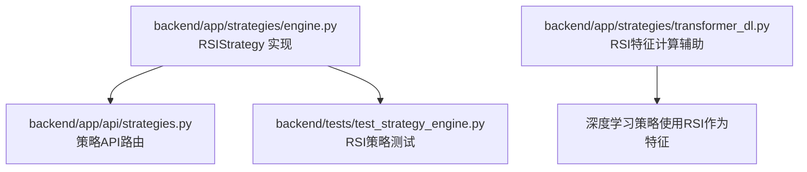
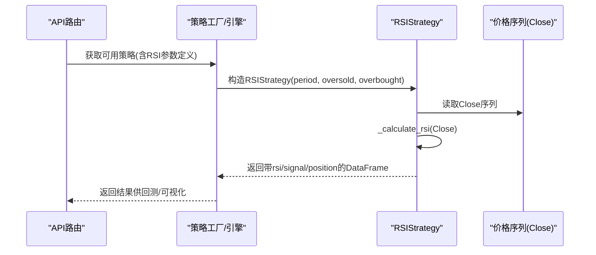
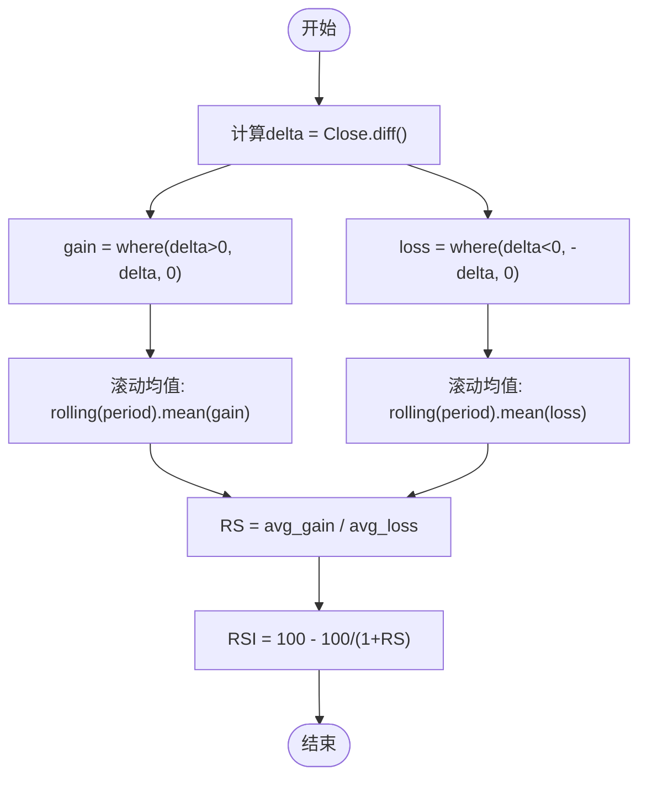
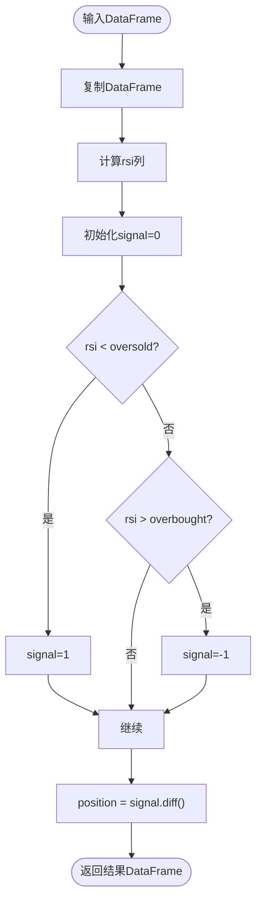
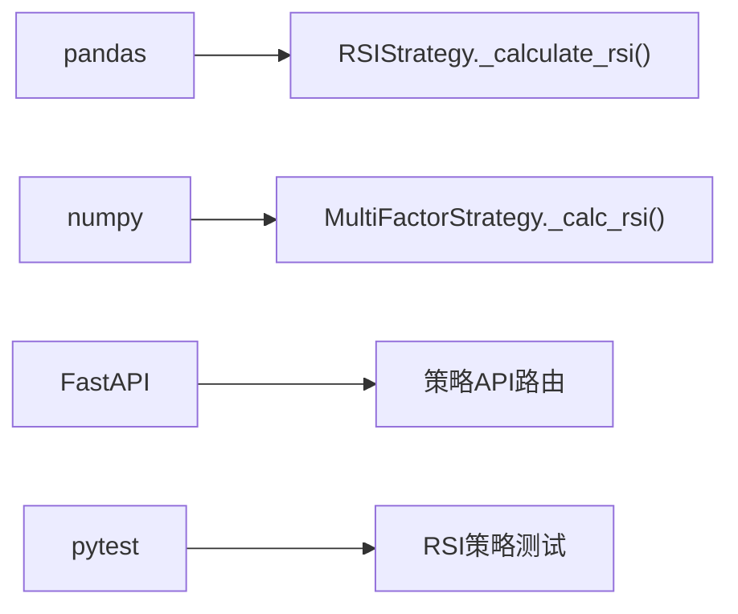

# RSI策略

<cite>
**本文引用的文件**   
- [backend/app/strategies/engine.py](file://backend/app/strategies/engine.py)
- [backend/app/strategies/transformer_dl.py](file://backend/app/strategies/transformer_dl.py)
- [backend/tests/test_strategy_engine.py](file://backend/tests/test_strategy_engine.py)
- [backend/app/api/strategies.py](file://backend/app/api/strategies.py)
</cite>

## 目录
1. [引言](#引言)
2. [项目结构](#项目结构)
3. [核心组件](#核心组件)
4. [架构总览](#架构总览)
5. [详细组件分析](#详细组件分析)
6. [依赖关系分析](#依赖关系分析)
7. [性能与实现特性](#性能与实现特性)
8. [参数调优与市场周期适配](#参数调优与市场周期适配)
9. [背离与多重顶底判断](#背离与多重顶底判断)
10. [横盘与趋势行情的表现差异及应对](#横盘与趋势行情的表现差异及应对)
11. [故障排查](#故障排查)
12. [结论](#结论)

## 引言
本文件围绕仓库中的RSI（相对强弱指标）策略进行系统化技术文档化，重点包括：
- RSI的数学计算过程：上涨幅度、下跌幅度、RS值与RSI值的推导。
- 三个关键参数的含义与设置原则：period、oversold、overbought。
- 交易信号规则：RSI低于超卖阈值时买入，高于超买阈值时卖出。
- 代码级实现解析：_calculate_rsi()方法中delta.where()、rolling().mean()等pandas操作的使用。
- 不同市场周期下的参数调优经验。
- RSI背离现象与多重顶底的识别思路。
- RSI在横盘整理与趋势行情中的表现差异与应对策略。

## 项目结构
与本RSI策略直接相关的后端代码位于backend/app/strategies目录下，其中engine.py实现了RSIStrategy类及其信号生成逻辑；transformer_dl.py中包含一个基于NumPy/Pandas的RSI特征计算辅助方法；API路由strategies.py暴露了策略列表接口；测试用例test_strategy_engine.py覆盖了RSI策略的信号结构与取值范围断言。

**图表来源**
- [backend/app/strategies/engine.py:114-150](file://backend/app/strategies/engine.py#L114-L150)
- [backend/app/api/strategies.py:11-24](file://backend/app/api/strategies.py#L11-L24)
- [backend/tests/test_strategy_engine.py:110-120](file://backend/tests/test_strategy_engine.py#L110-L120)
- [backend/app/strategies/transformer_dl.py:98-111](file://backend/app/strategies/transformer_dl.py#L98-L111)

**章节来源**
- [backend/app/strategies/engine.py:114-150](file://backend/app/strategies/engine.py#L114-L150)
- [backend/app/api/strategies.py:11-24](file://backend/app/api/strategies.py#L11-L24)
- [backend/tests/test_strategy_engine.py:110-120](file://backend/tests/test_strategy_engine.py#L110-L120)
- [backend/app/strategies/transformer_dl.py:98-111](file://backend/app/strategies/transformer_dl.py#L98-L111)

## 核心组件
- RSIStrategy：封装RSI计算与信号生成，包含参数period、oversold、overbought。
- _calculate_rsi()：基于pandas.Series的diff、where、rolling.mean计算RSI。
- generate_signals()：根据RSI阈值生成signal列，并通过diff得到position列。
- MultiFactorStrategy._calc_rsi()：多因子策略内部也实现了RSI计算，用于因子打分。
- FeatureEngineer._calculate_rsi()：深度学习策略的特征工程中使用的RSI计算辅助方法。

**章节来源**
- [backend/app/strategies/engine.py:114-150](file://backend/app/strategies/engine.py#L114-L150)
- [backend/app/strategies/engine.py:252-258](file://backend/app/strategies/engine.py#L252-L258)
- [backend/app/strategies/transformer_dl.py:98-111](file://backend/app/strategies/transformer_dl.py#L98-L111)

## 架构总览
RSI策略在系统中的调用路径如下：
- API层通过get_available_strategies()返回策略元数据，前端可据此展示RSI策略的参数定义。
- 回测或实盘引擎创建RSIStrategy实例，传入period、oversold、overbought。
- 输入OHLCV数据DataFrame后，generate_signals()计算rsi列并输出signal与position列。

**图表来源**
- [backend/app/api/strategies.py:11-24](file://backend/app/api/strategies.py#L11-L24)
- [backend/app/strategies/engine.py:506-597](file://backend/app/strategies/engine.py#L506-L597)
- [backend/app/strategies/engine.py:617-622](file://backend/app/strategies/engine.py#L617-L622)
- [backend/app/strategies/engine.py:135-150](file://backend/app/strategies/engine.py#L135-L150)

## 详细组件分析

### RSI数学计算与公式
RSI的核心步骤如下：
- 计算每日价格变动delta = Close_t - Close_{t-1}。
- 将正变动记为gain，负变动取绝对值记为loss。
- 对gain与loss分别做period期滚动均值，得到平均上涨幅度与平均下跌幅度。
- 计算RS = 平均上涨幅度 / 平均下跌幅度。
- 计算RSI = 100 - (100 / (1 + RS))。

该计算在RSIStrategy._calculate_rsi()中通过pandas实现：
- delta = prices.diff()
- gain = (delta.where(delta > 0, 0)).rolling(window=period).mean()
- loss = (-delta.where(delta < 0, 0)).rolling(window=period).mean()
- rs = gain / loss
- rsi = 100 - (100 / (1 + rs))

注意：当loss为0时，rs会除零产生无穷大，导致RSI趋近于100；这是RSI在单边上涨时的典型行为。

**图表来源**
- [backend/app/strategies/engine.py:126-133](file://backend/app/strategies/engine.py#L126-L133)

**章节来源**
- [backend/app/strategies/engine.py:126-133](file://backend/app/strategies/engine.py#L126-L133)

### 参数说明与设置原则
- period：RSI的滚动窗口长度，默认14。较短的period更敏感，较长的period更平滑。
- oversold：超卖阈值，默认30。RSI低于该值视为超卖区域，触发买入信号。
- overbought：超买阈值，默认70。RSI高于该值视为超买区域，触发卖出信号。

在系统注册表中，RSI策略的参数范围为：
- period: int，默认14，范围[5, 30]
- oversold: float，默认30，范围[10, 40]
- overbought: float，默认70，范围[60, 90]

这些约束有助于避免极端参数导致的信号噪声或失效。

**章节来源**
- [backend/app/strategies/engine.py:116-124](file://backend/app/strategies/engine.py#L116-L124)
- [backend/app/strategies/engine.py:537-544](file://backend/app/strategies/engine.py#L537-L544)

### 信号生成流程
generate_signals()的执行流程：
- 复制输入DataFrame以避免修改原始数据。
- 计算rsi列。
- 初始化signal列为0。
- 若rsi < oversold，则signal=1（买入）。
- 若rsi > overbought，则signal=-1（卖出）。
- position = signal.diff()，仅在信号变化时产生实际交易位置变更。

**图表来源**
- [backend/app/strategies/engine.py:135-150](file://backend/app/strategies/engine.py#L135-L150)

**章节来源**
- [backend/app/strategies/engine.py:135-150](file://backend/app/strategies/engine.py#L135-L150)

### pandas操作细节：delta.where()与rolling().mean()
- delta.where(delta > 0, 0)：将非正变动置为0，仅保留上涨幅度。
- -delta.where(delta < 0, 0)：将非负变动置为0，并将负变动取绝对值，得到下跌幅度。
- rolling(window=period).mean()：对gain与loss分别计算滚动均值，形成平均上涨与平均下跌。
- 这些操作向量化且高效，适合时间序列数据处理。

**章节来源**
- [backend/app/strategies/engine.py:126-133](file://backend/app/strategies/engine.py#L126-L133)

### 其他RSI实现参考
- MultiFactorStrategy._calc_rsi()：在多因子策略中用于RSI因子打分，处理loss为0的情况用replace(0, np.nan)避免除零。
- FeatureEngineer._calculate_rsi()：深度学习策略中使用np.where与pd.Series.rolling计算RSI，并对初始值填充50并归一化到[0,1]。

这些实现展示了在不同场景下对RSI计算的变体与稳健性处理。

**章节来源**
- [backend/app/strategies/engine.py:252-258](file://backend/app/strategies/engine.py#L252-L258)
- [backend/app/strategies/transformer_dl.py:98-111](file://backend/app/strategies/transformer_dl.py#L98-L111)

## 依赖关系分析
RSI策略依赖以下模块与外部库：
- pandas：Series.diff、where、rolling.mean等时间序列操作。
- numpy：数值计算与NaN处理（在多因子策略中）。
- FastAPI：API路由提供策略元数据查询。
- pytest：单元测试验证信号结构与RSI取值范围。

**图表来源**
- [backend/app/strategies/engine.py:1-6](file://backend/app/strategies/engine.py#L1-L6)
- [backend/app/api/strategies.py:1-6](file://backend/app/api/strategies.py#L1-L6)
- [backend/tests/test_strategy_engine.py:1-6](file://backend/tests/test_strategy_engine.py#L1-L6)

**章节来源**
- [backend/app/strategies/engine.py:1-6](file://backend/app/strategies/engine.py#L1-L6)
- [backend/app/api/strategies.py:1-6](file://backend/app/api/strategies.py#L1-L6)
- [backend/tests/test_strategy_engine.py:1-6](file://backend/tests/test_strategy_engine.py#L1-L6)

## 性能与实现特性
- 向量化计算：pandas的diff、where、rolling.mean均为向量化操作，适合大规模时间序列。
- 内存占用：generate_signals()复制输入DataFrame，避免副作用但增加内存开销。
- 除零保护：在多因子策略中对loss为0进行NaN替换，避免RSI异常。
- 边界处理：RSI在单边行情中可能长期处于超买或超卖区，需结合其他过滤条件。

**章节来源**
- [backend/app/strategies/engine.py:135-150](file://backend/app/strategies/engine.py#L135-L150)
- [backend/app/strategies/engine.py:252-258](file://backend/app/strategies/engine.py#L252-L258)

## 参数调优与市场周期适配
- 短周期（period=5~10）：适用于高频或短线交易，信号更敏感，但假信号较多。
- 中长周期（period=14~20）：经典配置，平衡灵敏度与稳定性，适合多数市场。
- 长周期（period=20~30）：适用于长线投资，减少噪音，滞后性更强。
- 超卖/超买阈值：
  - 震荡市：oversold=30、overbought=70较常见。
  - 强趋势市：可适当放宽至oversold=20、overbought=80，避免过早反转。
- 市场周期建议：
  - 牛市：提高overbought阈值，降低频繁卖出。
  - 熊市：降低oversold阈值，谨慎抄底。
  - 震荡市：保持标准阈值，配合成交量或波动率过滤。

**章节来源**
- [backend/app/strategies/engine.py:537-544](file://backend/app/strategies/engine.py#L537-L544)

## 背离与多重顶底判断
- 背离：
  - 顶背离：价格创新高而RSI未创新高，预示上涨动能减弱。
  - 底背离：价格创新低而RSI未创新低，预示下跌动能减弱。
- 多重顶底：
  - 双重顶/底：价格两次触及相似高点/低点，RSI出现相应背离或收敛。
  - 三重顶/底：多次试探同一水平位，确认支撑/阻力有效性。
- 实战要点：
  - 背离需结合趋势线与成交量确认。
  - 多重顶底失败时需止损，避免逆势交易。

[本节为概念性内容，不直接分析具体文件，故无“章节来源”]

## 横盘与趋势行情的表现差异及应对
- 横盘整理：
  - RSI在超买/超卖区间来回穿越，信号频繁但有效。
  - 建议：结合布林带或成交量过滤，避免假突破。
- 趋势行情：
  - RSI可能长期停留在超买或超卖区，传统反向信号失效。
  - 建议：采用趋势跟随策略（如均线交叉）或调整阈值，避免过早反转。
- 混合环境：
  - 使用多因子模型（如MultiFactorStrategy）综合RSI与其他指标，提升鲁棒性。

**章节来源**
- [backend/app/strategies/engine.py:208-324](file://backend/app/strategies/engine.py#L208-L324)

## 故障排查
- RSI值为NaN：
  - 检查输入数据是否包含缺失值，确保Close序列连续。
  - 在计算前进行fillna或dropna处理。
- RSI超出[0,100]：
  - 理论上RSI应在0~100之间，测试用例已断言该范围。
  - 若出现异常，检查loss是否为0导致除零。
- 信号过多或过少：
  - 调整period、oversold、overbought参数。
  - 结合其他指标过滤信号。
- 内存不足：
  - generate_signals()复制DataFrame，大数据集时考虑分块处理或优化内存。

**章节来源**
- [backend/tests/test_strategy_engine.py:116-120](file://backend/tests/test_strategy_engine.py#L116-L120)
- [backend/app/strategies/engine.py:135-150](file://backend/app/strategies/engine.py#L135-L150)

## 结论
RSI策略在本仓库中实现简洁清晰，核心计算基于pandas向量化操作，信号生成逻辑直观。通过合理设置period、oversold、overbought参数，并结合市场周期与背离、多重顶底等高级用法，可在不同环境中取得稳定效果。对于趋势行情，建议结合趋势跟踪策略；对于震荡行情，RSI的反转信号更具价值。多因子与深度学习策略中也融入了RSI特征，体现了其在量化体系中的基础地位。