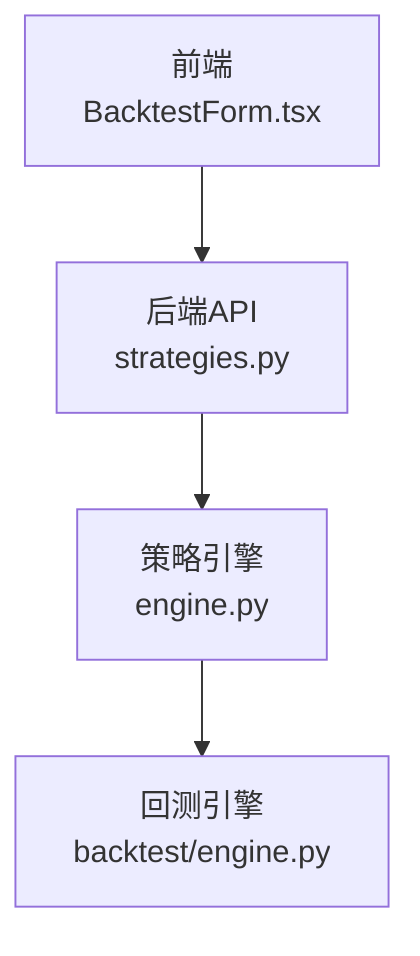
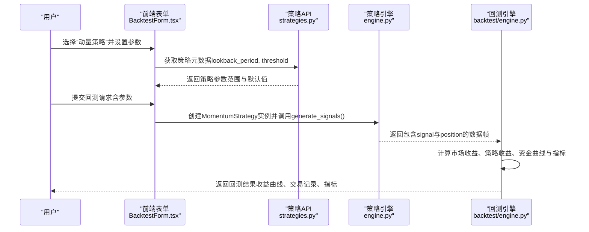
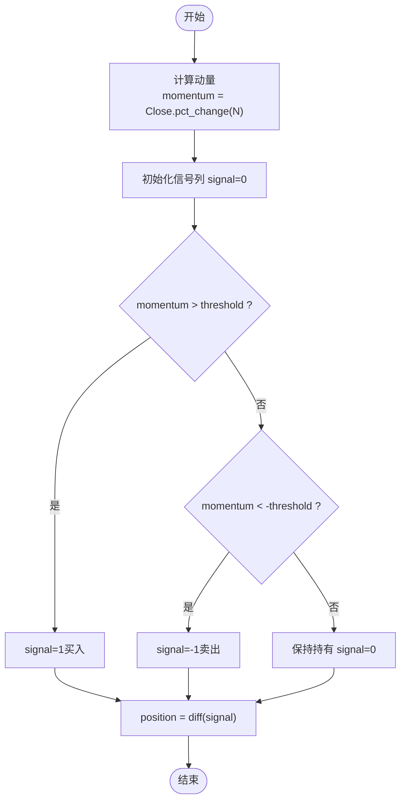
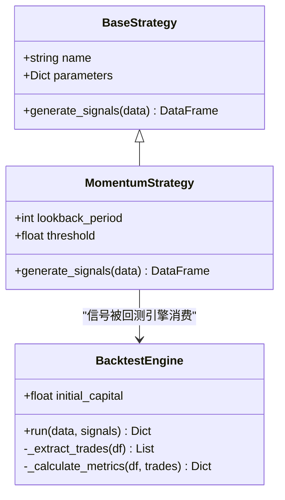
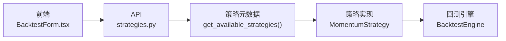

# 动量策略

<cite>
**本文引用的文件**   
- [backend/app/strategies/engine.py](file://backend/app/strategies/engine.py)
- [backend/app/backtest/engine.py](file://backend/app/backtest/engine.py)
- [backend/app/api/strategies.py](file://backend/app/api/strategies.py)
- [frontend/src/components/BacktestForm.tsx](file://frontend/src/components/BacktestForm.tsx)
</cite>

## 目录
1. [引言](#引言)
2. [项目结构](#项目结构)
3. [核心组件](#核心组件)
4. [架构总览](#架构总览)
5. [详细组件分析](#详细组件分析)
6. [依赖关系分析](#依赖关系分析)
7. [性能与计算复杂度](#性能与计算复杂度)
8. [参数调优指南](#参数调优指南)
9. [极端行情与假信号过滤](#极端行情与假信号过滤)
10. [故障排查](#故障排查)
11. [结论](#结论)

## 引言
本文件面向量化交易中的“价格动量”策略，系统讲解其数学定义、计算方法与工程实现。重点围绕以下目标展开：
- 基于收盘价序列的过去N日收益率（pct_change）计算动量指标；
- 解释回看周期 lookback_period 与阈值 threshold 的含义与作用；
- 说明通过阈值过滤生成交易信号的规则：涨幅超过正阈值买入，跌幅超过负阈值卖出；
- 结合代码路径展示动量指标的计算过程与信号生成逻辑；
- 提供不同市场环境下的参数调优建议；
- 给出极端行情与假信号的过滤方法，提升稳健性。

## 项目结构
本项目采用前后端分离架构：
- 后端提供策略实现、回测引擎与API接口；
- 前端提供策略参数配置界面；
- 动量策略在后端策略引擎中实现，并通过API暴露可用策略元数据。

图表来源
- [backend/app/api/strategies.py:1-25](file://backend/app/api/strategies.py#L1-L25)
- [backend/app/strategies/engine.py:506-597](file://backend/app/strategies/engine.py#L506-L597)
- [backend/app/backtest/engine.py:10-70](file://backend/app/backtest/engine.py#L10-L70)
- [frontend/src/components/BacktestForm.tsx:140-164](file://frontend/src/components/BacktestForm.tsx#L140-L164)

章节来源
- [backend/app/api/strategies.py:1-25](file://backend/app/api/strategies.py#L1-L25)
- [backend/app/strategies/engine.py:506-597](file://backend/app/strategies/engine.py#L506-L597)
- [backend/app/backtest/engine.py:10-70](file://backend/app/backtest/engine.py#L10-L70)
- [frontend/src/components/BacktestForm.tsx:140-164](file://frontend/src/components/BacktestForm.tsx#L140-L164)

## 核心组件
- 策略基类 BaseStrategy：定义统一的 generate_signals 接口，所有具体策略继承该基类。
- 动量策略 MomentumStrategy：基于过去N日收益率（pct_change）计算动量，使用阈值过滤生成买卖信号。
- 回测引擎 BacktestEngine：将策略信号应用于历史价格，计算收益曲线与绩效指标。
- 策略API：对外暴露可用策略列表及详情，便于前端选择与参数配置。

章节来源
- [backend/app/strategies/engine.py:17-25](file://backend/app/strategies/engine.py#L17-L25)
- [backend/app/strategies/engine.py:57-81](file://backend/app/strategies/engine.py#L57-L81)
- [backend/app/backtest/engine.py:10-70](file://backend/app/backtest/engine.py#L10-L70)
- [backend/app/api/strategies.py:1-25](file://backend/app/api/strategies.py#L1-L25)

## 架构总览
动量策略从输入价格序列到输出交易信号的完整流程如下：

图表来源
- [frontend/src/components/BacktestForm.tsx:140-164](file://frontend/src/components/BacktestForm.tsx#L140-L164)
- [backend/app/api/strategies.py:11-24](file://backend/app/api/strategies.py#L11-L24)
- [backend/app/strategies/engine.py:506-597](file://backend/app/strategies/engine.py#L506-L597)
- [backend/app/backtest/engine.py:15-70](file://backend/app/backtest/engine.py#L15-L70)

## 详细组件分析

### 动量策略数学定义与计算
- 价格动量的数学定义：以收盘价序列为输入，计算过去N日的百分比变化（收益率）。
- 计算公式：momentum_t = (Close_t - Close_{t-N}) / Close_{t-N}，等价于 pandas 的 pct_change(periods=N)。
- 在工程中，动量指标列命名为 momentum，由收盘价列 Close 计算得到。

章节来源
- [backend/app/strategies/engine.py:67-73](file://backend/app/strategies/engine.py#L67-L73)

### 参数含义与作用
- lookback_period（回看周期）：用于计算动量的时间窗口长度N。越大越平滑但滞后越强；越小越敏感但噪声更多。
- threshold（阈值）：用于过滤弱动量信号的正负阈值。只有当动量大于正阈值或小于负阈值时才产生交易信号。

章节来源
- [backend/app/strategies/engine.py:59-65](file://backend/app/strategies/engine.py#L59-L65)
- [backend/app/strategies/engine.py:75-77](file://backend/app/strategies/engine.py#L75-L77)
- [backend/app/strategies/engine.py:518-526](file://backend/app/strategies/engine.py#L518-L526)
- [frontend/src/components/BacktestForm.tsx:140-164](file://frontend/src/components/BacktestForm.tsx#L140-L164)

### 信号生成规则
- 初始信号列为0；
- 若 momentum > threshold，则 signal=1（买入）；
- 若 momentum < -threshold，则 signal=-1（卖出）；
- position 为 signal 的一阶差分，仅在信号发生变化时标记交易动作（例如从0变为1表示买入，从0变为-1表示卖出）。

图表来源
- [backend/app/strategies/engine.py:67-81](file://backend/app/strategies/engine.py#L67-L81)

章节来源
- [backend/app/strategies/engine.py:67-81](file://backend/app/strategies/engine.py#L67-L81)

### 代码级类图（面向对象结构）

图表来源
- [backend/app/strategies/engine.py:17-25](file://backend/app/strategies/engine.py#L17-L25)
- [backend/app/strategies/engine.py:57-81](file://backend/app/strategies/engine.py#L57-L81)
- [backend/app/backtest/engine.py:10-70](file://backend/app/backtest/engine.py#L10-L70)

## 依赖关系分析
- 前端 BacktestForm.tsx 暴露 lookback_period 与 threshold 两个参数控件，供用户调整动量策略参数。
- 后端 strategies.py 提供 get_available_strategies 接口，返回包括“动量策略”在内的策略元数据，其中包含参数类型、默认值与取值范围。
- engine.py 中的 MomentumStrategy 根据传入参数计算动量并生成信号；create_strategy 工厂函数负责按策略ID构造实例。
- backtest/engine.py 接收策略输出的信号，计算策略收益、资金曲线与绩效指标。

图表来源
- [frontend/src/components/BacktestForm.tsx:140-164](file://frontend/src/components/BacktestForm.tsx#L140-L164)
- [backend/app/api/strategies.py:11-24](file://backend/app/api/strategies.py#L11-L24)
- [backend/app/strategies/engine.py:506-597](file://backend/app/strategies/engine.py#L506-L597)
- [backend/app/backtest/engine.py:15-70](file://backend/app/backtest/engine.py#L15-L70)

章节来源
- [frontend/src/components/BacktestForm.tsx:140-164](file://frontend/src/components/BacktestForm.tsx#L140-L164)
- [backend/app/api/strategies.py:11-24](file://backend/app/api/strategies.py#L11-L24)
- [backend/app/strategies/engine.py:506-597](file://backend/app/strategies/engine.py#L506-L597)
- [backend/app/backtest/engine.py:15-70](file://backend/app/backtest/engine.py#L15-L70)

## 性能与计算复杂度
- 动量计算：对长度为T的价格序列进行滚动 pct_change(N)，时间复杂度 O(T)，空间复杂度 O(T)（存储动量列）。
- 信号生成：两次条件赋值与一次差分操作，时间复杂度 O(T)，空间复杂度 O(T)（存储 signal 与 position）。
- 回测阶段：每日收益与累计收益计算均为线性扫描，时间复杂度 O(T)，空间复杂度 O(T)。

优化建议：
- 使用向量化运算（pandas/numpy）避免显式循环；
- 对大规模数据可分块处理或使用内存映射；
- 合理设置 N 以减少不必要的长窗口计算开销。

[本节为通用性能讨论，不直接分析具体文件]

## 参数调优指南
- 趋势延续性强的市场（单边上涨/下跌）：
  - lookback_period：适当增大（如 20~60），捕捉中期趋势，减少短期波动干扰；
  - threshold：适度提高（如 0.05~0.10），避免频繁假信号。
- 震荡市（均值回归主导）：
  - lookback_period：缩短（如 5~15），快速响应价格变动；
  - threshold：降低（如 0.02~0.05），提高信号频率，配合其他过滤器（如波动率、成交量）抑制噪音。
- 高波动资产：
  - lookback_period：中等（如 10~20），平衡滞后与灵敏度；
  - threshold：提高（如 0.08~0.15），过滤剧烈波动中的随机跳变。
- 低流动性资产：
  - lookback_period：延长（如 20~40），平滑噪声；
  - threshold：提高（如 0.10~0.20），避免滑点与流动性不足导致的亏损。

参考参数范围（来自策略元数据与前端控件）：
- lookback_period：整数，默认 20，范围 5~100；
- threshold：浮点数，默认 0.05，范围 0.01~0.20。

章节来源
- [backend/app/strategies/engine.py:518-526](file://backend/app/strategies/engine.py#L518-L526)
- [frontend/src/components/BacktestForm.tsx:140-164](file://frontend/src/components/BacktestForm.tsx#L140-L164)

## 极端行情与假信号过滤
- 极端行情（暴涨暴跌、跳空缺口）：
  - 提高 threshold，避免在异常波动中追涨杀跌；
  - 引入波动率过滤：仅当近期波动率低于某阈值时启用动量信号，或在波动率极高时暂停交易；
  - 引入涨跌停/熔断机制检测：遇到极端涨跌停或熔断时跳过当日交易。
- 假信号过滤：
  - 多指标确认：结合 RSI、布林带 %B、均线偏离等指标进行二次确认；
  - 成交量过滤：放量突破才视为有效信号，缩量反弹视为假信号；
  - 连续信号要求：要求连续若干日满足动量阈值再入场，降低单次噪声影响；
  - 止损止盈：设定固定比例或波动率自适应止损止盈，控制单笔风险。

这些增强手段可在现有 MomentumStrategy 基础上扩展，例如在 generate_signals 中加入额外列（如 volatility、volume_filter）并在信号生成前进行条件判断。

[本节为概念性指导，不直接分析具体文件]

## 故障排查
常见问题与定位要点：
- 动量列为 NaN：
  - 原因：数据长度不足 N 日导致 pct_change 前N行缺失；
  - 解决：确保输入数据至少包含 N+1 条记录，或对前N行进行填充或忽略。
- 信号频繁切换：
  - 原因：threshold 过小或 lookback_period 过短；
  - 解决：提高 threshold 或增大 lookback_period，加入波动率或成交量过滤。
- 回测收益异常：
  - 原因：信号未对齐交易日或使用未来数据；
  - 解决：检查 position 是否为 signal.diff()，并确保策略收益使用 shift(1) 对齐。
- 前端参数无效：
  - 原因：前端未正确传递 lookback_period 或 threshold；
  - 解决：核对 BacktestForm.tsx 的参数绑定与校验范围。

章节来源
- [backend/app/strategies/engine.py:67-81](file://backend/app/strategies/engine.py#L67-L81)
- [backend/app/backtest/engine.py:31-39](file://backend/app/backtest/engine.py#L31-L39)
- [frontend/src/components/BacktestForm.tsx:140-164](file://frontend/src/components/BacktestForm.tsx#L140-L164)

## 结论
动量策略通过简单的价格动量指标与阈值过滤即可构建有效的趋势跟踪体系。在实际应用中，需根据市场环境与资产特性动态调整 lookback_period 与 threshold，并结合波动率、成交量等多重过滤器提升稳健性。工程上，本项目已提供清晰的策略实现与回测框架，便于快速迭代与验证不同参数组合的效果。

[本节为总结性内容，不直接分析具体文件]