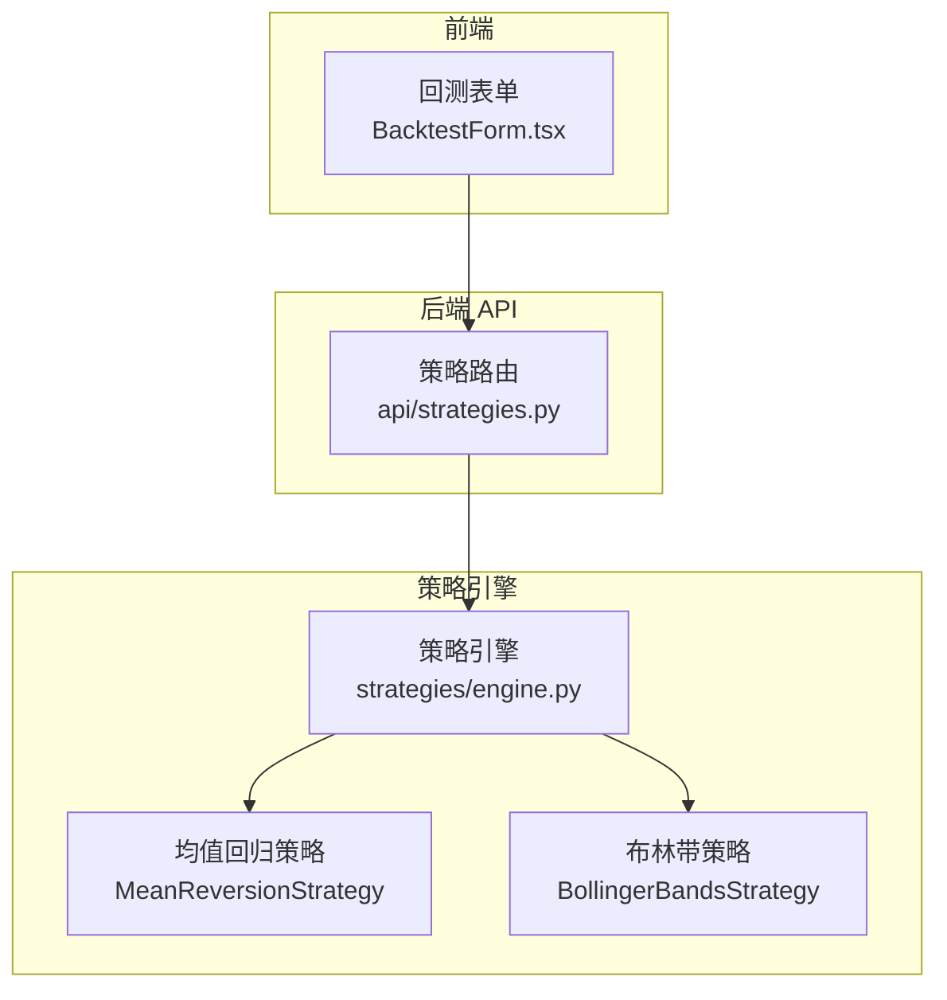
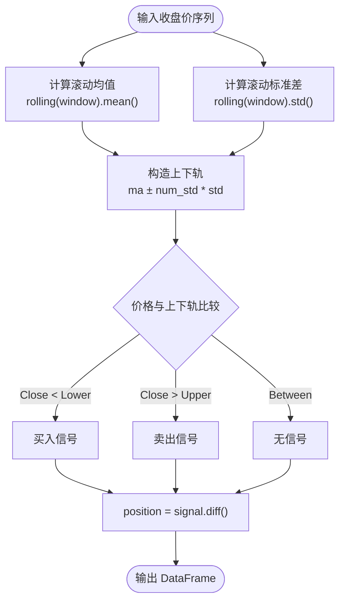
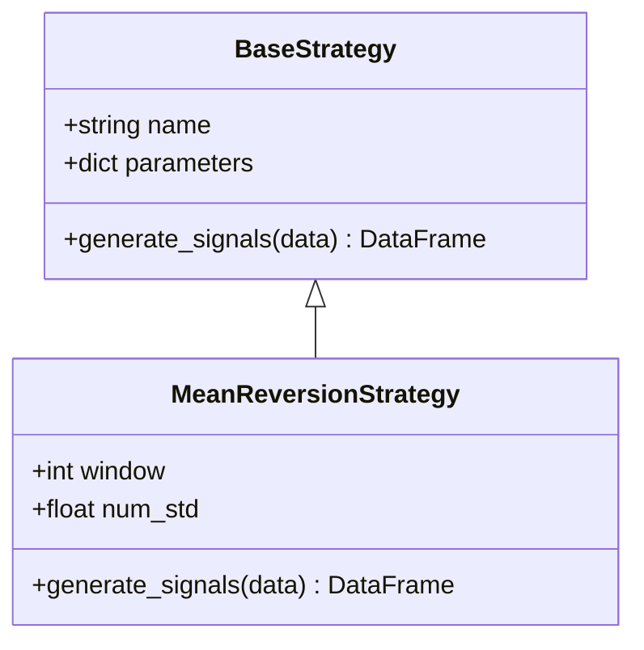
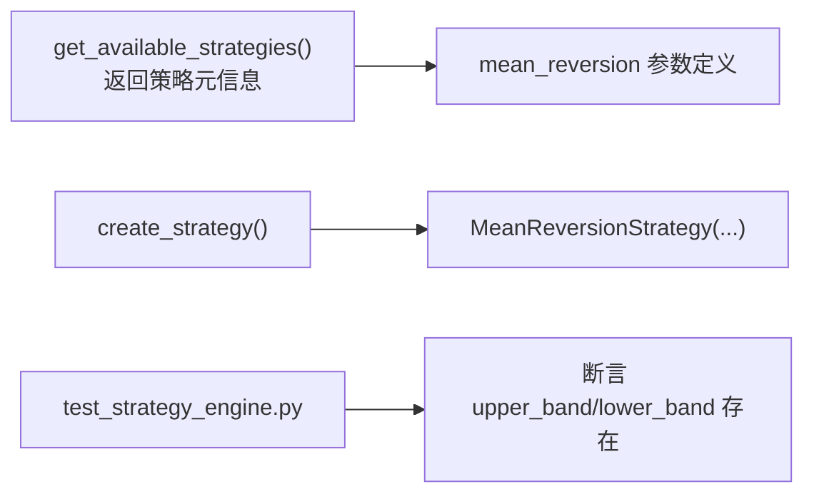

# 均值回归策略

<cite>
**本文引用的文件**   
- [backend/app/strategies/engine.py](file://backend/app/strategies/engine.py)
- [backend/tests/test_strategy_engine.py](file://backend/tests/test_strategy_engine.py)
- [frontend/src/components/BacktestForm.tsx](file://frontend/src/components/BacktestForm.tsx)
</cite>

## 目录
1. [引言](#引言)
2. [项目结构](#项目结构)
3. [核心组件](#核心组件)
4. [架构总览](#架构总览)
5. [详细组件分析](#详细组件分析)
6. [依赖关系分析](#依赖关系分析)
7. [性能与实现要点](#性能与实现要点)
8. [参数调优与适用环境](#参数调优与适用环境)
9. [趋势市与震荡市的识别](#趋势市与震荡市的识别)
10. [故障排查](#故障排查)
11. [结论](#结论)

## 引言
本文件围绕“均值回归策略”展开，系统讲解其数学基础（移动平均线、标准差、布林带）、交易逻辑（以价格偏离均值的标准差倍数判断超买超卖，低于下轨买入、高于上轨卖出），并结合仓库中的具体实现，给出可追溯的代码路径。文档同时提供不同波动率环境下的参数调整建议，解释该策略在震荡市场中的优势，并说明如何识别趋势市与震荡市的切换。

## 项目结构
本项目后端采用 FastAPI + 策略引擎的模块化设计，前端通过表单暴露策略参数。均值回归策略位于后端策略引擎中，并在前端回测表单中暴露可调参数窗口周期与标准差倍数。

图表来源
- [frontend/src/components/BacktestForm.tsx:166-190](file://frontend/src/components/BacktestForm.tsx#L166-L190)
- [backend/app/api/strategies.py:11-24](file://backend/app/api/strategies.py#L11-L24)
- [backend/app/strategies/engine.py:84-111](file://backend/app/strategies/engine.py#L84-L111)
- [backend/app/strategies/engine.py:153-205](file://backend/app/strategies/engine.py#L153-L205)

章节来源
- [backend/app/strategies/engine.py:1-12](file://backend/app/strategies/engine.py#L1-L12)
- [backend/app/api/strategies.py:1-24](file://backend/app/api/strategies.py#L1-L24)
- [frontend/src/components/BacktestForm.tsx:166-190](file://frontend/src/components/BacktestForm.tsx#L166-L190)

## 核心组件
- 均值回归策略类：基于收盘价计算滚动均值与滚动标准差，构建上下轨，按价格相对上下轨的位置生成买卖信号。
- 布林带策略类：与均值回归思路一致，但进一步引入 %B 指标与带宽过滤，用于更精细的信号控制。
- 前端表单：暴露 window 与 num_std 等关键参数，便于用户调节策略敏感度。

章节来源
- [backend/app/strategies/engine.py:84-111](file://backend/app/strategies/engine.py#L84-L111)
- [backend/app/strategies/engine.py:153-205](file://backend/app/strategies/engine.py#L153-L205)
- [frontend/src/components/BacktestForm.tsx:166-190](file://frontend/src/components/BacktestForm.tsx#L166-L190)

## 架构总览
均值回归策略的数据流如下：输入 OHLCV 数据 → 计算滚动均值与标准差 → 构造上下轨 → 比较当前收盘价与上下轨 → 输出信号列与持仓变化列。

图表来源
- [backend/app/strategies/engine.py:94-111](file://backend/app/strategies/engine.py#L94-L111)

## 详细组件分析

### 均值回归策略类 MeanReversionStrategy
- 参数
  - window：滚动窗口长度，决定均值与标准差的平滑程度。
  - num_std：标准差倍数，决定上下轨的宽度，即超买超卖的阈值强度。
- 核心计算
  - 使用 rolling().mean() 计算移动平均线（MA）。
  - 使用 rolling().std() 计算滚动标准差（STD）。
  - 上轨 = MA + num_std × STD；下轨 = MA − num_std × STD。
- 交易逻辑
  - 当收盘价低于下轨时，视为超卖，产生买入信号。
  - 当收盘价高于上轨时，视为超买，产生卖出信号。
  - position 列为 signal 的一阶差分，仅在信号变化时触发实际仓位变动。

图表来源
- [backend/app/strategies/engine.py:17-25](file://backend/app/strategies/engine.py#L17-L25)
- [backend/app/strategies/engine.py:84-111](file://backend/app/strategies/engine.py#L84-L111)

章节来源
- [backend/app/strategies/engine.py:84-111](file://backend/app/strategies/engine.py#L84-L111)

### 布林带策略类 BollingerBandsStrategy（对比参考）
- 与均值回归策略共享相同的均值与标准差计算方式，但额外引入：
  - %B = (Close − Lower) / (Upper − Lower)，衡量价格在通道内的相对位置。
  - Bandwidth = (Upper − Lower) / Mid，衡量通道宽度，用于过滤假信号。
- 信号规则
  - %B 接近下轨（小于 buy_threshold）时买入。
  - %B 接近上轨（大于 sell_threshold）时卖出。

章节来源
- [backend/app/strategies/engine.py:153-205](file://backend/app/strategies/engine.py#L153-L205)

### 前端参数暴露
- 针对均值回归策略，前端表单暴露：
  - 窗口周期（window）：默认 20，范围 10–100。
  - 标准差倍数（num_std）：默认 2.0，范围 1.0–3.0，步长 0.1。

章节来源
- [frontend/src/components/BacktestForm.tsx:166-190](file://frontend/src/components/BacktestForm.tsx#L166-L190)

## 依赖关系分析
- 策略注册与创建
  - 策略列表中包含 mean_reversion，参数定义包含 window 与 num_std。
  - create_strategy 根据 strategy_id 实例化对应策略类，传入前端或调用方提供的参数。
- 测试用例
  - 对均值回归策略进行信号列存在性校验与上下轨列存在性校验。

图表来源
- [backend/app/strategies/engine.py:506-597](file://backend/app/strategies/engine.py#L506-L597)
- [backend/app/strategies/engine.py:600-656](file://backend/app/strategies/engine.py#L600-L656)
- [backend/tests/test_strategy_engine.py:98-107](file://backend/tests/test_strategy_engine.py#L98-L107)

章节来源
- [backend/app/strategies/engine.py:506-656](file://backend/app/strategies/engine.py#L506-L656)
- [backend/tests/test_strategy_engine.py:98-107](file://backend/tests/test_strategy_engine.py#L98-L107)

## 性能与实现要点
- 向量化计算
  - 使用 pandas 的 rolling().mean() 与 rolling().std() 进行向量化计算，避免逐行循环，提升性能。
- 内存与时间复杂度
  - 对长度为 N 的价格序列，滚动均值与标准差的时间复杂度为 O(N)，空间复杂度取决于窗口大小与中间列数量。
- 信号到仓位的转换
  - position = signal.diff() 仅在信号变化时产生非零值，减少不必要的交易频率。

章节来源
- [backend/app/strategies/engine.py:94-111](file://backend/app/strategies/engine.py#L94-L111)

## 参数调优与适用环境
- window（滚动窗口）
  - 较小窗口（如 10–20）：对短期波动更敏感，信号频繁，适合高波动震荡行情。
  - 较大窗口（如 40–100）：更平滑，信号更少，适合低波动或趋势较弱的市场。
- num_std（标准差倍数）
  - 较小倍数（如 1.0–1.5）：通道更窄，更容易触发买卖信号，适合高波动环境。
  - 较大倍数（如 2.0–3.0）：通道更宽，信号更保守，适合低波动或需要过滤噪音的环境。
- 不同波动率环境的建议
  - 高波动震荡市：减小 window，适度降低 num_std，提高捕捉反弹的概率。
  - 低波动震荡市：增大 window，保持或略增 num_std，避免过度交易。
  - 强趋势市：均值回归易失效，应谨慎使用或结合趋势过滤。

章节来源
- [backend/app/strategies/engine.py:84-111](file://backend/app/strategies/engine.py#L84-L111)
- [frontend/src/components/BacktestForm.tsx:166-190](file://frontend/src/components/BacktestForm.tsx#L166-L190)

## 趋势市与震荡市的识别
- 波动率维度
  - 使用滚动标准差或 ATR 观察波动率水平：波动率持续放大且方向明确，倾向趋势市；波动率收敛且价格在中轴附近来回，倾向震荡市。
- 均线斜率与发散
  - 短中长期均线发散且斜率一致，倾向趋势市；均线粘合且反复交叉，倾向震荡市。
- 布林带形态
  - 带宽收窄后向上或向下突破，常伴随趋势启动；带宽持续扩张而价格在上/下轨间穿梭，多为震荡。
- 结合均值回归策略
  - 在震荡市中，价格频繁穿越上下轨，策略胜率较高。
  - 在趋势市中，价格可能长时间停留在单侧轨道外，导致连续止损，需配合趋势过滤（例如仅当波动率收敛或均线粘合时启用均值回归）。

[本节为概念性内容，不直接分析具体代码文件]

## 故障排查
- 常见问题
  - 初始 NaN：滚动窗口前若干条数据会缺失均值与标准差，需在后续处理中进行填充或忽略。
  - 信号过频：window 过小或 num_std 过小会导致频繁交易，增加手续费损耗。
  - 趋势市亏损：在强趋势环境中，均值回归容易逆势交易，需加入趋势过滤或切换策略。
- 验证方法
  - 检查输出 DataFrame 是否包含 ma、std、upper_band、lower_band、signal、position 等列。
  - 使用单元测试断言关键列存在性与信号格式。

章节来源
- [backend/tests/test_strategy_engine.py:98-107](file://backend/tests/test_strategy_engine.py#L98-L107)

## 结论
均值回归策略以移动平均线与标准差为基础，通过布林带式上下轨判断超买超卖，在震荡市场中具备天然优势。合理设置 window 与 num_std 能平衡信号的灵敏度与稳定性；在趋势市中需谨慎使用或叠加趋势过滤。项目中已提供清晰的实现与参数暴露，便于快速迭代与回测验证。