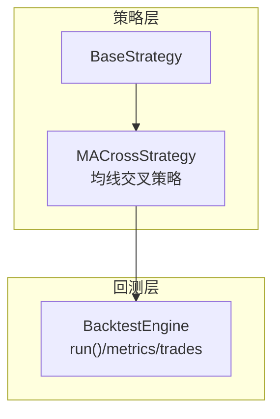
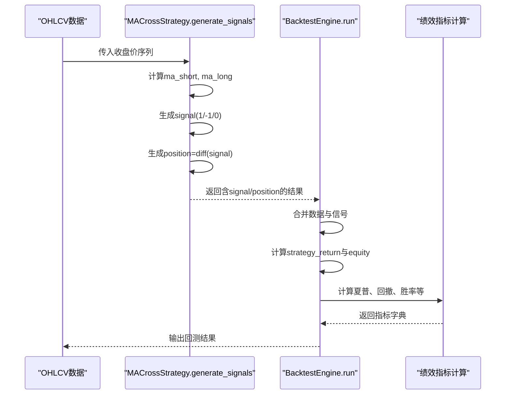
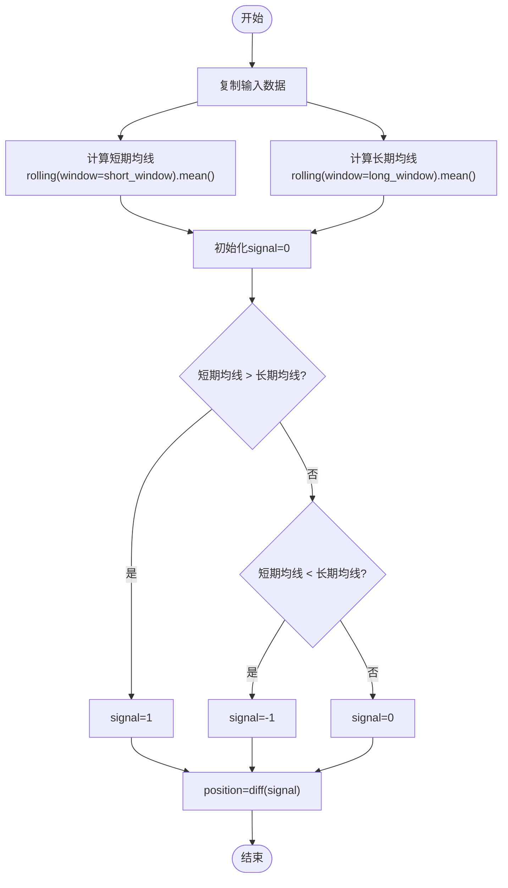
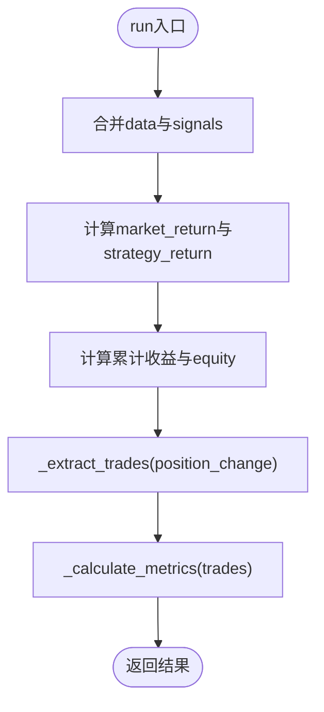
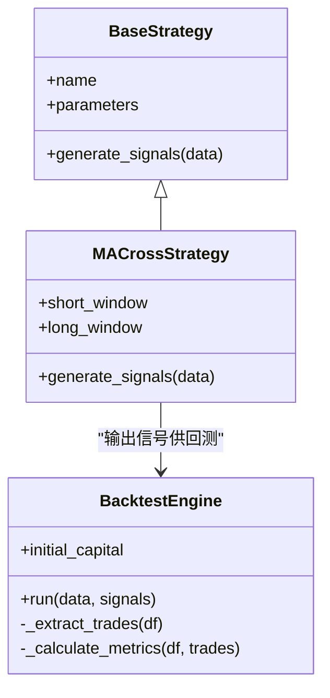

# 均线交叉策略

<cite>
**本文引用的文件**   
- [backend/app/strategies/engine.py](../../../../../../backend/app/strategies/engine.py)
- [backend/app/backtest/engine.py](../../../../../../backend/app/backtest/engine.py)
- [backend/tests/test_strategy_engine.py](../../../../../../backend/tests/test_strategy_engine.py)
</cite>

## 目录
1. [引言](#引言)
2. [项目结构](#项目结构)
3. [核心组件](#核心组件)
4. [架构总览](#架构总览)
5. [详细组件分析](#详细组件分析)
6. [依赖关系分析](#依赖关系分析)
7. [性能与实现要点](#性能与实现要点)
8. [参数调优与市场环境建议](#参数调优与市场环境建议)
9. [回测结果解读](#回测结果解读)
10. [实盘应用注意事项](#实盘应用注意事项)
11. [故障排查](#故障排查)
12. [结论](#结论)

## 引言
本文件围绕“均线交叉策略”展开，系统讲解短期与长期均线的计算原理、金叉与死叉的信号生成逻辑，以及 signal 列（1 买入、-1 卖出、0 持有）和 position 列（仅在信号变化时交易）的作用。文档结合仓库中的 pandas 实现，解释 rolling().mean() 的使用方式，并给出不同市场环境下的参数选择建议、回测结果解读方法与实盘注意事项，特别强调该策略在趋势跟踪中的应用价值与局限性。

## 项目结构
本项目后端采用 FastAPI + 策略引擎 + 回测引擎的分层设计：
- 策略层：定义多种策略类，其中包含均线交叉策略的完整实现。
- 回测层：接收策略输出的信号，计算收益曲线、交易记录与绩效指标。
- 测试层：对策略信号生成进行断言与边界条件验证。

图表来源
- [backend/app/strategies/engine.py:17-54](../../../../../../backend/app/strategies/engine.py#L17-L54)
- [backend/app/backtest/engine.py:10-70](../../../../../../backend/app/backtest/engine.py#L10-L70)

章节来源
- [backend/app/strategies/engine.py:17-54](../../../../../../backend/app/strategies/engine.py#L17-L54)
- [backend/app/backtest/engine.py:10-70](../../../../../../backend/app/backtest/engine.py#L10-L70)

## 核心组件
- BaseStrategy：策略基类，定义 generate_signals 接口。
- MACrossStrategy：均线交叉策略，负责计算短期与长期均线、生成 signal 与 position。
- BacktestEngine：回测引擎，将信号与价格序列合并，计算策略收益、资金曲线、交易记录与绩效指标。

章节来源
- [backend/app/strategies/engine.py:17-54](../../../../../../backend/app/strategies/engine.py#L17-L54)
- [backend/app/backtest/engine.py:10-70](../../../../../../backend/app/backtest/engine.py#L10-L70)

## 架构总览
均线交叉策略从输入 OHLCV 数据出发，通过滚动窗口计算两条移动平均线，比较其相对位置产生方向性信号；随后由回测引擎根据信号的差分（position）执行买卖，并输出收益曲线与绩效指标。

图表来源
- [backend/app/strategies/engine.py:38-54](../../../../../../backend/app/strategies/engine.py#L38-L54)
- [backend/app/backtest/engine.py:15-70](../../../../../../backend/app/backtest/engine.py#L15-L70)

## 详细组件分析

### MACrossStrategy（均线交叉策略）
- 输入：DataFrame，需包含 Close 列。
- 计算步骤：
  - 使用 rolling(window).mean() 分别计算短期与长期均线。
  - 初始化 signal 为 0。
  - 当短期均线上穿长期均线（即短期 > 长期）时，signal = 1（买入）。
  - 当短期均线下穿长期均线（即短期 < 长期）时，signal = -1（卖出）。
  - position = diff(signal)，仅在信号发生变化时产生交易动作。
- 输出：包含 ma_short、ma_long、signal、position 的 DataFrame。

图表来源
- [backend/app/strategies/engine.py:38-54](../../../../../../backend/app/strategies/engine.py#L38-L54)

章节来源
- [backend/app/strategies/engine.py:38-54](../../../../../../backend/app/strategies/engine.py#L38-L54)

### BacktestEngine（回测引擎）
- run(data, signals)：
  - 合并 data 与 signals，得到 signal 与 position_change。
  - 计算市场收益率 market_return 与策略收益率 strategy_return（使用上一期 signal）。
  - 计算累计收益与资金曲线 equity。
  - 提取交易记录 trades（基于 position_change 判断买卖）。
  - 计算绩效指标 metrics（总收益、年化收益、最大回撤、夏普比率、胜率、盈亏比等）。
- _extract_trades：遍历行，依据 position_change 的正负与当前持仓状态切换开平仓。
- _calculate_metrics：汇总关键指标，并对异常值做安全处理。

图表来源
- [backend/app/backtest/engine.py:15-70](../../../../../../backend/app/backtest/engine.py#L15-L70)
- [backend/app/backtest/engine.py:72-103](../../../../../../backend/app/backtest/engine.py#L72-L103)
- [backend/app/backtest/engine.py:105-163](../../../../../../backend/app/backtest/engine.py#L105-L163)

章节来源
- [backend/app/backtest/engine.py:15-70](../../../../../../backend/app/backtest/engine.py#L15-L70)
- [backend/app/backtest/engine.py:72-103](../../../../../../backend/app/backtest/engine.py#L72-L103)
- [backend/app/backtest/engine.py:105-163](../../../../../../backend/app/backtest/engine.py#L105-L163)

## 依赖关系分析
- MACrossStrategy 依赖 pandas 的 Series/DataFrame 与 rolling 方法。
- BacktestEngine 依赖 pandas 的数值运算与时间序列处理。
- 测试用例对信号 schema、默认参数、中间列存在性与 position 与 signal.diff 的一致性进行断言。

图表来源
- [backend/app/strategies/engine.py:17-54](../../../../../../backend/app/strategies/engine.py#L17-L54)
- [backend/app/backtest/engine.py:10-70](../../../../../../backend/app/backtest/engine.py#L10-L70)

章节来源
- [backend/tests/test_strategy_engine.py:70-84](../../../../../../backend/tests/test_strategy_engine.py#L70-L84)
- [backend/tests/test_strategy_engine.py:174-186](../../../../../../backend/tests/test_strategy_engine.py#L174-L186)

## 性能与实现要点
- rolling().mean() 的时间复杂度近似 O(n)，空间复杂度取决于窗口大小与数据规模。
- 向量化赋值（loc）避免逐行循环，提升计算效率。
- 使用 diff() 生成 position，仅当信号变化时触发交易，减少频繁换手。
- 回测中 strategy_return 使用 shift(1) 以避免未来函数泄露。

章节来源
- [backend/app/strategies/engine.py:38-54](../../../../../../backend/app/strategies/engine.py#L38-L54)
- [backend/app/backtest/engine.py:31-39](../../../../../../backend/app/backtest/engine.py#L31-L39)

## 参数调优与市场环境建议
- short_window（短期均线周期）
  - 含义：计算短期移动平均的回看天数。
  - 取值范围：2–50（前端与注册表限制）。
  - 调优建议：
    - 短周期更敏感，适合捕捉快速趋势，但假信号较多。
    - 在震荡市中易产生频繁交易，需配合过滤或更长 long_window。
- long_window（长期均线周期）
  - 含义：计算长期移动平均的回看天数。
  - 取值范围：10–200（前端与注册表限制）。
  - 调优建议：
    - 长周期更稳定，用于识别中长期趋势方向。
    - 与 short_window 拉开差距可增强趋势跟踪效果。
- 组合建议
  - 趋势明显市场：较短 short_window（如 5–10）+ 较长 long_window（如 20–60）。
  - 震荡市场：增大 long_window 或引入其他过滤器（波动率、成交量），降低交易频率。
  - 高频/短线：缩短双窗，但需严格风控与手续费考量。
  - 中长线：拉长双窗，提高稳定性，接受滞后性。

章节来源
- [backend/app/strategies/engine.py:30-36](../../../../../../backend/app/strategies/engine.py#L30-L36)
- [backend/app/strategies/engine.py:506-517](../../../../../../backend/app/strategies/engine.py#L506-L517)

## 回测结果解读
- 收益相关
  - total_return：总收益率。
  - annual_return：年化收益率。
  - equity_curve：资金曲线随时间的变化。
- 风险相关
  - max_drawdown：最大回撤（百分比）。
  - sharpe_ratio：夏普比率（考虑无风险利率）。
- 交易统计
  - total_trades/winning_trades/losing_trades：交易次数与胜败分布。
  - win_rate/profit_loss_ratio：胜率与盈亏比。
- 信号与交易
  - signals_data：包含 Date、Close、signal、position_change，便于可视化与复盘。
  - trades：每笔交易的入场/出场日期与价格、盈亏百分比。

章节来源
- [backend/app/backtest/engine.py:50-70](../../../../../../backend/app/backtest/engine.py#L50-L70)
- [backend/app/backtest/engine.py:72-103](../../../../../../backend/app/backtest/engine.py#L72-L103)
- [backend/app/backtest/engine.py:105-163](../../../../../../backend/app/backtest/engine.py#L105-L163)

## 实盘应用注意事项
- 滑点与手续费：均线交叉策略在震荡市可能频繁交易，需计入交易成本。
- 信号延迟：均线具有滞后性，趋势反转时可能出现较晚的退出信号。
- 仓位管理：建议结合波动率或风险预算控制仓位，避免单次亏损过大。
- 数据质量：确保收盘价序列连续且无缺失，避免滚动窗口计算异常。
- 过拟合风险：参数优化需在样本外数据验证，避免过度拟合历史行情。
- 多资产扩展：在不同品种上表现差异较大，需分品种校准参数。

[本节为通用指导，不直接分析具体文件]

## 故障排查
- 输入数据缺少 Close 列：
  - 现象：滚动计算失败或结果为空。
  - 解决：确保输入 DataFrame 包含 Close 列。
- 信号列非法值：
  - 现象：signal 出现非 {-1, 0, 1} 的值。
  - 解决：检查均线比较逻辑与赋值语句，确保只赋 1/-1/0。
- position 与 signal.diff 不一致：
  - 现象：position 未按预期反映信号变化。
  - 解决：确认 position = diff(signal) 的实现未被覆盖。
- 最小数据长度不足：
  - 现象：短数据导致 NaN 或行为异常。
  - 解决：保证数据长度至少大于 long_window，或在策略内填充/跳过前段。

章节来源
- [backend/tests/test_strategy_engine.py:70-84](../../../../../../backend/tests/test_strategy_engine.py#L70-L84)
- [backend/tests/test_strategy_engine.py:174-186](../../../../../../backend/tests/test_strategy_engine.py#L174-L186)

## 结论
均线交叉策略以简单直观的方式实现趋势跟踪：短期均线上穿长期均线视为买入信号，下穿视为卖出信号。通过 rolling().mean() 计算均线，并使用 diff(signal) 生成仅在信号变化时的交易指令，能有效降低频繁换手的成本。该策略在趋势市场中具备良好表现，但在震荡市场中容易受噪声干扰。实际应用中应结合市场环境选择合适的 short_window 与 long_window，并通过回测评估收益、风险与交易统计指标，同时注意滑点、手续费与过拟合等实盘问题。