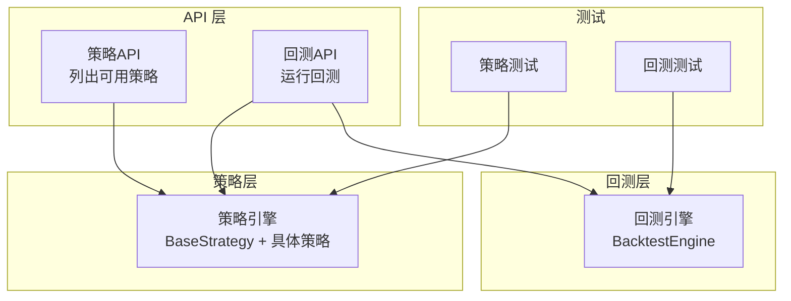
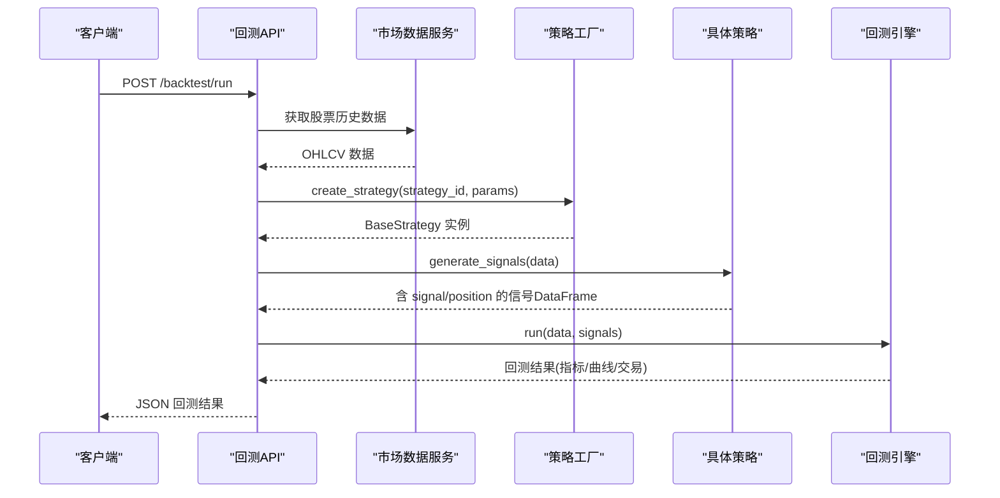
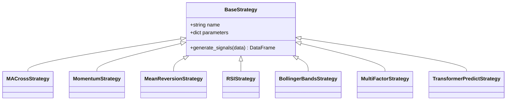
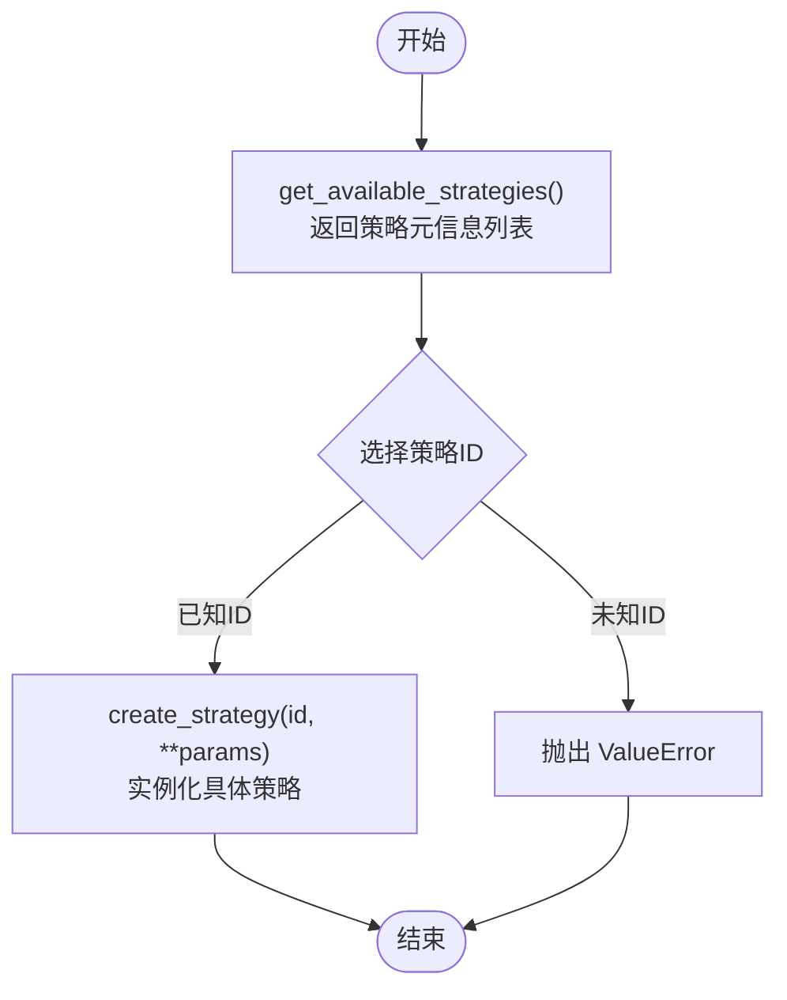
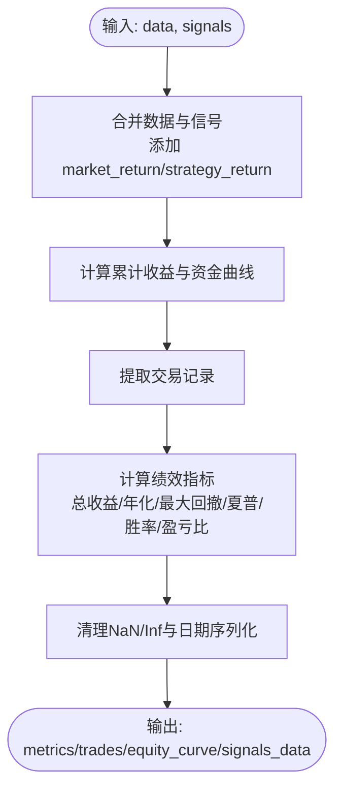
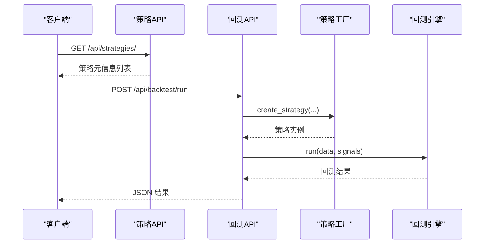
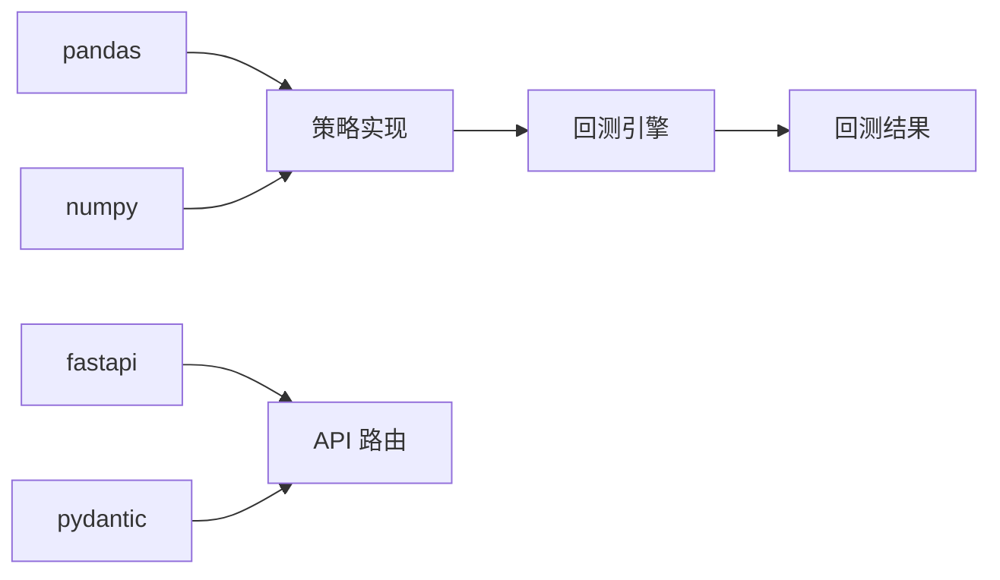

# 策略开发指南

<cite>
**本文引用的文件**   
- [backend/app/strategies/engine.py](../../../../../backend/app/strategies/engine.py)
- [backend/app/api/strategies.py](../../../../../backend/app/api/strategies.py)
- [backend/app/api/backtest.py](../../../../../backend/app/api/backtest.py)
- [backend/app/backtest/engine.py](../../../../../backend/app/backtest/engine.py)
- [backend/tests/test_strategy_engine.py](../../../../../backend/tests/test_strategy_engine.py)
- [backend/tests/test_backtest_engine.py](../../../../../backend/tests/test_backtest_engine.py)
</cite>

## 目录
1. [引言](#引言)
2. [项目结构](#项目结构)
3. [核心组件](#核心组件)
4. [架构总览](#架构总览)
5. [详细组件分析](#详细组件分析)
6. [依赖关系分析](#依赖关系分析)
7. [性能与优化建议](#性能与优化建议)
8. [故障排查指南](#故障排查指南)
9. [结论](#结论)
10. [附录：策略开发模板与最佳实践](#附录策略开发模板与最佳实践)

## 引言
本指南面向量化策略开发者，系统说明如何基于 BaseStrategy 基类开发自定义策略，覆盖标准流程、数据格式约定、信号生成逻辑设计、参数定义、注册机制与工厂模式、回测验证、测试方法与实盘部署注意事项。文档以仓库中现有实现为依据，提供可操作的步骤与图示，帮助你在不改动既有系统的前提下，快速集成新策略。

## 项目结构
本项目后端采用分层组织：
- 策略层：策略基类与多种具体策略实现位于 strategies 模块
- API 层：FastAPI 路由暴露策略列表与回测接口
- 回测引擎：计算收益曲线、交易记录与绩效指标
- 测试：针对策略与回测引擎的单元测试

图表来源
- [backend/app/strategies/engine.py:17-656](../../../../../backend/app/strategies/engine.py#L17-L656)
- [backend/app/api/strategies.py:1-25](../../../../../backend/app/api/strategies.py#L1-L25)
- [backend/app/api/backtest.py:1-77](../../../../../backend/app/api/backtest.py#L1-L77)
- [backend/app/backtest/engine.py:10-163](../../../../../backend/app/backtest/engine.py#L10-L163)

章节来源
- [backend/app/strategies/engine.py:17-656](../../../../../backend/app/strategies/engine.py#L17-L656)
- [backend/app/api/strategies.py:1-25](../../../../../backend/app/api/strategies.py#L1-L25)
- [backend/app/api/backtest.py:1-77](../../../../../backend/app/api/backtest.py#L1-L77)
- [backend/app/backtest/engine.py:10-163](../../../../../backend/app/backtest/engine.py#L10-L163)

## 核心组件
- BaseStrategy 与具体策略：统一信号生成接口，返回包含 signal 与 position 列的 DataFrame
- 策略注册表与工厂函数：集中管理策略元信息与实例化
- 回测引擎：将信号转化为资金曲线、交易记录与绩效指标
- API 路由：对外暴露策略列表与回测执行接口

章节来源
- [backend/app/strategies/engine.py:17-656](../../../../../backend/app/strategies/engine.py#L17-L656)
- [backend/app/backtest/engine.py:10-163](../../../../../backend/app/backtest/engine.py#L10-L163)
- [backend/app/api/strategies.py:1-25](../../../../../backend/app/api/strategies.py#L1-L25)
- [backend/app/api/backtest.py:1-77](../../../../../backend/app/api/backtest.py#L1-L77)

## 架构总览
下图展示从前端或外部调用到策略信号生成与回测执行的完整链路。

图表来源
- [backend/app/api/backtest.py:28-69](../../../../../backend/app/api/backtest.py#L28-L69)
- [backend/app/strategies/engine.py:600-656](../../../../../backend/app/strategies/engine.py#L600-L656)
- [backend/app/backtest/engine.py:15-70](../../../../../backend/app/backtest/engine.py#L15-L70)

## 详细组件分析

### 策略基类与继承体系
- BaseStrategy 定义统一的初始化与信号生成接口
- 具体策略（如均线交叉、动量、均值回归、RSI、布林带、多因子、Transformer预测）均继承 BaseStrategy，并实现 generate_signals
- 所有策略返回的数据框需包含 signal 与 position 列；signal 取值限定为 {1, -1, 0}，position 通常为 signal 的一阶差分

图表来源
- [backend/app/strategies/engine.py:17-504](../../../../../backend/app/strategies/engine.py#L17-L504)

章节来源
- [backend/app/strategies/engine.py:17-504](../../../../../backend/app/strategies/engine.py#L17-L504)

### 策略注册机制与工厂模式
- get_available_strategies 返回策略元信息列表，包含 id、name、description、parameters 等字段，供前端或外部系统动态加载
- create_strategy 根据 strategy_id 与参数创建具体策略实例，是典型的工厂模式
- 新增策略时，需在 get_available_strategies 与 create_strategy 两处同步注册

图表来源
- [backend/app/strategies/engine.py:506-656](../../../../../backend/app/strategies/engine.py#L506-L656)

章节来源
- [backend/app/strategies/engine.py:506-656](../../../../../backend/app/strategies/engine.py#L506-L656)

### 回测引擎与绩效指标
- BacktestEngine.run 接收原始行情数据与策略信号，计算策略收益、累计收益、资金曲线、交易记录与绩效指标
- 输出包含 metrics、trades、equity_curve、signals_data 等键，日期序列化为字符串，数值列清理 NaN/Inf 保证 JSON 安全

图表来源
- [backend/app/backtest/engine.py:15-70](../../../../../backend/app/backtest/engine.py#L15-L70)
- [backend/app/backtest/engine.py:105-163](../../../../../backend/app/backtest/engine.py#L105-L163)

章节来源
- [backend/app/backtest/engine.py:15-163](../../../../../backend/app/backtest/engine.py#L15-L163)

### API 路由与集成点
- 策略API：GET /api/strategies/ 与 GET /api/strategies/{id} 用于获取策略列表与详情
- 回测API：POST /api/backtest/run 接收策略ID、标的、时间范围、初始资金、数据源与参数，完成数据获取、策略创建、信号生成与回测执行

图表来源
- [backend/app/api/strategies.py:11-24](../../../../../backend/app/api/strategies.py#L11-L24)
- [backend/app/api/backtest.py:28-69](../../../../../backend/app/api/backtest.py#L28-L69)

章节来源
- [backend/app/api/strategies.py:1-25](../../../../../backend/app/api/strategies.py#L1-L25)
- [backend/app/api/backtest.py:1-77](../../../../../backend/app/api/backtest.py#L1-L77)

## 依赖关系分析
- 策略层依赖 pandas/numpy 进行数据处理
- API 层依赖 FastAPI 与 Pydantic 进行请求校验与路由
- 回测引擎依赖 pandas/numpy 计算收益与指标
- 测试用例通过 pytest 断言策略与回测行为

图表来源
- [backend/app/strategies/engine.py:4-7](../../../../../backend/app/strategies/engine.py#L4-L7)
- [backend/app/backtest/engine.py:4-7](../../../../../backend/app/backtest/engine.py#L4-L7)
- [backend/app/api/strategies.py:4-6](../../../../../backend/app/api/strategies.py#L4-L6)
- [backend/app/api/backtest.py:4-11](../../../../../backend/app/api/backtest.py#L4-L11)

章节来源
- [backend/app/strategies/engine.py:4-7](../../../../../backend/app/strategies/engine.py#L4-L7)
- [backend/app/backtest/engine.py:4-7](../../../../../backend/app/backtest/engine.py#L4-L7)
- [backend/app/api/strategies.py:4-6](../../../../../backend/app/api/strategies.py#L4-L6)
- [backend/app/api/backtest.py:4-11](../../../../../backend/app/api/backtest.py#L4-L11)

## 性能与优化建议
- 向量化优先：尽量使用 pandas rolling/pct_change/diff 等向量化操作，避免逐行循环
- 内存控制：在 generate_signals 中对输入 DataFrame 做 copy，避免污染上游数据
- 缺失值处理：对滚动窗口产生的 NaN 进行合理填充或跳过，确保后续逻辑稳定
- 阈值与边界：对除零、无穷大、NaN 进行防御性处理，避免回测指标异常
- 训练窗口与滑动窗口：深度学习或机器学习策略应使用滚动训练（walk-forward），防止未来数据泄露
- 指标健壮性：夏普比率、最大回撤等指标需处理极端情况（无波动、零方差）

[本节为通用指导，不直接分析具体文件]

## 故障排查指南
- 未知策略ID：create_strategy 会抛出 ValueError，检查策略是否已在注册表与工厂函数中注册
- 信号列缺失或非法：确保 generate_signals 返回包含 signal 与 position 列，且 signal 仅取 {-1, 0, 1}
- 回测结果为空或指标异常：检查数据时间序列连续性、是否存在大量缺失值或无效价格
- JSON 序列化失败：确认回测结果中的日期已序列化为字符串，数值列不含 NaN/Inf
- 深度学习策略不可用：若未安装依赖，create_strategy("transformer_dl") 会抛出 ImportError

章节来源
- [backend/app/strategies/engine.py:600-656](../../../../../backend/app/strategies/engine.py#L600-L656)
- [backend/tests/test_strategy_engine.py:48-50](../../../../../backend/tests/test_strategy_engine.py#L48-L50)
- [backend/tests/test_backtest_engine.py:158-179](../../../../../backend/tests/test_backtest_engine.py#L158-L179)

## 结论
通过 BaseStrategy 抽象与工厂模式，本项目实现了策略的可插拔扩展与统一管理。开发者只需遵循统一的信号生成接口与数据格式约定，即可快速集成新策略。配合完善的测试与回测引擎，可在本地完成策略验证与评估，并为后续实盘部署奠定基础。

[本节为总结性内容，不直接分析具体文件]

## 附录：策略开发模板与最佳实践

### 标准开发流程
- 继承 BaseStrategy，并在 __init__ 中设置 name 与 parameters
- 实现 generate_signals(data: pd.DataFrame) -> pd.DataFrame，返回包含 signal 与 position 列的结果
- 在 get_available_strategies 中注册策略元信息（id、name、description、parameters）
- 在 create_strategy 中添加策略ID分支，按参数构造实例
- 编写单元测试，覆盖信号结构、默认参数、边界条件与不修改输入数据

章节来源
- [backend/app/strategies/engine.py:17-25](../../../../../backend/app/strategies/engine.py#L17-L25)
- [backend/app/strategies/engine.py:506-656](../../../../../backend/app/strategies/engine.py#L506-L656)
- [backend/tests/test_strategy_engine.py:26-50](../../../../../backend/tests/test_strategy_engine.py#L26-L50)

### 数据格式约定
- 输入数据：OHLCV 数据框，至少包含 Close 列，可选 Volume
- 输出信号：必须包含 signal 与 position 列；signal ∈ {-1, 0, 1}；position 通常为 signal.diff()
- 日期列：Date 列应为 datetime 类型，便于回测引擎处理

章节来源
- [backend/app/backtest/engine.py:47-55](../../../../../backend/app/backtest/engine.py#L47-L55)
- [backend/tests/test_strategy_engine.py:57-63](../../../../../backend/tests/test_strategy_engine.py#L57-L63)

### 信号生成逻辑设计要点
- 明确入场与出场条件，避免频繁震荡导致的过度交易
- 使用 diff 生成 position，仅在信号变化时产生交易
- 对指标计算过程中的除零、无穷大、NaN 进行防护
- 对于复杂策略，拆分为多个子方法（如 RSI 计算、归一化等），提高可读性与可测试性

章节来源
- [backend/app/strategies/engine.py:114-150](../../../../../backend/app/strategies/engine.py#L114-L150)
- [backend/app/strategies/engine.py:252-265](../../../../../backend/app/strategies/engine.py#L252-L265)

### 错误处理与健壮性
- 在 create_strategy 中对未知ID抛出 ValueError
- 对深度学习相关策略，在未安装依赖时抛出 ImportError
- 在回测引擎中对指标计算进行安全舍入与异常值处理

章节来源
- [backend/app/strategies/engine.py:647-655](../../../../../backend/app/strategies/engine.py#L647-L655)
- [backend/app/backtest/engine.py:130-148](../../../../../backend/app/backtest/engine.py#L130-L148)

### 测试与回测验证
- 单元测试重点：
  - 策略注册表返回结构与必填字段
  - 工厂函数对已知ID与未知ID的行为
  - 信号数据结构与取值范围
  - 默认参数与中间列存在性
  - 短数据下的鲁棒性
  - 不修改输入数据
- 回测测试重点：
  - 返回结构完整性
  - 指标字段齐全且有效
  - 交易记录结构正确
  - JSON 序列化安全（日期字符串、数值有限）

章节来源
- [backend/tests/test_strategy_engine.py:26-187](../../../../../backend/tests/test_strategy_engine.py#L26-L187)
- [backend/tests/test_backtest_engine.py:16-179](../../../../../backend/tests/test_backtest_engine.py#L16-L179)

### 实盘部署注意事项
- 数据源稳定性：确保市场数据服务的可用性与延迟可控
- 参数校验：在 API 层对传入参数进行范围校验，避免非法配置进入策略
- 风控与滑点：回测阶段可加入手续费、滑点与仓位限制，更贴近实盘
- 监控与日志：记录策略运行状态、信号频率、异常与回滚策略
- 渐进式上线：先在模拟环境验证，再小资金试运行，逐步放量

[本节为通用指导，不直接分析具体文件]