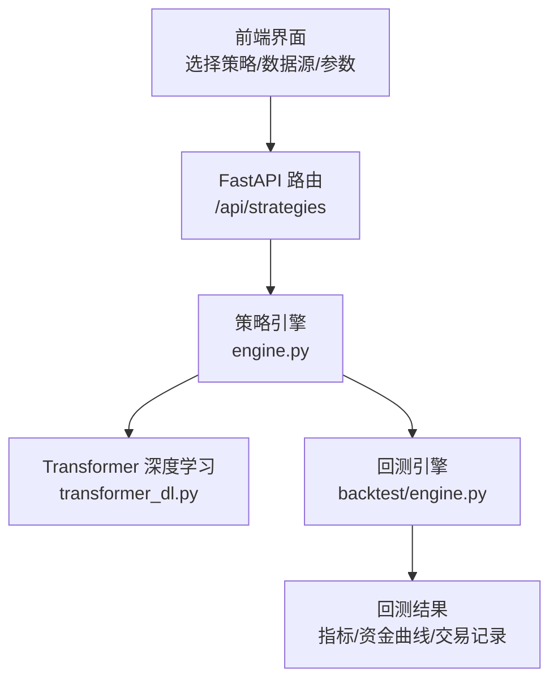
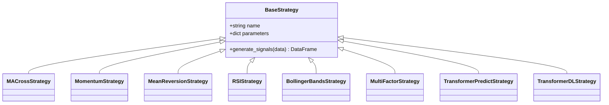
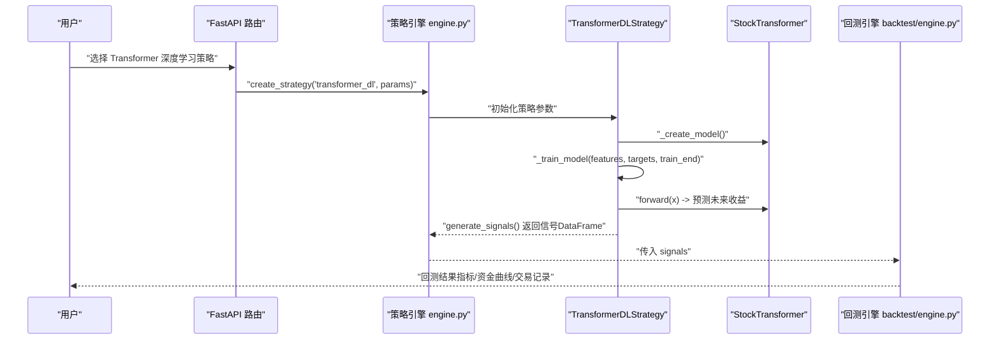
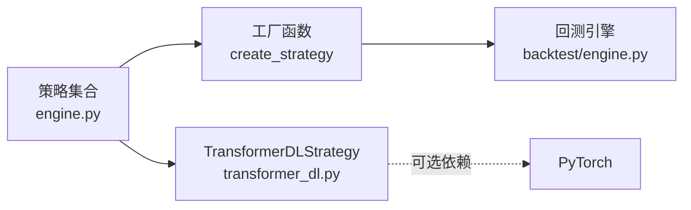

# 量化策略

<cite>
**本文引用的文件**   
- [backend/app/strategies/engine.py](file://backend/app/strategies/engine.py)
- [backend/app/strategies/transformer_dl.py](file://backend/app/strategies/transformer_dl.py)
- [backend/app/backtest/engine.py](file://backend/app/backtest/engine.py)
- [backend/app/api/strategies.py](file://backend/app/api/strategies.py)
- [backend/tests/test_strategy_engine.py](file://backend/tests/test_strategy_engine.py)
- [QUICKSTART.md](file://QUICKSTART.md)
</cite>

## 目录
1. [引言](#引言)
2. [项目结构](#项目结构)
3. [核心组件](#核心组件)
4. [架构总览](#架构总览)
5. [详细组件分析](#详细组件分析)
6. [依赖关系分析](#依赖关系分析)
7. [性能与回测指标](#性能与回测指标)
8. [参数调优指南](#参数调优指南)
9. [常见问题与排错](#常见问题与排错)
10. [结论](#结论)

## 引言
本文件面向量化策略开发者，系统性讲解平台支持的七类量化交易策略：均线交叉、动量、均值回归、RSI、布林带、多因子选股、Transformer深度学习。文档从理论基础、数学公式、参数含义、适用场景到优化建议逐层展开；同时深入解析 BaseStrategy 基类的设计模式与继承机制、信号生成逻辑、入场出场条件判断，并重点剖析 Transformer 深度学习策略的模型架构、注意力机制、训练流程与预测逻辑。文末提供参数调优方法、回测结果解读和实盘注意事项，帮助读者快速上手并稳健落地。

## 项目结构
后端采用 FastAPI + Python 的策略引擎与回测引擎分离设计，前端通过 API 调用策略列表与执行回测。关键路径如下：
- 策略定义与工厂：backend/app/strategies/engine.py
- Transformer 深度学习策略（PyTorch）：backend/app/strategies/transformer_dl.py
- 回测引擎与绩效指标：backend/app/backtest/engine.py
- 策略 API 路由：backend/app/api/strategies.py
- 单元测试覆盖策略创建与信号生成：backend/tests/test_strategy_engine.py
- 用户手册与参数说明：QUICKSTART.md

图表来源
- [backend/app/api/strategies.py:11-24](file://backend/app/api/strategies.py#L11-L24)
- [backend/app/strategies/engine.py:506-656](file://backend/app/strategies/engine.py#L506-L656)
- [backend/app/backtest/engine.py:10-70](file://backend/app/backtest/engine.py#L10-L70)

章节来源
- [backend/app/strategies/engine.py:17-656](file://backend/app/strategies/engine.py#L17-L656)
- [backend/app/strategies/transformer_dl.py:30-516](file://backend/app/strategies/transformer_dl.py#L30-L516)
- [backend/app/backtest/engine.py:10-163](file://backend/app/backtest/engine.py#L10-L163)
- [backend/app/api/strategies.py:11-24](file://backend/app/api/strategies.py#L11-L24)
- [QUICKSTART.md:138-204](file://QUICKSTART.md#L138-L204)

## 核心组件
- BaseStrategy 基类：统一策略接口，定义 name、parameters 与 generate_signals(data) 抽象方法，所有具体策略均继承该基类，保证信号输出结构一致。
- 传统技术指标策略：MACrossStrategy、MomentumStrategy、MeanReversionStrategy、RSIStrategy、BollingerBandsStrategy。
- 高级策略：MultiFactorStrategy（多因子选股）、TransformerPredictStrategy（简化版注意力预测）、TransformerDLStrategy（完整 PyTorch Transformer）。
- 工厂函数 create_strategy 与注册表 get_available_strategies：对外暴露策略 ID、名称、描述与参数元信息，支持动态实例化。
- 回测引擎 BacktestEngine：将策略信号转换为策略收益、累计净值、交易记录与绩效指标（总收益、年化、最大回撤、夏普比率、胜率、盈亏比等）。

章节来源
- [backend/app/strategies/engine.py:17-26](file://backend/app/strategies/engine.py#L17-L26)
- [backend/app/strategies/engine.py:28-504](file://backend/app/strategies/engine.py#L28-L504)
- [backend/app/strategies/engine.py:506-656](file://backend/app/strategies/engine.py#L506-L656)
- [backend/app/backtest/engine.py:10-163](file://backend/app/backtest/engine.py#L10-L163)

## 架构总览
策略系统采用“策略即服务”的模块化架构：
- 策略层：BaseStrategy 抽象 + 多种具体策略实现，统一返回包含 signal 与 position 列的 DataFrame。
- 回测层：BacktestEngine 读取策略信号，计算策略收益序列与资金曲线，统计绩效指标。
- 接口层：FastAPI 暴露策略列表与详情，便于前端展示与参数配置。
- 深度学习扩展：TransformerDLStrategy 在 PyTorch 可用时启用，否则降级为 TransformerPredictStrategy。

图表来源
- [backend/app/strategies/engine.py:17-504](file://backend/app/strategies/engine.py#L17-L504)
- [backend/app/strategies/transformer_dl.py:324-487](file://backend/app/strategies/transformer_dl.py#L324-L487)

## 详细组件分析

### BaseStrategy 设计与继承机制
- 设计要点：
  - 统一入口：generate_signals(data) 必须返回包含 signal 与 position 列的 DataFrame。
  - 参数封装：每个策略在 __init__ 中声明 parameters 字典，便于前端渲染与校验。
  - 可扩展性：新增策略只需继承 BaseStrategy 并在工厂函数中注册。
- 信号与仓位：
  - signal ∈ {-1, 0, 1}，分别表示卖出、持有、买入。
  - position = signal.diff()，用于标记实际开平仓动作，供回测引擎使用。

章节来源
- [backend/app/strategies/engine.py:17-26](file://backend/app/strategies/engine.py#L17-L26)
- [backend/tests/test_strategy_engine.py:57-64](file://backend/tests/test_strategy_engine.py#L57-L64)
- [backend/tests/test_strategy_engine.py:174-180](file://backend/tests/test_strategy_engine.py#L174-L180)

### 均线交叉策略（MACrossStrategy）
- 理论基础：短期均线上穿长期均线（金叉）视为多头信号，下穿（死叉）视为空头信号。
- 数学表达：
  - MA_short(t) = mean(Close[t-w_s+1:t])
  - MA_long(t) = mean(Close[t-w_l+1:t])
  - Signal(t) = 1 if MA_short > MA_long else -1
- 参数含义：
  - short_window：短期均线窗口，越小越灵敏但假信号增多。
  - long_window：长期均线窗口，越大越平滑但滞后更明显。
- 适用场景：趋势行情中捕捉方向转换；震荡市中易产生频繁假信号。
- 优化建议：
  - 结合波动率过滤或趋势强度指标（如 ADX）降低震荡期交易频率。
  - 调整短长周期比例，避免过短导致噪声放大。

章节来源
- [backend/app/strategies/engine.py:28-54](file://backend/app/strategies/engine.py#L28-L54)
- [backend/tests/test_strategy_engine.py:70-85](file://backend/tests/test_strategy_engine.py#L70-L85)

### 动量策略（MomentumStrategy）
- 理论基础：追涨杀跌，基于过去 N 日收益率超过阈值做多，低于负阈值做空。
- 数学表达：
  - Momentum(t) = (Close[t] - Close[t-p]) / Close[t-p]
  - Signal(t) = 1 if Momentum > threshold; -1 if Momentum < -threshold
- 参数含义：
  - lookback_period：回看周期，决定动量计算的时间跨度。
  - threshold：触发交易的动量阈值，控制信号敏感度。
- 适用场景：强趋势市场；对反转与震荡敏感。
- 优化建议：
  - 引入波动率过滤（如 ATR）或趋势过滤器（如均线斜率）减少震荡期亏损。
  - 动态阈值：根据历史波动率自适应调整 threshold。

章节来源
- [backend/app/strategies/engine.py:57-81](file://backend/app/strategies/engine.py#L57-L81)
- [backend/tests/test_strategy_engine.py:87-96](file://backend/tests/test_strategy_engine.py#L87-L96)

### 均值回归策略（MeanReversionStrategy）
- 理论基础：价格偏离均值后回归，低买高卖。
- 数学表达：
  - MA(t) = mean(Close[t-w+1:t])
  - Std(t) = std(Close[t-w+1:t])
  - Upper = MA + k * Std; Lower = MA - k * Std
  - Signal(t) = 1 if Close < Lower; -1 if Close > Upper
- 参数含义：
  - window：均值与标准差窗口。
  - num_std：标准差倍数，控制上下轨宽度。
- 适用场景：震荡市；趋势市可能持续突破导致连续亏损。
- 优化建议：
  - 结合成交量或波动率过滤，避免极端行情中的逆势交易。
  - 动态 num_std：根据波动状态调整通道宽度。

章节来源
- [backend/app/strategies/engine.py:84-111](file://backend/app/strategies/engine.py#L84-L111)
- [backend/tests/test_strategy_engine.py:98-107](file://backend/tests/test_strategy_engine.py#L98-L107)

### RSI 策略（RSIStrategy）
- 理论基础：相对强弱指数衡量涨跌动能，超卖反弹、超买回落。
- 数学表达：
  - Gain(t) = max(delta(t), 0); Loss(t) = max(-delta(t), 0)
  - RS(t) = EMA(Gain, period) / EMA(Loss, period)
  - RSI(t) = 100 - 100 / (1 + RS(t))
  - Signal(t) = 1 if RSI < oversold; -1 if RSI > overbought
- 参数含义：
  - period：RSI 周期。
  - oversold/overbought：超卖/超买阈值。
- 适用场景：震荡与弱趋势；强趋势中可能出现长时间超买/超卖。
- 优化建议：
  - 结合趋势过滤（如均线方向）避免逆势交易。
  - 使用双时间框架 RSI 或多周期确认提升信号质量。

章节来源
- [backend/app/strategies/engine.py:114-150](file://backend/app/strategies/engine.py#L114-L150)
- [backend/tests/test_strategy_engine.py:110-121](file://backend/tests/test_strategy_engine.py#L110-L121)

### 布林带策略（BollingerBandsStrategy）
- 理论基础：利用价格与布林带的相对位置 %B 与带宽收窄信号进行买卖。
- 数学表达：
  - BB_mid = mean(Close, w); BB_std = std(Close, w)
  - Upper = BB_mid + k * BB_std; Lower = BB_mid - k * BB_std
  - %B = (Close - Lower) / (Upper - Lower)
  - Bandwidth = (Upper - Lower) / BB_mid
  - Signal(t) = 1 if %B < buy_threshold; -1 if %B > sell_threshold
- 参数含义：
  - window：布林带周期。
  - num_std：标准差倍数。
  - buy_threshold/sell_threshold：%B 阈值，靠近下轨买入、靠近上轨卖出。
- 适用场景：震荡行情；趋势行情中需配合趋势过滤。
- 优化建议：
  - 结合带宽收窄（Bandwidth）过滤假信号。
  - 动态阈值：根据波动率与历史 %B 分布自适应调整。

章节来源
- [backend/app/strategies/engine.py:153-205](file://backend/app/strategies/engine.py#L153-L205)
- [backend/tests/test_strategy_engine.py:123-131](file://backend/tests/test_strategy_engine.py#L123-L131)

### 多因子选股策略（MultiFactorStrategy）
- 理论基础：综合多个因子打分，加权求和后按阈值决策。
- 因子构成：
  - 动量因子：过去 N 日收益率，越高得分越高。
  - 波动率因子：低波动偏好（低波溢价），波动越低得分越高。
  - 换手率因子：低换手偏好（流动性溢价），成交量越低得分越高。
  - 均线偏离因子：价格低于均线时得分高（均值回归机会）。
  - RSI 因子：RSI 越低得分越高（超卖反弹机会）。
- 归一化与合成：
  - 各因子 Min-Max 归一化至 [0,1]。
  - CompositeScore = Σ w_i * f_i
  - Signal(t) = 1 if CompositeScore > buy_score; -1 if CompositeScore < sell_score
- 参数含义：
  - momentum_window/volatility_window/ma_window/rsi_period：各因子计算窗口。
  - buy_score/sell_score：综合得分阈值。
  - w_*：各因子权重。
- 适用场景：跨资产或单标的多因子增强；适合震荡与温和趋势。
- 优化建议：
  - 因子相关性分析与权重优化（如 IC/IR、主成分分析）。
  - 滚动再平衡与动态权重调整。

章节来源
- [backend/app/strategies/engine.py:208-324](file://backend/app/strategies/engine.py#L208-L324)
- [backend/tests/test_strategy_engine.py:134-142](file://backend/tests/test_strategy_engine.py#L134-L142)

### Transformer 价格预测策略（TransformerPredictStrategy）
- 理论基础：使用自注意力机制捕捉价格序列的长距离依赖，通过多头注意力学习不同时间尺度的模式，基于预测的未来价格走势生成交易信号。
- 简化实现：
  - 特征工程：价格归一化、收益率、MA 偏离、波动率、成交量变化。
  - 多头注意力：对当前序列计算 Q/K/V 并进行缩放点积注意力。
  - 预测分数：基于注意力输出的加权特征组合得到 pred_score。
  - 信号规则：pred_score > threshold 买入，< -threshold 卖出。
- 参数含义：
  - seq_length：输入序列长度。
  - pred_horizon：预测未来天数。
  - n_heads：多头注意力头数。
  - threshold：交易阈值。
  - lookback_train：滚动训练使用的历史窗口。
- 适用场景：需要捕捉非线性依赖的中短期预测；对数据长度与质量要求较高。
- 优化建议：
  - 增加更多技术特征（MACD、ATR、成交量形态）。
  - 使用滚动训练（Walk-forward）避免未来泄露。
  - 结合风险预算与止损止盈。

章节来源
- [backend/app/strategies/engine.py:327-504](file://backend/app/strategies/engine.py#L327-L504)
- [backend/tests/test_strategy_engine.py:145-159](file://backend/tests/test_strategy_engine.py#L145-L159)

### Transformer 深度学习策略（TransformerDLStrategy）
- 模型架构：
  - 位置编码 PositionalEncoding：为正弦/余弦位置注入位置信息。
  - 多头自注意力 MultiHeadAttention：Q/K/V 线性映射、缩放点积注意力、残差连接与层归一化。
  - 前馈网络 FeedForwardNetwork：两层线性 + ReLU + Dropout + 残差 + LayerNorm。
  - 编码器堆叠 StockTransformer：输入投影 → 位置编码 → N 层 Encoder → 输出头预测未来收益。
- 训练流程：
  - 特征工程 FeatureEngineer：收益率、对数收益率、MA 偏离、波动率、成交量变化、RSI、MACD、布林带位置、动量，标准化后作为输入。
  - 数据集 StockDataset：滑动窗口构建 (X_t, y_{t+h})。
  - 训练循环：Adam 优化器 + CosineAnnealingLR 学习率调度 + MSE 损失 + 梯度裁剪。
  - 滚动训练 Walk-forward：固定训练窗口 train_window，定期重训模型，避免未来泄露。
- 预测逻辑：
  - _predict：取最近 seq_length 天特征，模型输出未来 h 日收益，取首项作为预测收益率。
  - 信号规则：pred_return > buy_threshold 买入，< sell_threshold 卖出。
- 参数含义：
  - seq_length/pred_horizon/d_model/n_heads/n_layers/d_ff/dropout
  - learning_rate/batch_size/epochs/train_window
  - buy_threshold/sell_threshold/device
- 适用场景：具备足够历史数据与算力环境；适合捕捉复杂非线性时序依赖。
- 优化建议：
  - 特征工程扩展（宏观因子、情绪指标、订单流）。
  - 正则化与早停（Early Stopping）防止过拟合。
  - 多目标优化（收益、波动、回撤）与风险约束。

图表来源
- [backend/app/api/strategies.py:11-24](file://backend/app/api/strategies.py#L11-L24)
- [backend/app/strategies/engine.py:600-656](file://backend/app/strategies/engine.py#L600-L656)
- [backend/app/strategies/transformer_dl.py:386-487](file://backend/app/strategies/transformer_dl.py#L386-L487)
- [backend/app/backtest/engine.py:15-70](file://backend/app/backtest/engine.py#L15-L70)

章节来源
- [backend/app/strategies/transformer_dl.py:30-137](file://backend/app/strategies/transformer_dl.py#L30-L137)
- [backend/app/strategies/transformer_dl.py:143-304](file://backend/app/strategies/transformer_dl.py#L143-L304)
- [backend/app/strategies/transformer_dl.py:324-487](file://backend/app/strategies/transformer_dl.py#L324-L487)

## 依赖关系分析
- 策略模块耦合度低：各策略独立实现 generate_signals，互不依赖。
- 深度学习可选依赖：TransformerDLStrategy 仅在 PyTorch 可用时启用，否则抛出 ImportError 提示安装。
- 工厂函数集中管理策略实例化，便于扩展与维护。
- 回测引擎与策略解耦：仅依赖信号 DataFrame 的结构（signal、position）。

图表来源
- [backend/app/strategies/engine.py:506-656](file://backend/app/strategies/engine.py#L506-L656)
- [backend/app/strategies/transformer_dl.py:18-25](file://backend/app/strategies/transformer_dl.py#L18-L25)
- [backend/app/backtest/engine.py:10-70](file://backend/app/backtest/engine.py#L10-L70)

章节来源
- [backend/app/strategies/engine.py:506-656](file://backend/app/strategies/engine.py#L506-L656)
- [backend/app/strategies/transformer_dl.py:18-25](file://backend/app/strategies/transformer_dl.py#L18-L25)

## 性能与回测指标
- 回测引擎计算：
  - 策略收益：strategy_return = market_return * signal.shift(1)
  - 累计收益：cumulative_strategy_return = (1 + strategy_return).cumprod()
  - 资金曲线：equity = initial_capital * cumulative_strategy_return
- 绩效指标：
  - 总收益率、年化收益率、最大回撤、夏普比率、胜率、总交易次数、盈亏比。
- 输出结构：
  - metrics：绩效指标字典
  - trades：交易记录列表
  - equity_curve：资金曲线时间序列
  - signals_data：信号与仓位变化序列

章节来源
- [backend/app/backtest/engine.py:15-70](file://backend/app/backtest/engine.py#L15-L70)
- [backend/app/backtest/engine.py:105-163](file://backend/app/backtest/engine.py#L105-L163)

## 参数调优指南
- 通用原则：
  - 分样本外测试：训练集/验证集/测试集划分，避免过拟合。
  - 滚动回测（Walk-forward）：模拟真实交易环境，评估稳定性。
  - 参数敏感性分析：观察关键参数变动对绩效的影响。
- 传统指标策略：
  - 均线交叉：短长周期比例与趋势过滤结合。
  - 动量：阈值与波动率自适应。
  - 均值回归/RSI/布林带：通道宽度与阈值随波动率动态调整。
- 多因子策略：
  - 因子权重优化：IC/IR、主成分分析、机器学习权重学习。
  - 因子去相关：剔除高度相关因子，提升信息增量。
- Transformer 深度学习：
  - 序列长度与预测步长：匹配市场节奏与交易频率。
  - 模型容量：d_model、n_heads、n_layers 与数据规模匹配。
  - 训练轮数与学习率：CosineAnnealingLR + Early Stopping。
  - 滚动训练间隔：retrain_interval 平衡稳定性与适应性。

章节来源
- [QUICKSTART.md:138-204](file://QUICKSTART.md#L138-L204)
- [backend/app/strategies/transformer_dl.py:397-436](file://backend/app/strategies/transformer_dl.py#L397-L436)

## 常见问题与排错
- 后端启动失败：模块未找到
  - 解决：激活虚拟环境并安装 requirements.txt。
- 前端启动失败：Cannot find module
  - 解决：清理 node_modules 并重新 npm install。
- 端口被占用
  - 解决：释放 8000/3000 端口。
- 获取股票数据失败
  - 解决：检查网络、切换数据源或使用模拟数据。
- Transformer 深度学习策略不可用
  - 解决：安装 PyTorch CPU 精简版与 scikit-learn。

章节来源
- [QUICKSTART.md:236-291](file://QUICKSTART.md#L236-L291)

## 结论
本平台提供了从传统技术指标到深度学习的完整量化策略体系。BaseStrategy 统一了策略接口与信号结构，便于扩展与回测；传统策略简单直观，适合快速验证与实盘基础；多因子策略通过因子合成提升稳健性；Transformer 深度学习策略则引入注意力机制与端到端学习，适合捕捉复杂非线性依赖。建议在回测阶段充分进行参数调优与样本外验证，并结合风险控制与资金管理，逐步过渡到实盘应用。