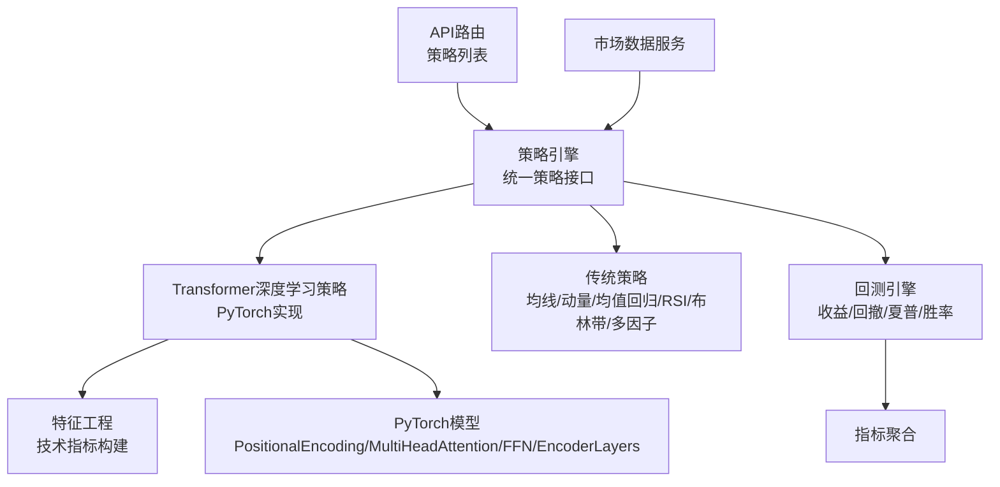
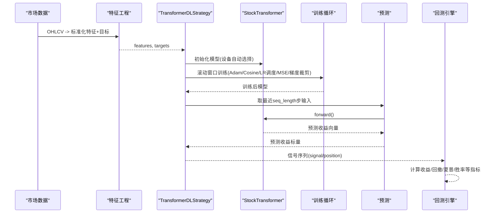
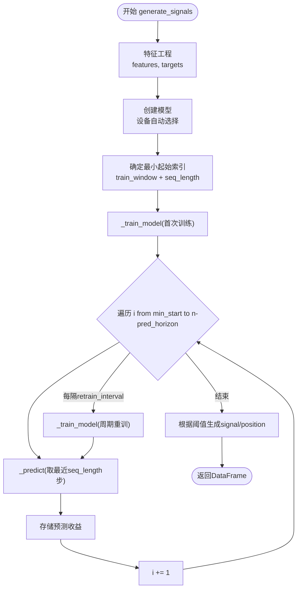
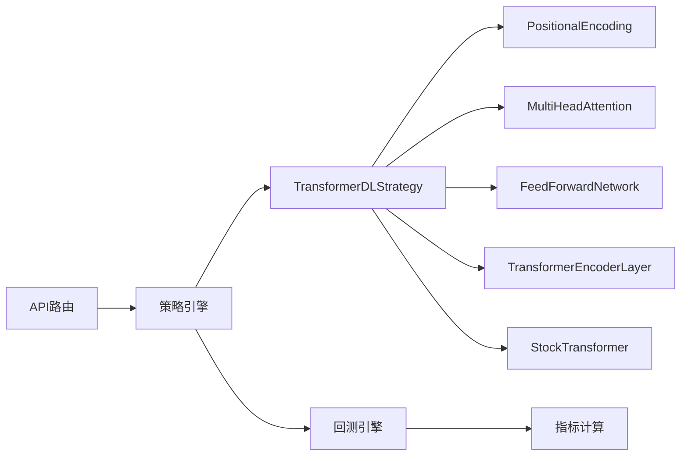
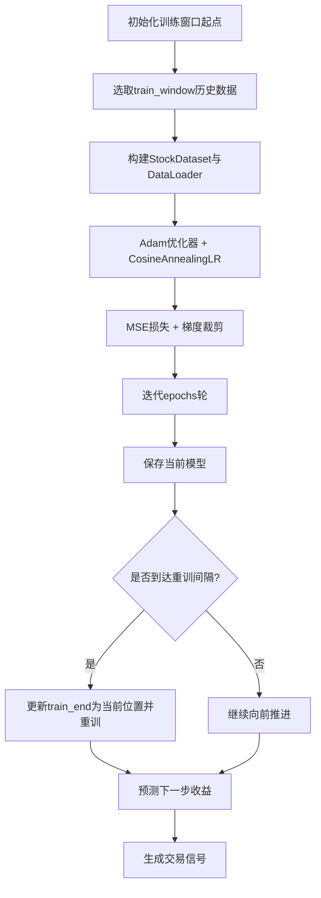

# Transformer深度学习策略

<cite>
**本文引用的文件**   
- [transformer_dl.py](../../../../../../backend/app/strategies/transformer_dl.py)
- [engine.py（策略引擎）](../../../../../../backend/app/strategies/engine.py)
- [engine.py（回测引擎）](../../../../../../backend/app/backtest/engine.py)
- [models.py](../../../../../../backend/app/models/models.py)
- [market_data.py](../../../../../../backend/app/services/market_data.py)
- [strategies.py（API路由）](../../../../../../backend/app/api/strategies.py)
</cite>

## 目录
1. [引言](#引言)
2. [项目结构](#项目结构)
3. [核心组件](#核心组件)
4. [架构总览](#架构总览)
5. [详细组件分析](#详细组件分析)
6. [依赖关系分析](#依赖关系分析)
7. [性能与优化建议](#性能与优化建议)
8. [参数调优指南](#参数调优指南)
9. [训练流程与预测逻辑](#训练流程与预测逻辑)
10. [常见问题与排错](#常见问题与排错)
11. [结论](#结论)

## 引言
本文件面向量化交易与深度学习交叉场景，系统性讲解基于 PyTorch 的 Transformer 价格预测策略。内容覆盖：
- Transformer 核心概念：自注意力、多头注意力、位置编码、前馈网络、层归一化
- 机器学习实践：滚动窗口训练、Walk-forward 验证、避免未来数据泄露
- 模型架构设计：输入投影、编码器堆叠、输出头
- 特征工程：收益率、对数收益率、均线偏离度、波动率、成交量变化、RSI、MACD、布林带位置、动量
- 训练与预测：数据集构造、优化器与学习率调度、梯度裁剪、设备自动选择
- 参数调优：序列长度、隐藏维度、注意力头数、层数、训练轮次等
- 性能优化与常见问题解决方案

## 项目结构
本项目后端采用分层组织：
- 策略层：传统策略与深度学习策略统一抽象
- 回测层：信号到资金曲线与指标计算
- 服务层：市场数据获取与数据源管理
- API层：暴露策略列表接口
- 模型层：持久化策略与回测结果

图表来源
- [strategies.py（API路由）:11-24](../../../../../../backend/app/api/strategies.py#L11-L24)
- [engine.py（策略引擎）:17-656](../../../../../../backend/app/strategies/engine.py#L17-L656)
- [transformer_dl.py:30-516](../../../../../../backend/app/strategies/transformer_dl.py#L30-L516)
- [engine.py（回测引擎）:10-163](../../../../../../backend/app/backtest/engine.py#L10-L163)
- [market_data.py:11-41](../../../../../../backend/app/services/market_data.py#L11-L41)

章节来源
- [engine.py（策略引擎）:17-656](../../../../../../backend/app/strategies/engine.py#L17-L656)
- [engine.py（回测引擎）:10-163](../../../../../../backend/app/backtest/engine.py#L10-L163)
- [transformer_dl.py:30-516](../../../../../../backend/app/strategies/transformer_dl.py#L30-L516)
- [strategies.py（API路由）:11-24](../../../../../../backend/app/api/strategies.py#L11-L24)
- [market_data.py:11-41](../../../../../../backend/app/services/market_data.py#L11-L41)

## 核心组件
- 特征工程类：从 OHLCV 构建标准化特征与未来收益目标
- PyTorch 模型组件：
  - PositionalEncoding：正弦/余弦位置编码
  - MultiHeadAttention：多头自注意力 + 残差 + 层归一化
  - FeedForwardNetwork：两层线性 + ReLU + Dropout + 残差 + 层归一化
  - TransformerEncoderLayer：注意力 + FFN 组合
  - StockTransformer：输入投影 + 位置编码 + N 层编码器 + 输出头
- 数据集与 DataLoader：滑动窗口样本生成
- TransformerDLStrategy：滚动窗口训练、周期性重训、预测与信号生成
- 策略引擎：统一 BaseStrategy 接口，提供多种传统策略与简化版 Transformer 预测策略
- 回测引擎：信号转收益、资金曲线、交易记录、综合指标

章节来源
- [transformer_dl.py:30-516](../../../../../../backend/app/strategies/transformer_dl.py#L30-L516)
- [engine.py（策略引擎）:17-656](../../../../../../backend/app/strategies/engine.py#L17-L656)
- [engine.py（回测引擎）:10-163](../../../../../../backend/app/backtest/engine.py#L10-L163)

## 架构总览
Transformer 深度学习策略的整体流程如下：
- 输入：OHLCV 时间序列
- 特征工程：计算多类技术指标并标准化
- 模型：StockTransformer（含位置编码、多头注意力、前馈网络）
- 训练：滚动窗口内使用 Adam + CosineAnnealingLR + MSE + 梯度裁剪
- 预测：取最近 seq_length 步作为输入，输出未来 pred_horizon 维向量，取首维为预测收益
- 信号：根据阈值将预测收益映射为买入/卖出信号
- 回测：计算策略收益、累计收益、资金曲线、交易记录与绩效指标

图表来源
- [transformer_dl.py:331-487](../../../../../../backend/app/strategies/transformer_dl.py#L331-L487)
- [engine.py（回测引擎）:15-70](../../../../../../backend/app/backtest/engine.py#L15-L70)

## 详细组件分析

### 特征工程（FeatureEngineer）
- 功能：
  - 计算收益率、对数收益率、20日均线偏离度、20日波动率、成交量变化、RSI(14)、MACD、布林带位置% B、10日动量
  - Z-score 标准化
  - 目标变量：未来5日收益率
- 复杂度：
  - 向量化计算为主，时间复杂度近似 O(n)，空间复杂度 O(n)
- 关键点：
  - 缺失值处理：bfill 填充初始 NaN
  - 数值稳定性：分母加小常数防止除零
  - 标准化：按列统计 mean/std，提升训练稳定性

章节来源
- [transformer_dl.py:30-137](../../../../../../backend/app/strategies/transformer_dl.py#L30-L137)

### PyTorch 模型组件

#### PositionalEncoding
- 作用：为序列注入位置信息，使用正弦/余弦函数
- 关键步骤：
  - 预计算 pe 矩阵，形状 (1, max_len, d_model)
  - forward 中将 pe 加到输入 x，再 Dropout
- 复杂度：O(max_len * d_model) 预计算；forward O(seq_len * d_model)

章节来源
- [transformer_dl.py:143-166](../../../../../../backend/app/strategies/transformer_dl.py#L143-L166)

#### MultiHeadAttention
- 作用：多头自注意力机制，支持可选 mask
- 关键步骤：
  - Q/K/V 线性变换后 reshape 为 (batch, n_heads, seq_len, d_k)
  - 缩放点积注意力 scores = QK^T / sqrt(d_k)
  - softmax 加权 V，拼接 heads，线性输出 W_o
  - 残差连接 + LayerNorm + Dropout
- 复杂度：
  - 主要计算在矩阵乘法，约 O(batch * seq_len^2 * d_model)

章节来源
- [transformer_dl.py:168-213](../../../../../../backend/app/strategies/transformer_dl.py#L168-L213)

#### FeedForwardNetwork
- 作用：位置前馈网络，两层线性 + ReLU + Dropout + 残差 + LayerNorm
- 复杂度：O(seq_len * d_model * d_ff)

章节来源
- [transformer_dl.py:215-235](../../../../../../backend/app/strategies/transformer_dl.py#L215-L235)

#### TransformerEncoderLayer
- 作用：封装多头注意力与 FFN，顺序执行 Attention -> FFN

章节来源
- [transformer_dl.py:237-247](../../../../../../backend/app/strategies/transformer_dl.py#L237-L247)

#### StockTransformer
- 作用：完整模型，包含输入投影、位置编码、N 层编码器、输出头
- 输出头：d_model -> d_model//2 -> pred_horizon
- 权重初始化：Xavier Uniform
- forward：取最后一个时间步作为上下文，经输出头得到预测向量

章节来源
- [transformer_dl.py:249-304](../../../../../../backend/app/strategies/transformer_dl.py#L249-L304)

#### StockDataset 与 DataLoader
- 作用：将特征与目标转换为滑动窗口样本
- __getitem__：返回 (x_seq, y_target)

章节来源
- [transformer_dl.py:306-320](../../../../../../backend/app/strategies/transformer_dl.py#L306-L320)

### TransformerDLStrategy（深度学习策略）
- 参数：
  - seq_length、pred_horizon、d_model、n_heads、n_layers、d_ff、dropout
  - learning_rate、batch_size、epochs、train_window
  - buy_threshold、sell_threshold、device
- 训练流程：
  - 滚动窗口：train_start = train_end - train_window
  - 数据加载：shuffle=True
  - 优化器：Adam + weight_decay
  - 学习率调度：CosineAnnealingLR(T_max=epochs)
  - 损失：MSELoss，仅用预测向量的第0维与目标比较
  - 梯度裁剪：max_norm=1.0
- 预测流程：
  - 取最近 seq_length 步作为输入，无梯度推理
  - 输出首维作为预测收益
- 信号生成：
  - 每 retrain_interval 步重训一次模型
  - 根据 buy/sell 阈值生成 signal，diff 得到 position

图表来源
- [transformer_dl.py:331-487](../../../../../../backend/app/strategies/transformer_dl.py#L331-L487)

章节来源
- [transformer_dl.py:324-487](../../../../../../backend/app/strategies/transformer_dl.py#L324-L487)

### 策略引擎与传统策略
- BaseStrategy：统一接口，要求实现 generate_signals
- 传统策略：均线交叉、动量、均值回归、RSI、布林带、多因子选股
- TransformerPredictStrategy：简化版注意力实现（NumPy），用于对比演示
- get_available_strategies：注册所有可用策略及其参数范围
- create_strategy：按 id 实例化具体策略

章节来源
- [engine.py（策略引擎）:17-656](../../../../../../backend/app/strategies/engine.py#L17-L656)

### 回测引擎
- 输入：原始行情 DataFrame 与信号 DataFrame
- 计算：
  - market_return、strategy_return（信号滞后一期）
  - 累计收益与资金曲线
  - 交易记录提取（入场/出场价、PnL、方向）
  - 指标：总收益、年化收益、最大回撤、夏普比率、胜率、盈亏比
- 输出：metrics、trades、equity_curve、signals_data

章节来源
- [engine.py（回测引擎）:10-163](../../../../../../backend/app/backtest/engine.py#L10-L163)

### 数据与持久化
- 市场数据服务：统一入口，支持多数据源自动选择
- 数据库模型：策略与回测结果的 SQLAlchemy 模型定义

章节来源
- [market_data.py:11-41](../../../../../../backend/app/services/market_data.py#L11-L41)
- [models.py:11-44](../../../../../../backend/app/models/models.py#L11-L44)

## 依赖关系分析
- 模块耦合：
  - API 路由依赖策略引擎以列出可用策略
  - 策略引擎依赖 TransformerDLStrategy（可选，需 PyTorch）
  - TransformerDLStrategy 依赖 PyTorch 组件与 NumPy/Pandas
  - 回测引擎独立于策略实现，仅依赖信号序列
- 外部依赖：
  - PyTorch（深度学习）
  - NumPy/Pandas（数据处理）
  - FastAPI（API 框架）
  - SQLAlchemy（ORM）

图表来源
- [strategies.py（API路由）:11-24](../../../../../../backend/app/api/strategies.py#L11-L24)
- [engine.py（策略引擎）:17-656](../../../../../../backend/app/strategies/engine.py#L17-L656)
- [transformer_dl.py:143-304](../../../../../../backend/app/strategies/transformer_dl.py#L143-L304)
- [engine.py（回测引擎）:10-163](../../../../../../backend/app/backtest/engine.py#L10-L163)

章节来源
- [strategies.py（API路由）:11-24](../../../../../../backend/app/api/strategies.py#L11-L24)
- [engine.py（策略引擎）:17-656](../../../../../../backend/app/strategies/engine.py#L17-L656)
- [transformer_dl.py:143-304](../../../../../../backend/app/strategies/transformer_dl.py#L143-L304)
- [engine.py（回测引擎）:10-163](../../../../../../backend/app/backtest/engine.py#L10-L163)

## 性能与优化建议
- 硬件加速：
  - device='auto' 自动选择 CUDA/CPU；确保 GPU 驱动与 PyTorch 版本匹配
- 训练效率：
  - batch_size 增大可提升吞吐，但需关注显存占用
  - 使用混合精度训练（如 torch.cuda.amp）进一步提速
  - 合理设置 epochs 与 retrain_interval，平衡过拟合与计算成本
- 数值稳定：
  - 已使用梯度裁剪与层归一化；必要时增加标签平滑或正则化
- 数据流水线：
  - 预计算特征并缓存，减少重复计算
  - 使用 pin_memory=True 与 num_workers>0 加速 DataLoader

[本节为通用指导，不直接分析具体文件]

## 参数调优指南
- 序列长度 seq_length：
  - 过小：无法捕捉长期依赖；过大：噪声增多且训练成本上升
  - 建议从 20-60 起步，结合资产波动特性调整
- 隐藏维度 d_model：
  - 越大表达能力越强，但易过拟合；建议 32-128
- 注意力头数 n_heads：
  - 需整除 d_model；常见 4-8；头数过多可能分散信息
- 编码器层数 n_layers：
  - 加深可增强表征能力，但训练更不稳定；建议 2-4
- 前馈维度 d_ff：
  - 通常为 d_model 的倍数；建议 128-256
- 训练轮数 epochs：
  - 结合 retrain_interval 控制重训频率；避免过拟合
- 学习率与调度：
  - 默认 0.001 + CosineAnnealingLR；可尝试 Warmup 或分段衰减
- 批大小 batch_size：
  - 32 起步，视显存调整
- 预测区间 pred_horizon：
  - 与交易频率相关；短频交易用小 horizon，中长频用大 horizon
- 阈值 buy_threshold/sell_threshold：
  - 影响交易频率与滑点成本；需结合历史回测优化

章节来源
- [transformer_dl.py:331-395](../../../../../../backend/app/strategies/transformer_dl.py#L331-L395)
- [engine.py（策略引擎）:582-596](../../../../../../backend/app/strategies/engine.py#L582-L596)

## 训练流程与预测逻辑

### 滚动窗口训练与 Walk-forward 验证
- 滚动窗口：每次训练使用固定长度的历史窗口 train_window
- Walk-forward：随时间推进逐步扩大训练集，保证不使用未来数据
- 周期重训：每隔 retrain_interval 步重新训练模型，适应市场状态漂移

图表来源
- [transformer_dl.py:397-487](../../../../../../backend/app/strategies/transformer_dl.py#L397-L487)

章节来源
- [transformer_dl.py:397-487](../../../../../../backend/app/strategies/transformer_dl.py#L397-L487)

### 预测逻辑
- 输入：最近 seq_length 步的特征张量
- 模型前向：经过输入投影、位置编码、编码器堆叠，取最后时间步
- 输出：pred_horizon 维向量，取第0维作为预测收益
- 信号：根据 buy/sell 阈值映射为 1/-1，diff 得到仓位变化

章节来源
- [transformer_dl.py:438-487](../../../../../../backend/app/strategies/transformer_dl.py#L438-L487)

## 常见问题与排错
- PyTorch 未安装或导入失败：
  - 现象：ImportError 提示需要 PyTorch
  - 解决：安装 CPU/GPU 版本 PyTorch，并确保 Python 环境一致
- 设备选择异常：
  - 现象：CUDA 不可用或显存不足
  - 解决：检查驱动与 PyTorch 版本；必要时切换 device='cpu'
- 训练不稳定或梯度爆炸：
  - 现象：Loss 发散或 NaN
  - 解决：启用梯度裁剪（已内置）、降低学习率、减小模型规模
- 过拟合：
  - 现象：训练 Loss 低但回测表现差
  - 解决：增加 dropout、减少 n_layers/d_model、缩短 seq_length、增加重训频率
- 未来数据泄露：
  - 现象：回测表现异常好但实盘失效
  - 解决：确保滚动窗口与 Walk-forward 验证，信号使用滞后一期

章节来源
- [transformer_dl.py:492-516](../../../../../../backend/app/strategies/transformer_dl.py#L492-L516)
- [engine.py（策略引擎）:647-653](../../../../../../backend/app/strategies/engine.py#L647-L653)
- [engine.py（回测引擎）:31-35](../../../../../../backend/app/backtest/engine.py#L31-L35)

## 结论
本策略以 Transformer 为核心，通过严谨的特征工程与滚动窗口训练，结合 Walk-forward 验证，有效避免未来数据泄露。模型组件清晰、可扩展性强，便于在不同资产与频率上迁移。建议在实盘前进行充分的历史回测与参数搜索，并结合风险控制与资金管理策略，以获得稳健的交易表现。