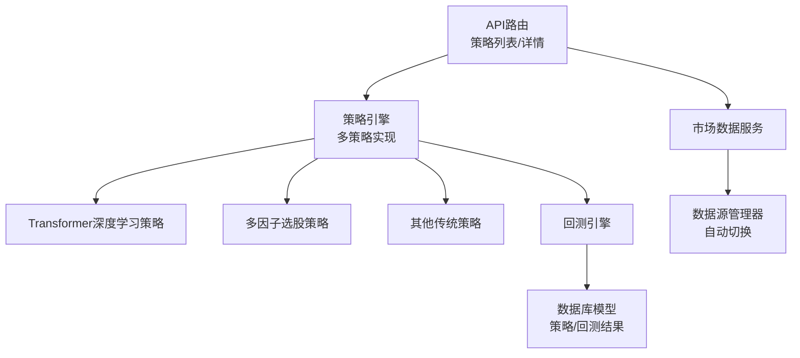
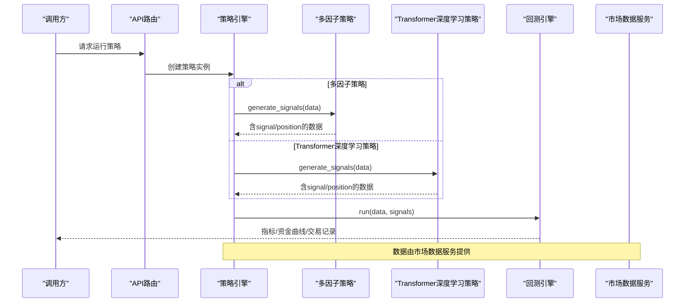
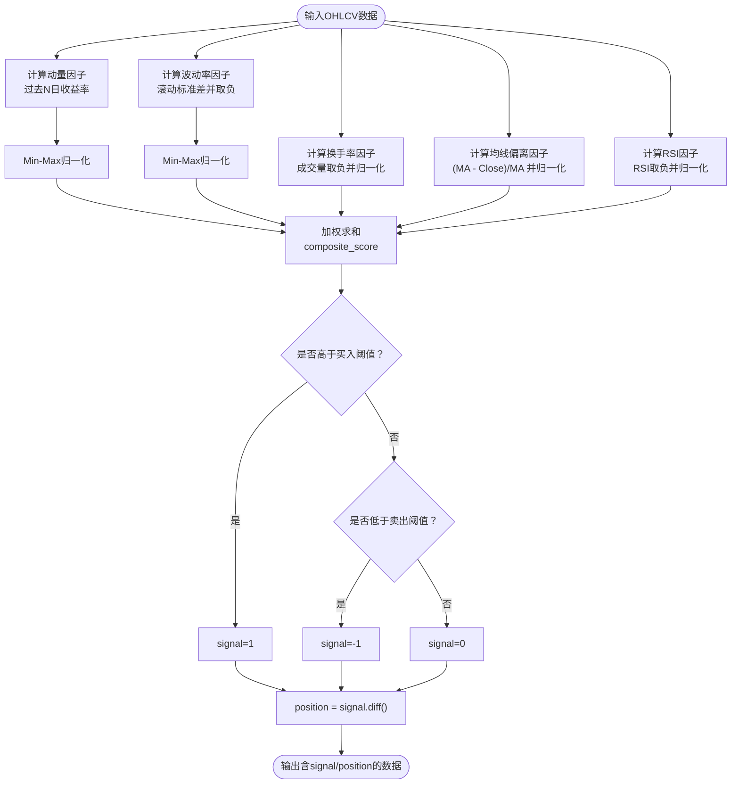
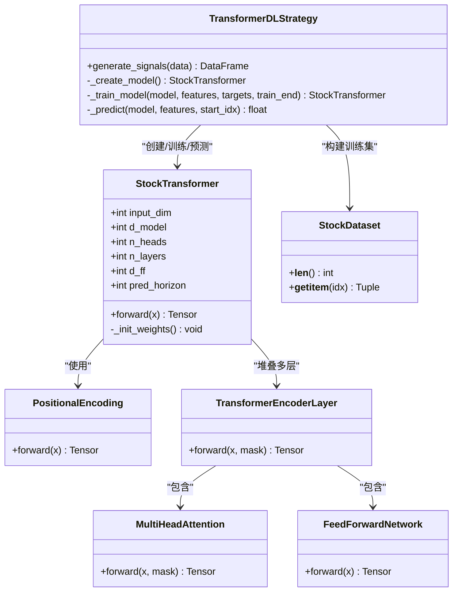
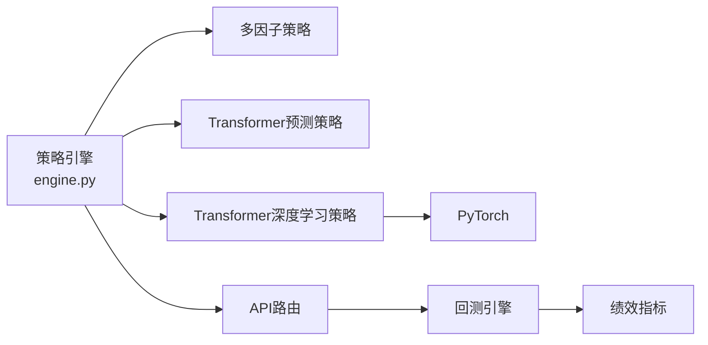

# 高级策略

<cite>
**本文引用的文件**   
- [backend/app/strategies/engine.py](../../../../../../backend/app/strategies/engine.py)
- [backend/app/strategies/transformer_dl.py](../../../../../../backend/app/strategies/transformer_dl.py)
- [backend/app/backtest/engine.py](../../../../../../backend/app/backtest/engine.py)
- [backend/app/api/strategies.py](../../../../../../backend/app/api/strategies.py)
- [backend/app/services/market_data.py](../../../../../../backend/app/services/market_data.py)
- [backend/app/models/models.py](../../../../../../backend/app/models/models.py)
- [DATA_SOURCES.md](../../../../../../DATA_SOURCES.md)
</cite>

## 目录
1. [引言](#引言)
2. [项目结构](#项目结构)
3. [核心组件](#核心组件)
4. [架构总览](#架构总览)
5. [详细组件分析](#详细组件分析)
6. [依赖关系分析](#依赖关系分析)
7. [性能与训练实践](#性能与训练实践)
8. [故障排查指南](#故障排查指南)
9. [结论](#结论)
10. [附录：参数与实现要点](#附录参数与实现要点)

## 引言
本文件面向“多因子选股策略”和“Transformer深度学习策略”的高级实现，系统性梳理以下主题：
- 多因子策略的五大因子（动量、波动率、换手率、均线偏离、RSI）的计算方法与加权打分机制。
- Transformer深度学习策略的核心概念（自注意力、多头注意力、位置编码）、模型架构、特征工程、滚动窗口训练与Walk-forward验证流程。
- 从数据接入、信号生成到回测评估的完整链路，以及可落地的最佳实践与常见问题排查。

## 项目结构
后端采用分层设计：API层暴露策略列表与详情；策略引擎提供多种策略实现；回测引擎负责绩效统计；市场数据服务对接多数据源；数据库模型用于持久化策略与回测结果。



图表来源
- [backend/app/api/strategies.py:11-24](../../../../../../backend/app/api/strategies.py#L11-L24)
- [backend/app/strategies/engine.py:506-597](../../../../../../backend/app/strategies/engine.py#L506-L597)
- [backend/app/backtest/engine.py:10-70](../../../../../../backend/app/backtest/engine.py#L10-L70)
- [backend/app/services/market_data.py:11-41](../../../../../../backend/app/services/market_data.py#L11-L41)
- [backend/app/models/models.py:11-44](../../../../../../backend/app/models/models.py#L11-L44)

章节来源
- [backend/app/api/strategies.py:11-24](../../../../../../backend/app/api/strategies.py#L11-L24)
- [backend/app/strategies/engine.py:506-597](../../../../../../backend/app/strategies/engine.py#L506-L597)
- [backend/app/backtest/engine.py:10-70](../../../../../../backend/app/backtest/engine.py#L10-L70)
- [backend/app/services/market_data.py:11-41](../../../../../../backend/app/services/market_data.py#L11-L41)
- [backend/app/models/models.py:11-44](../../../../../../backend/app/models/models.py#L11-L44)

## 核心组件
- 多因子选股策略：通过五大因子归一化后加权求和，得到综合得分并基于阈值生成交易信号。
- Transformer深度学习策略：基于PyTorch的完整Transformer架构，包含位置编码、多头自注意力、前馈网络、层归一化，使用滚动窗口训练与定期重训进行价格预测。
- 回测引擎：计算策略收益、资金曲线、夏普比率、最大回撤、胜率等指标，并提取交易记录。
- 市场数据服务：统一封装多数据源获取接口，支持自动选择与降级。
- 数据库模型：定义策略与回测结果的持久化结构。

章节来源
- [backend/app/strategies/engine.py:208-324](../../../../../../backend/app/strategies/engine.py#L208-L324)
- [backend/app/strategies/transformer_dl.py:30-137](../../../../../../backend/app/strategies/transformer_dl.py#L30-L137)
- [backend/app/strategies/transformer_dl.py:249-304](../../../../../../backend/app/strategies/transformer_dl.py#L249-L304)
- [backend/app/backtest/engine.py:10-163](../../../../../../backend/app/backtest/engine.py#L10-L163)
- [backend/app/services/market_data.py:11-41](../../../../../../backend/app/services/market_data.py#L11-L41)
- [backend/app/models/models.py:11-44](../../../../../../backend/app/models/models.py#L11-L44)

## 架构总览
下图展示从数据接入到信号生成再到回测评估的整体流程，重点标注多因子与Transformer两条路径。



图表来源
- [backend/app/api/strategies.py:11-24](../../../../../../backend/app/api/strategies.py#L11-L24)
- [backend/app/strategies/engine.py:506-597](../../../../../../backend/app/strategies/engine.py#L506-L597)
- [backend/app/backtest/engine.py:15-70](../../../../../../backend/app/backtest/engine.py#L15-L70)
- [backend/app/services/market_data.py:11-41](../../../../../../backend/app/services/market_data.py#L11-L41)

## 详细组件分析

### 多因子选股策略
多因子策略将五个因子分别归一化至[0,1]区间，再按权重加权求和得到综合得分，超过买入阈值则做多，低于卖出阈值则做空或减仓。

- 动量因子：过去N日收益率，越高得分越高。
- 波动率因子：低波动率偏好，先取负再归一化，使低波得分更高。
- 换手率因子：用成交量近似换手率，低成交量得分高。
- 均线偏离因子：价格低于均线时得分高，体现均值回归机会。
- RSI因子：RSI越低得分越高，捕捉超卖反弹机会。



图表来源
- [backend/app/strategies/engine.py:252-324](../../../../../../backend/app/strategies/engine.py#L252-L324)

章节来源
- [backend/app/strategies/engine.py:208-324](../../../../../../backend/app/strategies/engine.py#L208-L324)

### Transformer深度学习策略
该策略基于PyTorch实现完整的Transformer编码器，包括位置编码、多头自注意力、前馈网络与层归一化，并通过滚动窗口训练与定期重训进行价格预测。

#### 模型架构类图


图表来源
- [backend/app/strategies/transformer_dl.py:143-166](../../../../../../backend/app/strategies/transformer_dl.py#L143-L166)
- [backend/app/strategies/transformer_dl.py:168-213](../../../../../../backend/app/strategies/transformer_dl.py#L168-L213)
- [backend/app/strategies/transformer_dl.py:215-235](../../../../../../backend/app/strategies/transformer_dl.py#L215-L235)
- [backend/app/strategies/transformer_dl.py:237-247](../../../../../../backend/app/strategies/transformer_dl.py#L237-L247)
- [backend/app/strategies/transformer_dl.py:249-304](../../../../../../backend/app/strategies/transformer_dl.py#L249-L304)
- [backend/app/strategies/transformer_dl.py:306-320](../../../../../../backend/app/strategies/transformer_dl.py#L306-L320)
- [backend/app/strategies/transformer_dl.py:324-487](../../../../../../backend/app/strategies/transformer_dl.py#L324-L487)

#### 训练与预测序列图
```mermaid
sequenceDiagram
participant S as "TransformerDLStrategy"
participant FE as "FeatureEngineer"
participant DS as "StockDataset"
participant Model as "StockTransformer"
participant Opt as "Adam/CosineAnnealingLR"
participant BT as "BacktestEngine"
S->>FE : create_features(df)
FE-->>S : features, future_returns
S->>Model : _create_model()
loop 滚动窗口训练
S->>DS : 构造训练样本(seq_length)
S->>Opt : 初始化优化器/学习率调度
Opt->>Model : forward(batch_x)
Model-->>Opt : predictions
Opt->>Model : backward(step)
end
S->>Model : _predict(features, idx)
Model-->>S : pred_return
S->>BT : run(data, signals)
BT-->>S : metrics/equity_curve/trades
```

图表来源
- [backend/app/strategies/transformer_dl.py:30-96](../../../../../../backend/app/strategies/transformer_dl.py#L30-L96)
- [backend/app/strategies/transformer_dl.py:306-320](../../../../../../backend/app/strategies/transformer_dl.py#L306-L320)
- [backend/app/strategies/transformer_dl.py:386-436](../../../../../../backend/app/strategies/transformer_dl.py#L386-L436)
- [backend/app/strategies/transformer_dl.py:438-447](../../../../../../backend/app/strategies/transformer_dl.py#L438-L447)
- [backend/app/backtest/engine.py:15-70](../../../../../../backend/app/backtest/engine.py#L15-L70)

章节来源
- [backend/app/strategies/transformer_dl.py:30-137](../../../../../../backend/app/strategies/transformer_dl.py#L30-L137)
- [backend/app/strategies/transformer_dl.py:143-304](../../../../../../backend/app/strategies/transformer_dl.py#L143-L304)
- [backend/app/strategies/transformer_dl.py:324-487](../../../../../../backend/app/strategies/transformer_dl.py#L324-L487)
- [backend/app/backtest/engine.py:15-70](../../../../../../backend/app/backtest/engine.py#L15-L70)

### 关键深度学习技术说明
- 自注意力机制：对同一序列内各时间步计算Q/K/V的点积相似度，经缩放与Softmax得到注意力权重，再对V加权求和，捕获长距离依赖。
- 多头注意力：将嵌入维度切分为多个头并行计算注意力，最后拼接输出，增强模型对不同子空间的表征能力。
- 位置编码：为序列注入绝对位置信息，帮助模型区分不同时间步。
- 层归一化与残差连接：稳定训练并缓解梯度消失/爆炸问题。
- 前馈网络：在注意力之后对每个位置独立变换，增强非线性表达能力。

章节来源
- [backend/app/strategies/transformer_dl.py:143-213](../../../../../../backend/app/strategies/transformer_dl.py#L143-L213)
- [backend/app/strategies/transformer_dl.py:215-247](../../../../../../backend/app/strategies/transformer_dl.py#L215-L247)

### 机器学习实践方法
- 滚动窗口训练：以固定长度的历史窗口作为训练集，随时间向前滑动，逐步扩大训练范围，避免未来数据泄露。
- Walk-forward验证：在预测循环中周期性重训模型（例如每若干步重训一次），保持模型对近期市场结构的适应性。
- 目标变量：未来N日收益率，便于直接优化方向性预测。
- 标准化与填充：特征Z-score标准化，缺失值填充默认值，保证训练稳定性。

章节来源
- [backend/app/strategies/transformer_dl.py:397-436](../../../../../../backend/app/strategies/transformer_dl.py#L397-L436)
- [backend/app/strategies/transformer_dl.py:449-487](../../../../../../backend/app/strategies/transformer_dl.py#L449-L487)

## 依赖关系分析
- 策略引擎集中注册所有策略，对外暴露统一的create_strategy接口，内部根据strategy_id分发到具体实现。
- Transformer深度学习策略依赖PyTorch，若未安装会抛出明确错误提示。
- 回测引擎不依赖具体策略，仅消费signals数据框，计算通用绩效指标。
- 市场数据服务通过数据源管理器自动选择最优数据源，失败时降级。



图表来源
- [backend/app/strategies/engine.py:506-656](../../../../../../backend/app/strategies/engine.py#L506-L656)
- [backend/app/strategies/transformer_dl.py:492-516](../../../../../../backend/app/strategies/transformer_dl.py#L492-L516)
- [backend/app/backtest/engine.py:105-163](../../../../../../backend/app/backtest/engine.py#L105-L163)

章节来源
- [backend/app/strategies/engine.py:506-656](../../../../../../backend/app/strategies/engine.py#L506-L656)
- [backend/app/strategies/transformer_dl.py:492-516](../../../../../../backend/app/strategies/transformer_dl.py#L492-L516)
- [backend/app/backtest/engine.py:105-163](../../../../../../backend/app/backtest/engine.py#L105-L163)

## 性能与训练实践
- 特征工程
  - 多因子策略：对每个因子做Min-Max归一化，处理NaN与极值，确保加权打分稳定。
  - Transformer策略：构造9维特征（收益率、对数收益率、均线偏离、波动率、成交量变化、RSI、MACD、布林带位置、动量），并进行Z-score标准化。
- 训练配置
  - 优化器：Adam，配合余弦退火学习率调度。
  - 损失函数：MSE，针对未来收益率首维输出。
  - 正则与稳定：Dropout、梯度裁剪、Xavier初始化。
- 预测逻辑
  - 多因子策略：综合得分高于买入阈值做多，低于卖出阈值做空。
  - Transformer策略：预测未来收益率，超过正阈值做多，低于负阈值做空。
- 回测指标
  - 总收益、年化收益、最大回撤、夏普比率、胜率、盈亏比、交易次数等。

章节来源
- [backend/app/strategies/engine.py:252-324](../../../../../../backend/app/strategies/engine.py#L252-L324)
- [backend/app/strategies/transformer_dl.py:30-137](../../../../../../backend/app/strategies/transformer_dl.py#L30-L137)
- [backend/app/strategies/transformer_dl.py:386-436](../../../../../../backend/app/strategies/transformer_dl.py#L386-L436)
- [backend/app/backtest/engine.py:105-163](../../../../../../backend/app/backtest/engine.py#L105-L163)

## 故障排查指南
- PyTorch未安装
  - 现象：创建Transformer深度学习策略时报ImportError。
  - 处理：安装PyTorch后再试。
- 数据源不可用
  - 现象：无法获取股票数据或返回模拟数据。
  - 处理：检查网络与数据源依赖；系统会自动降级到备用数据源。
- 指标异常（NaN/Inf）
  - 现象：夏普比率或收益率为NaN/Inf。
  - 处理：回测引擎已做安全四舍五入与空值处理；检查输入数据质量与周期长度。
- 信号过频或过少
  - 现象：交易次数异常。
  - 处理：调整多因子阈值或Transformer预测阈值；检查因子权重与窗口参数。

章节来源
- [backend/app/strategies/transformer_dl.py:492-516](../../../../../../backend/app/strategies/transformer_dl.py#L492-L516)
- [backend/app/services/market_data.py:11-41](../../../../../../backend/app/services/market_data.py#L11-L41)
- [backend/app/backtest/engine.py:144-163](../../../../../../backend/app/backtest/engine.py#L144-L163)

## 结论
本项目在多因子与Transformer两条主线提供了完整的高阶策略实现：
- 多因子策略通过严谨的因子计算与加权打分机制，形成稳健的综合信号。
- Transformer深度学习策略以自注意力为核心，结合位置编码与多头注意力，利用滚动窗口训练与定期重训提升预测鲁棒性。
- 回测引擎提供标准化的绩效评估，便于策略对比与迭代优化。
建议在实际使用中，结合市场环境与资产特性，调优因子权重、窗口长度与模型超参，并持续监控回测指标与交易行为。

## 附录：参数与实现要点
- 多因子策略参数
  - momentum_window、volatility_window、ma_window、rsi_period
  - buy_score、sell_score
  - w_momentum、w_volatility、w_turnover、w_ma_deviation、w_rsi
- Transformer深度学习策略参数
  - seq_length、pred_horizon、d_model、n_heads、n_layers、d_ff、dropout
  - learning_rate、batch_size、epochs、train_window
  - buy_threshold、sell_threshold、device
- 数据源与可用性
  - 支持AKShare、BaoStock、YFinance与模拟数据，自动选择与降级。

章节来源
- [backend/app/strategies/engine.py:220-250](../../../../../../backend/app/strategies/engine.py#L220-L250)
- [backend/app/strategies/engine.py:558-596](../../../../../../backend/app/strategies/engine.py#L558-L596)
- [backend/app/strategies/transformer_dl.py:331-384](../../../../../../backend/app/strategies/transformer_dl.py#L331-L384)
- [DATA_SOURCES.md:1-125](../../../../../../DATA_SOURCES.md#L1-L125)